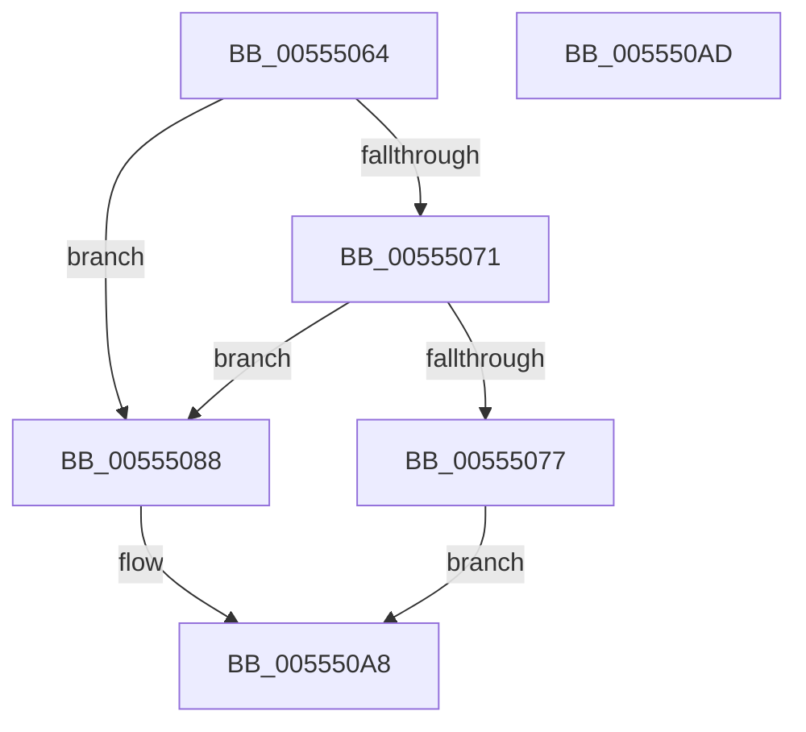

# HalpIommuDomainMapLogicalRange

- RVA: `0x00555064`–`0x005550AE` (길이 `74` bytes)
- VA: `0x0000000140555064`
- 실행 섹션: `.text`
- PDB 이름 있음: `예`; PDB Function 태그: `아니요`
- unwind 정보 RVA: `0x0005D2F4`
- 디코드: `20`개 명령, `74/74` bytes 표시
- 미해석 바이트: `0` (있으면 어셈블리에 `.byte`로 보존)

> 이 문서는 커널 이미지의 기계어와 PDB 기호를 분석해 생성했습니다. 4번과 5번은 함수 원형과 자료형을 바이너리 사용 방식에서 추정한 C 해석이며 원본 소스 복구 결과는 아닙니다.

## 1. Dependencies

- 직접 호출 지점: **2**; 고유 호출 대상: **2**
- 직접 호출자로 확인된 함수: **5**
- RIP 상대 이미지 참조: **1**

### Outgoing calls
- `0x00555081` → [IommupHvMapDeviceLogicalRange](../30/IommupHvMapDeviceLogicalRange_function_00306C94.md) (function, `0x00306C94`)
- `0x005550A3` → [HalpIommuMapLogicalRange](../56/HalpIommuMapLogicalRange_function_005690DC.md) (function, `0x005690DC`)

### Direct callers
- [IommuMapLogicalRangeEx](../30/IommuMapLogicalRangeEx_function_003074B0.md) at `0x0030768B`
- [IommuMapIdentityRangeEx](../30/IommuMapIdentityRangeEx_function_00307C10.md) at `0x00307E11`
- [HalpIommuAllocateDmaDomain](HalpIommuAllocateDmaDomain_function_00554904.md) at `0x00554C1F`
- [IommuMapReservedLogicalRange](../56/IommuMapReservedLogicalRange_function_005680F0.md) at `0x005681B0`
- [IommuReserveLogicalAddressRange](../56/IommuReserveLogicalAddressRange_function_00568400.md) at `0x005684D0`

### Static image references
- `0x00555068` → RVA `0x00FC1710` (`.data`; read)

## 2. Other-region calls and transfers

- 다른 실행 섹션으로 향하는 call: **0**
- 별도 외부 분기/꼬리 이동을 확인하지 못했습니다.

## 3. Assembly (complete function range)

```asm
00555064  48 83 EC 38                     sub rsp, 0x38
00555068  80 3D A1 C6 A6 00 00            cmp byte ptr [rip + 0xa6c6a1], 0
0055506F  74 17                           je 0x140555088
00555071  80 79 34 00                     cmp byte ptr [rcx + 0x34], 0
00555075  75 11                           jne 0x140555088
00555077  48 8B 44 24 60                  mov rax, qword ptr [rsp + 0x60]
0055507C  48 89 44 24 20                  mov qword ptr [rsp + 0x20], rax
00555081  E8 0E 1C DB FF                  call 0x140306c94
00555086  EB 20                           jmp 0x1405550a8
00555088  48 8B 44 24 60                  mov rax, qword ptr [rsp + 0x60]
0055508D  48 89 44 24 28                  mov qword ptr [rsp + 0x28], rax
00555092  4C 89 4C 24 20                  mov qword ptr [rsp + 0x20], r9
00555097  4D 8B C8                        mov r9, r8
0055509A  44 8B C2                        mov r8d, edx
0055509D  48 8B 51 28                     mov rdx, qword ptr [rcx + 0x28]
005550A1  33 C9                           xor ecx, ecx
005550A3  E8 34 40 01 00                  call 0x1405690dc
005550A8  48 83 C4 38                     add rsp, 0x38
005550AC  C3                              ret
005550AD  CC                              int3
```

## 4. C-style interpretation (structured pseudocode)

```c
__int64 __fastcall HalpIommuDomainMapLogicalRange(__int64 a1, int a2, __int64 a3, __int64 a4, __int64 a5)
{
    __int64 result;
    __int64 v_rsp;
    unsigned __int64 v_stack_m10;
    unsigned __int64 v_stack_m18;

    v_rsp = (v_rsp) - (56);
    if ((*(unsigned __int8 *)(v_rip + 10929825)) == 0) goto loc_00555088;
    if ((*(unsigned __int8 *)(a1 + 52)) != 0) goto loc_00555088;
    v_stack_m18 = a5;
    result = IommupHvMapDeviceLogicalRange(a1, a2, a3, a4);
    goto loc_005550A8;
loc_00555088:
    v_stack_m10 = a5;
    v_stack_m18 = a4;
    a1 = 0;
    result = HalpIommuMapLogicalRange(a1, *(unsigned __int64 *)(a1 + 40), (unsigned int)(a2), a3);
loc_005550A8:
    v_rsp = (v_rsp) + (56);
    return result;
}
```

## 5. (Beta) C Style

```c
int64_t HalpIommuDomainMapLogicalRange(void *Arg1, int32_t Arg2, int64_t Arg3, int64_t Arg4, int64_t Arg5)
{
    uint8_t *arg1 = (uint8_t *)Arg1;

    int64_t result;
    int64_t local_rsp;
    uint64_t v_stack_m10;
    uint64_t v_stack_m18;

    local_rsp = (local_rsp) - (56);
    if ((*(uint8_t *)(v_rip + 0xA6C6A1)) == 0) goto loc_00555088;
    if ((*(uint8_t *)(arg1 + 0x34)) != 0) goto loc_00555088;
    v_stack_m18 = Arg5;
    result = IommupHvMapDeviceLogicalRange(Arg1, Arg2, Arg3, Arg4);
    goto loc_005550A8;
loc_00555088:
    v_stack_m10 = Arg5;
    v_stack_m18 = Arg4;
    Arg1 = 0;
    result = HalpIommuMapLogicalRange(Arg1, *(uint64_t *)(arg1 + 0x28), (uint32_t)(Arg2), Arg3);
loc_005550A8:
    local_rsp = (local_rsp) + (56);
    return result;
}
```

### 관측된 메모리 오프셋

구조체 형식이 확인되지 않은 접근은 인자 기준의 오프셋으로만 기록했습니다.

| 기준 인자 | 오프셋 표현 | 폭 (bit) | 접근 |
|---|---:|---:|---|
| `Arg1` | `+ 0x28` | `64` | `R` |
| `Arg1` | `+ 0x34` | `8` | `R` |

## 6. Execution-region graph

[열기: 2D/3D 그래프와 함수 탐색 컨트롤 패널](../../../control-panel.html?section=text&rva=0x00555064&view=graph)

- 2D 그래프는 위에서 아래로 흐르고, 3D 그래프는 빈 공간을 드래그해 회전합니다. Shift+드래그는 이동, 휠은 확대·축소, 함수 노드 선택은 대상 보고서 이동입니다.

### Static fallback


