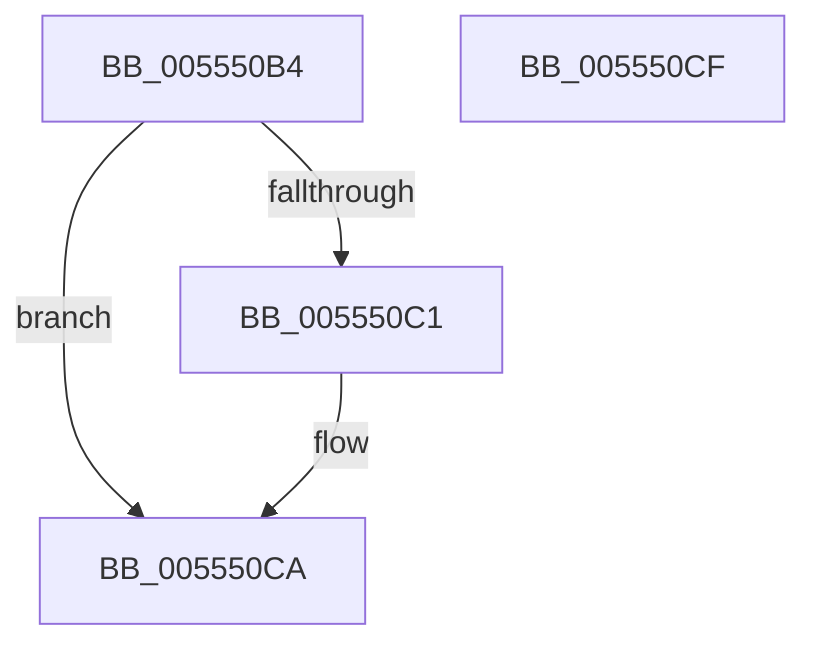

# HalpIommuDomainMarkHiberLogicalRange

- RVA: `0x005550B4`–`0x005550D0` (길이 `28` bytes)
- VA: `0x00000001405550B4`
- 실행 섹션: `.text`
- PDB 이름 있음: `예`; PDB Function 태그: `아니요`
- unwind 정보 RVA: `0x0005C788`
- 디코드: `8`개 명령, `28/28` bytes 표시
- 미해석 바이트: `0` (있으면 어셈블리에 `.byte`로 보존)

> 이 문서는 커널 이미지의 기계어와 PDB 기호를 분석해 생성했습니다. 4번과 5번은 함수 원형과 자료형을 바이너리 사용 방식에서 추정한 C 해석이며 원본 소스 복구 결과는 아닙니다.

## 1. Dependencies

- 직접 호출 지점: **1**; 고유 호출 대상: **1**
- 직접 호출자로 확인된 함수: **1**
- RIP 상대 이미지 참조: **1**

### Outgoing calls
- `0x005550C5` → [HalpIommuDmarPageTableMarkHiberPhase](../56/HalpIommuDmarPageTableMarkHiberPhase_function_00568D1C.md) (function, `0x00568D1C`)

### Direct callers
- [HalpDmaMarkHiberAdapter](../4D/HalpDmaMarkHiberAdapter_function_004DA56C.md) at `0x004DA5EC`
- [HalpDmaMarkHiberAdapter](../4D/HalpDmaMarkHiberAdapter_function_004DA56C.md) at `0x004DA684`

### Static image references
- `0x005550B8` → RVA `0x00FC1710` (`.data`; read)

## 2. Other-region calls and transfers

- 다른 실행 섹션으로 향하는 call: **0**
- 별도 외부 분기/꼬리 이동을 확인하지 못했습니다.

## 3. Assembly (complete function range)

```asm
005550B4  48 83 EC 28                     sub rsp, 0x28
005550B8  80 3D 51 C6 A6 00 00            cmp byte ptr [rip + 0xa6c651], 0
005550BF  75 09                           jne 0x1405550ca
005550C1  48 8B 52 28                     mov rdx, qword ptr [rdx + 0x28]
005550C5  E8 52 3C 01 00                  call 0x140568d1c
005550CA  48 83 C4 28                     add rsp, 0x28
005550CE  C3                              ret
005550CF  CC                              int3
```

## 4. C-style interpretation (structured pseudocode)

```c
__int64 __fastcall HalpIommuDomainMarkHiberLogicalRange(__int64 a1, __int64 a2)
{
    __int64 result;
    __int64 v_rsp;

    v_rsp = (v_rsp) - (40);
    if ((*(unsigned __int8 *)(v_rip + 10929745)) == 0) {
        a2 = *(unsigned __int64 *)(a2 + 40);
        result = HalpIommuDmarPageTableMarkHiberPhase(a1, a2, a3, a4);
    }
    v_rsp = (v_rsp) + (40);
    return result;
}
```

## 5. (Beta) C Style

```c
int64_t HalpIommuDomainMarkHiberLogicalRange(int64_t Arg1, void *Arg2)
{
    uint8_t *arg2 = (uint8_t *)Arg2;

    int64_t result;
    int64_t local_rsp;

    local_rsp = (local_rsp) - (40);
    if ((*(uint8_t *)(v_rip + 0xA6C651)) == 0) {
        Arg2 = *(uint64_t *)(arg2 + 0x28);
        result = HalpIommuDmarPageTableMarkHiberPhase(Arg1, Arg2, a3, a4);
    }
    local_rsp = (local_rsp) + (40);
    return result;
}
```

### 관측된 메모리 오프셋

구조체 형식이 확인되지 않은 접근은 인자 기준의 오프셋으로만 기록했습니다.

| 기준 인자 | 오프셋 표현 | 폭 (bit) | 접근 |
|---|---:|---:|---|
| `Arg2` | `+ 0x28` | `64` | `R` |

## 6. Execution-region graph

[열기: 2D/3D 그래프와 함수 탐색 컨트롤 패널](../../../control-panel.html?section=text&rva=0x005550B4&view=graph)

- 2D 그래프는 위에서 아래로 흐르고, 3D 그래프는 빈 공간을 드래그해 회전합니다. Shift+드래그는 이동, 휠은 확대·축소, 함수 노드 선택은 대상 보고서 이동입니다.

### Static fallback


