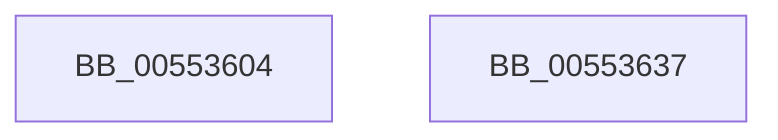

# HalpIommuExtMarkHiberMemory

- RVA: `0x00553604`–`0x00553638` (길이 `52` bytes)
- VA: `0x0000000140553604`
- 실행 섹션: `.text`
- PDB 이름 있음: `예`; PDB Function 태그: `아니요`
- unwind 정보 RVA: `0x0005D2F4`
- 디코드: `14`개 명령, `52/52` bytes 표시
- 미해석 바이트: `0` (있으면 어셈블리에 `.byte`로 보존)

> 이 문서는 커널 이미지의 기계어와 PDB 기호를 분석해 생성했습니다. 4번과 5번은 함수 원형과 자료형을 바이너리 사용 방식에서 추정한 C 해석이며 원본 소스 복구 결과는 아닙니다.

## 1. Dependencies

- 직접 호출 지점: **1**; 고유 호출 대상: **1**
- 직접 호출자로 확인된 함수: **3**
- RIP 상대 이미지 참조: **0**

### Outgoing calls
- `0x0055362D` → [PoSetHiberRange](../47/PoSetHiberRange_function_0047C580.md) (function, `0x0047C580`)

### Direct callers
- [IvtMarkHiberMemoryScalableModePasidTables](../../pagelk/B6/IvtMarkHiberMemoryScalableModePasidTables_function_00B62AF8.md) at `0x00B62B2D`
- [IvtMarkHiberMemoryScalableModePasidTables](../../pagelk/B6/IvtMarkHiberMemoryScalableModePasidTables_function_00B62AF8.md) at `0x00B62B65`
- [IvtMarkHiberMemoryScalableModePasidTables](../../pagelk/B6/IvtMarkHiberMemoryScalableModePasidTables_function_00B62AF8.md) at `0x00B62B75`
- [IvtMarkHiberRegions](../../pagelk/B6/IvtMarkHiberRegions_function_00B62BA0.md) at `0x00B62BD5`
- [IvtMarkHiberRegions](../../pagelk/B6/IvtMarkHiberRegions_function_00B62BA0.md) at `0x00B62C16`
- [HsaMarkHiberRegions](../../pagelk/B6/HsaMarkHiberRegions_function_00B636B0.md) at `0x00B636E0`
- [HsaMarkHiberRegions](../../pagelk/B6/HsaMarkHiberRegions_function_00B636B0.md) at `0x00B636F1`
- [HsaMarkHiberRegions](../../pagelk/B6/HsaMarkHiberRegions_function_00B636B0.md) at `0x00B63717`
- [HsaMarkHiberRegions](../../pagelk/B6/HsaMarkHiberRegions_function_00B636B0.md) at `0x00B63741`

### Static image references
- 디코드된 RIP-relative 메모리 참조가 없습니다.

## 2. Other-region calls and transfers

- 다른 실행 섹션으로 향하는 call: **0**
- 별도 외부 분기/꼬리 이동을 확인하지 못했습니다.

## 3. Assembly (complete function range)

```asm
00553604  48 83 EC 38                     sub rsp, 0x38
00553608  4C 8B D2                        mov r10, rdx
0055360B  45 8B C8                        mov r9d, r8d
0055360E  48 8B C1                        mov rax, rcx
00553611  C7 44 24 20 48 61 6C 49         mov dword ptr [rsp + 0x20], 0x496c6148
00553619  48 F7 D8                        neg rax
0055361C  4D 8B C2                        mov r8, r10
0055361F  1B D2                           sbb edx, edx
00553621  81 E2 02 00 FF FF               and edx, 0xffff0002
00553627  81 C2 00 00 01 00               add edx, 0x10000
0055362D  E8 4E 8F F2 FF                  call 0x14047c580
00553632  48 83 C4 38                     add rsp, 0x38
00553636  C3                              ret
00553637  CC                              int3
```

## 4. C-style interpretation (structured pseudocode)

```c
__int64 __fastcall HalpIommuExtMarkHiberMemory(__int64 a1, __int64 a2, int a3)
{
    __int64 result;
    __int64 v_rsp;
    unsigned int v_stack_m18;

    v_rsp = (v_rsp) - (56);
    v_stack_m18 = 0x496C6148ULL;
    result = -(a1);
    a2 = (unsigned int)((a2) & (0xFFFF0002ULL));
    a2 = (unsigned int)((a2) + (0x10000ULL));
    result = PoSetHiberRange(a1, a2, a2, (unsigned int)(a3));
    v_rsp = (v_rsp) + (56);
    return result;
}
```

## 5. (Beta) C Style

```c
int64_t HalpIommuExtMarkHiberMemory(int64_t Arg1, int64_t Arg2, int32_t Arg3)
{
    int64_t result;
    int64_t local_rsp;
    uint32_t v_stack_m18;

    local_rsp = (local_rsp) - (56);
    v_stack_m18 = 0x496C6148ULL;
    result = -(Arg1);
    Arg2 = (uint32_t)((Arg2) & (0xFFFF0002ULL));
    Arg2 = (uint32_t)((Arg2) + (0x10000ULL));
    result = PoSetHiberRange(Arg1, Arg2, Arg2, (uint32_t)(Arg3));
    local_rsp = (local_rsp) + (56);
    return result;
}
```

## 6. Execution-region graph

[열기: 2D/3D 그래프와 함수 탐색 컨트롤 패널](../../../control-panel.html?section=text&rva=0x00553604&view=graph)

- 2D 그래프는 위에서 아래로 흐르고, 3D 그래프는 빈 공간을 드래그해 회전합니다. Shift+드래그는 이동, 휠은 확대·축소, 함수 노드 선택은 대상 보고서 이동입니다.

### Static fallback


