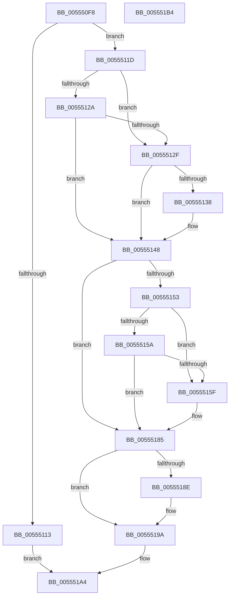

# HalpIommuFreeDmaDomain

- RVA: `0x005550F8`–`0x005551B5` (길이 `189` bytes)
- VA: `0x00000001405550F8`
- 실행 섹션: `.text`
- PDB 이름 있음: `예`; PDB Function 태그: `아니요`
- unwind 정보 RVA: `0x0005FD94`
- 디코드: `54`개 명령, `189/189` bytes 표시
- 미해석 바이트: `0` (있으면 어셈블리에 `.byte`로 보존)

> 이 문서는 커널 이미지의 기계어와 PDB 기호를 분석해 생성했습니다. 4번과 5번은 함수 원형과 자료형을 바이너리 사용 방식에서 추정한 C 해석이며 원본 소스 복구 결과는 아닙니다.

## 1. Dependencies

- 직접 호출 지점: **5**; 고유 호출 대상: **3**
- 직접 호출자로 확인된 함수: **2**
- RIP 상대 이미지 참조: **2**

### Outgoing calls
- `0x0055513B` → [HalpIommuCleanupPageTable](../56/HalpIommuCleanupPageTable_function_00568AC8.md) (function, `0x00568AC8`)
- `0x00555143` → [HalpMmAllocCtxFree](../3E/HalpMmAllocCtxFree_function_003E1904.md) (function, `0x003E1904`)
- `0x0055517E` → [guard_dispatch_icall](../6B/guard_dispatch_icall_function_006BAAD0.md) (function, `0x006BAAD0`)
- `0x00555195` → [guard_dispatch_icall](../6B/guard_dispatch_icall_function_006BAAD0.md) (function, `0x006BAAD0`)
- `0x0055519D` → [HalpMmAllocCtxFree](../3E/HalpMmAllocCtxFree_function_003E1904.md) (function, `0x003E1904`)

### Direct callers
- [HalpIommuAllocateDmaDomain](HalpIommuAllocateDmaDomain_function_00554904.md) at `0x00554CA3`
- [IommuDomainDelete](../../page/70/IommuDomainDelete_function_0070D3C0.md) at `0x0070D3CD`

### Static image references
- `0x0055511D` → RVA `0x00FC1710` (`.data`; read)
- `0x00555177` → RVA `0x00FC1E20` (`.data`; read)

## 2. Other-region calls and transfers

- 다른 실행 섹션으로 향하는 call: **0**
- 별도 외부 분기/꼬리 이동을 확인하지 못했습니다.

## 3. Assembly (complete function range)

```asm
005550F8  48 89 5C 24 10                  mov qword ptr [rsp + 0x10], rbx
005550FD  48 89 74 24 18                  mov qword ptr [rsp + 0x18], rsi
00555102  57                              push rdi
00555103  48 83 EC 20                     sub rsp, 0x20
00555107  48 8D 41 48                     lea rax, [rcx + 0x48]
0055510B  48 8B D9                        mov rbx, rcx
0055510E  48 39 00                        cmp qword ptr [rax], rax
00555111  74 0A                           je 0x14055511d
00555113  B8 08 07 00 C0                  mov eax, 0xc0000708
00555118  E9 87 00 00 00                  jmp 0x1405551a4
0055511D  80 3D EC C5 A6 00 00            cmp byte ptr [rip + 0xa6c5ec], 0
00555124  48 8D 79 34                     lea rdi, [rcx + 0x34]
00555128  74 05                           je 0x14055512f
0055512A  80 3F 00                        cmp byte ptr [rdi], 0
0055512D  74 19                           je 0x140555148
0055512F  48 8B 71 28                     mov rsi, qword ptr [rcx + 0x28]
00555133  48 85 F6                        test rsi, rsi
00555136  74 10                           je 0x140555148
00555138  48 8B CE                        mov rcx, rsi
0055513B  E8 88 39 01 00                  call 0x140568ac8
00555140  48 8B D6                        mov rdx, rsi
00555143  E8 BC C7 E8 FF                  call 0x1403e1904
00555148  33 F6                           xor esi, esi
0055514A  40 38 35 BF C5 A6 00            cmp byte ptr [rip + 0xa6c5bf], sil
00555151  74 32                           je 0x140555185
00555153  8B 43 08                        mov eax, dword ptr [rbx + 8]
00555156  85 C0                           test eax, eax
00555158  74 05                           je 0x14055515f
0055515A  83 F8 02                        cmp eax, 2
0055515D  75 26                           jne 0x140555185
0055515F  8B 43 30                        mov eax, dword ptr [rbx + 0x30]
00555162  48 8D 4C 24 30                  lea rcx, [rsp + 0x30]
00555167  48 83 64 24 30 00               and qword ptr [rsp + 0x30], 0
0055516D  89 44 24 30                     mov dword ptr [rsp + 0x30], eax
00555171  8A 07                           mov al, byte ptr [rdi]
00555173  88 44 24 34                     mov byte ptr [rsp + 0x34], al
00555177  48 8B 05 A2 CC A6 00            mov rax, qword ptr [rip + 0xa6cca2]
0055517E  E8 4D 59 16 00                  call 0x1406baad0
00555183  8B F0                           mov esi, eax
00555185  48 8B 4B 40                     mov rcx, qword ptr [rbx + 0x40]
00555189  48 85 C9                        test rcx, rcx
0055518C  74 0C                           je 0x14055519a
0055518E  48 8B 11                        mov rdx, qword ptr [rcx]
00555191  48 8B 42 20                     mov rax, qword ptr [rdx + 0x20]
00555195  E8 36 59 16 00                  call 0x1406baad0
0055519A  48 8B D3                        mov rdx, rbx
0055519D  E8 62 C7 E8 FF                  call 0x1403e1904
005551A2  8B C6                           mov eax, esi
005551A4  48 8B 5C 24 38                  mov rbx, qword ptr [rsp + 0x38]
005551A9  48 8B 74 24 40                  mov rsi, qword ptr [rsp + 0x40]
005551AE  48 83 C4 20                     add rsp, 0x20
005551B2  5F                              pop rdi
005551B3  C3                              ret
005551B4  CC                              int3
```

## 4. C-style interpretation (structured pseudocode)

```c
__int64 __fastcall HalpIommuFreeDmaDomain(__int64 a1)
{
    __int64 result;
    __int64 v_rsi;
    __int64 v_rsp;
    unsigned __int64 v_stack_p10;
    unsigned __int64 v_stack_p18;
    unsigned __int64 v_stack_p8;
    unsigned __int8 v_stack_pC;

    v_stack_p10 = v_rbx;
    v_stack_p18 = v_rsi;
    v_rsp = (v_rsp) - (32);
    if ((*(unsigned __int64 *)(a1 + 72)) == (a1 + 72)) goto loc_0055511D;
    goto loc_005551A4;
loc_0055511D:
    if ((*(unsigned __int8 *)(v_rip + 10929644)) == 0) goto loc_0055512F;
    if ((*(unsigned __int8 *)(a1 + 52)) == 0) goto loc_00555148;
loc_0055512F:
    result = (unsigned int)(0xC0000708ULL);
    if (*(unsigned __int64 *)(a1 + 40) != 0) {
        a1 = *(unsigned __int64 *)(a1 + 40);
        result = HalpIommuCleanupPageTable(a1, a2, a3, a4);
        a2 = *(unsigned __int64 *)(a1 + 40);
        result = HalpMmAllocCtxFree(a1, a2, a3, a4);
    }
    v_rsi = 0;
    if ((*(unsigned __int8 *)(v_rip + 10929599)) == 0) goto loc_00555185;
    if ((unsigned int)((unsigned int)(*(unsigned int *)(a1 + 8))) == 0) goto loc_0055515F;
    result = (unsigned int)(*(unsigned int *)(a1 + 8));
    if (((unsigned int)((unsigned int)(*(unsigned int *)(a1 + 8)))) == 2) {
        result = *(unsigned int *)(a1 + 48);
        a1 = v_stack_p8;
        v_stack_p8 = (unsigned int)(result);
        result = *(unsigned __int8 *)(a1 + 52);
        v_stack_pC = (unsigned __int8)(result);
        result = *(unsigned __int64 *)(v_rip + 10931362);
        result = guard_dispatch_icall(a1, a2, a3, a4);
        v_rsi = (unsigned int)(result);
    }
    if (*(unsigned __int64 *)(a1 + 64) != 0) {
        a2 = *(unsigned __int64 *)(*(unsigned __int64 *)(a1 + 64));
        result = *(unsigned __int64 *)(a2 + 32);
        result = guard_dispatch_icall(*(unsigned __int64 *)(a1 + 64), a2, a3, a4);
    }
    result = HalpMmAllocCtxFree(*(unsigned __int64 *)(a1 + 64), a1, a3, a4);
loc_005551A4:
    v_rsp = (v_rsp) + (32);
    return (unsigned int)((unsigned int)(v_rsi));
}
```

## 5. (Beta) C Style

```c
int64_t HalpIommuFreeDmaDomain(void *Arg1)
{
    uint8_t *arg1 = (uint8_t *)Arg1;

    int64_t result;
    int64_t local_rsi;
    int64_t local_rsp;
    uint64_t v_stack_p10;
    uint64_t v_stack_p18;
    uint64_t v_stack_p8;
    uint8_t v_stack_pC;

    v_stack_p10 = local_rbx;
    v_stack_p18 = local_rsi;
    local_rsp = (local_rsp) - (32);
    if ((*(uint64_t *)(arg1 + 0x48)) == (Arg1 + 72)) goto loc_0055511D;
    goto loc_005551A4;
loc_0055511D:
    if ((*(uint8_t *)(v_rip + 0xA6C5EC)) == 0) goto loc_0055512F;
    if ((*(uint8_t *)(arg1 + 0x34)) == 0) goto loc_00555148;
loc_0055512F:
    result = (uint32_t)(0xC0000708ULL);
    if (*(uint64_t *)(arg1 + 0x28) != 0) {
        Arg1 = *(uint64_t *)(arg1 + 0x28);
        result = HalpIommuCleanupPageTable(Arg1, a2, a3, a4);
        a2 = *(uint64_t *)(arg1 + 0x28);
        result = HalpMmAllocCtxFree(Arg1, a2, a3, a4);
    }
    local_rsi = 0;
    if ((*(uint8_t *)(v_rip + 0xA6C5BF)) == 0) goto loc_00555185;
    if ((uint32_t)((uint32_t)(*(uint32_t *)(arg1 + 0x8))) == 0) goto loc_0055515F;
    result = (uint32_t)(*(uint32_t *)(arg1 + 0x8));
    if (((uint32_t)((uint32_t)(*(uint32_t *)(arg1 + 0x8)))) == 2) {
        result = *(uint32_t *)(arg1 + 0x30);
        Arg1 = v_stack_p8;
        v_stack_p8 = (uint32_t)(result);
        result = *(uint8_t *)(arg1 + 0x34);
        v_stack_pC = (uint8_t)(result);
        result = *(uint64_t *)(v_rip + 0xA6CCA2);
        result = guard_dispatch_icall(Arg1, a2, a3, a4);
        local_rsi = (uint32_t)(result);
    }
    if (*(uint64_t *)(arg1 + 0x40) != 0) {
        a2 = *(uint64_t *)(*(uint64_t *)(arg1 + 0x40));
        result = *(uint64_t *)(a2 + 0x20);
        result = guard_dispatch_icall(*(uint64_t *)(arg1 + 0x40), a2, a3, a4);
    }
    result = HalpMmAllocCtxFree(*(uint64_t *)(arg1 + 0x40), Arg1, a3, a4);
loc_005551A4:
    local_rsp = (local_rsp) + (32);
    return (uint32_t)((uint32_t)(local_rsi));
}
```

### 관측된 메모리 오프셋

구조체 형식이 확인되지 않은 접근은 인자 기준의 오프셋으로만 기록했습니다.

| 기준 인자 | 오프셋 표현 | 폭 (bit) | 접근 |
|---|---:|---:|---|
| `Arg1` | `+ 0x0` | `8` | `R` |
| `Arg1` | `+ 0x0` | `64` | `R` |
| `Arg1` | `+ 0x8` | `32` | `R` |
| `Arg1` | `+ 0x28` | `64` | `R` |
| `Arg1` | `+ 0x30` | `32` | `R` |
| `Arg1` | `+ 0x34` | `64` | `R` |
| `Arg1` | `+ 0x40` | `64` | `R` |
| `Arg1` | `+ 0x48` | `64` | `R` |

## 6. Execution-region graph

[열기: 2D/3D 그래프와 함수 탐색 컨트롤 패널](../../../control-panel.html?section=text&rva=0x005550F8&view=graph)

- 2D 그래프는 위에서 아래로 흐르고, 3D 그래프는 빈 공간을 드래그해 회전합니다. Shift+드래그는 이동, 휠은 확대·축소, 함수 노드 선택은 대상 보고서 이동입니다.

### Static fallback


