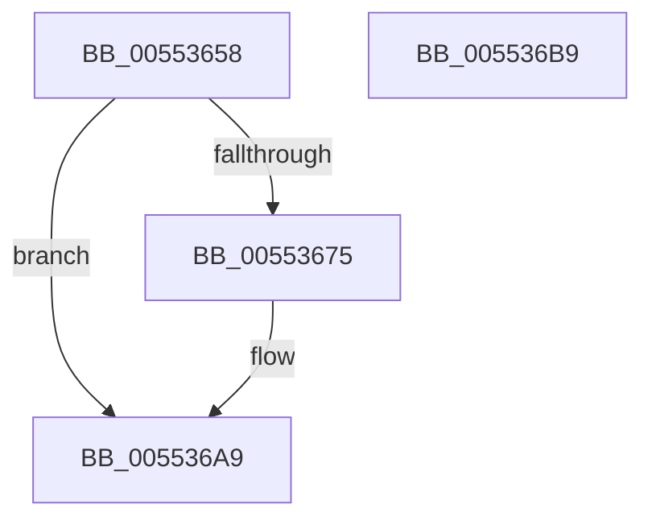

# HalpIommuFreeDomainId

- RVA: `0x00553658`–`0x005536BA` (길이 `98` bytes)
- VA: `0x0000000140553658`
- 실행 섹션: `.text`
- PDB 이름 있음: `예`; PDB Function 태그: `아니요`
- unwind 정보 RVA: `0x00060BC4`
- 디코드: `27`개 명령, `98/98` bytes 표시
- 미해석 바이트: `0` (있으면 어셈블리에 `.byte`로 보존)

> 이 문서는 커널 이미지의 기계어와 PDB 기호를 분석해 생성했습니다. 4번과 5번은 함수 원형과 자료형을 바이너리 사용 방식에서 추정한 C 해석이며 원본 소스 복구 결과는 아닙니다.

## 1. Dependencies

- 직접 호출 지점: **2**; 고유 호출 대상: **2**
- 직접 호출자로 확인된 함수: **3**
- RIP 상대 이미지 참조: **1**

### Outgoing calls
- `0x0055367F` → [KeAcquireSpinLockRaiseToDpc](../20/KeAcquireSpinLockRaiseToDpc_function_00208470.md) (function, `0x00208470`)
- `0x005536A4` → [KeReleaseSpinLock](../39/KeReleaseSpinLock_function_00392BA0.md) (function, `0x00392BA0`)

### Direct callers
- [HalpIommuDereferenceHardwareDomain](HalpIommuDereferenceHardwareDomain_function_00554E58.md) at `0x00554F06`
- [IommupDeviceDisableSvm](../../page/70/IommupDeviceDisableSvm_function_00708A28.md) at `0x00708ADB`
- [IommupDeviceEnableSvm](../../page/70/IommupDeviceEnableSvm_function_00708CC4.md) at `0x00708EAF`

### Static image references
- `0x00553667` → RVA `0x00FC1710` (`.data`; read)

## 2. Other-region calls and transfers

- 다른 실행 섹션으로 향하는 call: **0**
- 별도 외부 분기/꼬리 이동을 확인하지 못했습니다.

## 3. Assembly (complete function range)

```asm
00553658  48 89 5C 24 08                  mov qword ptr [rsp + 8], rbx
0055365D  48 89 74 24 10                  mov qword ptr [rsp + 0x10], rsi
00553662  57                              push rdi
00553663  48 83 EC 20                     sub rsp, 0x20
00553667  80 3D A2 E0 A6 00 00            cmp byte ptr [rip + 0xa6e0a2], 0
0055366E  48 8B F1                        mov rsi, rcx
00553671  8B FA                           mov edi, edx
00553673  75 34                           jne 0x1405536a9
00553675  48 8D 99 C0 01 00 00            lea rbx, [rcx + 0x1c0]
0055367C  48 8B CB                        mov rcx, rbx
0055367F  E8 EC 4D CB FF                  call 0x140208470
00553684  44 8B C7                        mov r8d, edi
00553687  48 8B CB                        mov rcx, rbx
0055368A  49 C1 E8 03                     shr r8, 3
0055368E  83 E7 07                        and edi, 7
00553691  4C 03 86 D0 01 00 00            add r8, qword ptr [rsi + 0x1d0]
00553698  41 0F BE 10                     movsx edx, byte ptr [r8]
0055369C  0F B3 FA                        btr edx, edi
0055369F  41 88 10                        mov byte ptr [r8], dl
005536A2  8A D0                           mov dl, al
005536A4  E8 F7 F4 E3 FF                  call 0x140392ba0
005536A9  48 8B 5C 24 30                  mov rbx, qword ptr [rsp + 0x30]
005536AE  48 8B 74 24 38                  mov rsi, qword ptr [rsp + 0x38]
005536B3  48 83 C4 20                     add rsp, 0x20
005536B7  5F                              pop rdi
005536B8  C3                              ret
005536B9  CC                              int3
```

## 4. C-style interpretation (structured pseudocode)

```c
__int64 __fastcall HalpIommuFreeDomainId(__int64 a1, int a2)
{
    __int64 result;
    __int64 v_rbx;
    __int64 v_rdi;
    __int64 v_rsp;
    unsigned __int64 v_stack_p10;
    unsigned __int64 v_stack_p8;

    v_stack_p8 = v_rbx;
    v_stack_p10 = v_rsi;
    v_rsp = (v_rsp) - (32);
    v_rdi = (unsigned int)(a2);
    if ((*(unsigned __int8 *)(v_rip + 10936482)) == 0) {
        v_rbx = a1 + 448;
        a1 = v_rbx;
        result = KeAcquireSpinLockRaiseToDpc(a1, a2, a3, a4);
        a3 = (unsigned int)((unsigned int)(a2));
        a1 = v_rbx;
        a3 = (a3) >> (3);
        v_rdi = (unsigned int)(((unsigned int)(a2)) & (7));
        a3 = (a3) + (*(unsigned __int64 *)(a1 + 464));
        a2 = (__int8)(*(unsigned __int8 *)(a3));
        *(unsigned __int8 *)(a3) = (unsigned __int8)(a2);
        a2 = (unsigned __int8)(result);
        result = KeReleaseSpinLock(a1, a2, a3, a4);
    }
    v_rsp = (v_rsp) + (32);
    return result;
}
```

## 5. (Beta) C Style

```c
int64_t HalpIommuFreeDomainId(void *Arg1, int32_t Arg2)
{
    uint8_t *arg1 = (uint8_t *)Arg1;

    int64_t result;
    int64_t local_rbx;
    int64_t local_rdi;
    int64_t local_rsp;
    uint64_t v_stack_p10;
    uint64_t v_stack_p8;

    v_stack_p8 = local_rbx;
    v_stack_p10 = local_rsi;
    local_rsp = (local_rsp) - (32);
    local_rdi = (uint32_t)(Arg2);
    if ((*(uint8_t *)(v_rip + 0xA6E0A2)) == 0) {
        local_rbx = Arg1 + 448;
        Arg1 = local_rbx;
        result = KeAcquireSpinLockRaiseToDpc(Arg1, Arg2, a3, a4);
        a3 = (uint32_t)((uint32_t)(Arg2));
        Arg1 = local_rbx;
        a3 = (a3) >> (3);
        local_rdi = (uint32_t)(((uint32_t)(Arg2)) & (7));
        a3 = (a3) + (*(uint64_t *)(arg1 + 0x1D0));
        Arg2 = (int8_t)(*(uint8_t *)(a3));
        *(uint8_t *)(a3) = (uint8_t)(Arg2);
        Arg2 = (uint8_t)(result);
        result = KeReleaseSpinLock(Arg1, Arg2, a3, a4);
    }
    local_rsp = (local_rsp) + (32);
    return result;
}
```

### 관측된 메모리 오프셋

구조체 형식이 확인되지 않은 접근은 인자 기준의 오프셋으로만 기록했습니다.

| 기준 인자 | 오프셋 표현 | 폭 (bit) | 접근 |
|---|---:|---:|---|
| `Arg1` | `+ 0x1C0` | `64` | `R` |
| `Arg1` | `+ 0x1D0` | `64` | `R` |

## 6. Execution-region graph

[열기: 2D/3D 그래프와 함수 탐색 컨트롤 패널](../../../control-panel.html?section=text&rva=0x00553658&view=graph)

- 2D 그래프는 위에서 아래로 흐르고, 3D 그래프는 빈 공간을 드래그해 회전합니다. Shift+드래그는 이동, 휠은 확대·축소, 함수 노드 선택은 대상 보고서 이동입니다.

### Static fallback


