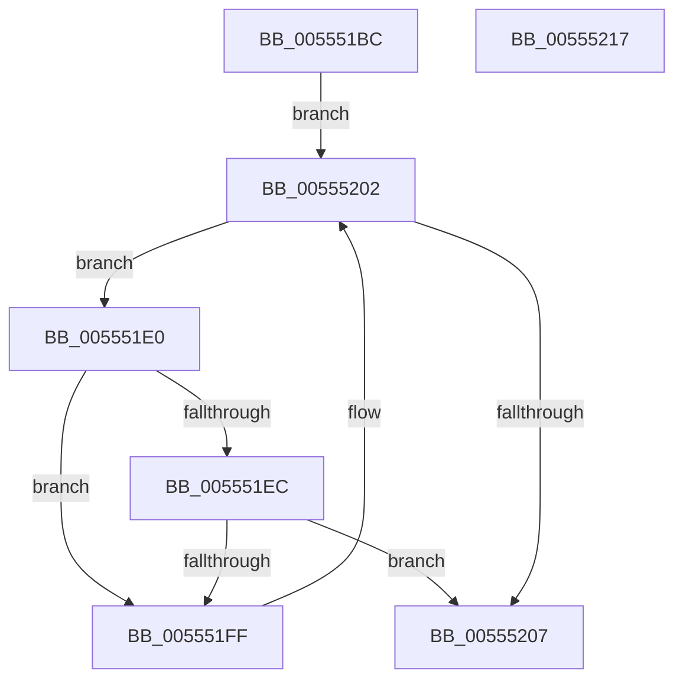

# HalpIommuGetAcpiDeviceMapCount

- RVA: `0x005551BC`–`0x00555218` (길이 `92` bytes)
- VA: `0x00000001405551BC`
- 실행 섹션: `.text`
- PDB 이름 있음: `예`; PDB Function 태그: `아니요`
- unwind 정보 RVA: `0x00060BC4`
- 디코드: `27`개 명령, `92/92` bytes 표시
- 미해석 바이트: `0` (있으면 어셈블리에 `.byte`로 보존)

> 이 문서는 커널 이미지의 기계어와 PDB 기호를 분석해 생성했습니다. 4번과 5번은 함수 원형과 자료형을 바이너리 사용 방식에서 추정한 C 해석이며 원본 소스 복구 결과는 아닙니다.

## 1. Dependencies

- 직접 호출 지점: **1**; 고유 호출 대상: **1**
- 직접 호출자로 확인된 함수: **2**
- RIP 상대 이미지 참조: **1**

### Outgoing calls
- `0x005551F6` → [guard_dispatch_icall](../6B/guard_dispatch_icall_function_006BAAD0.md) (function, `0x006BAAD0`)

### Direct callers
- [HalpIommuUnblockDevice](../4C/HalpIommuUnblockDevice_function_004C6250.md) at `0x004C6324`
- [HalpIommuDmaRemappingCapable](HalpIommuDmaRemappingCapable_function_00555000.md) at `0x0055503C`

### Static image references
- `0x005551CB` → RVA `0x00FC1740` (`.data`; read)

## 2. Other-region calls and transfers

- 다른 실행 섹션으로 향하는 call: **0**
- 별도 외부 분기/꼬리 이동을 확인하지 못했습니다.

## 3. Assembly (complete function range)

```asm
005551BC  48 89 5C 24 08                  mov qword ptr [rsp + 8], rbx
005551C1  48 89 74 24 10                  mov qword ptr [rsp + 0x10], rsi
005551C6  57                              push rdi
005551C7  48 83 EC 20                     sub rsp, 0x20
005551CB  48 8B 1D 6E C5 A6 00            mov rbx, qword ptr [rip + 0xa6c56e]
005551D2  48 8D 35 67 C5 A6 00            lea rsi, [rip + 0xa6c567]
005551D9  48 8B F9                        mov rdi, rcx
005551DC  33 C0                           xor eax, eax
005551DE  EB 22                           jmp 0x140555202
005551E0  4C 8B 83 70 01 00 00            mov r8, qword ptr [rbx + 0x170]
005551E7  4D 85 C0                        test r8, r8
005551EA  74 13                           je 0x1405551ff
005551EC  48 8B 4B 10                     mov rcx, qword ptr [rbx + 0x10]
005551F0  48 8B D7                        mov rdx, rdi
005551F3  49 8B C0                        mov rax, r8
005551F6  E8 D5 58 16 00                  call 0x1406baad0
005551FB  85 C0                           test eax, eax
005551FD  75 08                           jne 0x140555207
005551FF  48 8B 1B                        mov rbx, qword ptr [rbx]
00555202  48 3B DE                        cmp rbx, rsi
00555205  75 D9                           jne 0x1405551e0
00555207  48 8B 5C 24 30                  mov rbx, qword ptr [rsp + 0x30]
0055520C  48 8B 74 24 38                  mov rsi, qword ptr [rsp + 0x38]
00555211  48 83 C4 20                     add rsp, 0x20
00555215  5F                              pop rdi
00555216  C3                              ret
00555217  CC                              int3
```

## 4. C-style interpretation (structured pseudocode)

```c
__int64 __fastcall HalpIommuGetAcpiDeviceMapCount(__int64 a1)
{
    __int64 result;
    __int64 v_rsp;
    unsigned __int64 v_stack_p10;
    unsigned __int64 v_stack_p8;

    v_stack_p8 = v_rbx;
    v_stack_p10 = v_rsi;
    v_rsp = (v_rsp) - (32);
    result = 0;
    goto loc_00555202;
loc_005551E0:
    if (*(unsigned __int64 *)(*(unsigned __int64 *)(v_rip + 10929518) + 368) == 0) goto loc_005551FF;
    result = guard_dispatch_icall(*(unsigned __int64 *)(*(unsigned __int64 *)(v_rip + 10929518) + 16), a1, *(unsigned __int64 *)(*(unsigned __int64 *)(v_rip + 10929518) + 368), a4);
    if ((unsigned int)(result) != 0) goto loc_00555207;
loc_005551FF:
loc_00555202:
    if ((*(unsigned __int64 *)(*(unsigned __int64 *)(v_rip + 10929518))) != (v_rip + 10929511)) goto loc_005551E0;
loc_00555207:
    v_rsp = (v_rsp) + (32);
    return result;
}
```

## 5. (Beta) C Style

```c
int64_t HalpIommuGetAcpiDeviceMapCount(int64_t Arg1)
{
    int64_t result;
    int64_t local_rsp;
    uint64_t v_stack_p10;
    uint64_t v_stack_p8;

    v_stack_p8 = local_rbx;
    v_stack_p10 = local_rsi;
    local_rsp = (local_rsp) - (32);
    result = 0;
    goto loc_00555202;
loc_005551E0:
    if (*(uint64_t *)(*(uint64_t *)(v_rip + 0xA6C56E) + 0x170) == 0) goto loc_005551FF;
    result = guard_dispatch_icall(*(uint64_t *)(*(uint64_t *)(v_rip + 0xA6C56E) + 0x10), Arg1, *(uint64_t *)(*(uint64_t *)(v_rip + 0xA6C56E) + 0x170), a4);
    if ((uint32_t)(result) != 0) goto loc_00555207;
loc_005551FF:
loc_00555202:
    if ((*(uint64_t *)(*(uint64_t *)(v_rip + 0xA6C56E))) != (v_rip + 10929511)) goto loc_005551E0;
loc_00555207:
    local_rsp = (local_rsp) + (32);
    return result;
}
```

## 6. Execution-region graph

[열기: 2D/3D 그래프와 함수 탐색 컨트롤 패널](../../../control-panel.html?section=text&rva=0x005551BC&view=graph)

- 2D 그래프는 위에서 아래로 흐르고, 3D 그래프는 빈 공간을 드래그해 회전합니다. Shift+드래그는 이동, 휠은 확대·축소, 함수 노드 선택은 대상 보고서 이동입니다.

### Static fallback


