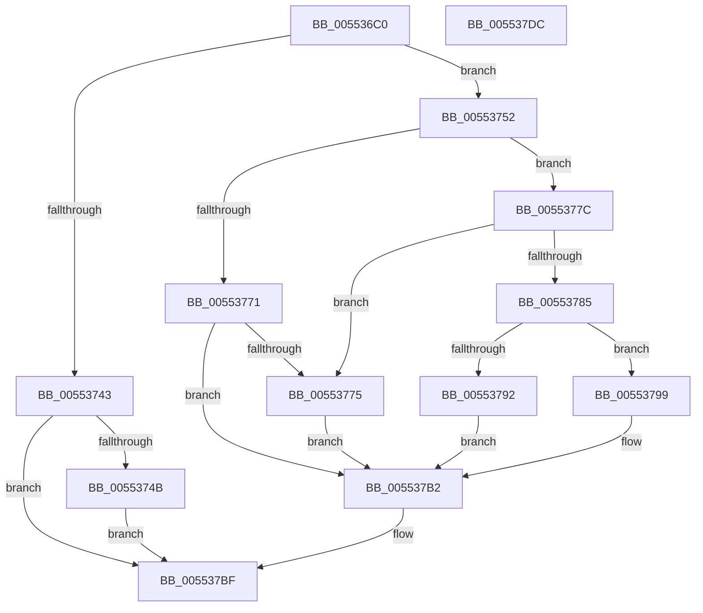

# HalpIommuGetDeviceId

- RVA: `0x005536C0`–`0x005537DD` (길이 `285` bytes)
- VA: `0x00000001405536C0`
- 실행 섹션: `.text`
- PDB 이름 있음: `예`; PDB Function 태그: `아니요`
- unwind 정보 RVA: `0x000C4460`
- 디코드: `81`개 명령, `285/285` bytes 표시
- 미해석 바이트: `0` (있으면 어셈블리에 `.byte`로 보존)

> 이 문서는 커널 이미지의 기계어와 PDB 기호를 분석해 생성했습니다. 4번과 5번은 함수 원형과 자료형을 바이너리 사용 방식에서 추정한 C 해석이며 원본 소스 복구 결과는 아닙니다.

## 1. Dependencies

- 직접 호출 지점: **8**; 고유 호출 대상: **6**
- 직접 호출자로 확인된 함수: **3**
- RIP 상대 이미지 참조: **1**

### Outgoing calls
- `0x005536EA` → [memset](../6C/memset_function_006C6C40.md) (function, `0x006C6C40`)
- `0x005536FE` → [IoGetDeviceAttachmentBaseRefWithTag](../27/IoGetDeviceAttachmentBaseRefWithTag_function_00272788.md) (function, `0x00272788`)
- `0x0055372B` → [IoQueryInterface](../../page/72/IoQueryInterface_function_00729930.md) (function, `0x00729930`)
- `0x0055373A` → [ObfDereferenceObjectWithTag](../2F/ObfDereferenceObjectWithTag_function_002F78E0.md) (function, `0x002F78E0`)
- `0x00553763` → [guard_dispatch_icall](../6B/guard_dispatch_icall_function_006BAAD0.md) (function, `0x006BAAD0`)
- `0x00553785` → [HalpMmAllocCtxAlloc](../3E/HalpMmAllocCtxAlloc_function_003E10B8.md) (function, `0x003E10B8`)
- `0x005537AB` → [guard_dispatch_icall](../6B/guard_dispatch_icall_function_006BAAD0.md) (function, `0x006BAAD0`)
- `0x005537BA` → [guard_dispatch_icall](../6B/guard_dispatch_icall_function_006BAAD0.md) (function, `0x006BAAD0`)

### Direct callers
- [IommuDomainAttachDevice](../56/IommuDomainAttachDevice_function_00567960.md) at `0x005679A0`
- [IommupCreateDeviceId](../56/IommupCreateDeviceId_function_0056888C.md) at `0x005688A5`
- [HalpQueryIommuReservedRegionInformation](../../page/70/HalpQueryIommuReservedRegionInformation_function_00708904.md) at `0x00708931`

### Static image references
- `0x00553715` → RVA `0x00019F50` (`.rdata`; read)

## 2. Other-region calls and transfers

- 다른 실행 섹션으로 향하는 call: **1**
  - `0x0055372B` → [IoQueryInterface](../../page/72/IoQueryInterface_function_00729930.md) (`.text` → `PAGE`)
- 별도 외부 분기/꼬리 이동을 확인하지 못했습니다.

## 3. Assembly (complete function range)

```asm
005536C0  48 89 5C 24 08                  mov qword ptr [rsp + 8], rbx
005536C5  48 89 74 24 18                  mov qword ptr [rsp + 0x18], rsi
005536CA  55                              push rbp
005536CB  57                              push rdi
005536CC  41 56                           push r14
005536CE  48 8D 6C 24 B9                  lea rbp, [rsp - 0x47]
005536D3  48 81 EC 90 00 00 00            sub rsp, 0x90
005536DA  4C 8B F2                        mov r14, rdx
005536DD  48 8B F9                        mov rdi, rcx
005536E0  33 D2                           xor edx, edx
005536E2  48 8D 4D F7                     lea rcx, [rbp - 9]
005536E6  44 8D 42 50                     lea r8d, [rdx + 0x50]
005536EA  E8 51 35 17 00                  call 0x1406c6c40
005536EF  48 83 65 6F 00                  and qword ptr [rbp + 0x6f], 0
005536F4  BA 44 66 6C 74                  mov edx, 0x746c6644
005536F9  48 8B CF                        mov rcx, rdi
005536FC  33 F6                           xor esi, esi
005536FE  E8 85 F0 D1 FF                  call 0x140272788
00553703  48 8B D8                        mov rbx, rax
00553706  44 8D 4E 50                     lea r9d, [rsi + 0x50]
0055370A  48 8D 45 F7                     lea rax, [rbp - 9]
0055370E  33 D2                           xor edx, edx
00553710  48 89 44 24 30                  mov qword ptr [rsp + 0x30], rax
00553715  4C 8D 05 34 68 AC FF            lea r8, [rip - 0x5397cc]
0055371C  48 89 5C 24 28                  mov qword ptr [rsp + 0x28], rbx
00553721  48 8B CF                        mov rcx, rdi
00553724  66 C7 44 24 20 02 00            mov word ptr [rsp + 0x20], 2
0055372B  E8 00 62 1D 00                  call 0x140729930
00553730  BA 44 66 6C 74                  mov edx, 0x746c6644
00553735  48 8B CB                        mov rcx, rbx
00553738  8B F8                           mov edi, eax
0055373A  E8 A1 41 DA FF                  call 0x1402f78e0
0055373F  85 FF                           test edi, edi
00553741  79 0F                           jns 0x140553752
00553743  81 FF 9A 00 00 C0               cmp edi, 0xc000009a
00553749  74 74                           je 0x1405537bf
0055374B  BF 25 02 00 C0                  mov edi, 0xc0000225
00553750  EB 6D                           jmp 0x1405537bf
00553752  48 8B 4D FF                     mov rcx, qword ptr [rbp - 1]
00553756  4C 8D 4D 6F                     lea r9, [rbp + 0x6f]
0055375A  48 8B 45 37                     mov rax, qword ptr [rbp + 0x37]
0055375E  45 33 C0                        xor r8d, r8d
00553761  33 D2                           xor edx, edx
00553763  E8 68 73 16 00                  call 0x1406baad0
00553768  8B F8                           mov edi, eax
0055376A  3D 23 00 00 C0                  cmp eax, 0xc0000023
0055376F  74 0B                           je 0x14055377c
00553771  85 C0                           test eax, eax
00553773  78 3D                           js 0x1405537b2
00553775  BF 01 00 00 C0                  mov edi, 0xc0000001
0055377A  EB 36                           jmp 0x1405537b2
0055377C  48 8B 55 6F                     mov rdx, qword ptr [rbp + 0x6f]
00553780  48 85 D2                        test rdx, rdx
00553783  74 F0                           je 0x140553775
00553785  E8 2E D9 E8 FF                  call 0x1403e10b8
0055378A  48 8B F0                        mov rsi, rax
0055378D  48 85 C0                        test rax, rax
00553790  75 07                           jne 0x140553799
00553792  BF 9A 00 00 C0                  mov edi, 0xc000009a
00553797  EB 19                           jmp 0x1405537b2
00553799  48 8B 55 6F                     mov rdx, qword ptr [rbp + 0x6f]
0055379D  4C 8B C0                        mov r8, rax
005537A0  48 8B 45 37                     mov rax, qword ptr [rbp + 0x37]
005537A4  45 33 C9                        xor r9d, r9d
005537A7  48 8B 4D FF                     mov rcx, qword ptr [rbp - 1]
005537AB  E8 20 73 16 00                  call 0x1406baad0
005537B0  8B F8                           mov edi, eax
005537B2  48 8B 4D FF                     mov rcx, qword ptr [rbp - 1]
005537B6  48 8B 45 0F                     mov rax, qword ptr [rbp + 0xf]
005537BA  E8 11 73 16 00                  call 0x1406baad0
005537BF  4C 8D 9C 24 90 00 00 00         lea r11, [rsp + 0x90]
005537C7  49 89 36                        mov qword ptr [r14], rsi
005537CA  49 8B 5B 20                     mov rbx, qword ptr [r11 + 0x20]
005537CE  8B C7                           mov eax, edi
005537D0  49 8B 73 30                     mov rsi, qword ptr [r11 + 0x30]
005537D4  49 8B E3                        mov rsp, r11
005537D7  41 5E                           pop r14
005537D9  5F                              pop rdi
005537DA  5D                              pop rbp
005537DB  C3                              ret
005537DC  CC                              int3
```

## 4. C-style interpretation (structured pseudocode)

```c
__int64 __fastcall HalpIommuGetDeviceId(__int64 a1, __int64 a2)
{
    __int64 result;
    __int64 v_rsi;
    __int64 v_rsp;
    unsigned __int64 v_stack_m18;
    unsigned __int64 v_stack_m28;
    unsigned __int64 v_stack_m50;
    unsigned __int64 v_stack_m5F;
    unsigned __int64 v_stack_m60;
    unsigned __int64 v_stack_m68;
    unsigned __int64 v_stack_m78;
    unsigned __int64 v_stack_m80;
    unsigned __int16 v_stack_m88;
    unsigned __int64 v_stack_p10;
    unsigned __int64 v_stack_p18;
    unsigned __int64 v_stack_p8;

    v_stack_p8 = v_rbx;
    v_stack_p18 = v_rsi;
    v_rsp = (v_rsp) - (144);
    a2 = 0;
    result = memset(v_stack_m68, a2, a2 + 80, a4);
    v_rsi = 0;
    result = IoGetDeviceAttachmentBaseRefWithTag(a1, (unsigned int)(0x746C6644ULL), a2 + 80, a4);
    a2 = 0;
    v_stack_m78 = v_stack_m68;
    v_stack_m80 = result;
    v_stack_m88 = 2;
    result = IoQueryInterface(a1, a2, v_rip - 5478348, v_rsi + 80);
    result = ObfDereferenceObjectWithTag(result, (unsigned int)(0x746C6644ULL), v_rip - 5478348, v_rsi + 80);
    if (!sign_flag) goto loc_00553752;
    if (((unsigned int)((unsigned int)((unsigned int)(result)))) == 0xC000009AULL) goto loc_005537BF;
    goto loc_005537BF;
loc_00553752:
    a3 = 0;
    a2 = 0;
    result = guard_dispatch_icall(v_stack_m60, a2, a3, v_stack_p10);
    if (((unsigned int)(result)) == 0xC0000023ULL) goto loc_0055377C;
    if (sign_flag) goto loc_005537B2;
loc_00553775:
    goto loc_005537B2;
loc_0055377C:
    if (v_stack_p10 == 0) goto loc_00553775;
    result = HalpMmAllocCtxAlloc(v_stack_m60, v_stack_p10, a3, v_stack_p10);
    if (result != 0) goto loc_00553799;
    goto loc_005537B2;
loc_00553799:
    a4 = 0;
    result = guard_dispatch_icall(v_stack_m60, v_stack_p10, result, a4);
loc_005537B2:
    result = guard_dispatch_icall(v_stack_m60, v_stack_p10, result, a4);
loc_005537BF:
    *(unsigned __int64 *)(a2) = result;
    return (unsigned int)((unsigned int)((unsigned int)((unsigned int)(result))));
}
```

## 5. (Beta) C Style

```c
int64_t HalpIommuGetDeviceId(int64_t Arg1, void *Arg2)
{
    uint8_t *arg2 = (uint8_t *)Arg2;

    int64_t result;
    int64_t local_rsi;
    int64_t local_rsp;
    uint64_t v_stack_m18;
    uint64_t v_stack_m28;
    uint64_t v_stack_m50;
    uint64_t v_stack_m5F;
    uint64_t v_stack_m60;
    uint64_t v_stack_m68;
    uint64_t v_stack_m78;
    uint64_t v_stack_m80;
    uint16_t v_stack_m88;
    uint64_t v_stack_p10;
    uint64_t v_stack_p18;
    uint64_t v_stack_p8;

    v_stack_p8 = local_rbx;
    v_stack_p18 = local_rsi;
    local_rsp = (local_rsp) - (144);
    Arg2 = 0;
    result = memset(v_stack_m68, Arg2, Arg2 + 80, a4);
    local_rsi = 0;
    result = IoGetDeviceAttachmentBaseRefWithTag(Arg1, (uint32_t)(0x746C6644ULL), Arg2 + 80, a4);
    Arg2 = 0;
    v_stack_m78 = v_stack_m68;
    v_stack_m80 = result;
    v_stack_m88 = 2;
    result = IoQueryInterface(Arg1, Arg2, v_rip - 5478348, local_rsi + 80);
    result = ObfDereferenceObjectWithTag(result, (uint32_t)(0x746C6644ULL), v_rip - 5478348, local_rsi + 80);
    if (!sign_flag) goto loc_00553752;
    if (((uint32_t)((uint32_t)((uint32_t)(result)))) == 0xC000009AULL) goto loc_005537BF;
    goto loc_005537BF;
loc_00553752:
    a3 = 0;
    Arg2 = 0;
    result = guard_dispatch_icall(v_stack_m60, Arg2, a3, v_stack_p10);
    if (((uint32_t)(result)) == 0xC0000023ULL) goto loc_0055377C;
    if (sign_flag) goto loc_005537B2;
loc_00553775:
    goto loc_005537B2;
loc_0055377C:
    if (v_stack_p10 == 0) goto loc_00553775;
    result = HalpMmAllocCtxAlloc(v_stack_m60, v_stack_p10, a3, v_stack_p10);
    if (result != 0) goto loc_00553799;
    goto loc_005537B2;
loc_00553799:
    a4 = 0;
    result = guard_dispatch_icall(v_stack_m60, v_stack_p10, result, a4);
loc_005537B2:
    result = guard_dispatch_icall(v_stack_m60, v_stack_p10, result, a4);
loc_005537BF:
    *(uint64_t *)(arg2) = result;
    return (uint32_t)((uint32_t)((uint32_t)((uint32_t)(result))));
}
```

### 관측된 메모리 오프셋

구조체 형식이 확인되지 않은 접근은 인자 기준의 오프셋으로만 기록했습니다.

| 기준 인자 | 오프셋 표현 | 폭 (bit) | 접근 |
|---|---:|---:|---|
| `Arg2` | `+ 0x0` | `64` | `W` |

## 6. Execution-region graph

[열기: 2D/3D 그래프와 함수 탐색 컨트롤 패널](../../../control-panel.html?section=text&rva=0x005536C0&view=graph)

- 2D 그래프는 위에서 아래로 흐르고, 3D 그래프는 빈 공간을 드래그해 회전합니다. Shift+드래그는 이동, 휠은 확대·축소, 함수 노드 선택은 대상 보고서 이동입니다.

### Static fallback


