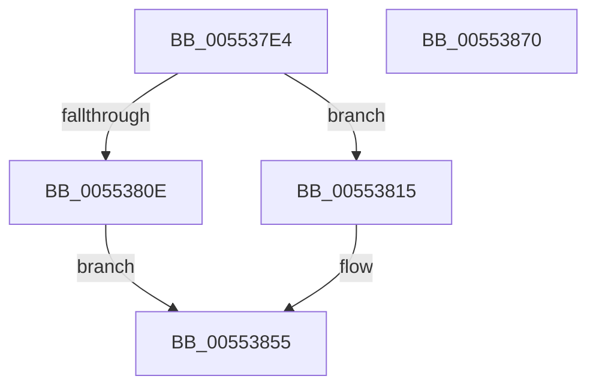

# HalpIommuGetDomainId

- RVA: `0x005537E4`–`0x00553871` (길이 `141` bytes)
- VA: `0x00000001405537E4`
- 실행 섹션: `.text`
- PDB 이름 있음: `예`; PDB Function 태그: `아니요`
- unwind 정보 RVA: `0x0005E6B4`
- 디코드: `38`개 명령, `141/141` bytes 표시
- 미해석 바이트: `0` (있으면 어셈블리에 `.byte`로 보존)

> 이 문서는 커널 이미지의 기계어와 PDB 기호를 분석해 생성했습니다. 4번과 5번은 함수 원형과 자료형을 바이너리 사용 방식에서 추정한 C 해석이며 원본 소스 복구 결과는 아닙니다.

## 1. Dependencies

- 직접 호출 지점: **3**; 고유 호출 대상: **3**
- 직접 호출자로 확인된 함수: **2**
- RIP 상대 이미지 참조: **1**

### Outgoing calls
- `0x0055381F` → [KeAcquireSpinLockRaiseToDpc](../20/KeAcquireSpinLockRaiseToDpc_function_00208470.md) (function, `0x00208470`)
- `0x00553835` → [RtlFindClearBitsAndSet](../3E/RtlFindClearBitsAndSet_function_003E0CD0.md) (function, `0x003E0CD0`)
- `0x0055384E` → [KeReleaseSpinLock](../39/KeReleaseSpinLock_function_00392BA0.md) (function, `0x00392BA0`)

### Direct callers
- [HalpIommuAcquireNewDomain](HalpIommuAcquireNewDomain_function_0055339C.md) at `0x005533CD`
- [IommupDeviceEnableSvm](../../page/70/IommupDeviceEnableSvm_function_00708CC4.md) at `0x00708DB0`

### Static image references
- `0x00553802` → RVA `0x00FC1710` (`.data`; read)

## 2. Other-region calls and transfers

- 다른 실행 섹션으로 향하는 call: **0**
- 별도 외부 분기/꼬리 이동을 확인하지 못했습니다.

## 3. Assembly (complete function range)

```asm
005537E4  48 8B C4                        mov rax, rsp
005537E7  48 89 58 08                     mov qword ptr [rax + 8], rbx
005537EB  48 89 68 10                     mov qword ptr [rax + 0x10], rbp
005537EF  48 89 70 18                     mov qword ptr [rax + 0x18], rsi
005537F3  48 89 78 20                     mov qword ptr [rax + 0x20], rdi
005537F7  41 56                           push r14
005537F9  48 83 EC 20                     sub rsp, 0x20
005537FD  33 ED                           xor ebp, ebp
005537FF  4C 8B F2                        mov r14, rdx
00553802  40 38 2D 07 DF A6 00            cmp byte ptr [rip + 0xa6df07], bpl
00553809  48 8B D9                        mov rbx, rcx
0055380C  74 07                           je 0x140553815
0055380E  B8 BB 00 00 C0                  mov eax, 0xc00000bb
00553813  EB 40                           jmp 0x140553855
00553815  48 8D B1 C0 01 00 00            lea rsi, [rcx + 0x1c0]
0055381C  48 8B CE                        mov rcx, rsi
0055381F  E8 4C 4C CB FF                  call 0x140208470
00553824  45 33 C0                        xor r8d, r8d
00553827  48 8D 8B C8 01 00 00            lea rcx, [rbx + 0x1c8]
0055382E  40 8A F8                        mov dil, al
00553831  41 8D 50 01                     lea edx, [r8 + 1]
00553835  E8 96 D4 E8 FF                  call 0x1403e0cd0
0055383A  83 F8 FF                        cmp eax, -1
0055383D  41 89 06                        mov dword ptr [r14], eax
00553840  BB 9A 00 00 C0                  mov ebx, 0xc000009a
00553845  40 8A D7                        mov dl, dil
00553848  48 8B CE                        mov rcx, rsi
0055384B  0F 45 DD                        cmovne ebx, ebp
0055384E  E8 4D F3 E3 FF                  call 0x140392ba0
00553853  8B C3                           mov eax, ebx
00553855  48 8B 5C 24 30                  mov rbx, qword ptr [rsp + 0x30]
0055385A  48 8B 6C 24 38                  mov rbp, qword ptr [rsp + 0x38]
0055385F  48 8B 74 24 40                  mov rsi, qword ptr [rsp + 0x40]
00553864  48 8B 7C 24 48                  mov rdi, qword ptr [rsp + 0x48]
00553869  48 83 C4 20                     add rsp, 0x20
0055386D  41 5E                           pop r14
0055386F  C3                              ret
00553870  CC                              int3
```

## 4. C-style interpretation (structured pseudocode)

```c
__int64 __fastcall HalpIommuGetDomainId(__int64 a1, __int64 a2, int a3)
{
    __int64 result;
    __int64 v_rbp;
    __int64 v_rbx;
    __int64 v_rsp;
    unsigned __int64 v_stack_p10;
    unsigned __int64 v_stack_p18;
    unsigned __int64 v_stack_p20;
    unsigned __int64 v_stack_p8;

    *(unsigned __int64 *)(v_rsp + 8) = v_rbx;
    *(unsigned __int64 *)(v_rsp + 16) = v_rbp;
    *(unsigned __int64 *)(v_rsp + 24) = v_rsi;
    *(unsigned __int64 *)(v_rsp + 32) = v_rdi;
    v_rsp = (v_rsp) - (32);
    v_rbp = 0;
    if ((*(unsigned __int8 *)(v_rip + 10936071)) == 0) goto loc_00553815;
    goto loc_00553855;
loc_00553815:
    result = KeAcquireSpinLockRaiseToDpc(a1 + 448, a2, a3, a4);
    a3 = 0;
    result = RtlFindClearBitsAndSet(a1 + 456, a3 + 1, a3, a4);
    *(unsigned int *)(a2) = (unsigned int)(result);
    v_rbx = (unsigned int)(0xC000009AULL);
    if (((unsigned int)(result)) != -1) { v_rbx = 0; }
    result = KeReleaseSpinLock(a1 + 448, (unsigned __int8)((unsigned __int8)(result)), a3, a4);
loc_00553855:
    v_rsp = (v_rsp) + (32);
    return (unsigned int)((unsigned int)(v_rbx));
}
```

## 5. (Beta) C Style

```c
int64_t HalpIommuGetDomainId(void *Arg1, void *Arg2, int32_t Arg3)
{
    uint8_t *arg1 = (uint8_t *)Arg1;
    uint8_t *arg2 = (uint8_t *)Arg2;

    int64_t result;
    int64_t local_rbp;
    int64_t local_rbx;
    int64_t local_rsp;
    uint64_t v_stack_p10;
    uint64_t v_stack_p18;
    uint64_t v_stack_p20;
    uint64_t v_stack_p8;

    *(uint64_t *)(local_rsp + 0x8) = local_rbx;
    *(uint64_t *)(local_rsp + 0x10) = local_rbp;
    *(uint64_t *)(local_rsp + 0x18) = local_rsi;
    *(uint64_t *)(local_rsp + 0x20) = local_rdi;
    local_rsp = (local_rsp) - (32);
    local_rbp = 0;
    if ((*(uint8_t *)(v_rip + 0xA6DF07)) == 0) goto loc_00553815;
    goto loc_00553855;
loc_00553815:
    result = KeAcquireSpinLockRaiseToDpc(Arg1 + 448, Arg2, Arg3, a4);
    Arg3 = 0;
    result = RtlFindClearBitsAndSet(Arg1 + 456, Arg3 + 1, Arg3, a4);
    *(uint32_t *)(arg2) = (uint32_t)(result);
    local_rbx = (uint32_t)(0xC000009AULL);
    if (((uint32_t)(result)) != -1) { local_rbx = 0; }
    result = KeReleaseSpinLock(Arg1 + 448, (uint8_t)((uint8_t)(result)), Arg3, a4);
loc_00553855:
    local_rsp = (local_rsp) + (32);
    return (uint32_t)((uint32_t)(local_rbx));
}
```

### 관측된 메모리 오프셋

구조체 형식이 확인되지 않은 접근은 인자 기준의 오프셋으로만 기록했습니다.

| 기준 인자 | 오프셋 표현 | 폭 (bit) | 접근 |
|---|---:|---:|---|
| `Arg1` | `+ 0x1C0` | `64` | `R` |
| `Arg1` | `+ 0x1C8` | `64` | `R` |
| `Arg2` | `+ 0x0` | `32` | `W` |

## 6. Execution-region graph

[열기: 2D/3D 그래프와 함수 탐색 컨트롤 패널](../../../control-panel.html?section=text&rva=0x005537E4&view=graph)

- 2D 그래프는 위에서 아래로 흐르고, 3D 그래프는 빈 공간을 드래그해 회전합니다. Shift+드래그는 이동, 휠은 확대·축소, 함수 노드 선택은 대상 보고서 이동입니다.

### Static fallback


