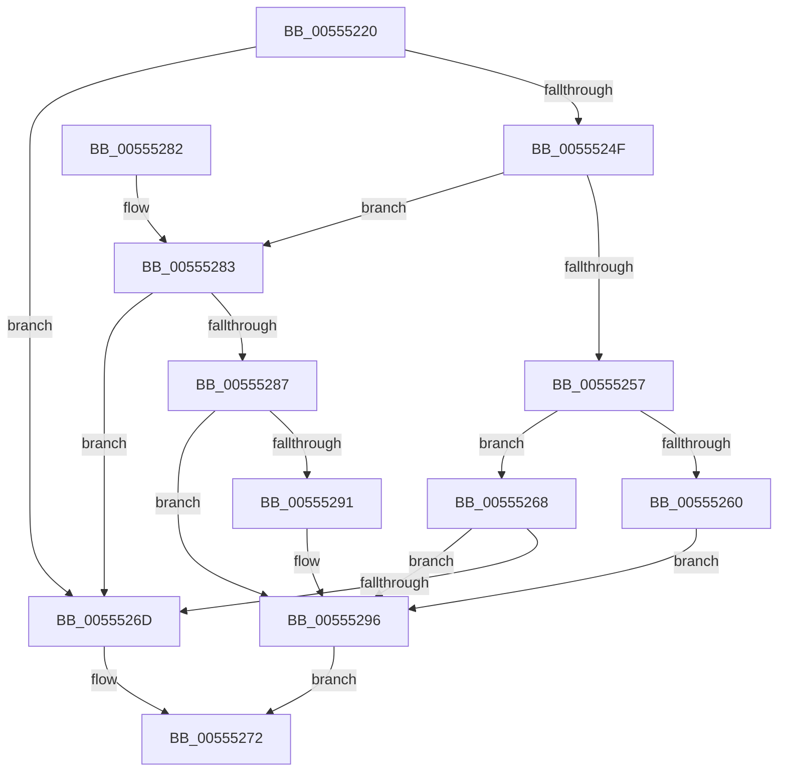

# HalpIommuGetPageTableType

- RVA: `0x00555220`–`0x0055529C` (길이 `124` bytes)
- VA: `0x0000000140555220`
- 실행 섹션: `.text`
- PDB 이름 있음: `예`; PDB Function 태그: `아니요`
- unwind 정보 RVA: `0x000C453C`
- 디코드: `43`개 명령, `124/124` bytes 표시
- 미해석 바이트: `0` (있으면 어셈블리에 `.byte`로 보존)

> 이 문서는 커널 이미지의 기계어와 PDB 기호를 분석해 생성했습니다. 4번과 5번은 함수 원형과 자료형을 바이너리 사용 방식에서 추정한 C 해석이며 원본 소스 복구 결과는 아닙니다.

## 1. Dependencies

- 직접 호출 지점: **2**; 고유 호출 대상: **2**
- 직접 호출자로 확인된 함수: **2**
- RIP 상대 이미지 참조: **0**

### Outgoing calls
- `0x00555246` → [HalpGetCpuInfo](../49/HalpGetCpuInfo_function_00498A70.md) (function, `0x00498A70`)
- `0x00555257` → [Feature_Test57481295__private_IsEnabledDeviceUsageNoInline](../4F/Feature_Test57481295__private_IsEnabledDeviceUsageNoInline_function_004F7B90.md) (function, `0x004F7B90`)

### Direct callers
- [HalpIommuAllocateDmaDomain](HalpIommuAllocateDmaDomain_function_00554904.md) at `0x00554B41`
- [HalpIommuConstructReservedPageTable](../../pagelk/B5/HalpIommuConstructReservedPageTable_function_00B5DD20.md) at `0x00B5DD5E`

### Static image references
- 디코드된 RIP-relative 메모리 참조가 없습니다.

## 2. Other-region calls and transfers

- 다른 실행 섹션으로 향하는 call: **0**
- 별도 외부 분기/꼬리 이동을 확인하지 못했습니다.

## 3. Assembly (complete function range)

```asm
00555220  48 8B C4                        mov rax, rsp
00555223  48 89 58 08                     mov qword ptr [rax + 8], rbx
00555227  48 89 70 10                     mov qword ptr [rax + 0x10], rsi
0055522B  57                              push rdi
0055522C  48 83 EC 20                     sub rsp, 0x20
00555230  48 8B FA                        mov rdi, rdx
00555233  4C 8D 48 18                     lea r9, [rax + 0x18]
00555237  40 8A F1                        mov sil, cl
0055523A  33 DB                           xor ebx, ebx
0055523C  33 D2                           xor edx, edx
0055523E  88 58 18                        mov byte ptr [rax + 0x18], bl
00555241  33 C9                           xor ecx, ecx
00555243  45 33 C0                        xor r8d, r8d
00555246  E8 25 38 F4 FF                  call 0x140498a70
0055524B  84 C0                           test al, al
0055524D  74 1E                           je 0x14055526d
0055524F  8A 44 24 40                     mov al, byte ptr [rsp + 0x40]
00555253  3C 02                           cmp al, 2
00555255  75 2C                           jne 0x140555283
00555257  E8 34 29 FA FF                  call 0x1404f7b90
0055525C  85 C0                           test eax, eax
0055525E  74 08                           je 0x140555268
00555260  40 84 F6                        test sil, sil
00555263  0F 95 C3                        setne bl
00555266  EB 2E                           jmp 0x140555296
00555268  40 84 F6                        test sil, sil
0055526B  74 29                           je 0x140555296
0055526D  B8 BB 00 00 C0                  mov eax, 0xc00000bb
00555272  48 8B 5C 24 30                  mov rbx, qword ptr [rsp + 0x30]
00555277  48 8B 74 24 38                  mov rsi, qword ptr [rsp + 0x38]
0055527C  48 83 C4 20                     add rsp, 0x20
00555280  5F                              pop rdi
00555281  C3                              ret
00555282  CC                              int3
00555283  3C 01                           cmp al, 1
00555285  75 E6                           jne 0x14055526d
00555287  BB 02 00 00 00                  mov ebx, 2
0055528C  40 84 F6                        test sil, sil
0055528F  75 05                           jne 0x140555296
00555291  BB 03 00 00 00                  mov ebx, 3
00555296  89 1F                           mov dword ptr [rdi], ebx
00555298  33 C0                           xor eax, eax
0055529A  EB D6                           jmp 0x140555272
```

## 4. C-style interpretation (structured pseudocode)

```c
__int64 __fastcall HalpIommuGetPageTableType(int a1, __int64 a2, int a3)
{
    __int64 result;
    __int64 v_rbx;
    __int64 v_rsp;
    unsigned __int64 v_stack_p10;
    unsigned __int8 v_stack_p18;
    unsigned __int64 v_stack_p8;

    *(unsigned __int64 *)(v_rsp + 8) = v_rbx;
    *(unsigned __int64 *)(v_rsp + 16) = v_rsi;
    v_rsp = (v_rsp) - (32);
    v_rbx = 0;
    a2 = 0;
    *(unsigned __int8 *)(v_rsp + 24) = 0;
    a1 = 0;
    a3 = 0;
    result = HalpGetCpuInfo(a1, a2, a3, v_rsp + 24);
    if ((unsigned __int8)(result) == 0) goto loc_0055526D;
    if (((unsigned __int8)(v_stack_p18)) != 2) goto loc_00555283;
    result = Feature_Test57481295__private_IsEnabledDeviceUsageNoInline(a1, a2, a3, v_rsp + 24);
    if ((unsigned int)(result) == 0) goto loc_00555268;
    v_rbx = ((unsigned __int8)((unsigned __int8)(a1)) != 0) ? 1 : 0;
    goto loc_00555296;
loc_00555268:
    if ((unsigned __int8)((unsigned __int8)(a1)) == 0) goto loc_00555296;
loc_0055526D:
loc_00555272:
    v_rsp = (v_rsp) + (32);
    return (unsigned int)(0xC00000BBULL);
loc_00555283:
    if (((unsigned __int8)((unsigned int)(0xC00000BBULL))) != 1) goto loc_0055526D;
    v_rbx = 2;
    if ((unsigned __int8)(v_stack_p10) == 0) {
        v_rbx = 3;
    }
    *(unsigned int *)(a2) = (unsigned int)(v_rbx);
    result = 0;
    goto loc_00555272;
}
```

## 5. (Beta) C Style

```c
int64_t HalpIommuGetPageTableType(int32_t Arg1, void *Arg2, int32_t Arg3)
{
    uint8_t *arg2 = (uint8_t *)Arg2;

    int64_t result;
    int64_t local_rbx;
    int64_t local_rsp;
    uint64_t v_stack_p10;
    uint8_t v_stack_p18;
    uint64_t v_stack_p8;

    *(uint64_t *)(local_rsp + 0x8) = local_rbx;
    *(uint64_t *)(local_rsp + 0x10) = local_rsi;
    local_rsp = (local_rsp) - (32);
    local_rbx = 0;
    Arg2 = 0;
    *(uint8_t *)(local_rsp + 0x18) = 0;
    Arg1 = 0;
    Arg3 = 0;
    result = HalpGetCpuInfo(Arg1, Arg2, Arg3, local_rsp + 24);
    if ((uint8_t)(result) == 0) goto loc_0055526D;
    if (((uint8_t)(v_stack_p18)) != 2) goto loc_00555283;
    result = Feature_Test57481295__private_IsEnabledDeviceUsageNoInline(Arg1, Arg2, Arg3, local_rsp + 24);
    if ((uint32_t)(result) == 0) goto loc_00555268;
    local_rbx = ((uint8_t)((uint8_t)(Arg1)) != 0) ? 1 : 0;
    goto loc_00555296;
loc_00555268:
    if ((uint8_t)((uint8_t)(Arg1)) == 0) goto loc_00555296;
loc_0055526D:
loc_00555272:
    local_rsp = (local_rsp) + (32);
    return (uint32_t)(0xC00000BBULL);
loc_00555283:
    if (((uint8_t)((uint32_t)(0xC00000BBULL))) != 1) goto loc_0055526D;
    local_rbx = 2;
    if ((uint8_t)(v_stack_p10) == 0) {
        local_rbx = 3;
    }
    *(uint32_t *)(arg2) = (uint32_t)(local_rbx);
    result = 0;
    goto loc_00555272;
}
```

### 관측된 메모리 오프셋

구조체 형식이 확인되지 않은 접근은 인자 기준의 오프셋으로만 기록했습니다.

| 기준 인자 | 오프셋 표현 | 폭 (bit) | 접근 |
|---|---:|---:|---|
| `Arg2` | `+ 0x0` | `32` | `W` |

## 6. Execution-region graph

[열기: 2D/3D 그래프와 함수 탐색 컨트롤 패널](../../../control-panel.html?section=text&rva=0x00555220&view=graph)

- 2D 그래프는 위에서 아래로 흐르고, 3D 그래프는 빈 공간을 드래그해 회전합니다. Shift+드래그는 이동, 휠은 확대·축소, 함수 노드 선택은 대상 보고서 이동입니다.

### Static fallback


