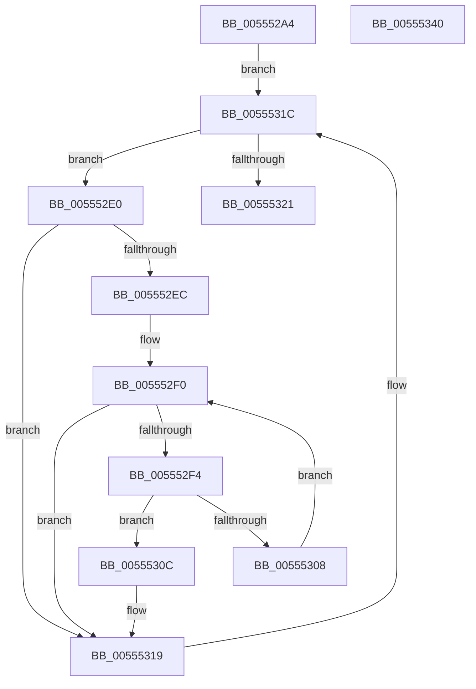

# HalpIommuGetReservedRanges

- RVA: `0x005552A4`–`0x00555341` (길이 `157` bytes)
- VA: `0x00000001405552A4`
- 실행 섹션: `.text`
- PDB 이름 있음: `예`; PDB Function 태그: `아니요`
- unwind 정보 RVA: `0x00075C18`
- 디코드: `51`개 명령, `157/157` bytes 표시
- 미해석 바이트: `0` (있으면 어셈블리에 `.byte`로 보존)

> 이 문서는 커널 이미지의 기계어와 PDB 기호를 분석해 생성했습니다. 4번과 5번은 함수 원형과 자료형을 바이너리 사용 방식에서 추정한 C 해석이며 원본 소스 복구 결과는 아닙니다.

## 1. Dependencies

- 직접 호출 지점: **1**; 고유 호출 대상: **1**
- 직접 호출자로 확인된 함수: **1**
- RIP 상대 이미지 참조: **1**

### Outgoing calls
- `0x005552FF` → [IidAreIdsStrictlyEqual](../6A/IidAreIdsStrictlyEqual_function_006A2BE4.md) (function, `0x006A2BE4`)

### Direct callers
- [HalpDmaGetReservedRegionsForTranslateDomain](HalpDmaGetReservedRegionsForTranslateDomain_function_0055232C.md) at `0x00552357`

### Static image references
- `0x005552C3` → RVA `0x00FC1740` (`.data`; read)

## 2. Other-region calls and transfers

- 다른 실행 섹션으로 향하는 call: **0**
- 별도 외부 분기/꼬리 이동을 확인하지 못했습니다.

## 3. Assembly (complete function range)

```asm
005552A4  48 89 5C 24 08                  mov qword ptr [rsp + 8], rbx
005552A9  48 89 6C 24 10                  mov qword ptr [rsp + 0x10], rbp
005552AE  48 89 74 24 18                  mov qword ptr [rsp + 0x18], rsi
005552B3  57                              push rdi
005552B4  41 54                           push r12
005552B6  41 55                           push r13
005552B8  41 56                           push r14
005552BA  41 57                           push r15
005552BC  48 83 EC 20                     sub rsp, 0x20
005552C0  83 22 00                        and dword ptr [rdx], 0
005552C3  4C 8D 2D 76 C4 A6 00            lea r13, [rip + 0xa6c476]
005552CA  49 83 20 00                     and qword ptr [r8], 0
005552CE  4D 8B F0                        mov r14, r8
005552D1  4C 8B 1D 68 C4 A6 00            mov r11, qword ptr [rip + 0xa6c468]
005552D8  4C 8B FA                        mov r15, rdx
005552DB  4C 8B E1                        mov r12, rcx
005552DE  EB 3C                           jmp 0x14055531c
005552E0  49 8B BB 18 02 00 00            mov rdi, qword ptr [r11 + 0x218]
005552E7  48 85 FF                        test rdi, rdi
005552EA  74 2D                           je 0x140555319
005552EC  8B 2F                           mov ebp, dword ptr [rdi]
005552EE  33 DB                           xor ebx, ebx
005552F0  3B DD                           cmp ebx, ebp
005552F2  73 25                           jae 0x140555319
005552F4  48 8B 74 DF 08                  mov rsi, qword ptr [rdi + rbx*8 + 8]
005552F9  49 8B D4                        mov rdx, r12
005552FC  48 8B 0E                        mov rcx, qword ptr [rsi]
005552FF  E8 E0 D8 14 00                  call 0x1406a2be4
00555304  84 C0                           test al, al
00555306  75 04                           jne 0x14055530c
00555308  FF C3                           inc ebx
0055530A  EB E4                           jmp 0x1405552f0
0055530C  8B 46 20                        mov eax, dword ptr [rsi + 0x20]
0055530F  41 89 07                        mov dword ptr [r15], eax
00555312  48 8D 46 28                     lea rax, [rsi + 0x28]
00555316  49 89 06                        mov qword ptr [r14], rax
00555319  4D 8B 1B                        mov r11, qword ptr [r11]
0055531C  4D 3B DD                        cmp r11, r13
0055531F  75 BF                           jne 0x1405552e0
00555321  48 8B 5C 24 50                  mov rbx, qword ptr [rsp + 0x50]
00555326  33 C0                           xor eax, eax
00555328  48 8B 6C 24 58                  mov rbp, qword ptr [rsp + 0x58]
0055532D  48 8B 74 24 60                  mov rsi, qword ptr [rsp + 0x60]
00555332  48 83 C4 20                     add rsp, 0x20
00555336  41 5F                           pop r15
00555338  41 5E                           pop r14
0055533A  41 5D                           pop r13
0055533C  41 5C                           pop r12
0055533E  5F                              pop rdi
0055533F  C3                              ret
00555340  CC                              int3
```

## 4. C-style interpretation (structured pseudocode)

```c
__int64 __fastcall HalpIommuGetReservedRanges(__int64 a1, __int64 a2, __int64 a3)
{
    __int64 result;
    __int64 v_rbx;
    __int64 v_rsp;
    unsigned __int64 v_stack_p10;
    unsigned __int64 v_stack_p18;
    unsigned __int64 v_stack_p8;

    v_stack_p8 = v_rbx;
    v_stack_p10 = v_rbp;
    v_stack_p18 = v_rsi;
    v_rsp = (v_rsp) - (32);
    goto loc_0055531C;
loc_005552E0:
    if (*(unsigned __int64 *)(*(unsigned __int64 *)(v_rip + 10929256) + 536) == 0) goto loc_00555319;
    v_rbx = 0;
loc_005552F0:
    if (0 >= ((unsigned int)((unsigned int)(*(unsigned int *)(*(unsigned __int64 *)(*(unsigned __int64 *)(v_rip + 10929256) + 536)))))) goto loc_00555319;
    result = IidAreIdsStrictlyEqual(*(unsigned __int64 *)(*(unsigned __int64 *)(*(unsigned __int64 *)(*(unsigned __int64 *)(v_rip + 10929256) + 536) + v_rbx * 8 + 8)), a1, a3, a4);
    if ((unsigned __int8)(result) != 0) goto loc_0055530C;
    v_rbx = (unsigned int)((v_rbx) + 1);
    goto loc_005552F0;
loc_0055530C:
    *(unsigned int *)(a2) = (unsigned int)((unsigned int)(*(unsigned int *)(*(unsigned __int64 *)(*(unsigned __int64 *)(*(unsigned __int64 *)(v_rip + 10929256) + 536) + v_rbx * 8 + 8) + 32)));
    *(unsigned __int64 *)(a3) = *(unsigned __int64 *)(*(unsigned __int64 *)(*(unsigned __int64 *)(v_rip + 10929256) + 536) + v_rbx * 8 + 8) + 40;
loc_00555319:
loc_0055531C:
    if ((*(unsigned __int64 *)(*(unsigned __int64 *)(v_rip + 10929256))) != (v_rip + 10929270)) goto loc_005552E0;
    result = 0;
    v_rsp = (v_rsp) + (32);
    return result;
}
```

## 5. (Beta) C Style

```c
int64_t HalpIommuGetReservedRanges(int64_t Arg1, void *Arg2, void *Arg3)
{
    uint8_t *arg2 = (uint8_t *)Arg2;
    uint8_t *arg3 = (uint8_t *)Arg3;

    int64_t result;
    int64_t local_rbx;
    int64_t local_rsp;
    uint64_t v_stack_p10;
    uint64_t v_stack_p18;
    uint64_t v_stack_p8;

    v_stack_p8 = local_rbx;
    v_stack_p10 = local_rbp;
    v_stack_p18 = local_rsi;
    local_rsp = (local_rsp) - (32);
    goto loc_0055531C;
loc_005552E0:
    if (*(uint64_t *)(*(uint64_t *)(v_rip + 0xA6C468) + 0x218) == 0) goto loc_00555319;
    local_rbx = 0;
loc_005552F0:
    if (0 >= ((uint32_t)((uint32_t)(*(uint32_t *)(*(uint64_t *)(*(uint64_t *)(v_rip + 0xA6C468) + 0x218)))))) goto loc_00555319;
    result = IidAreIdsStrictlyEqual(*(uint64_t *)(*(uint64_t *)(*(uint64_t *)(*(uint64_t *)(v_rip + 0xA6C468) + 0x218) + local_rbx * 8 + 0x8)), Arg1, Arg3, a4);
    if ((uint8_t)(result) != 0) goto loc_0055530C;
    local_rbx = (uint32_t)((local_rbx) + 1);
    goto loc_005552F0;
loc_0055530C:
    *(uint32_t *)(arg2) = (uint32_t)((uint32_t)(*(uint32_t *)(*(uint64_t *)(*(uint64_t *)(*(uint64_t *)(v_rip + 0xA6C468) + 0x218) + local_rbx * 8 + 0x8) + 0x20)));
    *(uint64_t *)(arg3) = *(uint64_t *)(*(uint64_t *)(*(uint64_t *)(v_rip + 0xA6C468) + 0x218) + local_rbx * 8 + 0x8) + 40;
loc_00555319:
loc_0055531C:
    if ((*(uint64_t *)(*(uint64_t *)(v_rip + 0xA6C468))) != (v_rip + 10929270)) goto loc_005552E0;
    result = 0;
    local_rsp = (local_rsp) + (32);
    return result;
}
```

### 관측된 메모리 오프셋

구조체 형식이 확인되지 않은 접근은 인자 기준의 오프셋으로만 기록했습니다.

| 기준 인자 | 오프셋 표현 | 폭 (bit) | 접근 |
|---|---:|---:|---|
| `Arg2` | `+ 0x0` | `32` | `R/W` |
| `Arg2` | `+ 0x0` | `32` | `W` |
| `Arg3` | `+ 0x0` | `64` | `R/W` |
| `Arg3` | `+ 0x0` | `64` | `W` |

## 6. Execution-region graph

[열기: 2D/3D 그래프와 함수 탐색 컨트롤 패널](../../../control-panel.html?section=text&rva=0x005552A4&view=graph)

- 2D 그래프는 위에서 아래로 흐르고, 3D 그래프는 빈 공간을 드래그해 회전합니다. Shift+드래그는 이동, 휠은 확대·축소, 함수 노드 선택은 대상 보고서 이동입니다.

### Static fallback


