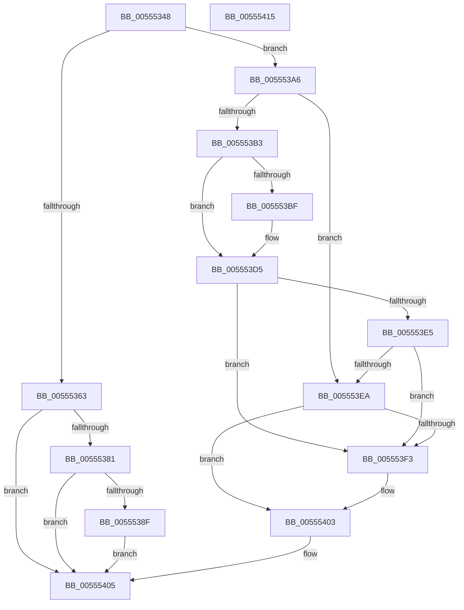

# HalpIommuInitializeDmaGuardPolicy

- RVA: `0x00555348`–`0x00555416` (길이 `206` bytes)
- VA: `0x0000000140555348`
- 실행 섹션: `.text`
- PDB 이름 있음: `예`; PDB Function 태그: `아니요`
- unwind 정보 RVA: `0x0008E1D0`
- 디코드: `49`개 명령, `206/206` bytes 표시
- 미해석 바이트: `0` (있으면 어셈블리에 `.byte`로 보존)

> 이 문서는 커널 이미지의 기계어와 PDB 기호를 분석해 생성했습니다. 4번과 5번은 함수 원형과 자료형을 바이너리 사용 방식에서 추정한 C 해석이며 원본 소스 복구 결과는 아닙니다.

## 1. Dependencies

- 직접 호출 지점: **2**; 고유 호출 대상: **2**
- 직접 호출자로 확인된 함수: **1**
- RIP 상대 이미지 참조: **7**

### Outgoing calls
- `0x00555374` → [guard_dispatch_icall](../6B/guard_dispatch_icall_function_006BAAD0.md) (function, `0x006BAAD0`)
- `0x005553C6` → [strstr](../4F/strstr_function_004FF680.md) (function, `0x004FF680`)

### Direct callers
- [HalpIommuInitSystem](../../pagelk/B5/HalpIommuInitSystem_function_00B5D7E0.md) at `0x00B5D99D`

### Static image references
- `0x00555357` → RVA `0x00FC1710` (`.data`; read)
- `0x00555363` → RVA `0x00FC1E48` (`.data`; read)
- `0x00555385` → RVA `0x00E103E8` (`.data`; write)
- `0x00555394` → RVA `0x00FC1734` (`.data`; write)
- `0x0055539E` → RVA `0x00FC1758` (`.data`; write)
- `0x005553BF` → RVA `0x00024F78` (`.rdata`; read)
- `0x005553EA` → RVA `0x00FC1730` (`.data`; read)

## 2. Other-region calls and transfers

- 다른 실행 섹션으로 향하는 call: **0**
- 별도 외부 분기/꼬리 이동을 확인하지 못했습니다.

## 3. Assembly (complete function range)

```asm
00555348  48 89 5C 24 08                  mov qword ptr [rsp + 8], rbx
0055534D  48 89 74 24 18                  mov qword ptr [rsp + 0x18], rsi
00555352  57                              push rdi
00555353  48 83 EC 20                     sub rsp, 0x20
00555357  80 3D B2 C3 A6 00 00            cmp byte ptr [rip + 0xa6c3b2], 0
0055535E  48 8B F9                        mov rdi, rcx
00555361  74 43                           je 0x1405553a6
00555363  48 8B 05 DE CA A6 00            mov rax, qword ptr [rip + 0xa6cade]
0055536A  48 8D 4C 24 38                  lea rcx, [rsp + 0x38]
0055536F  C6 44 24 38 00                  mov byte ptr [rsp + 0x38], 0
00555374  E8 57 57 16 00                  call 0x1406baad0
00555379  85 C0                           test eax, eax
0055537B  0F 88 84 00 00 00               js 0x140555405
00555381  8A 4C 24 38                     mov cl, byte ptr [rsp + 0x38]
00555385  88 0D 5D B0 8B 00               mov byte ptr [rip + 0x8bb05d], cl
0055538B  84 C9                           test cl, cl
0055538D  74 76                           je 0x140555405
0055538F  BB 01 00 00 00                  mov ebx, 1
00555394  C7 05 96 C3 A6 00 03 00 00 00   mov dword ptr [rip + 0xa6c396], 3
0055539E  89 1D B4 C3 A6 00               mov dword ptr [rip + 0xa6c3b4], ebx
005553A4  EB 5F                           jmp 0x140555405
005553A6  40 32 F6                        xor sil, sil
005553A9  BB 01 00 00 00                  mov ebx, 1
005553AE  48 85 FF                        test rdi, rdi
005553B1  74 37                           je 0x1405553ea
005553B3  48 8B 89 D8 00 00 00            mov rcx, qword ptr [rcx + 0xd8]
005553BA  48 85 C9                        test rcx, rcx
005553BD  74 16                           je 0x1405553d5
005553BF  48 8D 15 B2 FB AC FF            lea rdx, [rip - 0x53044e]
005553C6  E8 B5 A2 FA FF                  call 0x1404ff680
005553CB  48 85 C0                        test rax, rax
005553CE  40 0F B6 F6                     movzx esi, sil
005553D2  0F 45 F3                        cmovne esi, ebx
005553D5  48 8B 87 F0 00 00 00            mov rax, qword ptr [rdi + 0xf0]
005553DC  F6 80 58 0A 00 00 08            test byte ptr [rax + 0xa58], 8
005553E3  75 0E                           jne 0x1405553f3
005553E5  40 84 F6                        test sil, sil
005553E8  75 09                           jne 0x1405553f3
005553EA  80 3D 3F C3 A6 00 00            cmp byte ptr [rip + 0xa6c33f], 0
005553F1  74 10                           je 0x140555403
005553F3  C7 05 37 C3 A6 00 03 00 00 00   mov dword ptr [rip + 0xa6c337], 3
005553FD  89 1D 55 C3 A6 00               mov dword ptr [rip + 0xa6c355], ebx
00555403  33 C0                           xor eax, eax
00555405  48 8B 5C 24 30                  mov rbx, qword ptr [rsp + 0x30]
0055540A  48 8B 74 24 40                  mov rsi, qword ptr [rsp + 0x40]
0055540F  48 83 C4 20                     add rsp, 0x20
00555413  5F                              pop rdi
00555414  C3                              ret
00555415  CC                              int3
```

## 4. C-style interpretation (structured pseudocode)

```c
__int64 __fastcall HalpIommuInitializeDmaGuardPolicy(__int64 a1)
{
    __int64 result;
    __int64 v_rsi;
    __int64 v_rsp;
    unsigned __int64 v_stack_p10;
    unsigned __int64 v_stack_p18;
    unsigned __int64 v_stack_p8;

    v_stack_p8 = v_rbx;
    v_stack_p18 = v_rsi;
    v_rsp = (v_rsp) - (32);
    if ((*(unsigned __int8 *)(v_rip + 10929074)) == 0) goto loc_005553A6;
    v_stack_p10 = 0;
    result = guard_dispatch_icall(v_stack_p10, a2, a3, a4);
    if (sign_flag) goto loc_00555405;
    *(unsigned __int8 *)(v_rip + 9154653) = (unsigned __int8)(v_stack_p10);
    if ((unsigned __int8)(v_stack_p10) == 0) goto loc_00555405;
    *(unsigned int *)(v_rip + 10929046) = 3;
    *(unsigned int *)(v_rip + 10929076) = 1;
    goto loc_00555405;
loc_005553A6:
    v_rsi = 0;
    if (a1 == 0) goto loc_005553EA;
    if (*(unsigned __int64 *)(v_stack_p10 + 216) != 0) {
        a2 = v_rip - 5440590;
        result = strstr(*(unsigned __int64 *)(v_stack_p10 + 216), a2, a3, a4);
        v_rsi = 0;
        if (result != 0) { v_rsi = 1; }
    }
    if (((*(unsigned __int8 *)(*(unsigned __int64 *)(a1 + 240) + 2648)) & (8)) != 0) goto loc_005553F3;
    if ((unsigned __int8)(v_rsi) != 0) goto loc_005553F3;
loc_005553EA:
    if ((*(unsigned __int8 *)(v_rip + 10928959)) != 0) {
        *(unsigned int *)(v_rip + 10928951) = 3;
        *(unsigned int *)(v_rip + 10928981) = 1;
    }
    result = 0;
loc_00555405:
    v_rsp = (v_rsp) + (32);
    return result;
}
```

## 5. (Beta) C Style

```c
int64_t HalpIommuInitializeDmaGuardPolicy(void *Arg1)
{
    uint8_t *arg1 = (uint8_t *)Arg1;

    int64_t result;
    int64_t local_rsi;
    int64_t local_rsp;
    uint64_t v_stack_p10;
    uint64_t v_stack_p18;
    uint64_t v_stack_p8;

    v_stack_p8 = local_rbx;
    v_stack_p18 = local_rsi;
    local_rsp = (local_rsp) - (32);
    if ((*(uint8_t *)(v_rip + 0xA6C3B2)) == 0) goto loc_005553A6;
    v_stack_p10 = 0;
    result = guard_dispatch_icall(v_stack_p10, a2, a3, a4);
    if (sign_flag) goto loc_00555405;
    *(uint8_t *)(v_rip + 0x8BB05D) = (uint8_t)(v_stack_p10);
    if ((uint8_t)(v_stack_p10) == 0) goto loc_00555405;
    *(uint32_t *)(v_rip + 0xA6C396) = 3;
    *(uint32_t *)(v_rip + 0xA6C3B4) = 1;
    goto loc_00555405;
loc_005553A6:
    local_rsi = 0;
    if (Arg1 == NULL) goto loc_005553EA;
    if (*(uint64_t *)(v_stack_p10 + 0xD8) != 0) {
        a2 = v_rip - 5440590;
        result = strstr(*(uint64_t *)(v_stack_p10 + 0xD8), a2, a3, a4);
        local_rsi = 0;
        if (result != 0) { local_rsi = 1; }
    }
    if (((*(uint8_t *)(*(uint64_t *)(arg1 + 0xF0) + 0xA58)) & (8)) != 0) goto loc_005553F3;
    if ((uint8_t)(local_rsi) != 0) goto loc_005553F3;
loc_005553EA:
    if ((*(uint8_t *)(v_rip + 0xA6C33F)) != 0) {
        *(uint32_t *)(v_rip + 0xA6C337) = 3;
        *(uint32_t *)(v_rip + 0xA6C355) = 1;
    }
    result = 0;
loc_00555405:
    local_rsp = (local_rsp) + (32);
    return result;
}
```

### 관측된 메모리 오프셋

구조체 형식이 확인되지 않은 접근은 인자 기준의 오프셋으로만 기록했습니다.

| 기준 인자 | 오프셋 표현 | 폭 (bit) | 접근 |
|---|---:|---:|---|
| `Arg1` | `+ 0xD8` | `64` | `R` |

## 6. Execution-region graph

[열기: 2D/3D 그래프와 함수 탐색 컨트롤 패널](../../../control-panel.html?section=text&rva=0x00555348&view=graph)

- 2D 그래프는 위에서 아래로 흐르고, 3D 그래프는 빈 공간을 드래그해 회전합니다. Shift+드래그는 이동, 휠은 확대·축소, 함수 노드 선택은 대상 보고서 이동입니다.

### Static fallback


