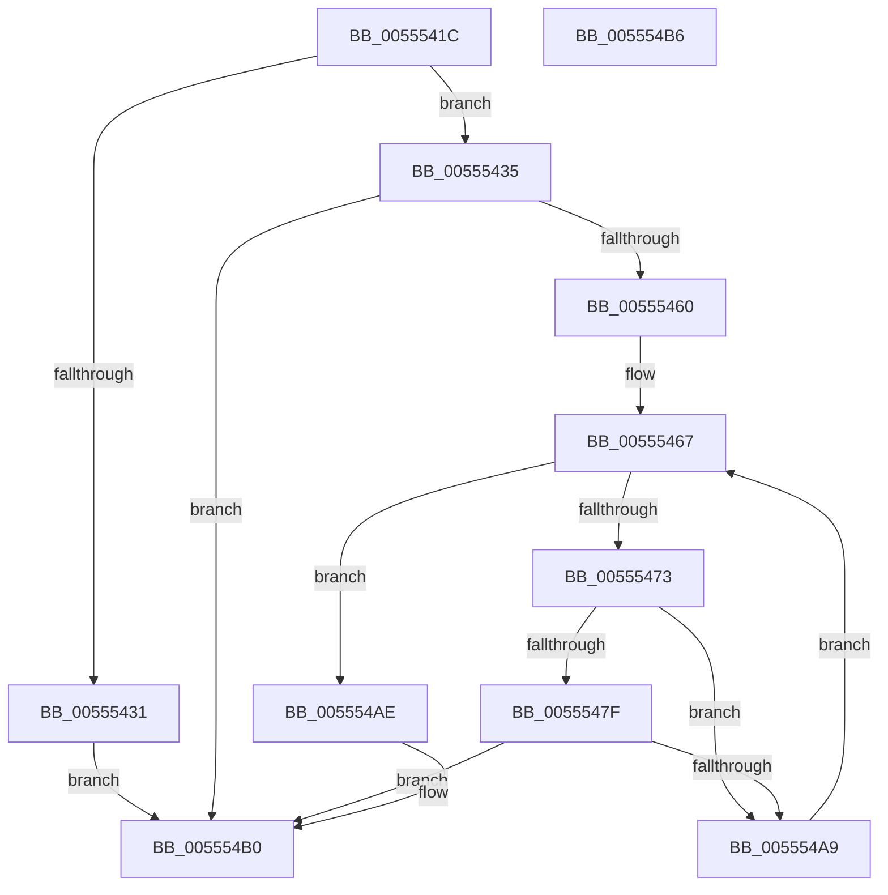

# HalpIommuInitializeDmar

- RVA: `0x0055541C`–`0x005554B7` (길이 `155` bytes)
- VA: `0x000000014055541C`
- 실행 섹션: `.text`
- PDB 이름 있음: `예`; PDB Function 태그: `아니요`
- unwind 정보 RVA: `0x00064C80`
- 디코드: `41`개 명령, `155/155` bytes 표시
- 미해석 바이트: `0` (있으면 어셈블리에 `.byte`로 보존)

> 이 문서는 커널 이미지의 기계어와 PDB 기호를 분석해 생성했습니다. 4번과 5번은 함수 원형과 자료형을 바이너리 사용 방식에서 추정한 C 해석이며 원본 소스 복구 결과는 아닙니다.

## 1. Dependencies

- 직접 호출 지점: **2**; 고유 호출 대상: **2**
- 직접 호출자로 확인된 함수: **1**
- RIP 상대 이미지 참조: **3**

### Outgoing calls
- `0x00555455` → [HalpIommuAllocateDmaDomain](HalpIommuAllocateDmaDomain_function_00554904.md) (function, `0x00554904`)
- `0x0055549E` → [HalpIommuGetHardwareDomain](../4D/HalpIommuGetHardwareDomain_function_004D7BCC.md) (function, `0x004D7BCC`)

### Direct callers
- [HalpIommuInitSystem](../../pagelk/B5/HalpIommuInitSystem_function_00B5D7E0.md) at `0x00B5D88F`

### Static image references
- `0x00555428` → RVA `0x00FC1710` (`.data`; read)
- `0x00555438` → RVA `0x00FC16B0` (`.data`; read)
- `0x00555460` → RVA `0x00FC1740` (`.data`; read)

## 2. Other-region calls and transfers

- 다른 실행 섹션으로 향하는 call: **0**
- 별도 외부 분기/꼬리 이동을 확인하지 못했습니다.

## 3. Assembly (complete function range)

```asm
0055541C  40 53                           push rbx
0055541E  48 83 EC 30                     sub rsp, 0x30
00555422  48 83 64 24 40 00               and qword ptr [rsp + 0x40], 0
00555428  80 3D E1 C2 A6 00 00            cmp byte ptr [rip + 0xa6c2e1], 0
0055542F  74 04                           je 0x140555435
00555431  33 C0                           xor eax, eax
00555433  EB 7B                           jmp 0x1405554b0
00555435  45 33 C9                        xor r9d, r9d
00555438  48 8D 05 71 C2 A6 00            lea rax, [rip + 0xa6c271]
0055543F  48 BA 00 00 00 00 00 00 00 80   movabs rdx, 0x8000000000000000
00555449  48 89 44 24 20                  mov qword ptr [rsp + 0x20], rax
0055544E  45 33 C0                        xor r8d, r8d
00555451  41 8D 49 01                     lea ecx, [r9 + 1]
00555455  E8 AA F4 FF FF                  call 0x140554904
0055545A  8B C8                           mov ecx, eax
0055545C  85 C0                           test eax, eax
0055545E  78 50                           js 0x1405554b0
00555460  48 8B 1D D9 C2 A6 00            mov rbx, qword ptr [rip + 0xa6c2d9]
00555467  48 8D 05 D2 C2 A6 00            lea rax, [rip + 0xa6c2d2]
0055546E  48 3B D8                        cmp rbx, rax
00555471  74 3B                           je 0x1405554ae
00555473  F7 83 D8 01 00 00 80 01 00 00   test dword ptr [rbx + 0x1d8], 0x180
0055547D  74 2A                           je 0x1405554a9
0055547F  48 8B 0D 2A C2 A6 00            mov rcx, qword ptr [rip + 0xa6c22a]
00555486  48 8D 44 24 40                  lea rax, [rsp + 0x40]
0055548B  48 89 44 24 28                  mov qword ptr [rsp + 0x28], rax
00555490  45 33 C9                        xor r9d, r9d
00555493  41 B0 01                        mov r8b, 1
00555496  C6 44 24 20 00                  mov byte ptr [rsp + 0x20], 0
0055549B  48 8B D3                        mov rdx, rbx
0055549E  E8 29 27 F8 FF                  call 0x1404d7bcc
005554A3  8B C8                           mov ecx, eax
005554A5  85 C0                           test eax, eax
005554A7  78 07                           js 0x1405554b0
005554A9  48 8B 1B                        mov rbx, qword ptr [rbx]
005554AC  EB B9                           jmp 0x140555467
005554AE  8B C1                           mov eax, ecx
005554B0  48 83 C4 30                     add rsp, 0x30
005554B4  5B                              pop rbx
005554B5  C3                              ret
005554B6  CC                              int3
```

## 4. C-style interpretation (structured pseudocode)

```c
__int64 __fastcall HalpIommuInitializeDmar(__int64 a1, __int64 a2, int a3, int a4)
{
    __int64 result;
    __int64 v_rsp;
    unsigned __int64 v_stack_m10;
    unsigned __int64 v_stack_m18;
    unsigned __int64 v_stack_p8;

    v_rsp = (v_rsp) - (48);
    if ((*(unsigned __int8 *)(v_rip + 10928865)) == 0) goto loc_00555435;
    result = 0;
    goto loc_005554B0;
loc_00555435:
    a4 = 0;
    v_stack_m18 = v_rip + 10928753;
    a3 = 0;
    result = HalpIommuAllocateDmaDomain(a4 + 1, a2, a3, a4);
    if (sign_flag) goto loc_005554B0;
loc_00555467:
    if ((*(unsigned __int64 *)(v_rip + 10928857)) == (v_rip + 10928850)) goto loc_005554AE;
    if (((*(unsigned int *)(*(unsigned __int64 *)(v_rip + 10928857) + 472)) & (384)) == 0) goto loc_005554A9;
    v_stack_m10 = v_stack_p8;
    a4 = 0;
    v_stack_m18 = 0;
    result = HalpIommuGetHardwareDomain(*(unsigned __int64 *)(v_rip + 10928682), *(unsigned __int64 *)(v_rip + 10928857), 1, a4);
    if (sign_flag) goto loc_005554B0;
loc_005554A9:
    goto loc_00555467;
loc_005554AE:
loc_005554B0:
    v_rsp = (v_rsp) + (48);
    return (unsigned int)((unsigned int)((unsigned int)((unsigned int)(result))));
}
```

## 5. (Beta) C Style

```c
int64_t HalpIommuInitializeDmar(int64_t Arg1, int64_t Arg2, int32_t Arg3, int32_t Arg4)
{
    int64_t result;
    int64_t local_rsp;
    uint64_t v_stack_m10;
    uint64_t v_stack_m18;
    uint64_t v_stack_p8;

    local_rsp = (local_rsp) - (48);
    if ((*(uint8_t *)(v_rip + 0xA6C2E1)) == 0) goto loc_00555435;
    result = 0;
    goto loc_005554B0;
loc_00555435:
    Arg4 = 0;
    v_stack_m18 = v_rip + 10928753;
    Arg3 = 0;
    result = HalpIommuAllocateDmaDomain(Arg4 + 1, Arg2, Arg3, Arg4);
    if (sign_flag) goto loc_005554B0;
loc_00555467:
    if ((*(uint64_t *)(v_rip + 0xA6C2D9)) == (v_rip + 10928850)) goto loc_005554AE;
    if (((*(uint32_t *)(*(uint64_t *)(v_rip + 0xA6C2D9) + 0x1D8)) & (384)) == 0) goto loc_005554A9;
    v_stack_m10 = v_stack_p8;
    Arg4 = 0;
    v_stack_m18 = 0;
    result = HalpIommuGetHardwareDomain(*(uint64_t *)(v_rip + 0xA6C22A), *(uint64_t *)(v_rip + 0xA6C2D9), 1, Arg4);
    if (sign_flag) goto loc_005554B0;
loc_005554A9:
    goto loc_00555467;
loc_005554AE:
loc_005554B0:
    local_rsp = (local_rsp) + (48);
    return (uint32_t)((uint32_t)((uint32_t)((uint32_t)(result))));
}
```

## 6. Execution-region graph

[열기: 2D/3D 그래프와 함수 탐색 컨트롤 패널](../../../control-panel.html?section=text&rva=0x0055541C&view=graph)

- 2D 그래프는 위에서 아래로 흐르고, 3D 그래프는 빈 공간을 드래그해 회전합니다. Shift+드래그는 이동, 휠은 확대·축소, 함수 노드 선택은 대상 보고서 이동입니다.

### Static fallback


