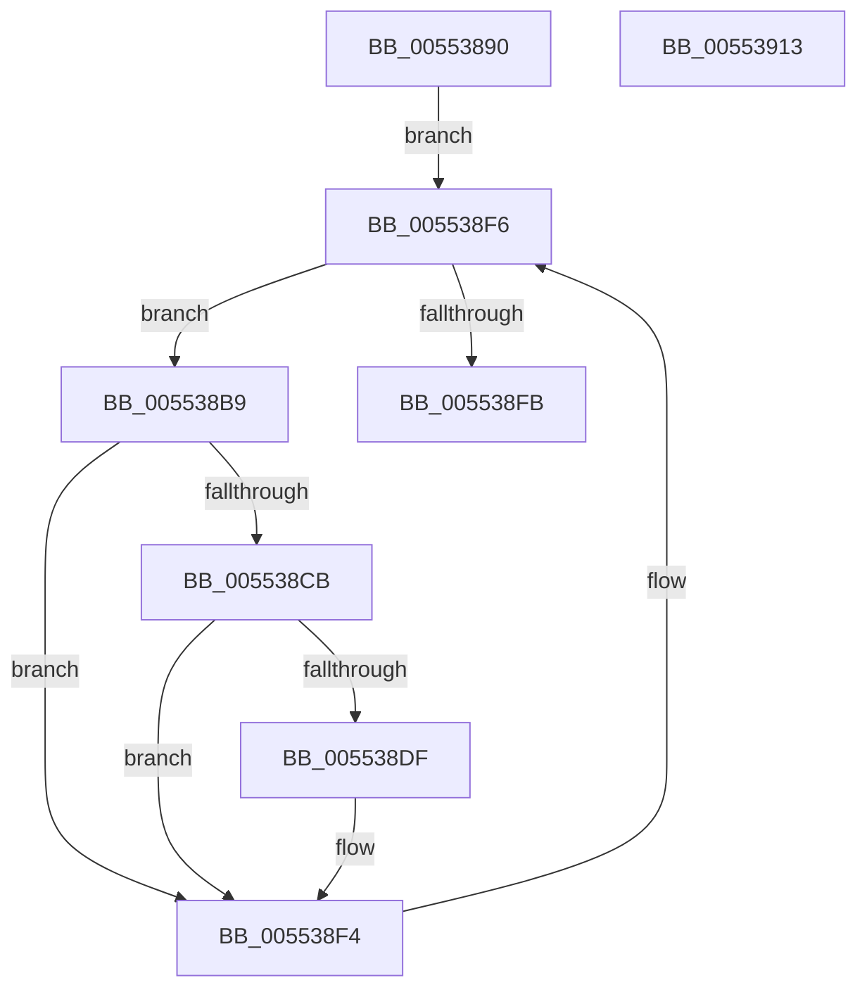

# HalpIommuInterruptRoutine

- RVA: `0x00553890`–`0x00553914` (길이 `132` bytes)
- VA: `0x0000000140553890`
- 실행 섹션: `.text`
- PDB 이름 있음: `예`; PDB Function 태그: `아니요`
- unwind 정보 RVA: `0x0005C954`
- 디코드: `35`개 명령, `132/132` bytes 표시
- 미해석 바이트: `0` (있으면 어셈블리에 `.byte`로 보존)

> 이 문서는 커널 이미지의 기계어와 PDB 기호를 분석해 생성했습니다. 4번과 5번은 함수 원형과 자료형을 바이너리 사용 방식에서 추정한 C 해석이며 원본 소스 복구 결과는 아닙니다.

## 1. Dependencies

- 직접 호출 지점: **2**; 고유 호출 대상: **1**
- 직접 호출자로 확인된 함수: **0**
- RIP 상대 이미지 참조: **2**

### Outgoing calls
- `0x005538D6` → [guard_dispatch_icall](../6B/guard_dispatch_icall_function_006BAAD0.md) (function, `0x006BAAD0`)
- `0x005538EF` → [guard_dispatch_icall](../6B/guard_dispatch_icall_function_006BAAD0.md) (function, `0x006BAAD0`)

### Direct callers
- 이 함수 시작 RVA로 연결되는 직접 call은 확인되지 않았습니다. 간접 호출은 완전히 역산할 수 없습니다.

### Static image references
- `0x005538A4` → RVA `0x00FC1740` (`.data`; read)
- `0x005538DF` → RVA `0x00E06D28` (`.data`; read)

## 2. Other-region calls and transfers

- 다른 실행 섹션으로 향하는 call: **0**
- 별도 외부 분기/꼬리 이동을 확인하지 못했습니다.

## 3. Assembly (complete function range)

```asm
00553890  48 89 5C 24 08                  mov qword ptr [rsp + 8], rbx
00553895  48 89 6C 24 10                  mov qword ptr [rsp + 0x10], rbp
0055389A  48 89 74 24 18                  mov qword ptr [rsp + 0x18], rsi
0055389F  57                              push rdi
005538A0  48 83 EC 20                     sub rsp, 0x20
005538A4  48 8B 1D 95 DE A6 00            mov rbx, qword ptr [rip + 0xa6de95]
005538AB  48 8D 2D 8E DE A6 00            lea rbp, [rip + 0xa6de8e]
005538B2  33 FF                           xor edi, edi
005538B4  40 32 F6                        xor sil, sil
005538B7  EB 3D                           jmp 0x1405538f6
005538B9  48 8D 0B                        lea rcx, [rbx]
005538BC  48 8B 1B                        mov rbx, qword ptr [rbx]
005538BF  F7 81 D8 01 00 00 20 01 00 00   test dword ptr [rcx + 0x1d8], 0x120
005538C9  74 29                           je 0x1405538f4
005538CB  48 8B 81 30 01 00 00            mov rax, qword ptr [rcx + 0x130]
005538D2  48 8B 49 10                     mov rcx, qword ptr [rcx + 0x10]
005538D6  E8 F5 71 16 00                  call 0x1406baad0
005538DB  84 C0                           test al, al
005538DD  74 15                           je 0x1405538f4
005538DF  48 8B 0D 42 34 8B 00            mov rcx, qword ptr [rip + 0x8b3442]
005538E6  40 B6 01                        mov sil, 1
005538E9  48 8B 41 60                     mov rax, qword ptr [rcx + 0x60]
005538ED  8B CF                           mov ecx, edi
005538EF  E8 DC 71 16 00                  call 0x1406baad0
005538F4  FF C7                           inc edi
005538F6  48 3B DD                        cmp rbx, rbp
005538F9  75 BE                           jne 0x1405538b9
005538FB  48 8B 5C 24 30                  mov rbx, qword ptr [rsp + 0x30]
00553900  40 8A C6                        mov al, sil
00553903  48 8B 74 24 40                  mov rsi, qword ptr [rsp + 0x40]
00553908  48 8B 6C 24 38                  mov rbp, qword ptr [rsp + 0x38]
0055390D  48 83 C4 20                     add rsp, 0x20
00553911  5F                              pop rdi
00553912  C3                              ret
00553913  CC                              int3
```

## 4. C-style interpretation (structured pseudocode)

```c
__int64 __fastcall HalpIommuInterruptRoutine(void)
{
    __int64 result;
    __int64 v_rdi;
    __int64 v_rsi;
    __int64 v_rsp;
    unsigned __int64 v_stack_p10;
    unsigned __int64 v_stack_p18;
    unsigned __int64 v_stack_p8;

    v_stack_p8 = v_rbx;
    v_stack_p10 = v_rbp;
    v_stack_p18 = v_rsi;
    v_rsp = (v_rsp) - (32);
    v_rdi = 0;
    v_rsi = 0;
    goto loc_005538F6;
loc_005538B9:
    if (((*(unsigned int *)(*(unsigned __int64 *)(v_rip + 10935957) + 472)) & (288)) == 0) goto loc_005538F4;
    result = guard_dispatch_icall(*(unsigned __int64 *)(*(unsigned __int64 *)(v_rip + 10935957) + 16), a2, a3, a4);
    if ((unsigned __int8)(result) != 0) {
        a1 = *(unsigned __int64 *)(v_rip + 9122882);
        v_rsi = 1;
        result = *(unsigned __int64 *)(a1 + 96);
        a1 = 0;
        result = guard_dispatch_icall(a1, a2, a3, a4);
    }
    v_rdi = (unsigned int)((v_rdi) + 1);
loc_005538F6:
    if ((*(unsigned __int64 *)(*(unsigned __int64 *)(v_rip + 10935957))) != (v_rip + 10935950)) goto loc_005538B9;
    v_rsp = (v_rsp) + (32);
    return (unsigned __int8)(v_rsi);
}
```

## 5. (Beta) C Style

```c
void HalpIommuInterruptRoutine(void)
{
    int64_t result;
    int64_t local_rdi;
    int64_t local_rsi;
    int64_t local_rsp;
    uint64_t v_stack_p10;
    uint64_t v_stack_p18;
    uint64_t v_stack_p8;

    v_stack_p8 = local_rbx;
    v_stack_p10 = local_rbp;
    v_stack_p18 = local_rsi;
    local_rsp = (local_rsp) - (32);
    local_rdi = 0;
    local_rsi = 0;
    goto loc_005538F6;
loc_005538B9:
    if (((*(uint32_t *)(*(uint64_t *)(v_rip + 0xA6DE95) + 0x1D8)) & (288)) == 0) goto loc_005538F4;
    result = guard_dispatch_icall(*(uint64_t *)(*(uint64_t *)(v_rip + 0xA6DE95) + 0x10), a2, a3, a4);
    if ((uint8_t)(result) != 0) {
        a1 = *(uint64_t *)(v_rip + 0x8B3442);
        local_rsi = 1;
        result = *(uint64_t *)(a1 + 0x60);
        a1 = 0;
        result = guard_dispatch_icall(a1, a2, a3, a4);
    }
    local_rdi = (uint32_t)((local_rdi) + 1);
loc_005538F6:
    if ((*(uint64_t *)(*(uint64_t *)(v_rip + 0xA6DE95))) != (v_rip + 10935950)) goto loc_005538B9;
    local_rsp = (local_rsp) + (32);
    return (uint8_t)(local_rsi);
}
```

## 6. Execution-region graph

[열기: 2D/3D 그래프와 함수 탐색 컨트롤 패널](../../../control-panel.html?section=text&rva=0x00553890&view=graph)

- 2D 그래프는 위에서 아래로 흐르고, 3D 그래프는 빈 공간을 드래그해 회전합니다. Shift+드래그는 이동, 휠은 확대·축소, 함수 노드 선택은 대상 보고서 이동입니다.

### Static fallback


