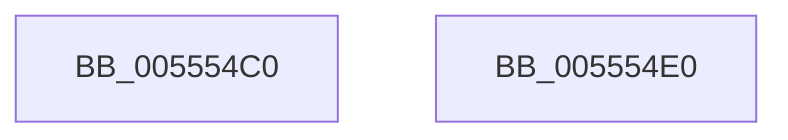

# HalpIommuIsDmarStageCompatible

- RVA: `0x005554C0`–`0x005554E1` (길이 `33` bytes)
- VA: `0x00000001405554C0`
- 실행 섹션: `.text`
- PDB 이름 있음: `예`; PDB Function 태그: `아니요`
- unwind 정보 RVA: `0x000DB714`
- 디코드: `10`개 명령, `33/33` bytes 표시
- 미해석 바이트: `0` (있으면 어셈블리에 `.byte`로 보존)

> 이 문서는 커널 이미지의 기계어와 PDB 기호를 분석해 생성했습니다. 4번과 5번은 함수 원형과 자료형을 바이너리 사용 방식에서 추정한 C 해석이며 원본 소스 복구 결과는 아닙니다.

## 1. Dependencies

- 직접 호출 지점: **0**; 고유 호출 대상: **0**
- 직접 호출자로 확인된 함수: **1**
- RIP 상대 이미지 참조: **0**

### Outgoing calls
- 직접 디코드된 call 명령이 없습니다.

### Direct callers
- [IommupDeviceEnablePasidTaggedDma](../../page/70/IommupDeviceEnablePasidTaggedDma_function_00708B74.md) at `0x00708C70`

### Static image references
- 디코드된 RIP-relative 메모리 참조가 없습니다.

## 2. Other-region calls and transfers

- 다른 실행 섹션으로 향하는 call: **0**
- 별도 외부 분기/꼬리 이동을 확인하지 못했습니다.

## 3. Assembly (complete function range)

```asm
005554C0  8B 81 D8 01 00 00               mov eax, dword ptr [rcx + 0x1d8]
005554C6  F6 DA                           neg dl
005554C8  45 1B C0                        sbb r8d, r8d
005554CB  41 83 E0 80                     and r8d, 0xffffff80
005554CF  41 81 C0 00 01 00 00            add r8d, 0x100
005554D6  41 23 C0                        and eax, r8d
005554D9  41 3B C0                        cmp eax, r8d
005554DC  0F 94 C0                        sete al
005554DF  C3                              ret
005554E0  CC                              int3
```

## 4. C-style interpretation (structured pseudocode)

```c
__int64 __fastcall HalpIommuIsDmarStageCompatible(__int64 a1, unsigned __int8 a2, int a3)
{
    __int64 result;

    a2 = (unsigned __int8)(-(a2));
    a3 = (unsigned int)((a3) & (0xFFFFFF80ULL));
    a3 = (unsigned int)((a3) + (256));
    result = (unsigned int)(((unsigned int)(*(unsigned int *)(a1 + 472))) & (a3));
    result = (((unsigned int)(result)) == a3) ? 1 : 0;
    return result;
}
```

## 5. (Beta) C Style

```c
int64_t HalpIommuIsDmarStageCompatible(void *Arg1, uint8_t Arg2, int32_t Arg3)
{
    uint8_t *arg1 = (uint8_t *)Arg1;

    int64_t result;

    Arg2 = (uint8_t)(-(Arg2));
    Arg3 = (uint32_t)((Arg3) & (0xFFFFFF80ULL));
    Arg3 = (uint32_t)((Arg3) + (256));
    result = (uint32_t)(((uint32_t)(*(uint32_t *)(arg1 + 0x1D8))) & (Arg3));
    result = (((uint32_t)(result)) == Arg3) ? 1 : 0;
    return result;
}
```

### 관측된 메모리 오프셋

구조체 형식이 확인되지 않은 접근은 인자 기준의 오프셋으로만 기록했습니다.

| 기준 인자 | 오프셋 표현 | 폭 (bit) | 접근 |
|---|---:|---:|---|
| `Arg1` | `+ 0x1D8` | `32` | `R` |

## 6. Execution-region graph

[열기: 2D/3D 그래프와 함수 탐색 컨트롤 패널](../../../control-panel.html?section=text&rva=0x005554C0&view=graph)

- 2D 그래프는 위에서 아래로 흐르고, 3D 그래프는 빈 공간을 드래그해 회전합니다. Shift+드래그는 이동, 휠은 확대·축소, 함수 노드 선택은 대상 보고서 이동입니다.

### Static fallback


