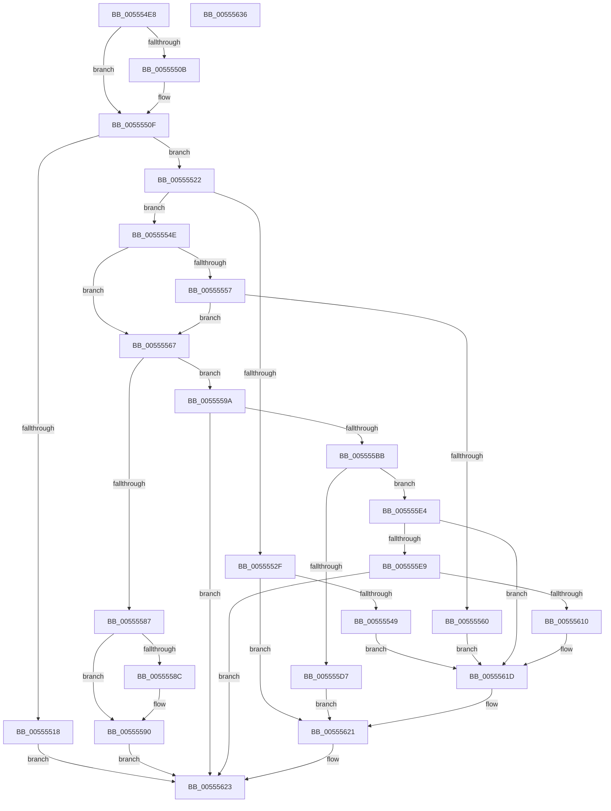

# HalpIommuJoinDmaDomain

- RVA: `0x005554E8`–`0x00555637` (길이 `335` bytes)
- VA: `0x00000001405554E8`
- 실행 섹션: `.text`
- PDB 이름 있음: `예`; PDB Function 태그: `아니요`
- unwind 정보 RVA: `0x000B8D7C`
- 디코드: `96`개 명령, `335/335` bytes 표시
- 미해석 바이트: `0` (있으면 어셈블리에 `.byte`로 보존)

> 이 문서는 커널 이미지의 기계어와 PDB 기호를 분석해 생성했습니다. 4번과 5번은 함수 원형과 자료형을 바이너리 사용 방식에서 추정한 C 해석이며 원본 소스 복구 결과는 아닙니다.

## 1. Dependencies

- 직접 호출 지점: **7**; 고유 호출 대상: **5**
- 직접 호출자로 확인된 함수: **3**
- RIP 상대 이미지 참조: **2**

### Outgoing calls
- `0x0055553A` → [IommupHvAttachDeviceDomain](../56/IommupHvAttachDeviceDomain_function_00566ABC.md) (function, `0x00566ABC`)
- `0x00555557` → [HalpIommuIsInPermanentPassthrough](../4F/HalpIommuIsInPermanentPassthrough_function_004FC31C.md) (function, `0x004FC31C`)
- `0x005555B2` → [HalpIommuGetHardwareDomain](../4D/HalpIommuGetHardwareDomain_function_004D7BCC.md) (function, `0x004D7BCC`)
- `0x005555CC` → [HalpIommuAttachDeviceDomain](HalpIommuAttachDeviceDomain_function_00553418.md) (function, `0x00553418`)
- `0x005555DD` → [HalpIommuDereferenceHardwareDomain](HalpIommuDereferenceHardwareDomain_function_00554E58.md) (function, `0x00554E58`)
- `0x00555605` → [HalpIommuGetHardwareDomain](../4D/HalpIommuGetHardwareDomain_function_004D7BCC.md) (function, `0x004D7BCC`)
- `0x00555618` → [HalpIommuDereferenceHardwareDomain](HalpIommuDereferenceHardwareDomain_function_00554E58.md) (function, `0x00554E58`)

### Direct callers
- [HalpIommuUnblockDevice](../4C/HalpIommuUnblockDevice_function_004C6250.md) at `0x004C63BE`
- [IommuDomainAttachDevice](../56/IommuDomainAttachDevice_function_00567960.md) at `0x00567A29`
- [IommuDomainAttachDeviceEx](../56/IommuDomainAttachDeviceEx_function_00567B60.md) at `0x00567BDE`

### Static image references
- `0x00555522` → RVA `0x00FC1710` (`.data`; read)
- `0x0055554E` → RVA `0x00FC16B0` (`.data`; read)

## 2. Other-region calls and transfers

- 다른 실행 섹션으로 향하는 call: **0**
- 별도 외부 분기/꼬리 이동을 확인하지 못했습니다.

## 3. Assembly (complete function range)

```asm
005554E8  48 89 5C 24 10                  mov qword ptr [rsp + 0x10], rbx
005554ED  48 89 6C 24 18                  mov qword ptr [rsp + 0x18], rbp
005554F2  56                              push rsi
005554F3  57                              push rdi
005554F4  41 56                           push r14
005554F6  48 83 EC 30                     sub rsp, 0x30
005554FA  48 83 64 24 50 00               and qword ptr [rsp + 0x50], 0
00555500  48 8B F2                        mov rsi, rdx
00555503  48 8B F9                        mov rdi, rcx
00555506  4D 85 C0                        test r8, r8
00555509  74 04                           je 0x14055550f
0055550B  41 C6 00 00                     mov byte ptr [r8], 0
0055550F  83 B9 88 01 00 00 01            cmp dword ptr [rcx + 0x188], 1
00555516  75 0A                           jne 0x140555522
00555518  B8 BB 00 00 C0                  mov eax, 0xc00000bb
0055551D  E9 01 01 00 00                  jmp 0x140555623
00555522  80 3D E7 C1 A6 00 00            cmp byte ptr [rip + 0xa6c1e7], 0
00555529  48 8B 69 18                     mov rbp, qword ptr [rcx + 0x18]
0055552D  74 1F                           je 0x14055554e
0055552F  44 8A 42 34                     mov r8b, byte ptr [rdx + 0x34]
00555533  8B 52 30                        mov edx, dword ptr [rdx + 0x30]
00555536  48 8B 49 20                     mov rcx, qword ptr [rcx + 0x20]
0055553A  E8 7D 15 01 00                  call 0x140566abc
0055553F  8B D8                           mov ebx, eax
00555541  85 C0                           test eax, eax
00555543  0F 88 D8 00 00 00               js 0x140555621
00555549  E9 CF 00 00 00                  jmp 0x14055561d
0055554E  48 3B 35 5B C1 A6 00            cmp rsi, qword ptr [rip + 0xa6c15b]
00555555  74 10                           je 0x140555567
00555557  E8 C0 6D FA FF                  call 0x1404fc31c
0055555C  84 C0                           test al, al
0055555E  74 07                           je 0x140555567
00555560  33 DB                           xor ebx, ebx
00555562  E9 B6 00 00 00                  jmp 0x14055561d
00555567  8A 42 34                        mov al, byte ptr [rdx + 0x34]
0055556A  48 8B 57 20                     mov rdx, qword ptr [rdi + 0x20]
0055556E  F6 D8                           neg al
00555570  1B C9                           sbb ecx, ecx
00555572  83 E1 80                        and ecx, 0xffffff80
00555575  8B 82 D8 01 00 00               mov eax, dword ptr [rdx + 0x1d8]
0055557B  81 C1 00 01 00 00               add ecx, 0x100
00555581  23 C1                           and eax, ecx
00555583  3B C1                           cmp eax, ecx
00555585  74 13                           je 0x14055559a
00555587  4D 85 C0                        test r8, r8
0055558A  74 04                           je 0x140555590
0055558C  41 80 08 01                     or byte ptr [r8], 1
00555590  B8 30 00 00 C0                  mov eax, 0xc0000030
00555595  E9 89 00 00 00                  jmp 0x140555623
0055559A  48 8D 44 24 50                  lea rax, [rsp + 0x50]
0055559F  41 B1 01                        mov r9b, 1
005555A2  48 89 44 24 28                  mov qword ptr [rsp + 0x28], rax
005555A7  45 8A C1                        mov r8b, r9b
005555AA  48 8B CE                        mov rcx, rsi
005555AD  C6 44 24 20 00                  mov byte ptr [rsp + 0x20], 0
005555B2  E8 15 26 F8 FF                  call 0x1404d7bcc
005555B7  85 C0                           test eax, eax
005555B9  78 68                           js 0x140555623
005555BB  4C 8B 74 24 50                  mov r14, qword ptr [rsp + 0x50]
005555C0  48 8B 57 28                     mov rdx, qword ptr [rdi + 0x28]
005555C4  48 8B 4F 20                     mov rcx, qword ptr [rdi + 0x20]
005555C8  4D 8D 46 20                     lea r8, [r14 + 0x20]
005555CC  E8 47 DE FF FF                  call 0x140553418
005555D1  8B D8                           mov ebx, eax
005555D3  85 C0                           test eax, eax
005555D5  79 0D                           jns 0x1405555e4
005555D7  49 8B D6                        mov rdx, r14
005555DA  48 8B CE                        mov rcx, rsi
005555DD  E8 76 F8 FF FF                  call 0x140554e58
005555E2  EB 3D                           jmp 0x140555621
005555E4  48 85 ED                        test rbp, rbp
005555E7  74 34                           je 0x14055561d
005555E9  48 8B 57 20                     mov rdx, qword ptr [rdi + 0x20]
005555ED  48 8D 44 24 50                  lea rax, [rsp + 0x50]
005555F2  48 89 44 24 28                  mov qword ptr [rsp + 0x28], rax
005555F7  45 33 C9                        xor r9d, r9d
005555FA  45 33 C0                        xor r8d, r8d
005555FD  C6 44 24 20 00                  mov byte ptr [rsp + 0x20], 0
00555602  48 8B CD                        mov rcx, rbp
00555605  E8 C2 25 F8 FF                  call 0x1404d7bcc
0055560A  8B D8                           mov ebx, eax
0055560C  85 C0                           test eax, eax
0055560E  78 13                           js 0x140555623
00555610  48 8B 54 24 50                  mov rdx, qword ptr [rsp + 0x50]
00555615  48 8B CD                        mov rcx, rbp
00555618  E8 3B F8 FF FF                  call 0x140554e58
0055561D  48 89 77 18                     mov qword ptr [rdi + 0x18], rsi
00555621  8B C3                           mov eax, ebx
00555623  48 8B 5C 24 58                  mov rbx, qword ptr [rsp + 0x58]
00555628  48 8B 6C 24 60                  mov rbp, qword ptr [rsp + 0x60]
0055562D  48 83 C4 30                     add rsp, 0x30
00555631  41 5E                           pop r14
00555633  5F                              pop rdi
00555634  5E                              pop rsi
00555635  C3                              ret
00555636  CC                              int3
```

## 4. C-style interpretation (structured pseudocode)

```c
__int64 __fastcall HalpIommuJoinDmaDomain(__int64 a1, __int64 a2, __int64 a3)
{
    __int64 result;
    __int64 v_rbx;
    __int64 v_rsp;
    unsigned __int64 v_stack_m20;
    unsigned __int8 v_stack_m28;
    unsigned __int64 v_stack_p10;
    unsigned __int64 v_stack_p18;
    unsigned __int64 v_stack_p8;

    v_stack_p10 = v_rbx;
    v_stack_p18 = v_rbp;
    v_rsp = (v_rsp) - (48);
    if (a3 != 0) {
        *(unsigned __int8 *)(a3) = 0;
    }
    if ((*(unsigned int *)(a1 + 392)) != 1) goto loc_00555522;
    goto loc_00555623;
loc_00555522:
    if ((*(unsigned __int8 *)(v_rip + 10928615)) == 0) goto loc_0055554E;
    result = IommupHvAttachDeviceDomain(*(unsigned __int64 *)(a1 + 32), (unsigned int)(*(unsigned int *)(a2 + 48)), *(unsigned __int8 *)(a2 + 52), a4);
    if (sign_flag) goto loc_00555621;
    goto loc_0055561D;
loc_0055554E:
    if (a2 == (*(unsigned __int64 *)(v_rip + 10928475))) goto loc_00555567;
    result = HalpIommuIsInPermanentPassthrough(*(unsigned __int64 *)(a1 + 32), (unsigned int)(*(unsigned int *)(a2 + 48)), *(unsigned __int8 *)(a2 + 52), a4);
    if ((unsigned __int8)(result) == 0) goto loc_00555567;
    v_rbx = 0;
    goto loc_0055561D;
loc_00555567:
    result = (unsigned __int8)(-(*(unsigned __int8 *)((unsigned int)(*(unsigned int *)(a2 + 48)) + 52)));
    a1 = (unsigned int)((*(unsigned __int64 *)(a1 + 32)) & (0xFFFFFF80ULL));
    a1 = (unsigned int)((a1) + (256));
    result = (unsigned int)(((unsigned int)(*(unsigned int *)(*(unsigned __int64 *)(a1 + 32) + 472))) & ((unsigned int)(a1)));
    if (((unsigned int)(result)) == ((unsigned int)(a1))) goto loc_0055559A;
    if (*(unsigned __int8 *)(a2 + 52) != 0) {
    }
    goto loc_00555623;
loc_0055559A:
    v_stack_m20 = v_stack_p8;
    v_stack_m28 = 0;
    result = HalpIommuGetHardwareDomain(a2, *(unsigned __int64 *)(a1 + 32), 1, 1);
    if (sign_flag) goto loc_00555623;
    result = HalpIommuAttachDeviceDomain(*(unsigned __int64 *)(a1 + 32), *(unsigned __int64 *)(a1 + 40), v_stack_p8 + 32, 1);
    if (!sign_flag) goto loc_005555E4;
    result = HalpIommuDereferenceHardwareDomain(a2, v_stack_p8, v_stack_p8 + 32, 1);
    goto loc_00555621;
loc_005555E4:
    if (*(unsigned __int64 *)(a1 + 24) == 0) goto loc_0055561D;
    v_stack_m20 = v_stack_p8;
    a4 = 0;
    a3 = 0;
    v_stack_m28 = 0;
    result = HalpIommuGetHardwareDomain(*(unsigned __int64 *)(a1 + 24), *(unsigned __int64 *)(a1 + 32), a3, a4);
    if (sign_flag) goto loc_00555623;
    result = HalpIommuDereferenceHardwareDomain(*(unsigned __int64 *)(a1 + 24), v_stack_p8, a3, a4);
loc_0055561D:
    *(unsigned __int64 *)(a1 + 24) = a2;
loc_00555621:
loc_00555623:
    v_rsp = (v_rsp) + (48);
    return (unsigned int)((unsigned int)((unsigned int)((unsigned int)(result))));
}
```

## 5. (Beta) C Style

```c
int64_t HalpIommuJoinDmaDomain(void *Arg1, void *Arg2, int64_t Arg3)
{
    uint8_t *arg1 = (uint8_t *)Arg1;
    uint8_t *arg2 = (uint8_t *)Arg2;

    int64_t result;
    int64_t local_rbx;
    int64_t local_rsp;
    uint64_t v_stack_m20;
    uint8_t v_stack_m28;
    uint64_t v_stack_p10;
    uint64_t v_stack_p18;
    uint64_t v_stack_p8;

    v_stack_p10 = local_rbx;
    v_stack_p18 = local_rbp;
    local_rsp = (local_rsp) - (48);
    if (Arg3 != 0) {
        *(uint8_t *)(Arg3) = 0;
    }
    if ((*(uint32_t *)(arg1 + 0x188)) != 1) goto loc_00555522;
    goto loc_00555623;
loc_00555522:
    if ((*(uint8_t *)(v_rip + 0xA6C1E7)) == 0) goto loc_0055554E;
    result = IommupHvAttachDeviceDomain(*(uint64_t *)(arg1 + 0x20), (uint32_t)(*(uint32_t *)(arg2 + 0x30)), *(uint8_t *)(arg2 + 0x34), a4);
    if (sign_flag) goto loc_00555621;
    goto loc_0055561D;
loc_0055554E:
    if (Arg2 == (*(uint64_t *)(v_rip + 0xA6C15B))) goto loc_00555567;
    result = HalpIommuIsInPermanentPassthrough(*(uint64_t *)(arg1 + 0x20), (uint32_t)(*(uint32_t *)(arg2 + 0x30)), *(uint8_t *)(arg2 + 0x34), a4);
    if ((uint8_t)(result) == 0) goto loc_00555567;
    local_rbx = 0;
    goto loc_0055561D;
loc_00555567:
    result = (uint8_t)(-(*(uint8_t *)((uint32_t)(*(uint32_t *)(arg2 + 0x30)) + 0x34)));
    Arg1 = (uint32_t)((*(uint64_t *)(arg1 + 0x20)) & (0xFFFFFF80ULL));
    Arg1 = (uint32_t)((Arg1) + (256));
    result = (uint32_t)(((uint32_t)(*(uint32_t *)(*(uint64_t *)(arg1 + 0x20) + 0x1D8))) & ((uint32_t)(Arg1)));
    if (((uint32_t)(result)) == ((uint32_t)(Arg1))) goto loc_0055559A;
    if (*(uint8_t *)(arg2 + 0x34) != 0) {
    }
    goto loc_00555623;
loc_0055559A:
    v_stack_m20 = v_stack_p8;
    v_stack_m28 = 0;
    result = HalpIommuGetHardwareDomain(Arg2, *(uint64_t *)(arg1 + 0x20), 1, 1);
    if (sign_flag) goto loc_00555623;
    result = HalpIommuAttachDeviceDomain(*(uint64_t *)(arg1 + 0x20), *(uint64_t *)(arg1 + 0x28), v_stack_p8 + 32, 1);
    if (!sign_flag) goto loc_005555E4;
    result = HalpIommuDereferenceHardwareDomain(Arg2, v_stack_p8, v_stack_p8 + 32, 1);
    goto loc_00555621;
loc_005555E4:
    if (*(uint64_t *)(arg1 + 0x18) == 0) goto loc_0055561D;
    v_stack_m20 = v_stack_p8;
    a4 = 0;
    Arg3 = 0;
    v_stack_m28 = 0;
    result = HalpIommuGetHardwareDomain(*(uint64_t *)(arg1 + 0x18), *(uint64_t *)(arg1 + 0x20), Arg3, a4);
    if (sign_flag) goto loc_00555623;
    result = HalpIommuDereferenceHardwareDomain(*(uint64_t *)(arg1 + 0x18), v_stack_p8, Arg3, a4);
loc_0055561D:
    *(void **)(arg1 + 0x18) = Arg2;
loc_00555621:
loc_00555623:
    local_rsp = (local_rsp) + (48);
    return (uint32_t)((uint32_t)((uint32_t)((uint32_t)(result))));
}
```

### 관측된 메모리 오프셋

구조체 형식이 확인되지 않은 접근은 인자 기준의 오프셋으로만 기록했습니다.

| 기준 인자 | 오프셋 표현 | 폭 (bit) | 접근 |
|---|---:|---:|---|
| `Arg1` | `+ 0x18` | `64` | `R` |
| `Arg1` | `+ 0x18` | `64` | `W` |
| `Arg1` | `+ 0x20` | `64` | `R` |
| `Arg1` | `+ 0x28` | `64` | `R` |
| `Arg1` | `+ 0x188` | `32` | `R` |
| `Arg2` | `+ 0x30` | `32` | `R` |
| `Arg2` | `+ 0x34` | `8` | `R` |

## 6. Execution-region graph

[열기: 2D/3D 그래프와 함수 탐색 컨트롤 패널](../../../control-panel.html?section=text&rva=0x005554E8&view=graph)

- 2D 그래프는 위에서 아래로 흐르고, 3D 그래프는 빈 공간을 드래그해 회전합니다. Shift+드래그는 이동, 휠은 확대·축소, 함수 노드 선택은 대상 보고서 이동입니다.

### Static fallback


