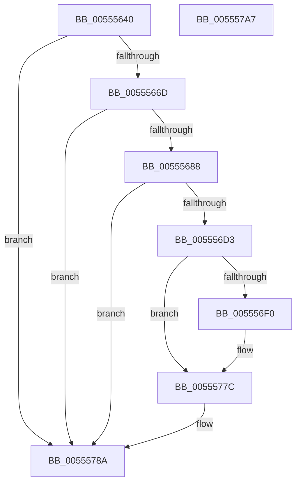

# HalpIommuLogEarlyFault

- RVA: `0x00555640`–`0x005557A8` (길이 `360` bytes)
- VA: `0x0000000140555640`
- 실행 섹션: `.text`
- PDB 이름 있음: `예`; PDB Function 태그: `아니요`
- unwind 정보 RVA: `0x000BD124`
- 디코드: `74`개 명령, `360/360` bytes 표시
- 미해석 바이트: `0` (있으면 어셈블리에 `.byte`로 보존)

> 이 문서는 커널 이미지의 기계어와 PDB 기호를 분석해 생성했습니다. 4번과 5번은 함수 원형과 자료형을 바이너리 사용 방식에서 추정한 C 해석이며 원본 소스 복구 결과는 아닙니다.

## 1. Dependencies

- 직접 호출 지점: **7**; 고유 호출 대상: **5**
- 직접 호출자로 확인된 함수: **2**
- RIP 상대 이미지 참조: **12**

### Outgoing calls
- `0x0055567B` → [EtwEventEnabled](../39/EtwEventEnabled_function_00392450.md) (function, `0x00392450`)
- `0x005556B3` → [EtwWriteEx](../25/EtwWriteEx_function_0025F0D0.md) (function, `0x0025F0D0`)
- `0x005556C6` → [EtwEventEnabled](../39/EtwEventEnabled_function_00392450.md) (function, `0x00392450`)
- `0x005556DA` → [KeAcquireSpinLockRaiseToDpc](../20/KeAcquireSpinLockRaiseToDpc_function_00208470.md) (function, `0x00208470`)
- `0x00555770` → [EtwWriteEx](../25/EtwWriteEx_function_0025F0D0.md) (function, `0x0025F0D0`)
- `0x00555785` → [KeReleaseSpinLock](../39/KeReleaseSpinLock_function_00392BA0.md) (function, `0x00392BA0`)
- `0x00555791` → [_security_check_cookie](../6A/_security_check_cookie_function_006AC640.md) (function, `0x006AC640`)

### Direct callers
- [HalpIommuEarlyFaultDpcRoutine](HalpIommuEarlyFaultDpcRoutine_function_005550E0.md) at `0x005550E4`
- [HalpIommuInitSystem](../../pagelk/B5/HalpIommuInitSystem_function_00B5D7E0.md) at `0x00B5D86C`

### Static image references
- `0x00555652` → RVA `0x00E0A740` (`.data`; read)
- `0x00555660` → RVA `0x00FC22C0` (`.data`; read)
- `0x0055566D` → RVA `0x00FC22B8` (`.data`; read)
- `0x00555674` → RVA `0x00020DC0` (`.rdata`; read)
- `0x005556BF` → RVA `0x0001E1A8` (`.rdata`; read)
- `0x005556D3` → RVA `0x00FC16E0` (`.data`; read)
- `0x005556DF` → RVA `0x00FC16C0` (`.data`; read)
- `0x005556F4` → RVA `0x00FC16C8` (`.data`; read)
- `0x0055571A` → RVA `0x00FC16D0` (`.data`; read)
- `0x00555725` → RVA `0x00FC16C4` (`.data`; read)
- `0x00555734` → RVA `0x00FC16D8` (`.data`; read)
- `0x00555775` → RVA `0x00FC16C0` (`.data`; read/write)

## 2. Other-region calls and transfers

- 다른 실행 섹션으로 향하는 call: **0**
- 별도 외부 분기/꼬리 이동을 확인하지 못했습니다.

## 3. Assembly (complete function range)

```asm
00555640  48 89 5C 24 08                  mov qword ptr [rsp + 8], rbx
00555645  55                              push rbp
00555646  48 8D 6C 24 A9                  lea rbp, [rsp - 0x57]
0055564B  48 81 EC 90 00 00 00            sub rsp, 0x90
00555652  48 8B 05 E7 50 8B 00            mov rax, qword ptr [rip + 0x8b50e7]
00555659  48 33 C4                        xor rax, rsp
0055565C  48 89 45 47                     mov qword ptr [rbp + 0x47], rax
00555660  80 3D 59 CC A6 00 00            cmp byte ptr [rip + 0xa6cc59], 0
00555667  0F 84 1D 01 00 00               je 0x14055578a
0055566D  48 8B 0D 44 CC A6 00            mov rcx, qword ptr [rip + 0xa6cc44]
00555674  48 8D 15 45 B7 AC FF            lea rdx, [rip - 0x5348bb]
0055567B  E8 D0 CD E3 FF                  call 0x140392450
00555680  84 C0                           test al, al
00555682  0F 84 02 01 00 00               je 0x14055578a
00555688  48 83 64 24 38 00               and qword ptr [rsp + 0x38], 0
0055568E  48 8D 15 2B B7 AC FF            lea rdx, [rip - 0x5348d5]
00555695  83 64 24 30 00                  and dword ptr [rsp + 0x30], 0
0055569A  45 33 C9                        xor r9d, r9d
0055569D  48 83 64 24 28 00               and qword ptr [rsp + 0x28], 0
005556A3  45 33 C0                        xor r8d, r8d
005556A6  48 8B 0D 0B CC A6 00            mov rcx, qword ptr [rip + 0xa6cc0b]
005556AD  48 83 64 24 20 00               and qword ptr [rsp + 0x20], 0
005556B3  E8 18 9A D0 FF                  call 0x14025f0d0
005556B8  48 8B 0D F9 CB A6 00            mov rcx, qword ptr [rip + 0xa6cbf9]
005556BF  48 8D 15 E2 8A AC FF            lea rdx, [rip - 0x53751e]
005556C6  E8 85 CD E3 FF                  call 0x140392450
005556CB  84 C0                           test al, al
005556CD  0F 84 B7 00 00 00               je 0x14055578a
005556D3  48 8D 0D 06 C0 A6 00            lea rcx, [rip + 0xa6c006]
005556DA  E8 91 2D CB FF                  call 0x140208470
005556DF  8B 0D DB BF A6 00               mov ecx, dword ptr [rip + 0xa6bfdb]
005556E5  8A D8                           mov bl, al
005556E7  F6 C1 01                        test cl, 1
005556EA  0F 84 8C 00 00 00               je 0x14055577c
005556F0  83 65 13 00                     and dword ptr [rbp + 0x13], 0
005556F4  48 8D 05 CD BF A6 00            lea rax, [rip + 0xa6bfcd]
005556FB  83 65 23 00                     and dword ptr [rbp + 0x23], 0
005556FF  48 8D 15 A2 8A AC FF            lea rdx, [rip - 0x53755e]
00555706  83 65 33 00                     and dword ptr [rbp + 0x33], 0
0055570A  B9 08 00 00 00                  mov ecx, 8
0055570F  83 65 43 00                     and dword ptr [rbp + 0x43], 0
00555713  45 33 C9                        xor r9d, r9d
00555716  48 89 45 07                     mov qword ptr [rbp + 7], rax
0055571A  48 8D 05 AF BF A6 00            lea rax, [rip + 0xa6bfaf]
00555721  48 89 45 17                     mov qword ptr [rbp + 0x17], rax
00555725  48 8D 05 98 BF A6 00            lea rax, [rip + 0xa6bf98]
0055572C  44 8D 41 FC                     lea r8d, [rcx - 4]
00555730  48 89 45 27                     mov qword ptr [rbp + 0x27], rax
00555734  48 8D 05 9D BF A6 00            lea rax, [rip + 0xa6bf9d]
0055573B  89 4D 0F                        mov dword ptr [rbp + 0xf], ecx
0055573E  48 89 45 37                     mov qword ptr [rbp + 0x37], rax
00555742  48 8D 45 07                     lea rax, [rbp + 7]
00555746  48 89 44 24 38                  mov qword ptr [rsp + 0x38], rax
0055574B  44 89 44 24 30                  mov dword ptr [rsp + 0x30], r8d
00555750  48 83 64 24 28 00               and qword ptr [rsp + 0x28], 0
00555756  48 83 64 24 20 00               and qword ptr [rsp + 0x20], 0
0055575C  89 4D 1F                        mov dword ptr [rbp + 0x1f], ecx
0055575F  44 89 45 2F                     mov dword ptr [rbp + 0x2f], r8d
00555763  45 33 C0                        xor r8d, r8d
00555766  89 4D 3F                        mov dword ptr [rbp + 0x3f], ecx
00555769  48 8B 0D 48 CB A6 00            mov rcx, qword ptr [rip + 0xa6cb48]
00555770  E8 5B 99 D0 FF                  call 0x14025f0d0
00555775  83 25 44 BF A6 00 FE            and dword ptr [rip + 0xa6bf44], 0xfffffffe
0055577C  8A D3                           mov dl, bl
0055577E  48 8D 0D 5B BF A6 00            lea rcx, [rip + 0xa6bf5b]
00555785  E8 16 D4 E3 FF                  call 0x140392ba0
0055578A  48 8B 4D 47                     mov rcx, qword ptr [rbp + 0x47]
0055578E  48 33 CC                        xor rcx, rsp
00555791  E8 AA 6E 15 00                  call 0x1406ac640
00555796  48 8B 9C 24 A0 00 00 00         mov rbx, qword ptr [rsp + 0xa0]
0055579E  48 81 C4 90 00 00 00            add rsp, 0x90
005557A5  5D                              pop rbp
005557A6  C3                              ret
005557A7  CC                              int3
```

## 4. C-style interpretation (structured pseudocode)

```c
__int64 __fastcall HalpIommuLogEarlyFault(__int64 a1, __int64 a2, int a3, int a4)
{
    __int64 result;
    __int64 v_rsp;
    unsigned __int64 v_stack_m18;
    unsigned int v_stack_m1C;
    unsigned int v_stack_m20;
    unsigned __int64 v_stack_m28;
    unsigned int v_stack_m2C;
    unsigned int v_stack_m30;
    unsigned __int64 v_stack_m38;
    unsigned int v_stack_m3C;
    unsigned int v_stack_m40;
    unsigned __int64 v_stack_m48;
    unsigned int v_stack_m4C;
    unsigned int v_stack_m50;
    unsigned __int64 v_stack_m58;
    unsigned __int64 v_stack_m5F;
    unsigned __int64 v_stack_m60;
    unsigned int v_stack_m68;
    unsigned __int64 v_stack_m70;
    unsigned __int64 v_stack_m78;
    unsigned __int64 v_stack_p8;

    v_stack_p8 = v_rbx;
    v_rsp = (v_rsp) - (144);
    result = (*(unsigned __int64 *)(v_rip + 9130215)) ^ (v_rsp);
    v_stack_m18 = result;
    if ((*(unsigned __int8 *)(v_rip + 10931289)) == 0) goto loc_0055578A;
    result = EtwEventEnabled(*(unsigned __int64 *)(v_rip + 10931268), v_rip - 5458107, a3, a4);
    if ((unsigned __int8)(result) == 0) goto loc_0055578A;
    a4 = 0;
    a3 = 0;
    result = EtwWriteEx(*(unsigned __int64 *)(v_rip + 10931211), v_rip - 5458133, a3, a4);
    result = EtwEventEnabled(*(unsigned __int64 *)(v_rip + 10931193), v_rip - 5469470, a3, a4);
    if ((unsigned __int8)(result) == 0) goto loc_0055578A;
    result = KeAcquireSpinLockRaiseToDpc(v_rip + 10928134, v_rip - 5469470, a3, a4);
    if ((((unsigned __int8)((unsigned int)(*(unsigned int *)(v_rip + 10928091)))) & (1)) != 0) {
        result = v_rip + 10928077;
        a2 = v_rip - 5469534;
        a1 = 8;
        a4 = 0;
        v_stack_m58 = result;
        result = v_rip + 10928047;
        v_stack_m48 = result;
        result = v_rip + 10928024;
        a3 = a1 - 4;
        v_stack_m38 = result;
        result = v_rip + 10928029;
        v_stack_m50 = (unsigned int)(a1);
        v_stack_m28 = result;
        result = v_stack_m58;
        v_stack_m60 = result;
        v_stack_m68 = a3;
        v_stack_m40 = (unsigned int)(a1);
        v_stack_m30 = a3;
        a3 = 0;
        v_stack_m20 = (unsigned int)(a1);
        a1 = *(unsigned __int64 *)(v_rip + 10931016);
        result = EtwWriteEx(a1, a2, a3, a4);
    }
    result = KeReleaseSpinLock(v_rip + 10927963, (unsigned __int8)((unsigned __int8)(result)), a3, a4);
loc_0055578A:
    a1 = (v_stack_m18) ^ (v_rsp);
    result = _security_check_cookie(a1, (unsigned __int8)((unsigned __int8)(result)), a3, a4);
    v_rsp = (v_rsp) + (144);
    return result;
}
```

## 5. (Beta) C Style

```c
int64_t HalpIommuLogEarlyFault(int64_t Arg1, int64_t Arg2, int32_t Arg3, int32_t Arg4)
{
    int64_t result;
    int64_t local_rsp;
    uint64_t v_stack_m18;
    uint32_t v_stack_m1C;
    uint32_t v_stack_m20;
    uint64_t v_stack_m28;
    uint32_t v_stack_m2C;
    uint32_t v_stack_m30;
    uint64_t v_stack_m38;
    uint32_t v_stack_m3C;
    uint32_t v_stack_m40;
    uint64_t v_stack_m48;
    uint32_t v_stack_m4C;
    uint32_t v_stack_m50;
    uint64_t v_stack_m58;
    uint64_t v_stack_m5F;
    uint64_t v_stack_m60;
    uint32_t v_stack_m68;
    uint64_t v_stack_m70;
    uint64_t v_stack_m78;
    uint64_t v_stack_p8;

    v_stack_p8 = local_rbx;
    local_rsp = (local_rsp) - (144);
    result = (*(uint64_t *)(v_rip + 0x8B50E7)) ^ (local_rsp);
    v_stack_m18 = result;
    if ((*(uint8_t *)(v_rip + 0xA6CC59)) == 0) goto loc_0055578A;
    result = EtwEventEnabled(*(uint64_t *)(v_rip + 0xA6CC44), v_rip - 5458107, Arg3, Arg4);
    if ((uint8_t)(result) == 0) goto loc_0055578A;
    Arg4 = 0;
    Arg3 = 0;
    result = EtwWriteEx(*(uint64_t *)(v_rip + 0xA6CC0B), v_rip - 5458133, Arg3, Arg4);
    result = EtwEventEnabled(*(uint64_t *)(v_rip + 0xA6CBF9), v_rip - 5469470, Arg3, Arg4);
    if ((uint8_t)(result) == 0) goto loc_0055578A;
    result = KeAcquireSpinLockRaiseToDpc(v_rip + 10928134, v_rip - 5469470, Arg3, Arg4);
    if ((((uint8_t)((uint32_t)(*(uint32_t *)(v_rip + 0xA6BFDB)))) & (1)) != 0) {
        result = v_rip + 10928077;
        Arg2 = v_rip - 5469534;
        Arg1 = 8;
        Arg4 = 0;
        v_stack_m58 = result;
        result = v_rip + 10928047;
        v_stack_m48 = result;
        result = v_rip + 10928024;
        Arg3 = Arg1 - 4;
        v_stack_m38 = result;
        result = v_rip + 10928029;
        v_stack_m50 = (uint32_t)(Arg1);
        v_stack_m28 = result;
        result = v_stack_m58;
        v_stack_m60 = result;
        v_stack_m68 = Arg3;
        v_stack_m40 = (uint32_t)(Arg1);
        v_stack_m30 = Arg3;
        Arg3 = 0;
        v_stack_m20 = (uint32_t)(Arg1);
        Arg1 = *(uint64_t *)(v_rip + 0xA6CB48);
        result = EtwWriteEx(Arg1, Arg2, Arg3, Arg4);
    }
    result = KeReleaseSpinLock(v_rip + 10927963, (uint8_t)((uint8_t)(result)), Arg3, Arg4);
loc_0055578A:
    Arg1 = (v_stack_m18) ^ (local_rsp);
    result = _security_check_cookie(Arg1, (uint8_t)((uint8_t)(result)), Arg3, Arg4);
    local_rsp = (local_rsp) + (144);
    return result;
}
```

## 6. Execution-region graph

[열기: 2D/3D 그래프와 함수 탐색 컨트롤 패널](../../../control-panel.html?section=text&rva=0x00555640&view=graph)

- 2D 그래프는 위에서 아래로 흐르고, 3D 그래프는 빈 공간을 드래그해 회전합니다. Shift+드래그는 이동, 휠은 확대·축소, 함수 노드 선택은 대상 보고서 이동입니다.

### Static fallback


