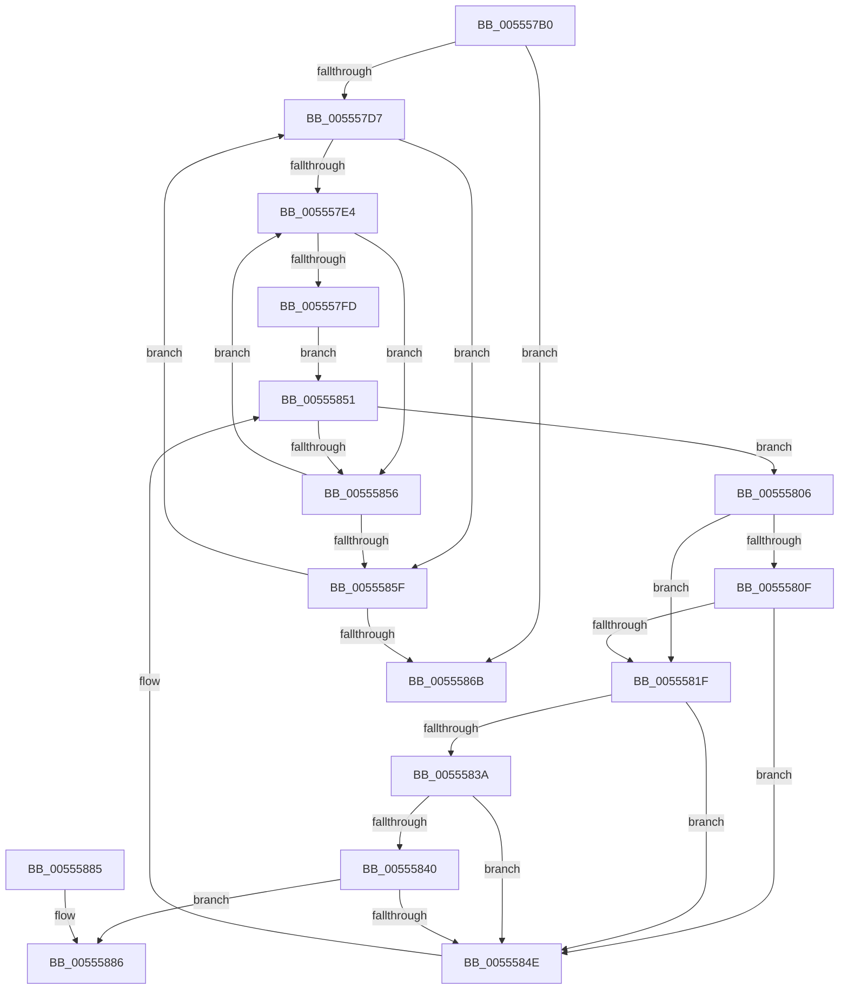

# HalpIommuProcessMemoryErrata

- RVA: `0x005557B0`–`0x0055589C` (길이 `236` bytes)
- VA: `0x00000001405557B0`
- 실행 섹션: `.text`
- PDB 이름 있음: `예`; PDB Function 태그: `아니요`
- unwind 정보 RVA: `0x000C4500`
- 디코드: `65`개 명령, `236/236` bytes 표시
- 미해석 바이트: `0` (있으면 어셈블리에 `.byte`로 보존)

> 이 문서는 커널 이미지의 기계어와 PDB 기호를 분석해 생성했습니다. 4번과 5번은 함수 원형과 자료형을 바이너리 사용 방식에서 추정한 C 해석이며 원본 소스 복구 결과는 아닙니다.

## 1. Dependencies

- 직접 호출 지점: **1**; 고유 호출 대상: **1**
- 직접 호출자로 확인된 함수: **1**
- RIP 상대 이미지 참조: **1**

### Outgoing calls
- `0x00555896` → [KeBugCheckEx](../4F/KeBugCheckEx_function_004FD660.md) (function, `0x004FD660`)

### Direct callers
- [HalpIommuProcessReservationsInternal](HalpIommuProcessReservationsInternal_function_00555900.md) at `0x0055599B`

### Static image references
- `0x00555840` → RVA `0x00FC1730` (`.data`; read)

## 2. Other-region calls and transfers

- 다른 실행 섹션으로 향하는 call: **0**
- 별도 외부 분기/꼬리 이동을 확인하지 못했습니다.

## 3. Assembly (complete function range)

```asm
005557B0  48 89 5C 24 08                  mov qword ptr [rsp + 8], rbx
005557B5  48 89 6C 24 10                  mov qword ptr [rsp + 0x10], rbp
005557BA  48 89 74 24 18                  mov qword ptr [rsp + 0x18], rsi
005557BF  57                              push rdi
005557C0  48 83 EC 30                     sub rsp, 0x30
005557C4  45 33 D2                        xor r10d, r10d
005557C7  49 8B E8                        mov rbp, r8
005557CA  48 8B F2                        mov rsi, rdx
005557CD  8B F9                           mov edi, ecx
005557CF  85 C9                           test ecx, ecx
005557D1  0F 84 94 00 00 00               je 0x14055586b
005557D7  4A 8B 1C D6                     mov rbx, qword ptr [rsi + r10*8]
005557DB  45 33 DB                        xor r11d, r11d
005557DE  44 39 5B 20                     cmp dword ptr [rbx + 0x20], r11d
005557E2  76 7B                           jbe 0x14055585f
005557E4  41 8B C3                        mov eax, r11d
005557E7  4E 8D 04 5D 05 00 00 00         lea r8, [r11*2 + 5]
005557EF  4C 03 C0                        add r8, rax
005557F2  4E 8D 04 C3                     lea r8, [rbx + r8*8]
005557F6  41 80 78 10 00                  cmp byte ptr [r8 + 0x10], 0
005557FB  75 59                           jne 0x140555856
005557FD  48 8D 55 20                     lea rdx, [rbp + 0x20]
00555801  4C 8B 0A                        mov r9, qword ptr [rdx]
00555804  EB 4B                           jmp 0x140555851
00555806  49 63 41 18                     movsxd rax, dword ptr [r9 + 0x18]
0055580A  83 F8 25                        cmp eax, 0x25
0055580D  77 10                           ja 0x14055581f
0055580F  48 B9 48 00 C0 C0 25 00 00 00   movabs rcx, 0x25c0c00048
00555819  48 0F A3 C1                     bt rcx, rax
0055581D  72 2F                           jb 0x14055584e
0055581F  49 8B 41 28                     mov rax, qword ptr [r9 + 0x28]
00555823  49 8B 49 20                     mov rcx, qword ptr [r9 + 0x20]
00555827  48 C1 E0 0C                     shl rax, 0xc
0055582B  48 FF C8                        dec rax
0055582E  48 C1 E1 0C                     shl rcx, 0xc
00555832  48 03 C1                        add rax, rcx
00555835  49 39 00                        cmp qword ptr [r8], rax
00555838  77 14                           ja 0x14055584e
0055583A  49 39 48 08                     cmp qword ptr [r8 + 8], rcx
0055583E  72 0E                           jb 0x14055584e
00555840  80 3D E9 BE A6 00 00            cmp byte ptr [rip + 0xa6bee9], 0
00555847  41 C6 40 10 01                  mov byte ptr [r8 + 0x10], 1
0055584C  75 38                           jne 0x140555886
0055584E  4D 8B 09                        mov r9, qword ptr [r9]
00555851  4C 3B CA                        cmp r9, rdx
00555854  75 B0                           jne 0x140555806
00555856  41 FF C3                        inc r11d
00555859  44 3B 5B 20                     cmp r11d, dword ptr [rbx + 0x20]
0055585D  72 85                           jb 0x1405557e4
0055585F  41 FF C2                        inc r10d
00555862  44 3B D7                        cmp r10d, edi
00555865  0F 82 6C FF FF FF               jb 0x1405557d7
0055586B  48 8B 5C 24 40                  mov rbx, qword ptr [rsp + 0x40]
00555870  B8 01 00 00 00                  mov eax, 1
00555875  48 8B 6C 24 48                  mov rbp, qword ptr [rsp + 0x48]
0055587A  48 8B 74 24 50                  mov rsi, qword ptr [rsp + 0x50]
0055587F  48 83 C4 30                     add rsp, 0x30
00555883  5F                              pop rdi
00555884  C3                              ret
00555885  CC                              int3
00555886  48 83 64 24 20 00               and qword ptr [rsp + 0x20], 0
0055588C  BA 01 05 00 00                  mov edx, 0x501
00555891  B9 5C 00 00 00                  mov ecx, 0x5c
00555896  E8 C5 7D FA FF                  call 0x1404fd660
0055589B  CC                              int3
```

## 4. C-style interpretation (structured pseudocode)

```c
__int64 __fastcall HalpIommuProcessMemoryErrata(int a1, __int64 a2, __int64 a3)
{
    __int64 result;
    __int64 v_r10;
    __int64 v_r11;
    __int64 v_rsp;
    unsigned __int64 v_stack_p10;
    unsigned __int64 v_stack_p18;
    unsigned __int64 v_stack_p20;
    unsigned __int64 v_stack_p8;

    v_stack_p8 = v_rbx;
    v_stack_p10 = v_rbp;
    v_stack_p18 = v_rsi;
    v_rsp = (v_rsp) - (48);
    v_r10 = 0;
    if (a1 == 0) goto loc_0055586B;
loc_005557D7:
    v_r11 = 0;
    if ((*(unsigned int *)(*(unsigned __int64 *)(a2 + v_r10 * 8) + 32)) <= 0) goto loc_0055585F;
loc_005557E4:
    a3 = (v_r11 * 2 + 5) + (0);
    if ((*(unsigned __int8 *)(*(unsigned __int64 *)(a2 + v_r10 * 8) + a3 * 8 + 16)) != 0) goto loc_00555856;
    goto loc_00555851;
loc_00555806:
    if (((unsigned int)((int)(*(unsigned int *)(*(unsigned __int64 *)(a3 + 32) + 24)))) > 37) goto loc_0055581F;
    if (((unsigned int)((int)(*(unsigned int *)(*(unsigned __int64 *)(a3 + 32) + 24)))) < 37) goto loc_0055584E;
loc_0055581F:
    result = (*(unsigned __int64 *)(*(unsigned __int64 *)(a3 + 32) + 40)) << (12);
    result = (result) - 1;
    a1 = (*(unsigned __int64 *)(*(unsigned __int64 *)(a3 + 32) + 32)) << (12);
    result = (result) + (a1);
    if ((*(unsigned __int64 *)(*(unsigned __int64 *)(a2 + v_r10 * 8) + a3 * 8)) > result) goto loc_0055584E;
    if ((*(unsigned __int64 *)(*(unsigned __int64 *)(a2 + v_r10 * 8) + a3 * 8 + 8)) < a1) goto loc_0055584E;
    *(unsigned __int8 *)(*(unsigned __int64 *)(a2 + v_r10 * 8) + a3 * 8 + 16) = 1;
    if ((*(unsigned __int8 *)(v_rip + 10927849)) != 0) goto loc_00555886;
loc_0055584E:
loc_00555851:
    if ((*(unsigned __int64 *)(*(unsigned __int64 *)(a3 + 32))) != (a3 + 32)) goto loc_00555806;
loc_00555856:
    v_r11 = (unsigned int)((v_r11) + 1);
    if (((unsigned int)(v_r11)) < (*(unsigned int *)(*(unsigned __int64 *)(a2 + v_r10 * 8) + 32))) goto loc_005557E4;
loc_0055585F:
    v_r10 = (unsigned int)((v_r10) + 1);
    if (((unsigned int)(v_r10)) < ((unsigned int)((unsigned int)(a1)))) goto loc_005557D7;
loc_0055586B:
    v_rsp = (v_rsp) + (48);
    return 1;
loc_00555886:
    result = KeBugCheckEx(92, (unsigned int)(0x501ULL), *(unsigned __int64 *)(a2 + v_r10 * 8) + a3 * 8, *(unsigned __int64 *)(*(unsigned __int64 *)(a3 + 32)));
    return result;
}
```

## 5. (Beta) C Style

```c
int64_t HalpIommuProcessMemoryErrata(int32_t Arg1, void *Arg2, void *Arg3)
{
    uint8_t *arg2 = (uint8_t *)Arg2;
    uint8_t *arg3 = (uint8_t *)Arg3;

    int64_t result;
    int64_t local_r10;
    int64_t local_r11;
    int64_t local_rsp;
    uint64_t v_stack_p10;
    uint64_t v_stack_p18;
    uint64_t v_stack_p20;
    uint64_t v_stack_p8;

    v_stack_p8 = local_rbx;
    v_stack_p10 = local_rbp;
    v_stack_p18 = local_rsi;
    local_rsp = (local_rsp) - (48);
    local_r10 = 0;
    if (Arg1 == 0) goto loc_0055586B;
loc_005557D7:
    local_r11 = 0;
    if ((*(uint32_t *)(*(uint64_t *)(arg2 + local_r10 * 8) + 0x20)) <= 0) goto loc_0055585F;
loc_005557E4:
    Arg3 = (local_r11 * 2 + 5) + (0);
    if ((*(uint8_t *)(*(uint64_t *)(arg2 + local_r10 * 8) + arg3 * 8 + 0x10)) != 0) goto loc_00555856;
    goto loc_00555851;
loc_00555806:
    if (((uint32_t)((int32_t)(*(uint32_t *)(*(uint64_t *)(arg3 + 0x20) + 0x18)))) > 37) goto loc_0055581F;
    if (((uint32_t)((int32_t)(*(uint32_t *)(*(uint64_t *)(arg3 + 0x20) + 0x18)))) < 37) goto loc_0055584E;
loc_0055581F:
    result = (*(uint64_t *)(*(uint64_t *)(arg3 + 0x20) + 0x28)) << (12);
    result = (result) - 1;
    Arg1 = (*(uint64_t *)(*(uint64_t *)(arg3 + 0x20) + 0x20)) << (12);
    result = (result) + (Arg1);
    if ((*(uint64_t *)(*(uint64_t *)(arg2 + local_r10 * 8) + arg3 * 8)) > result) goto loc_0055584E;
    if ((*(uint64_t *)(*(uint64_t *)(arg2 + local_r10 * 8) + arg3 * 8 + 0x8)) < Arg1) goto loc_0055584E;
    *(uint8_t *)(*(uint64_t *)(arg2 + local_r10 * 8) + arg3 * 8 + 0x10) = 1;
    if ((*(uint8_t *)(v_rip + 0xA6BEE9)) != 0) goto loc_00555886;
loc_0055584E:
loc_00555851:
    if ((*(uint64_t *)(*(uint64_t *)(arg3 + 0x20))) != (Arg3 + 32)) goto loc_00555806;
loc_00555856:
    local_r11 = (uint32_t)((local_r11) + 1);
    if (((uint32_t)(local_r11)) < (*(uint32_t *)(*(uint64_t *)(arg2 + local_r10 * 8) + 0x20))) goto loc_005557E4;
loc_0055585F:
    local_r10 = (uint32_t)((local_r10) + 1);
    if (((uint32_t)(local_r10)) < ((uint32_t)((uint32_t)(Arg1)))) goto loc_005557D7;
loc_0055586B:
    local_rsp = (local_rsp) + (48);
    return 1;
loc_00555886:
    result = KeBugCheckEx(92, (uint32_t)(0x501ULL), *(uint64_t *)(arg2 + local_r10 * 8) + Arg3 * 8, *(uint64_t *)(*(uint64_t *)(arg3 + 0x20)));
    return result;
}
```

### 관측된 메모리 오프셋

구조체 형식이 확인되지 않은 접근은 인자 기준의 오프셋으로만 기록했습니다.

| 기준 인자 | 오프셋 표현 | 폭 (bit) | 접근 |
|---|---:|---:|---|
| `Arg2` | `+ 0x0 + r10*8` | `64` | `R` |
| `Arg3` | `+ 0x0` | `64` | `R` |
| `Arg3` | `+ 0x20` | `64` | `R` |

## 6. Execution-region graph

[열기: 2D/3D 그래프와 함수 탐색 컨트롤 패널](../../../control-panel.html?section=text&rva=0x005557B0&view=graph)

- 2D 그래프는 위에서 아래로 흐르고, 3D 그래프는 빈 공간을 드래그해 회전합니다. Shift+드래그는 이동, 휠은 확대·축소, 함수 노드 선택은 대상 보고서 이동입니다.

### Static fallback


