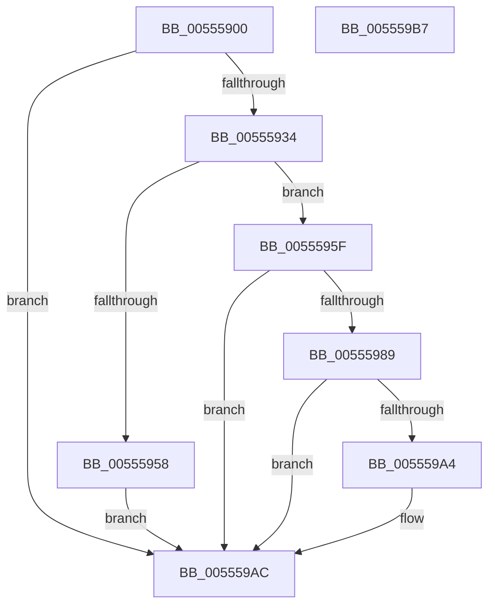

# HalpIommuProcessReservationsInternal

- RVA: `0x00555900`–`0x005559B8` (길이 `184` bytes)
- VA: `0x0000000140555900`
- 실행 섹션: `.text`
- PDB 이름 있음: `예`; PDB Function 태그: `아니요`
- unwind 정보 RVA: `0x00068D5C`
- 디코드: `47`개 명령, `184/184` bytes 표시
- 미해석 바이트: `0` (있으면 어셈블리에 `.byte`로 보존)

> 이 문서는 커널 이미지의 기계어와 PDB 기호를 분석해 생성했습니다. 4번과 5번은 함수 원형과 자료형을 바이너리 사용 방식에서 추정한 C 해석이며 원본 소스 복구 결과는 아닙니다.

## 1. Dependencies

- 직접 호출 지점: **5**; 고유 호출 대상: **4**
- 직접 호출자로 확인된 함수: **1**
- RIP 상대 이미지 참조: **0**

### Outgoing calls
- `0x00555928` → [guard_dispatch_icall](../6B/guard_dispatch_icall_function_006BAAD0.md) (function, `0x006BAAD0`)
- `0x00555944` → [HalpMmAllocateMemoryInternal](../54/HalpMmAllocateMemoryInternal_function_00544990.md) (function, `0x00544990`)
- `0x00555980` → [guard_dispatch_icall](../6B/guard_dispatch_icall_function_006BAAD0.md) (function, `0x006BAAD0`)
- `0x0055599B` → [HalpIommuProcessMemoryErrata](HalpIommuProcessMemoryErrata_function_005557B0.md) (function, `0x005557B0`)
- `0x005559A7` → [HalpIommuDetermineReservedPciRid](HalpIommuDetermineReservedPciRid_function_00554F4C.md) (function, `0x00554F4C`)

### Direct callers
- [HalpIommuProcessReservations](HalpIommuProcessReservations_function_005558A4.md) at `0x005558D8`

### Static image references
- 디코드된 RIP-relative 메모리 참조가 없습니다.

## 2. Other-region calls and transfers

- 다른 실행 섹션으로 향하는 call: **0**
- 별도 외부 분기/꼬리 이동을 확인하지 못했습니다.

## 3. Assembly (complete function range)

```asm
00555900  48 89 5C 24 10                  mov qword ptr [rsp + 0x10], rbx
00555905  57                              push rdi
00555906  48 83 EC 20                     sub rsp, 0x20
0055590A  48 8B 81 58 01 00 00            mov rax, qword ptr [rcx + 0x158]
00555911  48 8B FA                        mov rdi, rdx
00555914  83 64 24 30 00                  and dword ptr [rsp + 0x30], 0
00555919  48 8D 54 24 30                  lea rdx, [rsp + 0x30]
0055591E  48 8B D9                        mov rbx, rcx
00555921  45 33 C0                        xor r8d, r8d
00555924  48 8B 49 10                     mov rcx, qword ptr [rcx + 0x10]
00555928  E8 A3 51 16 00                  call 0x1406baad0
0055592D  3D 23 00 00 C0                  cmp eax, 0xc0000023
00555932  75 78                           jne 0x1405559ac
00555934  8B 4C 24 30                     mov ecx, dword ptr [rsp + 0x30]
00555938  BA 01 00 00 00                  mov edx, 1
0055593D  8D 0C CD 08 00 00 00            lea ecx, [rcx*8 + 8]
00555944  E8 47 F0 FE FF                  call 0x140544990
00555949  48 89 83 18 02 00 00            mov qword ptr [rbx + 0x218], rax
00555950  48 8B C8                        mov rcx, rax
00555953  48 85 C0                        test rax, rax
00555956  75 07                           jne 0x14055595f
00555958  B8 9A 00 00 C0                  mov eax, 0xc000009a
0055595D  EB 4D                           jmp 0x1405559ac
0055595F  8B 44 24 30                     mov eax, dword ptr [rsp + 0x30]
00555963  48 8D 54 24 30                  lea rdx, [rsp + 0x30]
00555968  89 01                           mov dword ptr [rcx], eax
0055596A  4C 8B 83 18 02 00 00            mov r8, qword ptr [rbx + 0x218]
00555971  48 8B 83 58 01 00 00            mov rax, qword ptr [rbx + 0x158]
00555978  49 83 C0 08                     add r8, 8
0055597C  48 8B 4B 10                     mov rcx, qword ptr [rbx + 0x10]
00555980  E8 4B 51 16 00                  call 0x1406baad0
00555985  85 C0                           test eax, eax
00555987  78 23                           js 0x1405559ac
00555989  48 8B 93 18 02 00 00            mov rdx, qword ptr [rbx + 0x218]
00555990  4C 8B C7                        mov r8, rdi
00555993  8B 4C 24 30                     mov ecx, dword ptr [rsp + 0x30]
00555997  48 83 C2 08                     add rdx, 8
0055599B  E8 10 FE FF FF                  call 0x1405557b0
005559A0  85 C0                           test eax, eax
005559A2  78 08                           js 0x1405559ac
005559A4  48 8B CB                        mov rcx, rbx
005559A7  E8 A0 F5 FF FF                  call 0x140554f4c
005559AC  48 8B 5C 24 38                  mov rbx, qword ptr [rsp + 0x38]
005559B1  48 83 C4 20                     add rsp, 0x20
005559B5  5F                              pop rdi
005559B6  C3                              ret
005559B7  CC                              int3
```

## 4. C-style interpretation (structured pseudocode)

```c
__int64 __fastcall HalpIommuProcessReservationsInternal(__int64 a1, __int64 a2, int a3)
{
    __int64 result;
    __int64 v_rsp;
    unsigned __int64 v_stack_p10;
    unsigned int v_stack_p8;

    v_stack_p10 = v_rbx;
    v_rsp = (v_rsp) - (32);
    a3 = 0;
    result = guard_dispatch_icall(*(unsigned __int64 *)(a1 + 16), v_stack_p8, a3, a4);
    if (((unsigned int)(result)) != 0xC0000023ULL) goto loc_005559AC;
    result = HalpMmAllocateMemoryInternal((unsigned int)(v_stack_p8) * 8 + 8, 1, a3, a4);
    *(unsigned __int64 *)(a1 + 536) = result;
    if (result != 0) goto loc_0055595F;
    goto loc_005559AC;
loc_0055595F:
    *(unsigned int *)(result) = (unsigned int)((unsigned int)(v_stack_p8));
    a3 = (*(unsigned __int64 *)(a1 + 536)) + (8);
    result = guard_dispatch_icall(*(unsigned __int64 *)(a1 + 16), v_stack_p8, a3, a4);
    if (sign_flag) goto loc_005559AC;
    a2 = (*(unsigned __int64 *)(a1 + 536)) + (8);
    result = HalpIommuProcessMemoryErrata((unsigned int)(v_stack_p8), a2, a2, a4);
    if (!(sign_flag)) {
        a1 = a1;
        result = HalpIommuDetermineReservedPciRid(a1, a2, a2, a4);
    }
    v_rsp = (v_rsp) + (32);
    return result;
}
```

## 5. (Beta) C Style

```c
int64_t HalpIommuProcessReservationsInternal(void *Arg1, int64_t Arg2, int32_t Arg3)
{
    uint8_t *arg1 = (uint8_t *)Arg1;

    int64_t result;
    int64_t local_rsp;
    uint64_t v_stack_p10;
    uint32_t v_stack_p8;

    v_stack_p10 = local_rbx;
    local_rsp = (local_rsp) - (32);
    Arg3 = 0;
    result = guard_dispatch_icall(*(uint64_t *)(arg1 + 0x10), v_stack_p8, Arg3, a4);
    if (((uint32_t)(result)) != 0xC0000023ULL) goto loc_005559AC;
    result = HalpMmAllocateMemoryInternal((uint32_t)(v_stack_p8) * 8 + 8, 1, Arg3, a4);
    *(uint64_t *)(arg1 + 0x218) = result;
    if (result != 0) goto loc_0055595F;
    goto loc_005559AC;
loc_0055595F:
    *(uint32_t *)(result) = (uint32_t)((uint32_t)(v_stack_p8));
    Arg3 = (*(uint64_t *)(arg1 + 0x218)) + (8);
    result = guard_dispatch_icall(*(uint64_t *)(arg1 + 0x10), v_stack_p8, Arg3, a4);
    if (sign_flag) goto loc_005559AC;
    Arg2 = (*(uint64_t *)(arg1 + 0x218)) + (8);
    result = HalpIommuProcessMemoryErrata((uint32_t)(v_stack_p8), Arg2, Arg2, a4);
    if (!(sign_flag)) {
        Arg1 = Arg1;
        result = HalpIommuDetermineReservedPciRid(Arg1, Arg2, Arg2, a4);
    }
    local_rsp = (local_rsp) + (32);
    return result;
}
```

### 관측된 메모리 오프셋

구조체 형식이 확인되지 않은 접근은 인자 기준의 오프셋으로만 기록했습니다.

| 기준 인자 | 오프셋 표현 | 폭 (bit) | 접근 |
|---|---:|---:|---|
| `Arg1` | `+ 0x10` | `64` | `R` |
| `Arg1` | `+ 0x158` | `64` | `R` |
| `Arg1` | `+ 0x218` | `64` | `R` |
| `Arg1` | `+ 0x218` | `64` | `W` |

## 6. Execution-region graph

[열기: 2D/3D 그래프와 함수 탐색 컨트롤 패널](../../../control-panel.html?section=text&rva=0x00555900&view=graph)

- 2D 그래프는 위에서 아래로 흐르고, 3D 그래프는 빈 공간을 드래그해 회전합니다. Shift+드래그는 이동, 휠은 확대·축소, 함수 노드 선택은 대상 보고서 이동입니다.

### Static fallback


