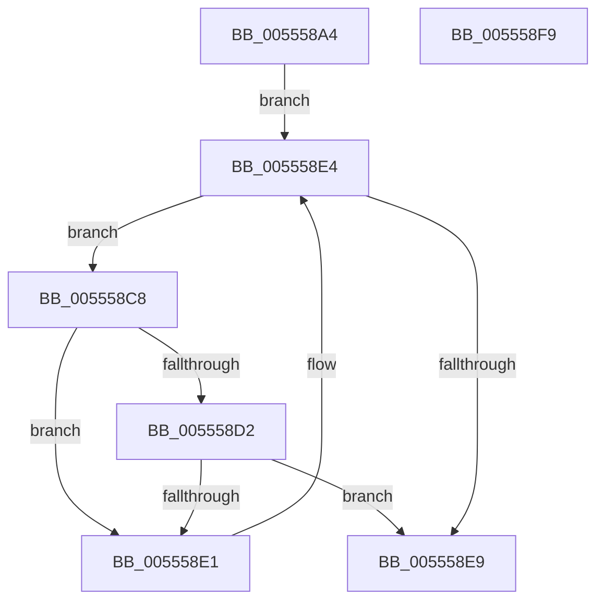

# HalpIommuProcessReservations

- RVA: `0x005558A4`–`0x005558FA` (길이 `86` bytes)
- VA: `0x00000001405558A4`
- 실행 섹션: `.text`
- PDB 이름 있음: `예`; PDB Function 태그: `아니요`
- unwind 정보 RVA: `0x00060BC4`
- 디코드: `25`개 명령, `86/86` bytes 표시
- 미해석 바이트: `0` (있으면 어셈블리에 `.byte`로 보존)

> 이 문서는 커널 이미지의 기계어와 PDB 기호를 분석해 생성했습니다. 4번과 5번은 함수 원형과 자료형을 바이너리 사용 방식에서 추정한 C 해석이며 원본 소스 복구 결과는 아닙니다.

## 1. Dependencies

- 직접 호출 지점: **1**; 고유 호출 대상: **1**
- 직접 호출자로 확인된 함수: **1**
- RIP 상대 이미지 참조: **1**

### Outgoing calls
- `0x005558D8` → [HalpIommuProcessReservationsInternal](HalpIommuProcessReservationsInternal_function_00555900.md) (function, `0x00555900`)

### Direct callers
- [HalpIommuInitSystem](../../pagelk/B5/HalpIommuInitSystem_function_00B5D7E0.md) at `0x00B5D970`

### Static image references
- `0x005558B3` → RVA `0x00FC1740` (`.data`; read)

## 2. Other-region calls and transfers

- 다른 실행 섹션으로 향하는 call: **0**
- 별도 외부 분기/꼬리 이동을 확인하지 못했습니다.

## 3. Assembly (complete function range)

```asm
005558A4  48 89 5C 24 08                  mov qword ptr [rsp + 8], rbx
005558A9  48 89 74 24 10                  mov qword ptr [rsp + 0x10], rsi
005558AE  57                              push rdi
005558AF  48 83 EC 20                     sub rsp, 0x20
005558B3  48 8B 1D 86 BE A6 00            mov rbx, qword ptr [rip + 0xa6be86]
005558BA  48 8D 35 7F BE A6 00            lea rsi, [rip + 0xa6be7f]
005558C1  48 8B F9                        mov rdi, rcx
005558C4  33 C0                           xor eax, eax
005558C6  EB 1C                           jmp 0x1405558e4
005558C8  48 83 BB 58 01 00 00 00         cmp qword ptr [rbx + 0x158], 0
005558D0  74 0F                           je 0x1405558e1
005558D2  48 8B D7                        mov rdx, rdi
005558D5  48 8B CB                        mov rcx, rbx
005558D8  E8 23 00 00 00                  call 0x140555900
005558DD  85 C0                           test eax, eax
005558DF  78 08                           js 0x1405558e9
005558E1  48 8B 1B                        mov rbx, qword ptr [rbx]
005558E4  48 3B DE                        cmp rbx, rsi
005558E7  75 DF                           jne 0x1405558c8
005558E9  48 8B 5C 24 30                  mov rbx, qword ptr [rsp + 0x30]
005558EE  48 8B 74 24 38                  mov rsi, qword ptr [rsp + 0x38]
005558F3  48 83 C4 20                     add rsp, 0x20
005558F7  5F                              pop rdi
005558F8  C3                              ret
005558F9  CC                              int3
```

## 4. C-style interpretation (structured pseudocode)

```c
__int64 __fastcall HalpIommuProcessReservations(__int64 a1)
{
    __int64 result;
    __int64 v_rsp;
    unsigned __int64 v_stack_p10;
    unsigned __int64 v_stack_p8;

    v_stack_p8 = v_rbx;
    v_stack_p10 = v_rsi;
    v_rsp = (v_rsp) - (32);
    result = 0;
    goto loc_005558E4;
loc_005558C8:
    if ((*(unsigned __int64 *)(*(unsigned __int64 *)(v_rip + 10927750) + 344)) == 0) goto loc_005558E1;
    result = HalpIommuProcessReservationsInternal(*(unsigned __int64 *)(v_rip + 10927750), a1, a3, a4);
    if (sign_flag) goto loc_005558E9;
loc_005558E1:
loc_005558E4:
    if ((*(unsigned __int64 *)(*(unsigned __int64 *)(v_rip + 10927750))) != (v_rip + 10927743)) goto loc_005558C8;
loc_005558E9:
    v_rsp = (v_rsp) + (32);
    return result;
}
```

## 5. (Beta) C Style

```c
int64_t HalpIommuProcessReservations(int64_t Arg1)
{
    int64_t result;
    int64_t local_rsp;
    uint64_t v_stack_p10;
    uint64_t v_stack_p8;

    v_stack_p8 = local_rbx;
    v_stack_p10 = local_rsi;
    local_rsp = (local_rsp) - (32);
    result = 0;
    goto loc_005558E4;
loc_005558C8:
    if ((*(uint64_t *)(*(uint64_t *)(v_rip + 0xA6BE86) + 0x158)) == 0) goto loc_005558E1;
    result = HalpIommuProcessReservationsInternal(*(uint64_t *)(v_rip + 0xA6BE86), Arg1, a3, a4);
    if (sign_flag) goto loc_005558E9;
loc_005558E1:
loc_005558E4:
    if ((*(uint64_t *)(*(uint64_t *)(v_rip + 0xA6BE86))) != (v_rip + 10927743)) goto loc_005558C8;
loc_005558E9:
    local_rsp = (local_rsp) + (32);
    return result;
}
```

## 6. Execution-region graph

[열기: 2D/3D 그래프와 함수 탐색 컨트롤 패널](../../../control-panel.html?section=text&rva=0x005558A4&view=graph)

- 2D 그래프는 위에서 아래로 흐르고, 3D 그래프는 빈 공간을 드래그해 회전합니다. Shift+드래그는 이동, 휠은 확대·축소, 함수 노드 선택은 대상 보고서 이동입니다.

### Static fallback


