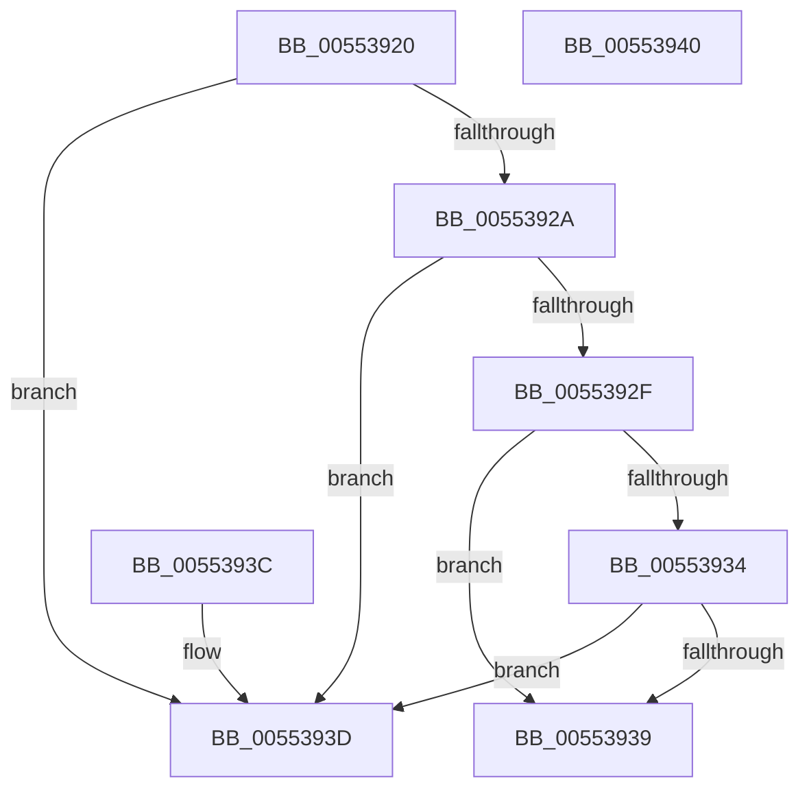

# HalpIommuSupportEnabled

- RVA: `0x00553920`–`0x00553941` (길이 `33` bytes)
- VA: `0x0000000140553920`
- 실행 섹션: `.text`
- PDB 이름 있음: `예`; PDB Function 태그: `아니요`
- unwind 정보 RVA: `0x000DB714`
- 디코드: `15`개 명령, `33/33` bytes 표시
- 미해석 바이트: `0` (있으면 어셈블리에 `.byte`로 보존)

> 이 문서는 커널 이미지의 기계어와 PDB 기호를 분석해 생성했습니다. 4번과 5번은 함수 원형과 자료형을 바이너리 사용 방식에서 추정한 C 해석이며 원본 소스 복구 결과는 아닙니다.

## 1. Dependencies

- 직접 호출 지점: **0**; 고유 호출 대상: **0**
- 직접 호출자로 확인된 함수: **0**
- RIP 상대 이미지 참조: **1**

### Outgoing calls
- 직접 디코드된 call 명령이 없습니다.

### Direct callers
- 이 함수 시작 RVA로 연결되는 직접 call은 확인되지 않았습니다. 간접 호출은 완전히 역산할 수 없습니다.

### Static image references
- `0x00553920` → RVA `0x00FC1734` (`.data`; read)

## 2. Other-region calls and transfers

- 다른 실행 섹션으로 향하는 call: **0**
- 별도 외부 분기/꼬리 이동을 확인하지 못했습니다.

## 3. Assembly (complete function range)

```asm
00553920  8B 0D 0E DE A6 00               mov ecx, dword ptr [rip + 0xa6de0e]
00553926  85 C9                           test ecx, ecx
00553928  74 13                           je 0x14055393d
0055392A  83 E9 01                        sub ecx, 1
0055392D  74 0E                           je 0x14055393d
0055392F  83 E9 01                        sub ecx, 1
00553932  74 05                           je 0x140553939
00553934  83 F9 01                        cmp ecx, 1
00553937  74 04                           je 0x14055393d
00553939  32 C0                           xor al, al
0055393B  C3                              ret
0055393C  CC                              int3
0055393D  B0 01                           mov al, 1
0055393F  C3                              ret
00553940  CC                              int3
```

## 4. C-style interpretation (structured pseudocode)

```c
__int64 __fastcall HalpIommuSupportEnabled(void)
{
    __int64 result;

    if ((unsigned int)((unsigned int)(*(unsigned int *)(v_rip + 10935822))) == 0) goto loc_0055393D;
    a1 = (unsigned int)(((unsigned int)(*(unsigned int *)(v_rip + 10935822))) - (1));
    if (condition_is_equal) goto loc_0055393D;
    a1 = (unsigned int)((a1) - (1));
    if (condition_is_equal) goto loc_00553939;
    if (((unsigned int)(a1)) == 1) goto loc_0055393D;
loc_00553939:
    result = 0;
    return result;
loc_0055393D:
    return 1;
}
```

## 5. (Beta) C Style

```c
void HalpIommuSupportEnabled(void)
{
    int64_t result;

    if ((uint32_t)((uint32_t)(*(uint32_t *)(v_rip + 0xA6DE0E))) == 0) goto loc_0055393D;
    a1 = (uint32_t)(((uint32_t)(*(uint32_t *)(v_rip + 0xA6DE0E))) - (1));
    if (condition_is_equal) goto loc_0055393D;
    a1 = (uint32_t)((a1) - (1));
    if (condition_is_equal) goto loc_00553939;
    if (((uint32_t)(a1)) == 1) goto loc_0055393D;
loc_00553939:
    result = 0;
    return result;
loc_0055393D:
    return 1;
}
```

## 6. Execution-region graph

[열기: 2D/3D 그래프와 함수 탐색 컨트롤 패널](../../../control-panel.html?section=text&rva=0x00553920&view=graph)

- 2D 그래프는 위에서 아래로 흐르고, 3D 그래프는 빈 공간을 드래그해 회전합니다. Shift+드래그는 이동, 휠은 확대·축소, 함수 노드 선택은 대상 보고서 이동입니다.

### Static fallback


