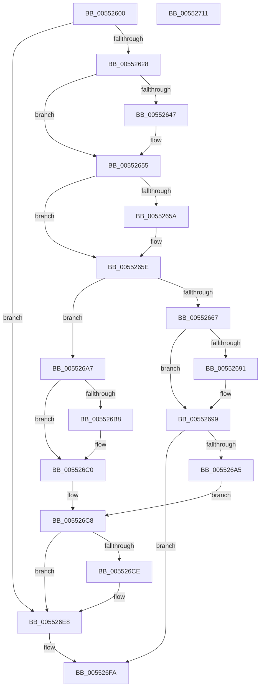

# HalpLeaveDmaDomain

- RVA: `0x00552600`–`0x00552712` (길이 `274` bytes)
- VA: `0x0000000140552600`
- 실행 섹션: `.text`
- PDB 이름 있음: `예`; PDB Function 태그: `아니요`
- unwind 정보 RVA: `0x0005C954`
- 디코드: `70`개 명령, `274/274` bytes 표시
- 미해석 바이트: `0` (있으면 어셈블리에 `.byte`로 보존)

> 이 문서는 커널 이미지의 기계어와 PDB 기호를 분석해 생성했습니다. 4번과 5번은 함수 원형과 자료형을 바이너리 사용 방식에서 추정한 C 해석이며 원본 소스 복구 결과는 아닙니다.

## 1. Dependencies

- 직접 호출 지점: **9**; 고유 호출 대상: **6**
- 직접 호출자로 확인된 함수: **2**
- RIP 상대 이미지 참조: **1**

### Outgoing calls
- `0x00552637` → [KeAbPreAcquire](../21/KeAbPreAcquire_function_00210230.md) (function, `0x00210230`)
- `0x00552650` → [ExfAcquirePushLockExclusiveEx](../20/ExfAcquirePushLockExclusiveEx_function_0020FC90.md) (function, `0x0020FC90`)
- `0x00552679` → [guard_dispatch_icall](../6B/guard_dispatch_icall_function_006BAAD0.md) (function, `0x006BAAD0`)
- `0x00552694` → [ExfTryToWakePushLock](../26/ExfTryToWakePushLock_function_00265DD0.md) (function, `0x00265DD0`)
- `0x0055269C` → [KeAbPostRelease](../2E/KeAbPostRelease_function_002E1600.md) (function, `0x002E1600`)
- `0x005526BB` → [ExfTryToWakePushLock](../26/ExfTryToWakePushLock_function_00265DD0.md) (function, `0x00265DD0`)
- `0x005526C3` → [KeAbPostRelease](../2E/KeAbPostRelease_function_002E1600.md) (function, `0x002E1600`)
- `0x005526E3` → [guard_dispatch_icall](../6B/guard_dispatch_icall_function_006BAAD0.md) (function, `0x006BAAD0`)
- `0x005526EB` → [HalpDmaDereferenceDomainObject](../3F/HalpDmaDereferenceDomainObject_function_003F69DC.md) (function, `0x003F69DC`)

### Direct callers
- [HalpDmaFreeChildAdapter](HalpDmaFreeChildAdapter_function_00550E30.md) at `0x00550EE1`
- [HalLeaveDmaDomain](HalLeaveDmaDomain_function_00551BC0.md) at `0x00551BF8`

### Static image references
- `0x00552667` → RVA `0x00FC1778` (`.data`; read)

## 2. Other-region calls and transfers

- 다른 실행 섹션으로 향하는 call: **0**
- 별도 외부 분기/꼬리 이동을 확인하지 못했습니다.

## 3. Assembly (complete function range)

```asm
00552600  48 89 5C 24 08                  mov qword ptr [rsp + 8], rbx
00552605  48 89 6C 24 10                  mov qword ptr [rsp + 0x10], rbp
0055260A  48 89 74 24 18                  mov qword ptr [rsp + 0x18], rsi
0055260F  57                              push rdi
00552610  48 83 EC 20                     sub rsp, 0x20
00552614  48 8B A9 00 02 00 00            mov rbp, qword ptr [rcx + 0x200]
0055261B  48 8B F9                        mov rdi, rcx
0055261E  83 7D 30 00                     cmp dword ptr [rbp + 0x30], 0
00552622  0F 84 C0 00 00 00               je 0x1405526e8
00552628  48 8D 99 40 01 00 00            lea rbx, [rcx + 0x140]
0055262F  45 33 C0                        xor r8d, r8d
00552632  48 8B CB                        mov rcx, rbx
00552635  33 D2                           xor edx, edx
00552637  E8 F4 DB CB FF                  call 0x140210230
0055263C  F0 48 0F BA 2B 00               lock bts qword ptr [rbx], 0
00552642  48 8B F0                        mov rsi, rax
00552645  73 0E                           jae 0x140552655
00552647  4C 8B C3                        mov r8, rbx
0055264A  48 8B D0                        mov rdx, rax
0055264D  48 8B CB                        mov rcx, rbx
00552650  E8 3B D6 CB FF                  call 0x14020fc90
00552655  48 85 F6                        test rsi, rsi
00552658  74 04                           je 0x14055265e
0055265A  C6 46 0A 01                     mov byte ptr [rsi + 0xa], 1
0055265E  80 BF 5A 01 00 00 00            cmp byte ptr [rdi + 0x15a], 0
00552665  75 40                           jne 0x1405526a7
00552667  48 8B 05 0A F1 A6 00            mov rax, qword ptr [rip + 0xa6f10a]
0055266E  48 8B 8F 20 02 00 00            mov rcx, qword ptr [rdi + 0x220]
00552675  48 8B 40 18                     mov rax, qword ptr [rax + 0x18]
00552679  E8 52 84 16 00                  call 0x1406baad0
0055267E  8B F0                           mov esi, eax
00552680  48 83 C9 FF                     or rcx, 0xffffffffffffffff
00552684  F0 48 0F C1 0B                  lock xadd qword ptr [rbx], rcx
00552689  80 E1 06                        and cl, 6
0055268C  80 F9 02                        cmp cl, 2
0055268F  75 08                           jne 0x140552699
00552691  48 8B CB                        mov rcx, rbx
00552694  E8 37 37 D1 FF                  call 0x140265dd0
00552699  48 8B CB                        mov rcx, rbx
0055269C  E8 5F EF D8 FF                  call 0x1402e1600
005526A1  85 F6                           test esi, esi
005526A3  78 55                           js 0x1405526fa
005526A5  EB 21                           jmp 0x1405526c8
005526A7  48 83 C9 FF                     or rcx, 0xffffffffffffffff
005526AB  F0 48 0F C1 0B                  lock xadd qword ptr [rbx], rcx
005526B0  80 E1 06                        and cl, 6
005526B3  80 F9 02                        cmp cl, 2
005526B6  75 08                           jne 0x1405526c0
005526B8  48 8B CB                        mov rcx, rbx
005526BB  E8 10 37 D1 FF                  call 0x140265dd0
005526C0  48 8B CB                        mov rcx, rbx
005526C3  E8 38 EF D8 FF                  call 0x1402e1600
005526C8  83 7D 30 03                     cmp dword ptr [rbp + 0x30], 3
005526CC  75 1A                           jne 0x1405526e8
005526CE  48 8B 05 A3 F0 A6 00            mov rax, qword ptr [rip + 0xa6f0a3]
005526D5  48 8B 8F 30 02 00 00            mov rcx, qword ptr [rdi + 0x230]
005526DC  48 8B 80 88 00 00 00            mov rax, qword ptr [rax + 0x88]
005526E3  E8 E8 83 16 00                  call 0x1406baad0
005526E8  48 8B CD                        mov rcx, rbp
005526EB  E8 EC 42 EA FF                  call 0x1403f69dc
005526F0  48 83 A7 00 02 00 00 00         and qword ptr [rdi + 0x200], 0
005526F8  33 F6                           xor esi, esi
005526FA  48 8B 5C 24 30                  mov rbx, qword ptr [rsp + 0x30]
005526FF  8B C6                           mov eax, esi
00552701  48 8B 74 24 40                  mov rsi, qword ptr [rsp + 0x40]
00552706  48 8B 6C 24 38                  mov rbp, qword ptr [rsp + 0x38]
0055270B  48 83 C4 20                     add rsp, 0x20
0055270F  5F                              pop rdi
00552710  C3                              ret
00552711  CC                              int3
```

## 4. C-style interpretation (structured pseudocode)

```c
__int64 __fastcall HalpLeaveDmaDomain(__int64 a1, int a2, int a3)
{
    __int64 result;
    __int64 v_rsi;
    __int64 v_rsp;
    unsigned __int64 v_stack_p10;
    unsigned __int64 v_stack_p18;
    unsigned __int64 v_stack_p8;

    v_stack_p8 = v_rbx;
    v_stack_p10 = v_rbp;
    v_stack_p18 = v_rsi;
    v_rsp = (v_rsp) - (32);
    if ((*(unsigned int *)(*(unsigned __int64 *)(a1 + 512) + 48)) == 0) goto loc_005526E8;
    a3 = 0;
    a2 = 0;
    result = KeAbPreAcquire(a1 + 320, a2, a3, a4);
    if (!(condition_is_above_or_equal)) {
        a3 = a1 + 320;
        a2 = result;
        a1 = a1 + 320;
        result = ExfAcquirePushLockExclusiveEx(a1, a2, a3, a4);
    }
    if (result != 0) {
        *(unsigned __int8 *)(result + 10) = 1;
    }
    if ((*(unsigned __int8 *)(a1 + 346)) != 0) goto loc_005526A7;
    result = guard_dispatch_icall(*(unsigned __int64 *)(a1 + 544), a2, a3, a4);
    a1 = (*(unsigned __int64 *)(a1 + 544)) | (-1);
    a1 = (unsigned __int8)((a1) & (6));
    if (((unsigned __int8)(a1)) == 2) {
        a1 = a1 + 320;
        result = ExfTryToWakePushLock(a1, a2, a3, a4);
    }
    result = KeAbPostRelease(a1 + 320, a2, a3, a4);
    if (sign_flag) goto loc_005526FA;
    goto loc_005526C8;
loc_005526A7:
    a1 = (a1 + 320) | (-1);
    a1 = (unsigned __int8)((a1) & (6));
    if (((unsigned __int8)(a1)) == 2) {
        a1 = a1 + 320;
        result = ExfTryToWakePushLock(a1, a2, a3, a4);
    }
    result = KeAbPostRelease(a1 + 320, a2, a3, a4);
loc_005526C8:
    if ((*(unsigned int *)(*(unsigned __int64 *)(a1 + 512) + 48)) == 3) {
        result = *(unsigned __int64 *)(v_rip + 10940579);
        a1 = *(unsigned __int64 *)(a1 + 560);
        result = *(unsigned __int64 *)(result + 136);
        result = guard_dispatch_icall(a1, a2, a3, a4);
    }
    result = HalpDmaDereferenceDomainObject(*(unsigned __int64 *)(a1 + 512), a2, a3, a4);
    v_rsi = 0;
loc_005526FA:
    v_rsp = (v_rsp) + (32);
    return 0;
}
```

## 5. (Beta) C Style

```c
int64_t HalpLeaveDmaDomain(void *Arg1, int32_t Arg2, int32_t Arg3)
{
    uint8_t *arg1 = (uint8_t *)Arg1;

    int64_t result;
    int64_t local_rsi;
    int64_t local_rsp;
    uint64_t v_stack_p10;
    uint64_t v_stack_p18;
    uint64_t v_stack_p8;

    v_stack_p8 = local_rbx;
    v_stack_p10 = local_rbp;
    v_stack_p18 = local_rsi;
    local_rsp = (local_rsp) - (32);
    if ((*(uint32_t *)(*(uint64_t *)(arg1 + 0x200) + 0x30)) == 0) goto loc_005526E8;
    Arg3 = 0;
    Arg2 = 0;
    result = KeAbPreAcquire(Arg1 + 320, Arg2, Arg3, a4);
    if (!(condition_is_above_or_equal)) {
        Arg3 = Arg1 + 320;
        Arg2 = result;
        Arg1 = Arg1 + 320;
        result = ExfAcquirePushLockExclusiveEx(Arg1, Arg2, Arg3, a4);
    }
    if (result != 0) {
        *(uint8_t *)(result + 0xA) = 1;
    }
    if ((*(uint8_t *)(arg1 + 0x15A)) != 0) goto loc_005526A7;
    result = guard_dispatch_icall(*(uint64_t *)(arg1 + 0x220), Arg2, Arg3, a4);
    Arg1 = (*(uint64_t *)(arg1 + 0x220)) | (-1);
    Arg1 = (uint8_t)((Arg1) & (6));
    if (((uint8_t)(Arg1)) == 2) {
        Arg1 = Arg1 + 320;
        result = ExfTryToWakePushLock(Arg1, Arg2, Arg3, a4);
    }
    result = KeAbPostRelease(Arg1 + 320, Arg2, Arg3, a4);
    if (sign_flag) goto loc_005526FA;
    goto loc_005526C8;
loc_005526A7:
    Arg1 = (Arg1 + 320) | (-1);
    Arg1 = (uint8_t)((Arg1) & (6));
    if (((uint8_t)(Arg1)) == 2) {
        Arg1 = Arg1 + 320;
        result = ExfTryToWakePushLock(Arg1, Arg2, Arg3, a4);
    }
    result = KeAbPostRelease(Arg1 + 320, Arg2, Arg3, a4);
loc_005526C8:
    if ((*(uint32_t *)(*(uint64_t *)(arg1 + 0x200) + 0x30)) == 3) {
        result = *(uint64_t *)(v_rip + 0xA6F0A3);
        Arg1 = *(uint64_t *)(arg1 + 0x230);
        result = *(uint64_t *)(result + 0x88);
        result = guard_dispatch_icall(Arg1, Arg2, Arg3, a4);
    }
    result = HalpDmaDereferenceDomainObject(*(uint64_t *)(arg1 + 0x200), Arg2, Arg3, a4);
    local_rsi = 0;
loc_005526FA:
    local_rsp = (local_rsp) + (32);
    return 0;
}
```

### 관측된 메모리 오프셋

구조체 형식이 확인되지 않은 접근은 인자 기준의 오프셋으로만 기록했습니다.

| 기준 인자 | 오프셋 표현 | 폭 (bit) | 접근 |
|---|---:|---:|---|
| `Arg1` | `+ 0x0` | `64` | `R/W` |
| `Arg1` | `+ 0x140` | `64` | `R` |
| `Arg1` | `+ 0x15A` | `8` | `R` |
| `Arg1` | `+ 0x200` | `64` | `R` |
| `Arg1` | `+ 0x200` | `64` | `R/W` |
| `Arg1` | `+ 0x220` | `64` | `R` |
| `Arg1` | `+ 0x230` | `64` | `R` |

## 6. Execution-region graph

[열기: 2D/3D 그래프와 함수 탐색 컨트롤 패널](../../../control-panel.html?section=text&rva=0x00552600&view=graph)

- 2D 그래프는 위에서 아래로 흐르고, 3D 그래프는 빈 공간을 드래그해 회전합니다. Shift+드래그는 이동, 휠은 확대·축소, 함수 노드 선택은 대상 보고서 이동입니다.

### Static fallback


