# HalpMcEnumerateAndSetPatchConfig

- RVA: `0x0055AB38`–`0x0055AF2C` (길이 `1,012` bytes)
- VA: `0x000000014055AB38`
- 실행 섹션: `.text`
- PDB 이름 있음: `예`; PDB Function 태그: `아니요`
- unwind 정보 RVA: `0x000C47E4`
- 디코드: `261`개 명령, `1,012/1,012` bytes 표시
- 미해석 바이트: `0` (있으면 어셈블리에 `.byte`로 보존)

> 이 문서는 커널 이미지의 기계어와 PDB 기호를 분석해 생성했습니다. 4번과 5번은 함수 원형과 자료형을 바이너리 사용 방식에서 추정한 C 해석이며 원본 소스 복구 결과는 아닙니다.

## 1. Dependencies

- 직접 호출 지점: **25**; 고유 호출 대상: **15**
- 직접 호출자로 확인된 함수: **2**
- RIP 상대 이미지 참조: **4**

### Outgoing calls
- `0x0055ABD5` → [ExFreePoolWithTag](../../poolcode/B8/ExFreePoolWithTag_function_00B82870.md) (function, `0x00B82870`)
- `0x0055ABE7` → [ExAllocatePool2](../../poolcode/B8/ExAllocatePool2_function_00B820F0.md) (function, `0x00B820F0`)
- `0x0055AC12` → [ZwQueryKey](../6A/ZwQueryKey_function_006AD390.md) (function, `0x006AD390`)
- `0x0055AC58` → [ExAllocatePool2](../../poolcode/B8/ExAllocatePool2_function_00B820F0.md) (function, `0x00B820F0`)
- `0x0055AC96` → [ExFreePoolWithTag](../../poolcode/B8/ExFreePoolWithTag_function_00B82870.md) (function, `0x00B82870`)
- `0x0055ACAA` → [ExAllocatePool2](../../poolcode/B8/ExAllocatePool2_function_00B820F0.md) (function, `0x00B820F0`)
- `0x0055ACD7` → [ZwEnumerateKey](../6A/ZwEnumerateKey_function_006AD710.md) (function, `0x006AD710`)
- `0x0055AD07` → [memset](../6C/memset_function_006C6C40.md) (function, `0x006C6C40`)
- `0x0055AD1C` → [RtlStringCbCopyNW](../39/RtlStringCbCopyNW_function_003905E8.md) (function, `0x003905E8`)
- `0x0055AD46` → [wcstoul](../50/wcstoul_function_005024A0.md) (function, `0x005024A0`)
- `0x0055AD5A` → [RtlInitUnicodeString](../42/RtlInitUnicodeString_function_0042A780.md) (function, `0x0042A780`)
- `0x0055AD95` → [ZwClose](../6A/ZwClose_function_006AD2B0.md) (function, `0x006AD2B0`)
- `0x0055ADAF` → [ZwOpenKey](../6A/ZwOpenKey_function_006AD310.md) (function, `0x006AD310`)
- `0x0055ADD0` → [HalpMcEnumerateAndSetPatchConfig](HalpMcEnumerateAndSetPatchConfig_function_0055AB38.md) (function, `0x0055AB38`)
- `0x0055ADFF` → [wcstoul](../50/wcstoul_function_005024A0.md) (function, `0x005024A0`)
- `0x0055AE1C` → [memset](../6C/memset_function_006C6C40.md) (function, `0x006C6C40`)
- `0x0055AE59` → [RtlInitUnicodeString](../42/RtlInitUnicodeString_function_0042A780.md) (function, `0x0042A780`)
- `0x0055AE62` → [MmGetSystemRoutineAddress](../../page/90/MmGetSystemRoutineAddress_function_0090EFE0.md) (function, `0x0090EFE0`)
- `0x0055AE8A` → [guard_dispatch_icall](../6B/guard_dispatch_icall_function_006BAAD0.md) (function, `0x006BAAD0`)
- `0x0055AEA2` → [PrExtControlOperations](../66/PrExtControlOperations_function_00666A6C.md) (function, `0x00666A6C`)
- `0x0055AEC8` → [ExFreePoolWithTag](../../poolcode/B8/ExFreePoolWithTag_function_00B82870.md) (function, `0x00B82870`)
- `0x0055AED5` → [ExFreePoolWithTag](../../poolcode/B8/ExFreePoolWithTag_function_00B82870.md) (function, `0x00B82870`)
- `0x0055AEE7` → [ExFreePoolWithTag](../../poolcode/B8/ExFreePoolWithTag_function_00B82870.md) (function, `0x00B82870`)
- `0x0055AEFD` → [ZwClose](../6A/ZwClose_function_006AD2B0.md) (function, `0x006AD2B0`)
- `0x0055AF0B` → [_security_check_cookie](../6A/_security_check_cookie_function_006AC640.md) (function, `0x006AC640`)

### Direct callers
- [HalpMcEnumerateAndSetPatchConfig](HalpMcEnumerateAndSetPatchConfig_function_0055AB38.md) at `0x0055ADD0`
- [HalpMcPatchConfiguration](HalpMcPatchConfiguration_function_0055B184.md) at `0x0055B201`

### Static image references
- `0x0055AB54` → RVA `0x00E0A740` (`.data`; read)
- `0x0055AE26` → RVA `0x000257D8` (`.rdata`; read)
- `0x0055AE31` → RVA `0x00023C80` (`.rdata`; read)
- `0x0055AE67` → RVA `0x008C8FD0` (`RtlQueryRegistryValues`; read)

## 2. Other-region calls and transfers

- 다른 실행 섹션으로 향하는 call: **9**
  - `0x0055ABD5` → [ExFreePoolWithTag](../../poolcode/B8/ExFreePoolWithTag_function_00B82870.md) (`.text` → `POOLCODE`)
  - `0x0055ABE7` → [ExAllocatePool2](../../poolcode/B8/ExAllocatePool2_function_00B820F0.md) (`.text` → `POOLCODE`)
  - `0x0055AC58` → [ExAllocatePool2](../../poolcode/B8/ExAllocatePool2_function_00B820F0.md) (`.text` → `POOLCODE`)
  - `0x0055AC96` → [ExFreePoolWithTag](../../poolcode/B8/ExFreePoolWithTag_function_00B82870.md) (`.text` → `POOLCODE`)
  - `0x0055ACAA` → [ExAllocatePool2](../../poolcode/B8/ExAllocatePool2_function_00B820F0.md) (`.text` → `POOLCODE`)
  - `0x0055AE62` → [MmGetSystemRoutineAddress](../../page/90/MmGetSystemRoutineAddress_function_0090EFE0.md) (`.text` → `PAGE`)
  - `0x0055AEC8` → [ExFreePoolWithTag](../../poolcode/B8/ExFreePoolWithTag_function_00B82870.md) (`.text` → `POOLCODE`)
  - `0x0055AED5` → [ExFreePoolWithTag](../../poolcode/B8/ExFreePoolWithTag_function_00B82870.md) (`.text` → `POOLCODE`)
  - `0x0055AEE7` → [ExFreePoolWithTag](../../poolcode/B8/ExFreePoolWithTag_function_00B82870.md) (`.text` → `POOLCODE`)
- 별도 외부 분기/꼬리 이동을 확인하지 못했습니다.

## 3. Assembly (complete function range)

```asm
0055AB38  48 89 5C 24 18                  mov qword ptr [rsp + 0x18], rbx
0055AB3D  55                              push rbp
0055AB3E  56                              push rsi
0055AB3F  57                              push rdi
0055AB40  41 54                           push r12
0055AB42  41 55                           push r13
0055AB44  41 56                           push r14
0055AB46  41 57                           push r15
0055AB48  48 8D 6C 24 C0                  lea rbp, [rsp - 0x40]
0055AB4D  48 81 EC 40 01 00 00            sub rsp, 0x140
0055AB54  48 8B 05 E5 FB 8A 00            mov rax, qword ptr [rip + 0x8afbe5]
0055AB5B  48 33 C4                        xor rax, rsp
0055AB5E  48 89 45 30                     mov qword ptr [rbp + 0x30], rax
0055AB62  0F 57 C0                        xorps xmm0, xmm0
0055AB65  48 89 4C 24 50                  mov qword ptr [rsp + 0x50], rcx
0055AB6A  48 8B D9                        mov rbx, rcx
0055AB6D  48 89 54 24 48                  mov qword ptr [rsp + 0x48], rdx
0055AB72  33 C9                           xor ecx, ecx
0055AB74  33 FF                           xor edi, edi
0055AB76  21 4C 24 30                     and dword ptr [rsp + 0x30], ecx
0055AB7A  45 33 F6                        xor r14d, r14d
0055AB7D  48 21 4C 24 38                  and qword ptr [rsp + 0x38], rcx
0055AB82  33 F6                           xor esi, esi
0055AB84  48 89 4D 80                     mov qword ptr [rbp - 0x80], rcx
0055AB88  45 8B E8                        mov r13d, r8d
0055AB8B  89 4D 88                        mov dword ptr [rbp - 0x78], ecx
0055AB8E  48 89 4D 20                     mov qword ptr [rbp + 0x20], rcx
0055AB92  89 4D 28                        mov dword ptr [rbp + 0x28], ecx
0055AB95  0F 11 44 24 60                  movups xmmword ptr [rsp + 0x60], xmm0
0055AB9A  0F 11 44 24 70                  movups xmmword ptr [rsp + 0x70], xmm0
0055AB9F  0F 11 45 90                     movups xmmword ptr [rbp - 0x70], xmm0
0055ABA3  48 85 D2                        test rdx, rdx
0055ABA6  75 10                           jne 0x14055abb8
0055ABA8  41 83 F8 01                     cmp r8d, 1
0055ABAC  75 0A                           jne 0x14055abb8
0055ABAE  BB 0D 00 00 C0                  mov ebx, 0xc000000d
0055ABB3  E9 4A 03 00 00                  jmp 0x14055af02
0055ABB8  45 33 FF                        xor r15d, r15d
0055ABBB  41 BC 00 01 00 00               mov r12d, 0x100
0055ABC1  EB 05                           jmp 0x14055abc8
0055ABC3  48 8B 5C 24 50                  mov rbx, qword ptr [rsp + 0x50]
0055ABC8  4D 85 F6                        test r14, r14
0055ABCB  74 0D                           je 0x14055abda
0055ABCD  BA 48 61 6C 63                  mov edx, 0x636c6148
0055ABD2  49 8B CE                        mov rcx, r14
0055ABD5  E8 96 7C 62 00                  call 0x140b82870
0055ABDA  8B 54 24 30                     mov edx, dword ptr [rsp + 0x30]
0055ABDE  41 B8 48 61 6C 63               mov r8d, 0x636c6148
0055ABE4  49 8B CC                        mov rcx, r12
0055ABE7  E8 04 75 62 00                  call 0x140b820f0
0055ABEC  4C 8B F0                        mov r14, rax
0055ABEF  48 85 C0                        test rax, rax
0055ABF2  0F 84 F6 02 00 00               je 0x14055aeee
0055ABF8  44 8B 4C 24 30                  mov r9d, dword ptr [rsp + 0x30]
0055ABFD  48 8D 44 24 30                  lea rax, [rsp + 0x30]
0055AC02  4D 8B C6                        mov r8, r14
0055AC05  48 89 44 24 20                  mov qword ptr [rsp + 0x20], rax
0055AC0A  BA 02 00 00 00                  mov edx, 2
0055AC0F  48 8B CB                        mov rcx, rbx
0055AC12  E8 79 27 15 00                  call 0x1406ad390
0055AC17  41 FF C7                        inc r15d
0055AC1A  8B D8                           mov ebx, eax
0055AC1C  3D 23 00 00 C0                  cmp eax, 0xc0000023
0055AC21  74 07                           je 0x14055ac2a
0055AC23  3D 05 00 00 80                  cmp eax, 0x80000005
0055AC28  75 06                           jne 0x14055ac30
0055AC2A  41 83 FF 0A                     cmp r15d, 0xa
0055AC2E  72 93                           jb 0x14055abc3
0055AC30  85 C0                           test eax, eax
0055AC32  0F 88 95 02 00 00               js 0x14055aecd
0055AC38  41 8B 46 18                     mov eax, dword ptr [r14 + 0x18]
0055AC3C  41 B8 48 61 6C 63               mov r8d, 0x636c6148
0055AC42  45 8B 7E 14                     mov r15d, dword ptr [r14 + 0x14]
0055AC46  83 C0 02                        add eax, 2
0055AC49  8B D0                           mov edx, eax
0055AC4B  44 89 7C 24 40                  mov dword ptr [rsp + 0x40], r15d
0055AC50  49 8B CC                        mov rcx, r12
0055AC53  48 89 44 24 58                  mov qword ptr [rsp + 0x58], rax
0055AC58  E8 93 74 62 00                  call 0x140b820f0
0055AC5D  48 8B F0                        mov rsi, rax
0055AC60  48 85 C0                        test rax, rax
0055AC63  75 0A                           jne 0x14055ac6f
0055AC65  BB 17 00 00 C0                  mov ebx, 0xc0000017
0055AC6A  E9 5E 02 00 00                  jmp 0x14055aecd
0055AC6F  C7 44 24 30 18 00 00 00         mov dword ptr [rsp + 0x30], 0x18
0055AC77  45 33 E4                        xor r12d, r12d
0055AC7A  48 8B C7                        mov rax, rdi
0055AC7D  45 3B E7                        cmp r12d, r15d
0055AC80  0F 83 35 02 00 00               jae 0x14055aebb
0055AC86  45 33 FF                        xor r15d, r15d
0055AC89  48 85 FF                        test rdi, rdi
0055AC8C  74 0D                           je 0x14055ac9b
0055AC8E  BA 48 61 6C 63                  mov edx, 0x636c6148
0055AC93  48 8B CF                        mov rcx, rdi
0055AC96  E8 D5 7B 62 00                  call 0x140b82870
0055AC9B  8B 54 24 30                     mov edx, dword ptr [rsp + 0x30]
0055AC9F  B9 00 01 00 00                  mov ecx, 0x100
0055ACA4  41 B8 48 61 6C 63               mov r8d, 0x636c6148
0055ACAA  E8 41 74 62 00                  call 0x140b820f0
0055ACAF  48 8B F8                        mov rdi, rax
0055ACB2  48 85 C0                        test rax, rax
0055ACB5  74 AE                           je 0x14055ac65
0055ACB7  48 8B 4C 24 50                  mov rcx, qword ptr [rsp + 0x50]
0055ACBC  48 8D 44 24 30                  lea rax, [rsp + 0x30]
0055ACC1  48 89 44 24 28                  mov qword ptr [rsp + 0x28], rax
0055ACC6  4C 8B CF                        mov r9, rdi
0055ACC9  8B 44 24 30                     mov eax, dword ptr [rsp + 0x30]
0055ACCD  45 33 C0                        xor r8d, r8d
0055ACD0  41 8B D4                        mov edx, r12d
0055ACD3  89 44 24 20                     mov dword ptr [rsp + 0x20], eax
0055ACD7  E8 34 2A 15 00                  call 0x1406ad710
0055ACDC  41 FF C7                        inc r15d
0055ACDF  8B D8                           mov ebx, eax
0055ACE1  3D 23 00 00 C0                  cmp eax, 0xc0000023
0055ACE6  74 07                           je 0x14055acef
0055ACE8  3D 05 00 00 80                  cmp eax, 0x80000005
0055ACED  75 06                           jne 0x14055acf5
0055ACEF  41 83 FF 0A                     cmp r15d, 0xa
0055ACF3  72 94                           jb 0x14055ac89
0055ACF5  85 C0                           test eax, eax
0055ACF7  0F 88 C3 01 00 00               js 0x14055aec0
0055ACFD  4C 8B 44 24 58                  mov r8, qword ptr [rsp + 0x58]
0055AD02  33 D2                           xor edx, edx
0055AD04  48 8B CE                        mov rcx, rsi
0055AD07  E8 34 BF 16 00                  call 0x1406c6c40
0055AD0C  44 8B 4F 0C                     mov r9d, dword ptr [rdi + 0xc]
0055AD10  4C 8D 47 10                     lea r8, [rdi + 0x10]
0055AD14  48 8B 54 24 58                  mov rdx, qword ptr [rsp + 0x58]
0055AD19  48 8B CE                        mov rcx, rsi
0055AD1C  E8 C7 58 E3 FF                  call 0x1403905e8
0055AD21  8B D8                           mov ebx, eax
0055AD23  85 C0                           test eax, eax
0055AD25  0F 88 95 01 00 00               js 0x14055aec0
0055AD2B  45 85 ED                        test r13d, r13d
0055AD2E  0F 85 B8 00 00 00               jne 0x14055adec
0055AD34  33 C0                           xor eax, eax
0055AD36  45 8D 45 10                     lea r8d, [r13 + 0x10]
0055AD3A  33 D2                           xor edx, edx
0055AD3C  48 89 45 20                     mov qword ptr [rbp + 0x20], rax
0055AD40  48 8B CE                        mov rcx, rsi
0055AD43  89 45 28                        mov dword ptr [rbp + 0x28], eax
0055AD46  E8 55 77 FA FF                  call 0x1405024a0
0055AD4B  89 45 20                        mov dword ptr [rbp + 0x20], eax
0055AD4E  4C 8B 7C 24 48                  mov r15, qword ptr [rsp + 0x48]
0055AD53  48 8B D6                        mov rdx, rsi
0055AD56  48 8D 4D 90                     lea rcx, [rbp - 0x70]
0055AD5A  E8 21 FA EC FF                  call 0x14042a780
0055AD5F  48 83 7C 24 38 00               cmp qword ptr [rsp + 0x38], 0
0055AD65  0F 57 C0                        xorps xmm0, xmm0
0055AD68  48 8B 44 24 50                  mov rax, qword ptr [rsp + 0x50]
0055AD6D  48 89 44 24 68                  mov qword ptr [rsp + 0x68], rax
0055AD72  48 8D 45 90                     lea rax, [rbp - 0x70]
0055AD76  48 89 44 24 70                  mov qword ptr [rsp + 0x70], rax
0055AD7B  C7 44 24 60 30 00 00 00         mov dword ptr [rsp + 0x60], 0x30
0055AD83  C7 44 24 78 40 02 00 00         mov dword ptr [rsp + 0x78], 0x240
0055AD8B  F3 0F 7F 45 80                  movdqu xmmword ptr [rbp - 0x80], xmm0
0055AD90  74 0E                           je 0x14055ada0
0055AD92  48 8B CE                        mov rcx, rsi
0055AD95  E8 16 25 15 00                  call 0x1406ad2b0
0055AD9A  48 83 64 24 38 00               and qword ptr [rsp + 0x38], 0
0055ADA0  4C 8D 44 24 60                  lea r8, [rsp + 0x60]
0055ADA5  BA 19 00 02 00                  mov edx, 0x20019
0055ADAA  48 8D 4C 24 38                  lea rcx, [rsp + 0x38]
0055ADAF  E8 5C 25 15 00                  call 0x1406ad310
0055ADB4  8B D8                           mov ebx, eax
0055ADB6  85 C0                           test eax, eax
0055ADB8  0F 88 02 01 00 00               js 0x14055aec0
0055ADBE  45 85 ED                        test r13d, r13d
0055ADC1  75 4F                           jne 0x14055ae12
0055ADC3  48 8B 4C 24 38                  mov rcx, qword ptr [rsp + 0x38]
0055ADC8  45 8D 45 01                     lea r8d, [r13 + 1]
0055ADCC  48 8D 55 20                     lea rdx, [rbp + 0x20]
0055ADD0  E8 63 FD FF FF                  call 0x14055ab38
0055ADD5  8B D8                           mov ebx, eax
0055ADD7  85 C0                           test eax, eax
0055ADD9  0F 88 E1 00 00 00               js 0x14055aec0
0055ADDF  44 8B 7C 24 40                  mov r15d, dword ptr [rsp + 0x40]
0055ADE4  41 FF C4                        inc r12d
0055ADE7  E9 8E FE FF FF                  jmp 0x14055ac7a
0055ADEC  41 83 FD 01                     cmp r13d, 1
0055ADF0  0F 85 58 FF FF FF               jne 0x14055ad4e
0055ADF6  33 D2                           xor edx, edx
0055ADF8  45 8D 45 0F                     lea r8d, [r13 + 0xf]
0055ADFC  48 8B CE                        mov rcx, rsi
0055ADFF  E8 9C 76 FA FF                  call 0x1405024a0
0055AE04  4C 8B 7C 24 48                  mov r15, qword ptr [rsp + 0x48]
0055AE09  41 89 47 08                     mov dword ptr [r15 + 8], eax
0055AE0D  E9 41 FF FF FF                  jmp 0x14055ad53
0055AE12  33 D2                           xor edx, edx
0055AE14  48 8D 4D B0                     lea rcx, [rbp - 0x50]
0055AE18  44 8D 42 70                     lea r8d, [rdx + 0x70]
0055AE1C  E8 1F BE 16 00                  call 0x1406c6c40
0055AE21  48 8B 5C 24 38                  mov rbx, qword ptr [rsp + 0x38]
0055AE26  48 8D 05 AB A9 AC FF            lea rax, [rip - 0x535655]
0055AE2D  48 89 45 C0                     mov qword ptr [rbp - 0x40], rax
0055AE31  48 8D 15 48 8E AC FF            lea rdx, [rip - 0x5371b8]
0055AE38  49 8D 47 04                     lea rax, [r15 + 4]
0055AE3C  C7 45 B8 20 01 00 00            mov dword ptr [rbp - 0x48], 0x120
0055AE43  0F 57 C0                        xorps xmm0, xmm0
0055AE46  48 89 45 C8                     mov qword ptr [rbp - 0x38], rax
0055AE4A  48 8D 4D A0                     lea rcx, [rbp - 0x60]
0055AE4E  C7 45 D0 00 00 00 04            mov dword ptr [rbp - 0x30], 0x4000000
0055AE55  0F 11 45 A0                     movups xmmword ptr [rbp - 0x60], xmm0
0055AE59  E8 22 F9 EC FF                  call 0x14042a780
0055AE5E  48 8D 4D A0                     lea rcx, [rbp - 0x60]
0055AE62  E8 79 41 3B 00                  call 0x14090efe0
0055AE67  48 8D 0D 62 E1 36 00            lea rcx, [rip + 0x36e162]
0055AE6E  48 85 C0                        test rax, rax
0055AE71  4C 8D 45 B0                     lea r8, [rbp - 0x50]
0055AE75  48 8B D3                        mov rdx, rbx
0055AE78  48 0F 44 C1                     cmove rax, rcx
0055AE7C  48 83 64 24 20 00               and qword ptr [rsp + 0x20], 0
0055AE82  45 33 C9                        xor r9d, r9d
0055AE85  B9 00 00 00 40                  mov ecx, 0x40000000
0055AE8A  E8 41 FC 15 00                  call 0x1406baad0
0055AE8F  8B D8                           mov ebx, eax
0055AE91  85 C0                           test eax, eax
0055AE93  78 2B                           js 0x14055aec0
0055AE95  41 B8 0C 00 00 00               mov r8d, 0xc
0055AE9B  49 8B D7                        mov rdx, r15
0055AE9E  41 8D 48 F5                     lea ecx, [r8 - 0xb]
0055AEA2  E8 C5 BB 10 00                  call 0x140666a6c
0055AEA7  8B D8                           mov ebx, eax
0055AEA9  3D 25 02 00 C0                  cmp eax, 0xc0000225
0055AEAE  0F 85 23 FF FF FF               jne 0x14055add7
0055AEB4  33 DB                           xor ebx, ebx
0055AEB6  E9 24 FF FF FF                  jmp 0x14055addf
0055AEBB  48 85 C0                        test rax, rax
0055AEBE  74 0D                           je 0x14055aecd
0055AEC0  BA 48 61 6C 63                  mov edx, 0x636c6148
0055AEC5  48 8B CF                        mov rcx, rdi
0055AEC8  E8 A3 79 62 00                  call 0x140b82870
0055AECD  BA 48 61 6C 63                  mov edx, 0x636c6148
0055AED2  49 8B CE                        mov rcx, r14
0055AED5  E8 96 79 62 00                  call 0x140b82870
0055AEDA  48 85 F6                        test rsi, rsi
0055AEDD  74 14                           je 0x14055aef3
0055AEDF  BA 48 61 6C 63                  mov edx, 0x636c6148
0055AEE4  48 8B CE                        mov rcx, rsi
0055AEE7  E8 84 79 62 00                  call 0x140b82870
0055AEEC  EB 05                           jmp 0x14055aef3
0055AEEE  BB 17 00 00 C0                  mov ebx, 0xc0000017
0055AEF3  48 8B 4C 24 38                  mov rcx, qword ptr [rsp + 0x38]
0055AEF8  48 85 C9                        test rcx, rcx
0055AEFB  74 05                           je 0x14055af02
0055AEFD  E8 AE 23 15 00                  call 0x1406ad2b0
0055AF02  8B C3                           mov eax, ebx
0055AF04  48 8B 4D 30                     mov rcx, qword ptr [rbp + 0x30]
0055AF08  48 33 CC                        xor rcx, rsp
0055AF0B  E8 30 17 15 00                  call 0x1406ac640
0055AF10  48 8B 9C 24 90 01 00 00         mov rbx, qword ptr [rsp + 0x190]
0055AF18  48 81 C4 40 01 00 00            add rsp, 0x140
0055AF1F  41 5F                           pop r15
0055AF21  41 5E                           pop r14
0055AF23  41 5D                           pop r13
0055AF25  41 5C                           pop r12
0055AF27  5F                              pop rdi
0055AF28  5E                              pop rsi
0055AF29  5D                              pop rbp
0055AF2A  C3                              ret
0055AF2B  CC                              int3
```

## 4. C-style interpretation (structured pseudocode)

```c
__int64 __fastcall HalpMcEnumerateAndSetPatchConfig(__int64 a1, __int64 a2, int a3)
{
    __int64 result;
    __int64 v_r12;
    __int64 v_r14;
    __int64 v_r15;
    __int64 v_rbx;
    __int64 v_rdi;
    __int64 v_rsi;
    __int64 v_rsp;
    unsigned int v_stack_m100;
    unsigned __int64 v_stack_m108;
    unsigned __int64 v_stack_m110;
    unsigned __int64 v_stack_m118;
    unsigned __int64 v_stack_m120;
    unsigned __int64 v_stack_m128;
    unsigned __int64 v_stack_m130;
    unsigned int v_stack_m138;
    unsigned __int64 v_stack_m140;
    unsigned int v_stack_m148;
    unsigned __int64 v_stack_m150;
    unsigned __int64 v_stack_m158;
    unsigned __int64 v_stack_m48;
    unsigned int v_stack_m50;
    unsigned __int64 v_stack_m58;
    unsigned __int64 v_stack_m78;
    unsigned int v_stack_mA8;
    unsigned __int64 v_stack_mB0;
    unsigned __int64 v_stack_mB8;
    unsigned int v_stack_mC0;
    unsigned __int64 v_stack_mC8;
    unsigned __int64 v_stack_mD8;
    unsigned __int64 v_stack_mE8;
    unsigned int v_stack_mF0;
    unsigned __int64 v_stack_mF8;
    unsigned __int64 v_stack_p18;

    v_stack_p18 = v_rbx;
    v_rsp = (v_rsp) - (320);
    result = (*(unsigned __int64 *)(v_rip + 9108453)) ^ (v_rsp);
    v_stack_m48 = result;
    v_stack_m128 = a1;
    v_stack_m130 = a2;
    a1 = 0;
    v_rdi = 0;
    v_r14 = 0;
    v_rsi = 0;
    v_stack_mF8 = 0;
    v_stack_mF0 = 0;
    v_stack_m58 = 0;
    v_stack_m50 = 0;
    v_stack_m118 = v_xmm0;
    v_stack_m108 = v_xmm0;
    v_stack_mE8 = v_xmm0;
    if (a2 != 0) goto loc_0055ABB8;
    if (a3 != 1) goto loc_0055ABB8;
    goto loc_0055AF02;
loc_0055ABB8:
    v_r15 = 0;
    goto loc_0055ABC8;
loc_0055ABC3:
loc_0055ABC8:
    if (0 != 0) {
        a2 = 0x636C6148ULL;
        a1 = 0;
        result = ExFreePoolWithTag(a1, a2, a3, a4);
    }
    result = ExAllocatePool2(256, (unsigned int)(v_stack_m148), (unsigned int)(0x636C6148ULL), a4);
    if (result == 0) goto loc_0055AEEE;
    v_stack_m158 = v_stack_m148;
    result = ZwQueryKey(v_stack_m128, 2, result, (unsigned int)(v_stack_m148));
    v_r15 = (unsigned int)((v_r15) + 1);
    if (((unsigned int)(result)) == 0xC0000023ULL) goto loc_0055AC2A;
    if (((unsigned int)(result)) != 0x80000005ULL) goto loc_0055AC30;
loc_0055AC2A:
    if (((unsigned int)(v_r15)) < 10) goto loc_0055ABC3;
loc_0055AC30:
    if (sign_flag) goto loc_0055AECD;
    result = (unsigned int)(((unsigned int)(*(unsigned int *)(result + 24))) + (2));
    v_stack_m138 = (unsigned int)((unsigned int)(*(unsigned int *)(result + 20)));
    v_stack_m120 = result;
    result = ExAllocatePool2(256, (unsigned int)((unsigned int)(result)), (unsigned int)(0x636C6148ULL), (unsigned int)(v_stack_m148));
    if (result != 0) goto loc_0055AC6F;
loc_0055AC65:
    goto loc_0055AECD;
loc_0055AC6F:
    v_stack_m148 = 24;
    v_r12 = 0;
loc_0055AC7A:
    if (0 >= ((unsigned int)((unsigned int)(*(unsigned int *)(result + 20))))) goto loc_0055AEBB;
    v_r15 = 0;
loc_0055AC89:
    result = 0;
    if (0 != 0) {
        a2 = 0x636C6148ULL;
        a1 = 0;
        result = ExFreePoolWithTag(a1, a2, (unsigned int)(0x636C6148ULL), (unsigned int)(v_stack_m148));
    }
    result = ExAllocatePool2(256, (unsigned int)(v_stack_m148), (unsigned int)(0x636C6148ULL), (unsigned int)(v_stack_m148));
    if (result == 0) goto loc_0055AC65;
    v_stack_m150 = v_stack_m148;
    a3 = 0;
    v_stack_m158 = (unsigned int)((unsigned int)(v_stack_m148));
    result = ZwEnumerateKey(v_stack_m128, 0, a3, result);
    v_r15 = (unsigned int)((v_r15) + 1);
    if (((unsigned int)(result)) == 0xC0000023ULL) goto loc_0055ACEF;
    if (((unsigned int)(result)) != 0x80000005ULL) goto loc_0055ACF5;
loc_0055ACEF:
    if (((unsigned int)(v_r15)) < 10) goto loc_0055AC89;
loc_0055ACF5:
    if (sign_flag) goto loc_0055AEC0;
    a2 = 0;
    result = memset(result, a2, v_stack_m120, result);
    result = RtlStringCbCopyNW(result, v_stack_m120, result + 16, (unsigned int)(*(unsigned int *)(result + 12)));
    if (sign_flag) goto loc_0055AEC0;
    if ((unsigned int)((unsigned int)(a3)) != 0) goto loc_0055ADEC;
    result = 0;
    a2 = 0;
    v_stack_m58 = 0;
    v_stack_m50 = 0;
    result = wcstoul(0, a2, (unsigned int)(a3) + 16, (unsigned int)(*(unsigned int *)(result + 12)));
    v_stack_m58 = (unsigned int)(result);
loc_0055AD4E:
loc_0055AD53:
    result = RtlInitUnicodeString(v_stack_mE8, result, (unsigned int)(a3) + 16, (unsigned int)(*(unsigned int *)(result + 12)));
    v_stack_m110 = v_stack_m128;
    v_stack_m108 = v_stack_mE8;
    v_stack_m118 = 48;
    v_stack_m100 = 576;
    v_stack_mF8 = v_xmm0;
    result = v_stack_mE8;
    if (v_stack_m140 != 0) {
        a1 = result;
        result = ZwClose(a1, result, (unsigned int)(a3) + 16, (unsigned int)(*(unsigned int *)(result + 12)));
    }
    result = ZwOpenKey(v_stack_m140, (unsigned int)(0x20019ULL), v_stack_m118, (unsigned int)(*(unsigned int *)(result + 12)));
    if (sign_flag) goto loc_0055AEC0;
    if ((unsigned int)((unsigned int)(a3)) != 0) goto loc_0055AE12;
    result = HalpMcEnumerateAndSetPatchConfig(v_stack_m140, v_stack_m58, (unsigned int)(a3) + 1, (unsigned int)(*(unsigned int *)(result + 12)));
loc_0055ADD7:
    if (sign_flag) goto loc_0055AEC0;
loc_0055ADDF:
    v_r12 = (unsigned int)((v_r12) + 1);
    goto loc_0055AC7A;
loc_0055ADEC:
    if (((unsigned int)((unsigned int)(a3))) != 1) goto loc_0055AD4E;
    a2 = 0;
    result = wcstoul(result, a2, (unsigned int)(a3) + 15, (unsigned int)(*(unsigned int *)(result + 12)));
    *(unsigned int *)(v_stack_m130 + 8) = (unsigned int)(result);
    goto loc_0055AD53;
loc_0055AE12:
    a2 = 0;
    result = memset(v_stack_mC8, a2, a2 + 112, (unsigned int)(*(unsigned int *)(result + 12)));
    v_stack_mB8 = v_rip - 5461589;
    v_stack_mC0 = 288;
    v_stack_mB0 = v_stack_m130 + 4;
    v_stack_mA8 = 0x4000000ULL;
    v_stack_mD8 = v_xmm0;
    result = RtlInitUnicodeString(v_stack_mD8, v_rip - 5468600, a2 + 112, (unsigned int)(*(unsigned int *)(result + 12)));
    result = MmGetSystemRoutineAddress(v_stack_mD8, v_rip - 5468600, a2 + 112, (unsigned int)(*(unsigned int *)(result + 12)));
    if (result == 0) { result = v_rip + 3596642; }
    a4 = 0;
    result = guard_dispatch_icall((unsigned int)(0x40000000ULL), v_stack_m140, v_stack_mC8, a4);
    if (sign_flag) goto loc_0055AEC0;
    result = PrExtControlOperations(12 - 11, v_stack_m130, 12, a4);
    if (((unsigned int)(result)) != 0xC0000225ULL) goto loc_0055ADD7;
    v_rbx = 0;
    goto loc_0055ADDF;
loc_0055AEBB:
    if (result != 0) {
        a2 = 0x636C6148ULL;
        a1 = result;
        result = ExFreePoolWithTag(a1, a2, 12, a4);
    }
    result = ExFreePoolWithTag(result, (unsigned int)(0x636C6148ULL), 12, a4);
    if (result == 0) goto loc_0055AEF3;
    result = ExFreePoolWithTag(result, (unsigned int)(0x636C6148ULL), 12, a4);
    goto loc_0055AEF3;
loc_0055AEEE:
loc_0055AEF3:
    if (v_stack_m140 != 0) {
        result = ZwClose(v_stack_m140, (unsigned int)(0x636C6148ULL), 12, a4);
    }
    a1 = (v_stack_m48) ^ (v_rsp);
    result = _security_check_cookie(a1, (unsigned int)(0x636C6148ULL), 12, a4);
    v_rsp = (v_rsp) + (320);
    return result;
}
```

## 5. (Beta) C Style

```c
int64_t HalpMcEnumerateAndSetPatchConfig(int64_t Arg1, int64_t Arg2, int32_t Arg3)
{
    int64_t result;
    int64_t local_r12;
    int64_t local_r14;
    int64_t local_r15;
    int64_t local_rbx;
    int64_t local_rdi;
    int64_t local_rsi;
    int64_t local_rsp;
    uint32_t v_stack_m100;
    uint64_t v_stack_m108;
    uint64_t v_stack_m110;
    uint64_t v_stack_m118;
    uint64_t v_stack_m120;
    uint64_t v_stack_m128;
    uint64_t v_stack_m130;
    uint32_t v_stack_m138;
    uint64_t v_stack_m140;
    uint32_t v_stack_m148;
    uint64_t v_stack_m150;
    uint64_t v_stack_m158;
    uint64_t v_stack_m48;
    uint32_t v_stack_m50;
    uint64_t v_stack_m58;
    uint64_t v_stack_m78;
    uint32_t v_stack_mA8;
    uint64_t v_stack_mB0;
    uint64_t v_stack_mB8;
    uint32_t v_stack_mC0;
    uint64_t v_stack_mC8;
    uint64_t v_stack_mD8;
    uint64_t v_stack_mE8;
    uint32_t v_stack_mF0;
    uint64_t v_stack_mF8;
    uint64_t v_stack_p18;

    v_stack_p18 = local_rbx;
    local_rsp = (local_rsp) - (320);
    result = (*(uint64_t *)(v_rip + 0x8AFBE5)) ^ (local_rsp);
    v_stack_m48 = result;
    v_stack_m128 = Arg1;
    v_stack_m130 = Arg2;
    Arg1 = 0;
    local_rdi = 0;
    local_r14 = 0;
    local_rsi = 0;
    v_stack_mF8 = 0;
    v_stack_mF0 = 0;
    v_stack_m58 = 0;
    v_stack_m50 = 0;
    v_stack_m118 = v_xmm0;
    v_stack_m108 = v_xmm0;
    v_stack_mE8 = v_xmm0;
    if (Arg2 != 0) goto loc_0055ABB8;
    if (Arg3 != 1) goto loc_0055ABB8;
    goto loc_0055AF02;
loc_0055ABB8:
    local_r15 = 0;
    goto loc_0055ABC8;
loc_0055ABC3:
loc_0055ABC8:
    if (0 != 0) {
        Arg2 = 0x636C6148ULL;
        Arg1 = 0;
        result = ExFreePoolWithTag(Arg1, Arg2, Arg3, a4);
    }
    result = ExAllocatePool2(256, (uint32_t)(v_stack_m148), (uint32_t)(0x636C6148ULL), a4);
    if (result == 0) goto loc_0055AEEE;
    v_stack_m158 = v_stack_m148;
    result = ZwQueryKey(v_stack_m128, 2, result, (uint32_t)(v_stack_m148));
    local_r15 = (uint32_t)((local_r15) + 1);
    if (((uint32_t)(result)) == 0xC0000023ULL) goto loc_0055AC2A;
    if (((uint32_t)(result)) != 0x80000005ULL) goto loc_0055AC30;
loc_0055AC2A:
    if (((uint32_t)(local_r15)) < 10) goto loc_0055ABC3;
loc_0055AC30:
    if (sign_flag) goto loc_0055AECD;
    result = (uint32_t)(((uint32_t)(*(uint32_t *)(result + 0x18))) + (2));
    v_stack_m138 = (uint32_t)((uint32_t)(*(uint32_t *)(result + 0x14)));
    v_stack_m120 = result;
    result = ExAllocatePool2(256, (uint32_t)((uint32_t)(result)), (uint32_t)(0x636C6148ULL), (uint32_t)(v_stack_m148));
    if (result != 0) goto loc_0055AC6F;
loc_0055AC65:
    goto loc_0055AECD;
loc_0055AC6F:
    v_stack_m148 = 24;
    local_r12 = 0;
loc_0055AC7A:
    if (0 >= ((uint32_t)((uint32_t)(*(uint32_t *)(result + 0x14))))) goto loc_0055AEBB;
    local_r15 = 0;
loc_0055AC89:
    result = 0;
    if (0 != 0) {
        Arg2 = 0x636C6148ULL;
        Arg1 = 0;
        result = ExFreePoolWithTag(Arg1, Arg2, (uint32_t)(0x636C6148ULL), (uint32_t)(v_stack_m148));
    }
    result = ExAllocatePool2(256, (uint32_t)(v_stack_m148), (uint32_t)(0x636C6148ULL), (uint32_t)(v_stack_m148));
    if (result == 0) goto loc_0055AC65;
    v_stack_m150 = v_stack_m148;
    Arg3 = 0;
    v_stack_m158 = (uint32_t)((uint32_t)(v_stack_m148));
    result = ZwEnumerateKey(v_stack_m128, 0, Arg3, result);
    local_r15 = (uint32_t)((local_r15) + 1);
    if (((uint32_t)(result)) == 0xC0000023ULL) goto loc_0055ACEF;
    if (((uint32_t)(result)) != 0x80000005ULL) goto loc_0055ACF5;
loc_0055ACEF:
    if (((uint32_t)(local_r15)) < 10) goto loc_0055AC89;
loc_0055ACF5:
    if (sign_flag) goto loc_0055AEC0;
    Arg2 = 0;
    result = memset(result, Arg2, v_stack_m120, result);
    result = RtlStringCbCopyNW(result, v_stack_m120, result + 16, (uint32_t)(*(uint32_t *)(result + 0xC)));
    if (sign_flag) goto loc_0055AEC0;
    if ((uint32_t)((uint32_t)(Arg3)) != 0) goto loc_0055ADEC;
    result = 0;
    Arg2 = 0;
    v_stack_m58 = 0;
    v_stack_m50 = 0;
    result = wcstoul(0, Arg2, (uint32_t)(Arg3) + 16, (uint32_t)(*(uint32_t *)(result + 0xC)));
    v_stack_m58 = (uint32_t)(result);
loc_0055AD4E:
loc_0055AD53:
    result = RtlInitUnicodeString(v_stack_mE8, result, (uint32_t)(Arg3) + 16, (uint32_t)(*(uint32_t *)(result + 0xC)));
    v_stack_m110 = v_stack_m128;
    v_stack_m108 = v_stack_mE8;
    v_stack_m118 = 48;
    v_stack_m100 = 576;
    v_stack_mF8 = v_xmm0;
    result = v_stack_mE8;
    if (v_stack_m140 != 0) {
        Arg1 = result;
        result = ZwClose(Arg1, result, (uint32_t)(Arg3) + 16, (uint32_t)(*(uint32_t *)(result + 0xC)));
    }
    result = ZwOpenKey(v_stack_m140, (uint32_t)(0x20019ULL), v_stack_m118, (uint32_t)(*(uint32_t *)(result + 0xC)));
    if (sign_flag) goto loc_0055AEC0;
    if ((uint32_t)((uint32_t)(Arg3)) != 0) goto loc_0055AE12;
    result = HalpMcEnumerateAndSetPatchConfig(v_stack_m140, v_stack_m58, (uint32_t)(Arg3) + 1, (uint32_t)(*(uint32_t *)(result + 0xC)));
loc_0055ADD7:
    if (sign_flag) goto loc_0055AEC0;
loc_0055ADDF:
    local_r12 = (uint32_t)((local_r12) + 1);
    goto loc_0055AC7A;
loc_0055ADEC:
    if (((uint32_t)((uint32_t)(Arg3))) != 1) goto loc_0055AD4E;
    Arg2 = 0;
    result = wcstoul(result, Arg2, (uint32_t)(Arg3) + 15, (uint32_t)(*(uint32_t *)(result + 0xC)));
    *(uint32_t *)(v_stack_m130 + 0x8) = (uint32_t)(result);
    goto loc_0055AD53;
loc_0055AE12:
    Arg2 = 0;
    result = memset(v_stack_mC8, Arg2, Arg2 + 112, (uint32_t)(*(uint32_t *)(result + 0xC)));
    v_stack_mB8 = v_rip - 5461589;
    v_stack_mC0 = 288;
    v_stack_mB0 = v_stack_m130 + 4;
    v_stack_mA8 = 0x4000000ULL;
    v_stack_mD8 = v_xmm0;
    result = RtlInitUnicodeString(v_stack_mD8, v_rip - 5468600, Arg2 + 112, (uint32_t)(*(uint32_t *)(result + 0xC)));
    result = MmGetSystemRoutineAddress(v_stack_mD8, v_rip - 5468600, Arg2 + 112, (uint32_t)(*(uint32_t *)(result + 0xC)));
    if (result == 0) { result = v_rip + 3596642; }
    a4 = 0;
    result = guard_dispatch_icall((uint32_t)(0x40000000ULL), v_stack_m140, v_stack_mC8, a4);
    if (sign_flag) goto loc_0055AEC0;
    result = PrExtControlOperations(12 - 11, v_stack_m130, 12, a4);
    if (((uint32_t)(result)) != 0xC0000225ULL) goto loc_0055ADD7;
    local_rbx = 0;
    goto loc_0055ADDF;
loc_0055AEBB:
    if (result != 0) {
        Arg2 = 0x636C6148ULL;
        Arg1 = result;
        result = ExFreePoolWithTag(Arg1, Arg2, 12, a4);
    }
    result = ExFreePoolWithTag(result, (uint32_t)(0x636C6148ULL), 12, a4);
    if (result == 0) goto loc_0055AEF3;
    result = ExFreePoolWithTag(result, (uint32_t)(0x636C6148ULL), 12, a4);
    goto loc_0055AEF3;
loc_0055AEEE:
loc_0055AEF3:
    if (v_stack_m140 != 0) {
        result = ZwClose(v_stack_m140, (uint32_t)(0x636C6148ULL), 12, a4);
    }
    Arg1 = (v_stack_m48) ^ (local_rsp);
    result = _security_check_cookie(Arg1, (uint32_t)(0x636C6148ULL), 12, a4);
    local_rsp = (local_rsp) + (320);
    return result;
}
```

## 6. Execution-region graph

[열기: 2D/3D 그래프와 함수 탐색 컨트롤 패널](../../../control-panel.html?section=text&rva=0x0055AB38&view=graph)

- 2D 그래프는 위에서 아래로 흐르고, 3D 그래프는 빈 공간을 드래그해 회전합니다. Shift+드래그는 이동, 휠은 확대·축소, 함수 노드 선택은 대상 보고서 이동입니다.

### Static fallback

```mermaid
flowchart TD
  bb_0055AB38[BB_0055AB38]
  bb_0055ABA8[BB_0055ABA8]
  bb_0055ABAE[BB_0055ABAE]
  bb_0055ABB8[BB_0055ABB8]
  bb_0055ABC3[BB_0055ABC3]
  bb_0055ABC8[BB_0055ABC8]
  bb_0055ABCD[BB_0055ABCD]
  bb_0055ABDA[BB_0055ABDA]
  bb_0055ABF8[BB_0055ABF8]
  bb_0055AC23[BB_0055AC23]
  bb_0055AC2A[BB_0055AC2A]
  bb_0055AC30[BB_0055AC30]
  bb_0055AC38[BB_0055AC38]
  bb_0055AC65[BB_0055AC65]
  bb_0055AC6F[BB_0055AC6F]
  bb_0055AC7A[BB_0055AC7A]
  bb_0055AC86[BB_0055AC86]
  bb_0055AC89[BB_0055AC89]
  bb_0055AC8E[BB_0055AC8E]
  bb_0055AC9B[BB_0055AC9B]
  bb_0055ACB7[BB_0055ACB7]
  bb_0055ACE8[BB_0055ACE8]
  bb_0055ACEF[BB_0055ACEF]
  bb_0055ACF5[BB_0055ACF5]
  bb_0055ACFD[BB_0055ACFD]
  bb_0055AD2B[BB_0055AD2B]
  bb_0055AD34[BB_0055AD34]
  bb_0055AD4E[BB_0055AD4E]
  bb_0055AD53[BB_0055AD53]
  bb_0055AD92[BB_0055AD92]
  bb_0055ADA0[BB_0055ADA0]
  bb_0055ADBE[BB_0055ADBE]
  bb_0055ADC3[BB_0055ADC3]
  bb_0055ADD7[BB_0055ADD7]
  bb_0055ADDF[BB_0055ADDF]
  bb_0055ADEC[BB_0055ADEC]
  bb_0055ADF6[BB_0055ADF6]
  bb_0055AE12[BB_0055AE12]
  bb_0055AE95[BB_0055AE95]
  bb_0055AEB4[BB_0055AEB4]
  bb_0055AEBB[BB_0055AEBB]
  bb_0055AEC0[BB_0055AEC0]
  bb_0055AECD[BB_0055AECD]
  bb_0055AEDF[BB_0055AEDF]
  bb_0055AEEE[BB_0055AEEE]
  bb_0055AEF3[BB_0055AEF3]
  bb_0055AEFD[BB_0055AEFD]
  bb_0055AF02[BB_0055AF02]
  bb_0055AF2B[BB_0055AF2B]
  bb_0055AB38 -->|branch| bb_0055ABB8
  bb_0055AB38 -->|fallthrough| bb_0055ABA8
  bb_0055ABA8 -->|branch| bb_0055ABB8
  bb_0055ABA8 -->|fallthrough| bb_0055ABAE
  bb_0055ABAE -->|branch| bb_0055AF02
  bb_0055ABB8 -->|branch| bb_0055ABC8
  bb_0055ABC3 -->|flow| bb_0055ABC8
  bb_0055ABC8 -->|branch| bb_0055ABDA
  bb_0055ABC8 -->|fallthrough| bb_0055ABCD
  bb_0055ABCD -->|flow| bb_0055ABDA
  bb_0055ABDA -->|branch| bb_0055AEEE
  bb_0055ABDA -->|fallthrough| bb_0055ABF8
  bb_0055ABF8 -->|branch| bb_0055AC2A
  bb_0055ABF8 -->|fallthrough| bb_0055AC23
  bb_0055AC23 -->|branch| bb_0055AC30
  bb_0055AC23 -->|fallthrough| bb_0055AC2A
  bb_0055AC2A -->|branch| bb_0055ABC3
  bb_0055AC2A -->|fallthrough| bb_0055AC30
  bb_0055AC30 -->|branch| bb_0055AECD
  bb_0055AC30 -->|fallthrough| bb_0055AC38
  bb_0055AC38 -->|branch| bb_0055AC6F
  bb_0055AC38 -->|fallthrough| bb_0055AC65
  bb_0055AC65 -->|branch| bb_0055AECD
  bb_0055AC6F -->|flow| bb_0055AC7A
  bb_0055AC7A -->|branch| bb_0055AEBB
  bb_0055AC7A -->|fallthrough| bb_0055AC86
  bb_0055AC86 -->|flow| bb_0055AC89
  bb_0055AC89 -->|branch| bb_0055AC9B
  bb_0055AC89 -->|fallthrough| bb_0055AC8E
  bb_0055AC8E -->|flow| bb_0055AC9B
  bb_0055AC9B -->|branch| bb_0055AC65
  bb_0055AC9B -->|fallthrough| bb_0055ACB7
  bb_0055ACB7 -->|branch| bb_0055ACEF
  bb_0055ACB7 -->|fallthrough| bb_0055ACE8
  bb_0055ACE8 -->|branch| bb_0055ACF5
  bb_0055ACE8 -->|fallthrough| bb_0055ACEF
  bb_0055ACEF -->|branch| bb_0055AC89
  bb_0055ACEF -->|fallthrough| bb_0055ACF5
  bb_0055ACF5 -->|branch| bb_0055AEC0
  bb_0055ACF5 -->|fallthrough| bb_0055ACFD
  bb_0055ACFD -->|branch| bb_0055AEC0
  bb_0055ACFD -->|fallthrough| bb_0055AD2B
  bb_0055AD2B -->|branch| bb_0055ADEC
  bb_0055AD2B -->|fallthrough| bb_0055AD34
  bb_0055AD34 -->|flow| bb_0055AD4E
  bb_0055AD4E -->|flow| bb_0055AD53
  bb_0055AD53 -->|branch| bb_0055ADA0
  bb_0055AD53 -->|fallthrough| bb_0055AD92
  bb_0055AD92 -->|flow| bb_0055ADA0
  bb_0055ADA0 -->|branch| bb_0055AEC0
  bb_0055ADA0 -->|fallthrough| bb_0055ADBE
  bb_0055ADBE -->|branch| bb_0055AE12
  bb_0055ADBE -->|fallthrough| bb_0055ADC3
  bb_0055ADC3 -->|flow| bb_0055ADD7
  bb_0055ADD7 -->|branch| bb_0055AEC0
  bb_0055ADD7 -->|fallthrough| bb_0055ADDF
  bb_0055ADDF -->|branch| bb_0055AC7A
  bb_0055ADEC -->|branch| bb_0055AD4E
  bb_0055ADEC -->|fallthrough| bb_0055ADF6
  bb_0055ADF6 -->|branch| bb_0055AD53
  bb_0055AE12 -->|branch| bb_0055AEC0
  bb_0055AE12 -->|fallthrough| bb_0055AE95
  bb_0055AE95 -->|branch| bb_0055ADD7
  bb_0055AE95 -->|fallthrough| bb_0055AEB4
  bb_0055AEB4 -->|branch| bb_0055ADDF
  bb_0055AEBB -->|branch| bb_0055AECD
  bb_0055AEBB -->|fallthrough| bb_0055AEC0
  bb_0055AEC0 -->|flow| bb_0055AECD
  bb_0055AECD -->|branch| bb_0055AEF3
  bb_0055AECD -->|fallthrough| bb_0055AEDF
  bb_0055AEDF -->|branch| bb_0055AEF3
  bb_0055AEEE -->|flow| bb_0055AEF3
  bb_0055AEF3 -->|branch| bb_0055AF02
  bb_0055AEF3 -->|fallthrough| bb_0055AEFD
  bb_0055AEFD -->|flow| bb_0055AF02
```


