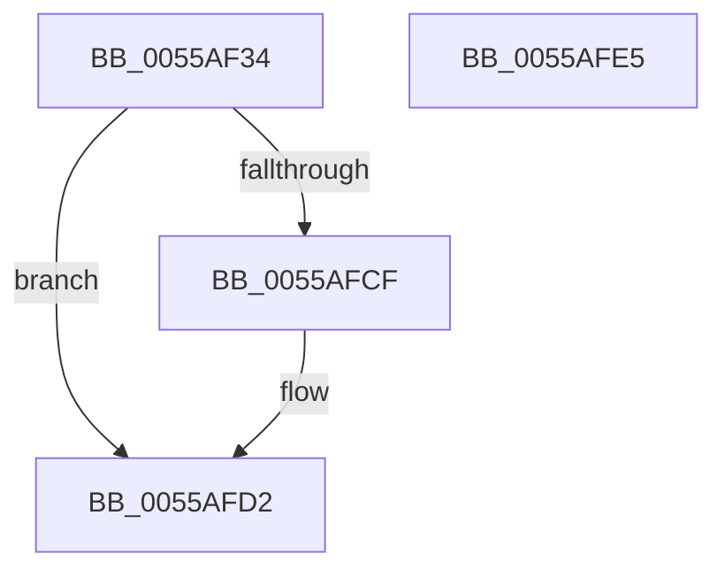

# HalpMcGetLoadConfiguration

- RVA: `0x0055AF34`–`0x0055AFE6` (길이 `178` bytes)
- VA: `0x000000014055AF34`
- 실행 섹션: `.text`
- PDB 이름 있음: `예`; PDB Function 태그: `아니요`
- unwind 정보 RVA: `0x000C47D0`
- 디코드: `42`개 명령, `178/178` bytes 표시
- 미해석 바이트: `0` (있으면 어셈블리에 `.byte`로 보존)

> 이 문서는 커널 이미지의 기계어와 PDB 기호를 분석해 생성했습니다. 4번과 5번은 함수 원형과 자료형을 바이너리 사용 방식에서 추정한 C 해석이며 원본 소스 복구 결과는 아닙니다.

## 1. Dependencies

- 직접 호출 지점: **4**; 고유 호출 대상: **4**
- 직접 호출자로 확인된 함수: **1**
- RIP 상대 이미지 참조: **4**

### Outgoing calls
- `0x0055AF57` → [memset](../6C/memset_function_006C6C40.md) (function, `0x006C6C40`)
- `0x0055AF8F` → [RtlInitUnicodeString](../42/RtlInitUnicodeString_function_0042A780.md) (function, `0x0042A780`)
- `0x0055AF98` → [MmGetSystemRoutineAddress](../../page/90/MmGetSystemRoutineAddress_function_0090EFE0.md) (function, `0x0090EFE0`)
- `0x0055AFC3` → [guard_dispatch_icall](../6B/guard_dispatch_icall_function_006BAAD0.md) (function, `0x006BAAD0`)

### Direct callers
- [HalpLoadMicrocode](../../page/70/HalpLoadMicrocode_function_0070B200.md) at `0x0070B255`

### Static image references
- `0x0055AF5C` → RVA `0x000258A0` (`.rdata`; read)
- `0x0055AF6E` → RVA `0x00023C80` (`.rdata`; read)
- `0x0055AF9D` → RVA `0x008C8FD0` (`RtlQueryRegistryValues`; read)
- `0x0055AFAF` → RVA `0x000258C0` (`.rdata`; read)

## 2. Other-region calls and transfers

- 다른 실행 섹션으로 향하는 call: **1**
  - `0x0055AF98` → [MmGetSystemRoutineAddress](../../page/90/MmGetSystemRoutineAddress_function_0090EFE0.md) (`.text` → `PAGE`)
- 별도 외부 분기/꼬리 이동을 확인하지 못했습니다.

## 3. Assembly (complete function range)

```asm
0055AF34  48 89 5C 24 10                  mov qword ptr [rsp + 0x10], rbx
0055AF39  55                              push rbp
0055AF3A  48 8D 6C 24 A9                  lea rbp, [rsp - 0x57]
0055AF3F  48 81 EC B0 00 00 00            sub rsp, 0xb0
0055AF46  83 65 67 00                     and dword ptr [rbp + 0x67], 0
0055AF4A  33 D2                           xor edx, edx
0055AF4C  48 8B D9                        mov rbx, rcx
0055AF4F  48 8D 4D E7                     lea rcx, [rbp - 0x19]
0055AF53  44 8D 42 70                     lea r8d, [rdx + 0x70]
0055AF57  E8 E4 BC 16 00                  call 0x1406c6c40
0055AF5C  48 8D 05 3D A9 AC FF            lea rax, [rip - 0x5356c3]
0055AF63  C7 45 EF 20 01 00 00            mov dword ptr [rbp - 0x11], 0x120
0055AF6A  48 89 45 F7                     mov qword ptr [rbp - 9], rax
0055AF6E  48 8D 15 0B 8D AC FF            lea rdx, [rip - 0x5372f5]
0055AF75  48 8D 45 67                     lea rax, [rbp + 0x67]
0055AF79  C7 45 07 00 00 00 04            mov dword ptr [rbp + 7], 0x4000000
0055AF80  0F 57 C0                        xorps xmm0, xmm0
0055AF83  48 89 45 FF                     mov qword ptr [rbp - 1], rax
0055AF87  48 8D 4D D7                     lea rcx, [rbp - 0x29]
0055AF8B  0F 11 45 D7                     movups xmmword ptr [rbp - 0x29], xmm0
0055AF8F  E8 EC F7 EC FF                  call 0x14042a780
0055AF94  48 8D 4D D7                     lea rcx, [rbp - 0x29]
0055AF98  E8 43 40 3B 00                  call 0x14090efe0
0055AF9D  48 8D 0D 2C E0 36 00            lea rcx, [rip + 0x36e02c]
0055AFA4  48 85 C0                        test rax, rax
0055AFA7  4C 8D 45 E7                     lea r8, [rbp - 0x19]
0055AFAB  48 0F 44 C1                     cmove rax, rcx
0055AFAF  48 8D 15 0A A9 AC FF            lea rdx, [rip - 0x5356f6]
0055AFB6  48 83 64 24 20 00               and qword ptr [rsp + 0x20], 0
0055AFBC  45 33 C9                        xor r9d, r9d
0055AFBF  41 8D 49 02                     lea ecx, [r9 + 2]
0055AFC3  E8 08 FB 15 00                  call 0x1406baad0
0055AFC8  85 C0                           test eax, eax
0055AFCA  8B 45 67                        mov eax, dword ptr [rbp + 0x67]
0055AFCD  78 03                           js 0x14055afd2
0055AFCF  83 E0 01                        and eax, 1
0055AFD2  88 03                           mov byte ptr [rbx], al
0055AFD4  48 8B 9C 24 C8 00 00 00         mov rbx, qword ptr [rsp + 0xc8]
0055AFDC  48 81 C4 B0 00 00 00            add rsp, 0xb0
0055AFE3  5D                              pop rbp
0055AFE4  C3                              ret
0055AFE5  CC                              int3
```

## 4. C-style interpretation (structured pseudocode)

```c
__int64 __fastcall HalpMcGetLoadConfiguration(__int64 a1, int a2, __int64 a3, int a4)
{
    __int64 result;
    __int64 v_rsp;
    unsigned int v_stack_m58;
    unsigned __int64 v_stack_m5F;
    unsigned __int64 v_stack_m60;
    unsigned __int64 v_stack_m68;
    unsigned int v_stack_m70;
    unsigned __int64 v_stack_m78;
    unsigned __int64 v_stack_m88;
    unsigned __int64 v_stack_m98;
    unsigned __int64 v_stack_p10;
    unsigned int v_stack_p8;

    v_stack_p10 = v_rbx;
    v_rsp = (v_rsp) - (176);
    a2 = 0;
    result = memset(v_stack_m78, a2, a2 + 112, a4);
    v_stack_m70 = 288;
    v_stack_m68 = v_rip - 5461699;
    v_stack_m58 = 0x4000000ULL;
    v_stack_m60 = v_stack_p8;
    v_stack_m88 = v_xmm0;
    result = RtlInitUnicodeString(v_stack_m88, v_rip - 5468917, a2 + 112, a4);
    result = MmGetSystemRoutineAddress(v_stack_m88, v_rip - 5468917, a2 + 112, a4);
    if (result == 0) { result = v_rip + 3596332; }
    a4 = 0;
    result = guard_dispatch_icall(a4 + 2, v_rip - 5461750, v_stack_m78, a4);
    result = (unsigned int)(v_stack_p8);
    if (!(sign_flag)) {
        result = (unsigned int)(((unsigned int)(v_stack_p8)) & (1));
    }
    *(unsigned __int8 *)(a1) = (unsigned __int8)(result);
    v_rsp = (v_rsp) + (176);
    return result;
}
```

## 5. (Beta) C Style

```c
int64_t HalpMcGetLoadConfiguration(void *Arg1, int32_t Arg2, int64_t Arg3, int32_t Arg4)
{
    uint8_t *arg1 = (uint8_t *)Arg1;

    int64_t result;
    int64_t local_rsp;
    uint32_t v_stack_m58;
    uint64_t v_stack_m5F;
    uint64_t v_stack_m60;
    uint64_t v_stack_m68;
    uint32_t v_stack_m70;
    uint64_t v_stack_m78;
    uint64_t v_stack_m88;
    uint64_t v_stack_m98;
    uint64_t v_stack_p10;
    uint32_t v_stack_p8;

    v_stack_p10 = local_rbx;
    local_rsp = (local_rsp) - (176);
    Arg2 = 0;
    result = memset(v_stack_m78, Arg2, Arg2 + 112, Arg4);
    v_stack_m70 = 288;
    v_stack_m68 = v_rip - 5461699;
    v_stack_m58 = 0x4000000ULL;
    v_stack_m60 = v_stack_p8;
    v_stack_m88 = v_xmm0;
    result = RtlInitUnicodeString(v_stack_m88, v_rip - 5468917, Arg2 + 112, Arg4);
    result = MmGetSystemRoutineAddress(v_stack_m88, v_rip - 5468917, Arg2 + 112, Arg4);
    if (result == 0) { result = v_rip + 3596332; }
    Arg4 = 0;
    result = guard_dispatch_icall(Arg4 + 2, v_rip - 5461750, v_stack_m78, Arg4);
    result = (uint32_t)(v_stack_p8);
    if (!(sign_flag)) {
        result = (uint32_t)(((uint32_t)(v_stack_p8)) & (1));
    }
    *(uint8_t *)(arg1) = (uint8_t)(result);
    local_rsp = (local_rsp) + (176);
    return result;
}
```

### 관측된 메모리 오프셋

구조체 형식이 확인되지 않은 접근은 인자 기준의 오프셋으로만 기록했습니다.

| 기준 인자 | 오프셋 표현 | 폭 (bit) | 접근 |
|---|---:|---:|---|
| `Arg1` | `+ 0x0` | `8` | `W` |

## 6. Execution-region graph

[열기: 2D/3D 그래프와 함수 탐색 컨트롤 패널](../../../control-panel.html?section=text&rva=0x0055AF34&view=graph)

- 2D 그래프는 위에서 아래로 흐르고, 3D 그래프는 빈 공간을 드래그해 회전합니다. Shift+드래그는 이동, 휠은 확대·축소, 함수 노드 선택은 대상 보고서 이동입니다.

### Static fallback


