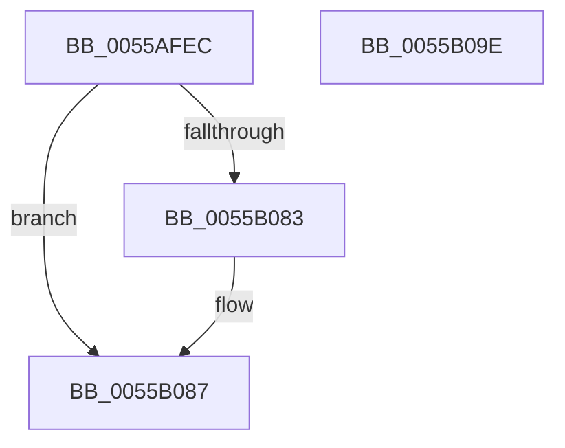

# HalpMcGetRollbackRequest

- RVA: `0x0055AFEC`–`0x0055B09F` (길이 `179` bytes)
- VA: `0x000000014055AFEC`
- 실행 섹션: `.text`
- PDB 이름 있음: `예`; PDB Function 태그: `아니요`
- unwind 정보 RVA: `0x000C3D54`
- 디코드: `41`개 명령, `179/179` bytes 표시
- 미해석 바이트: `0` (있으면 어셈블리에 `.byte`로 보존)

> 이 문서는 커널 이미지의 기계어와 PDB 기호를 분석해 생성했습니다. 4번과 5번은 함수 원형과 자료형을 바이너리 사용 방식에서 추정한 C 해석이며 원본 소스 복구 결과는 아닙니다.

## 1. Dependencies

- 직접 호출 지점: **5**; 고유 호출 대상: **5**
- 직접 호출자로 확인된 함수: **1**
- RIP 상대 이미지 참조: **4**

### Outgoing calls
- `0x0055B008` → [memset](../6C/memset_function_006C6C40.md) (function, `0x006C6C40`)
- `0x0055B040` → [RtlInitUnicodeString](../42/RtlInitUnicodeString_function_0042A780.md) (function, `0x0042A780`)
- `0x0055B049` → [MmGetSystemRoutineAddress](../../page/90/MmGetSystemRoutineAddress_function_0090EFE0.md) (function, `0x0090EFE0`)
- `0x0055B074` → [guard_dispatch_icall](../6B/guard_dispatch_icall_function_006BAAD0.md) (function, `0x006BAAD0`)
- `0x0055B090` → [PrExtControlOperations](../66/PrExtControlOperations_function_00666A6C.md) (function, `0x00666A6C`)

### Direct callers
- [HalpLoadMicrocode](../../page/70/HalpLoadMicrocode_function_0070B200.md) at `0x0070B26E`

### Static image references
- `0x0055B00D` → RVA `0x000257F0` (`.rdata`; read)
- `0x0055B01F` → RVA `0x00023C80` (`.rdata`; read)
- `0x0055B04E` → RVA `0x008C8FD0` (`RtlQueryRegistryValues`; read)
- `0x0055B060` → RVA `0x000258C0` (`.rdata`; read)

## 2. Other-region calls and transfers

- 다른 실행 섹션으로 향하는 call: **1**
  - `0x0055B049` → [MmGetSystemRoutineAddress](../../page/90/MmGetSystemRoutineAddress_function_0090EFE0.md) (`.text` → `PAGE`)
- 별도 외부 분기/꼬리 이동을 확인하지 못했습니다.

## 3. Assembly (complete function range)

```asm
0055AFEC  40 55                           push rbp
0055AFEE  48 8D 6C 24 A9                  lea rbp, [rsp - 0x57]
0055AFF3  48 81 EC B0 00 00 00            sub rsp, 0xb0
0055AFFA  83 65 67 00                     and dword ptr [rbp + 0x67], 0
0055AFFE  48 8D 4D E7                     lea rcx, [rbp - 0x19]
0055B002  33 D2                           xor edx, edx
0055B004  44 8D 42 70                     lea r8d, [rdx + 0x70]
0055B008  E8 33 BC 16 00                  call 0x1406c6c40
0055B00D  48 8D 05 DC A7 AC FF            lea rax, [rip - 0x535824]
0055B014  C7 45 EF 20 01 00 00            mov dword ptr [rbp - 0x11], 0x120
0055B01B  48 89 45 F7                     mov qword ptr [rbp - 9], rax
0055B01F  48 8D 15 5A 8C AC FF            lea rdx, [rip - 0x5373a6]
0055B026  48 8D 45 67                     lea rax, [rbp + 0x67]
0055B02A  C7 45 07 00 00 00 04            mov dword ptr [rbp + 7], 0x4000000
0055B031  0F 57 C0                        xorps xmm0, xmm0
0055B034  48 89 45 FF                     mov qword ptr [rbp - 1], rax
0055B038  48 8D 4D D7                     lea rcx, [rbp - 0x29]
0055B03C  0F 11 45 D7                     movups xmmword ptr [rbp - 0x29], xmm0
0055B040  E8 3B F7 EC FF                  call 0x14042a780
0055B045  48 8D 4D D7                     lea rcx, [rbp - 0x29]
0055B049  E8 92 3F 3B 00                  call 0x14090efe0
0055B04E  48 8D 0D 7B DF 36 00            lea rcx, [rip + 0x36df7b]
0055B055  48 85 C0                        test rax, rax
0055B058  4C 8D 45 E7                     lea r8, [rbp - 0x19]
0055B05C  48 0F 44 C1                     cmove rax, rcx
0055B060  48 8D 15 59 A8 AC FF            lea rdx, [rip - 0x5357a7]
0055B067  48 83 64 24 20 00               and qword ptr [rsp + 0x20], 0
0055B06D  45 33 C9                        xor r9d, r9d
0055B070  41 8D 49 02                     lea ecx, [r9 + 2]
0055B074  E8 57 FA 15 00                  call 0x1406baad0
0055B079  41 B8 01 00 00 00               mov r8d, 1
0055B07F  85 C0                           test eax, eax
0055B081  78 04                           js 0x14055b087
0055B083  44 21 45 67                     and dword ptr [rbp + 0x67], r8d
0055B087  48 8D 55 67                     lea rdx, [rbp + 0x67]
0055B08B  B9 0B 00 00 00                  mov ecx, 0xb
0055B090  E8 D7 B9 10 00                  call 0x140666a6c
0055B095  48 81 C4 B0 00 00 00            add rsp, 0xb0
0055B09C  5D                              pop rbp
0055B09D  C3                              ret
0055B09E  CC                              int3
```

## 4. C-style interpretation (structured pseudocode)

```c
__int64 __fastcall HalpMcGetRollbackRequest(__int64 a1, int a2, __int64 a3, int a4)
{
    __int64 result;
    __int64 v_rsp;
    unsigned int v_stack_m58;
    unsigned __int64 v_stack_m5F;
    unsigned __int64 v_stack_m60;
    unsigned __int64 v_stack_m68;
    unsigned int v_stack_m70;
    unsigned __int64 v_stack_m78;
    unsigned __int64 v_stack_m88;
    unsigned __int64 v_stack_m98;
    unsigned int v_stack_p8;

    v_rsp = (v_rsp) - (176);
    a2 = 0;
    result = memset(v_stack_m78, a2, a2 + 112, a4);
    v_stack_m70 = 288;
    v_stack_m68 = v_rip - 5462052;
    v_stack_m58 = 0x4000000ULL;
    v_stack_m60 = v_stack_p8;
    v_stack_m88 = v_xmm0;
    result = RtlInitUnicodeString(v_stack_m88, v_rip - 5469094, a2 + 112, a4);
    result = MmGetSystemRoutineAddress(v_stack_m88, v_rip - 5469094, a2 + 112, a4);
    if (result == 0) { result = v_rip + 3596155; }
    a4 = 0;
    result = guard_dispatch_icall(a4 + 2, v_rip - 5461927, v_stack_m78, a4);
    if (!(sign_flag)) {
    }
    result = PrExtControlOperations(11, v_stack_p8, 1, a4);
    v_rsp = (v_rsp) + (176);
    return result;
}
```

## 5. (Beta) C Style

```c
int64_t HalpMcGetRollbackRequest(int64_t Arg1, int32_t Arg2, int64_t Arg3, int32_t Arg4)
{
    int64_t result;
    int64_t local_rsp;
    uint32_t v_stack_m58;
    uint64_t v_stack_m5F;
    uint64_t v_stack_m60;
    uint64_t v_stack_m68;
    uint32_t v_stack_m70;
    uint64_t v_stack_m78;
    uint64_t v_stack_m88;
    uint64_t v_stack_m98;
    uint32_t v_stack_p8;

    local_rsp = (local_rsp) - (176);
    Arg2 = 0;
    result = memset(v_stack_m78, Arg2, Arg2 + 112, Arg4);
    v_stack_m70 = 288;
    v_stack_m68 = v_rip - 5462052;
    v_stack_m58 = 0x4000000ULL;
    v_stack_m60 = v_stack_p8;
    v_stack_m88 = v_xmm0;
    result = RtlInitUnicodeString(v_stack_m88, v_rip - 5469094, Arg2 + 112, Arg4);
    result = MmGetSystemRoutineAddress(v_stack_m88, v_rip - 5469094, Arg2 + 112, Arg4);
    if (result == 0) { result = v_rip + 3596155; }
    Arg4 = 0;
    result = guard_dispatch_icall(Arg4 + 2, v_rip - 5461927, v_stack_m78, Arg4);
    if (!(sign_flag)) {
    }
    result = PrExtControlOperations(11, v_stack_p8, 1, Arg4);
    local_rsp = (local_rsp) + (176);
    return result;
}
```

## 6. Execution-region graph

[열기: 2D/3D 그래프와 함수 탐색 컨트롤 패널](../../../control-panel.html?section=text&rva=0x0055AFEC&view=graph)

- 2D 그래프는 위에서 아래로 흐르고, 3D 그래프는 빈 공간을 드래그해 회전합니다. Shift+드래그는 이동, 휠은 확대·축소, 함수 노드 선택은 대상 보고서 이동입니다.

### Static fallback


