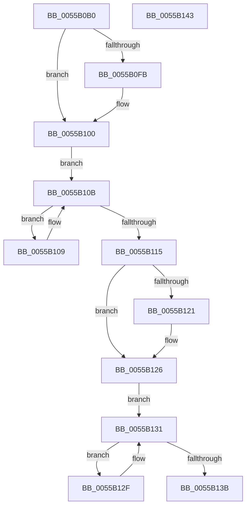

# HalpMcLoadMicrocodeWorker

- RVA: `0x0055B0B0`–`0x0055B144` (길이 `148` bytes)
- VA: `0x000000014055B0B0`
- 실행 섹션: `.text`
- PDB 이름 있음: `예`; PDB Function 태그: `아니요`
- unwind 정보 RVA: `0x0005CF00`
- 디코드: `43`개 명령, `148/148` bytes 표시
- 미해석 바이트: `0` (있으면 어셈블리에 `.byte`로 보존)

> 이 문서는 커널 이미지의 기계어와 PDB 기호를 분석해 생성했습니다. 4번과 5번은 함수 원형과 자료형을 바이너리 사용 방식에서 추정한 C 해석이며 원본 소스 복구 결과는 아닙니다.

## 1. Dependencies

- 직접 호출 지점: **3**; 고유 호출 대상: **2**
- 직접 호출자로 확인된 함수: **0**
- RIP 상대 이미지 참조: **4**

### Outgoing calls
- `0x0055B0DE` → [HalpInterruptGetIdentifiers](../4C/HalpInterruptGetIdentifiers_function_004C5DC0.md) (function, `0x004C5DC0`)
- `0x0055B0FB` → [HalpMcUpdateMicrocode](../4D/HalpMcUpdateMicrocode_function_004DB3FC.md) (function, `0x004DB3FC`)
- `0x0055B121` → [HalpMcUpdateMicrocode](../4D/HalpMcUpdateMicrocode_function_004DB3FC.md) (function, `0x004DB3FC`)

### Direct callers
- 이 함수 시작 RVA로 연결되는 직접 call은 확인되지 않았습니다. 간접 호출은 완전히 역산할 수 없습니다.

### Static image references
- `0x0055B100` → RVA `0x00F90534` (`.data`; read/write)
- `0x0055B10B` → RVA `0x00F90534` (`.data`; read)
- `0x0055B126` → RVA `0x00F90538` (`.data`; read/write)
- `0x0055B131` → RVA `0x00F90538` (`.data`; read)

## 2. Other-region calls and transfers

- 다른 실행 섹션으로 향하는 call: **0**
- 별도 외부 분기/꼬리 이동을 확인하지 못했습니다.

## 3. Assembly (complete function range)

```asm
0055B0B0  40 53                           push rbx
0055B0B2  48 83 EC 20                     sub rsp, 0x20
0055B0B6  65 48 8B 04 25 20 00 00 00      mov rax, qword ptr gs:[0x20]
0055B0BF  48 8D 54 24 38                  lea rdx, [rsp + 0x38]
0055B0C4  65 8B 0C 25 A4 01 00 00         mov ecx, dword ptr gs:[0x1a4]
0055B0CC  45 33 C0                        xor r8d, r8d
0055B0CF  83 64 24 38 00                  and dword ptr [rsp + 0x38], 0
0055B0D4  8B 98 A4 00 00 00               mov ebx, dword ptr [rax + 0xa4]
0055B0DA  FF CB                           dec ebx
0055B0DC  F7 D3                           not ebx
0055B0DE  E8 DD AC F6 FF                  call 0x1404c5dc0
0055B0E3  8B 4C 24 38                     mov ecx, dword ptr [rsp + 0x38]
0055B0E7  83 CA FF                        or edx, 0xffffffff
0055B0EA  85 C0                           test eax, eax
0055B0EC  0F 48 CA                        cmovs ecx, edx
0055B0EF  8B C1                           mov eax, ecx
0055B0F1  89 4C 24 38                     mov dword ptr [rsp + 0x38], ecx
0055B0F5  23 C3                           and eax, ebx
0055B0F7  3B C1                           cmp eax, ecx
0055B0F9  75 05                           jne 0x14055b100
0055B0FB  E8 FC 02 F8 FF                  call 0x1404db3fc
0055B100  F0 FF 0D 2D 54 A3 00            lock dec dword ptr [rip + 0xa3542d]
0055B107  EB 02                           jmp 0x14055b10b
0055B109  F3 90                           pause
0055B10B  8B 05 23 54 A3 00               mov eax, dword ptr [rip + 0xa35423]
0055B111  85 C0                           test eax, eax
0055B113  7F F4                           jg 0x14055b109
0055B115  8B 44 24 38                     mov eax, dword ptr [rsp + 0x38]
0055B119  23 C3                           and eax, ebx
0055B11B  3B 44 24 38                     cmp eax, dword ptr [rsp + 0x38]
0055B11F  74 05                           je 0x14055b126
0055B121  E8 D6 02 F8 FF                  call 0x1404db3fc
0055B126  F0 FF 0D 0B 54 A3 00            lock dec dword ptr [rip + 0xa3540b]
0055B12D  EB 02                           jmp 0x14055b131
0055B12F  F3 90                           pause
0055B131  8B 05 01 54 A3 00               mov eax, dword ptr [rip + 0xa35401]
0055B137  85 C0                           test eax, eax
0055B139  7F F4                           jg 0x14055b12f
0055B13B  33 C0                           xor eax, eax
0055B13D  48 83 C4 20                     add rsp, 0x20
0055B141  5B                              pop rbx
0055B142  C3                              ret
0055B143  CC                              int3
```

## 4. C-style interpretation (structured pseudocode)

```c
__int64 __fastcall HalpMcLoadMicrocodeWorker(__int64 a1, __int64 a2, int a3)
{
    __int64 result;
    __int64 v_rbx;
    __int64 v_rsp;
    unsigned __int64 v_stack_p10;

    v_rsp = (v_rsp) - (32);
    a3 = 0;
    v_rbx = (unsigned int)(((unsigned int)(*(unsigned int *)(*(unsigned __int64 *)(gs_base + (0 + 32)) + 164))) - 1);
    v_rbx = (unsigned int)(~(v_rbx));
    result = HalpInterruptGetIdentifiers((unsigned int)(*(unsigned int *)(gs_base + (0 + 420))), v_stack_p10, a3, a4);
    a2 = (unsigned int)((v_stack_p10) | (0xFFFFFFFFULL));
    a1 = (unsigned int)(v_stack_p10);
    if (sign_flag) { a1 = (unsigned int)(a2); }
    v_stack_p10 = (unsigned int)(a1);
    result = (unsigned int)(((unsigned int)((unsigned int)(a1))) & ((unsigned int)(v_rbx)));
    if (((unsigned int)(result)) == ((unsigned int)(a1))) {
        result = HalpMcUpdateMicrocode(a1, a2, a3, a4);
    }
    goto loc_0055B10B;
loc_0055B109:
loc_0055B10B:
    if (condition_is_greater) goto loc_0055B109;
    result = (unsigned int)(((unsigned int)(v_stack_p10)) & ((unsigned int)(v_rbx)));
    if (((unsigned int)(result)) != v_stack_p10) {
        result = HalpMcUpdateMicrocode(a1, a2, a3, a4);
    }
    goto loc_0055B131;
loc_0055B12F:
loc_0055B131:
    if (condition_is_greater) goto loc_0055B12F;
    result = 0;
    v_rsp = (v_rsp) + (32);
    return result;
}
```

## 5. (Beta) C Style

```c
int64_t HalpMcLoadMicrocodeWorker(int64_t Arg1, int64_t Arg2, int32_t Arg3)
{
    int64_t result;
    int64_t local_rbx;
    int64_t local_rsp;
    uint64_t v_stack_p10;

    local_rsp = (local_rsp) - (32);
    Arg3 = 0;
    local_rbx = (uint32_t)(((uint32_t)(*(uint32_t *)(*(uint64_t *)(gs_base + (0 + 0x20)) + 0xA4))) - 1);
    local_rbx = (uint32_t)(~(local_rbx));
    result = HalpInterruptGetIdentifiers((uint32_t)(*(uint32_t *)(gs_base + (0 + 0x1A4))), v_stack_p10, Arg3, a4);
    Arg2 = (uint32_t)((v_stack_p10) | (0xFFFFFFFFULL));
    Arg1 = (uint32_t)(v_stack_p10);
    if (sign_flag) { Arg1 = (uint32_t)(Arg2); }
    v_stack_p10 = (uint32_t)(Arg1);
    result = (uint32_t)(((uint32_t)((uint32_t)(Arg1))) & ((uint32_t)(local_rbx)));
    if (((uint32_t)(result)) == ((uint32_t)(Arg1))) {
        result = HalpMcUpdateMicrocode(Arg1, Arg2, Arg3, a4);
    }
    goto loc_0055B10B;
loc_0055B109:
loc_0055B10B:
    if (condition_is_greater) goto loc_0055B109;
    result = (uint32_t)(((uint32_t)(v_stack_p10)) & ((uint32_t)(local_rbx)));
    if (((uint32_t)(result)) != v_stack_p10) {
        result = HalpMcUpdateMicrocode(Arg1, Arg2, Arg3, a4);
    }
    goto loc_0055B131;
loc_0055B12F:
loc_0055B131:
    if (condition_is_greater) goto loc_0055B12F;
    result = 0;
    local_rsp = (local_rsp) + (32);
    return result;
}
```

## 6. Execution-region graph

[열기: 2D/3D 그래프와 함수 탐색 컨트롤 패널](../../../control-panel.html?section=text&rva=0x0055B0B0&view=graph)

- 2D 그래프는 위에서 아래로 흐르고, 3D 그래프는 빈 공간을 드래그해 회전합니다. Shift+드래그는 이동, 휠은 확대·축소, 함수 노드 선택은 대상 보고서 이동입니다.

### Static fallback


