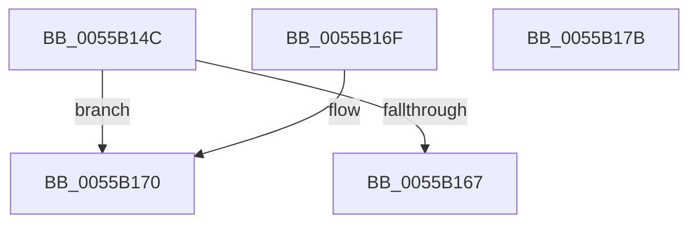

# HalpMcParallelLoadSupported

- RVA: `0x0055B14C`–`0x0055B17C` (길이 `48` bytes)
- VA: `0x000000014055B14C`
- 실행 섹션: `.text`
- PDB 이름 있음: `예`; PDB Function 태그: `아니요`
- unwind 정보 RVA: `0x000DB714`
- 디코드: `15`개 명령, `48/48` bytes 표시
- 미해석 바이트: `0` (있으면 어셈블리에 `.byte`로 보존)

> 이 문서는 커널 이미지의 기계어와 PDB 기호를 분석해 생성했습니다. 4번과 5번은 함수 원형과 자료형을 바이너리 사용 방식에서 추정한 C 해석이며 원본 소스 복구 결과는 아닙니다.

## 1. Dependencies

- 직접 호출 지점: **0**; 고유 호출 대상: **0**
- 직접 호출자로 확인된 함수: **1**
- RIP 상대 이미지 참조: **0**

### Outgoing calls
- 직접 디코드된 call 명령이 없습니다.

### Direct callers
- [HalpLoadMicrocode](../../page/70/HalpLoadMicrocode_function_0070B200.md) at `0x0070B263`

### Static image references
- 디코드된 RIP-relative 메모리 참조가 없습니다.

## 2. Other-region calls and transfers

- 다른 실행 섹션으로 향하는 call: **0**
- 별도 외부 분기/꼬리 이동을 확인하지 못했습니다.

## 3. Assembly (complete function range)

```asm
0055B14C  65 48 8B 04 25 20 00 00 00      mov rax, qword ptr gs:[0x20]
0055B155  45 32 C0                        xor r8b, r8b
0055B158  BA 01 00 00 00                  mov edx, 1
0055B15D  8A 88 8D 00 00 00               mov cl, byte ptr [rax + 0x8d]
0055B163  3A CA                           cmp cl, dl
0055B165  75 09                           jne 0x14055b170
0055B167  80 78 40 17                     cmp byte ptr [rax + 0x40], 0x17
0055B16B  0F 93 C0                        setae al
0055B16E  C3                              ret
0055B16F  CC                              int3
0055B170  80 F9 02                        cmp cl, 2
0055B173  41 0F B6 C0                     movzx eax, r8b
0055B177  0F 44 C2                        cmove eax, edx
0055B17A  C3                              ret
0055B17B  CC                              int3
```

## 4. C-style interpretation (structured pseudocode)

```c
__int64 __fastcall HalpMcParallelLoadSupported(__int64 a1, __int64 a2, unsigned __int8 a3)
{
    __int64 result;

    a3 = 0;
    if (((unsigned __int8)(*(unsigned __int8 *)(*(unsigned __int64 *)(gs_base + (0 + 32)) + 141))) != 1) goto loc_0055B170;
    result = ((*(unsigned __int8 *)(*(unsigned __int64 *)(gs_base + (0 + 32)) + 64)) >= 23) ? 1 : 0;
    return result;
loc_0055B170:
    result = 0;
    if (((unsigned __int8)(*(unsigned __int8 *)(*(unsigned __int64 *)(gs_base + (0 + 32)) + 141))) == 2) { result = 1; }
    return result;
}
```

## 5. (Beta) C Style

```c
int64_t HalpMcParallelLoadSupported(int64_t Arg1, int64_t Arg2, uint8_t Arg3)
{
    int64_t result;

    Arg3 = 0;
    if (((uint8_t)(*(uint8_t *)(*(uint64_t *)(gs_base + (0 + 0x20)) + 0x8D))) != 1) goto loc_0055B170;
    result = ((*(uint8_t *)(*(uint64_t *)(gs_base + (0 + 0x20)) + 0x40)) >= 23) ? 1 : 0;
    return result;
loc_0055B170:
    result = 0;
    if (((uint8_t)(*(uint8_t *)(*(uint64_t *)(gs_base + (0 + 0x20)) + 0x8D))) == 2) { result = 1; }
    return result;
}
```

## 6. Execution-region graph

[열기: 2D/3D 그래프와 함수 탐색 컨트롤 패널](../../../control-panel.html?section=text&rva=0x0055B14C&view=graph)

- 2D 그래프는 위에서 아래로 흐르고, 3D 그래프는 빈 공간을 드래그해 회전합니다. Shift+드래그는 이동, 휠은 확대·축소, 함수 노드 선택은 대상 보고서 이동입니다.

### Static fallback


