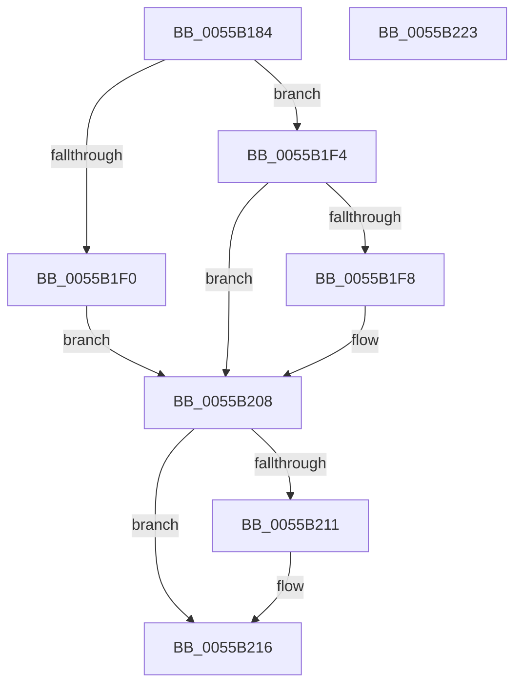

# HalpMcPatchConfiguration

- RVA: `0x0055B184`–`0x0055B224` (길이 `160` bytes)
- VA: `0x000000014055B184`
- 실행 섹션: `.text`
- PDB 이름 있음: `예`; PDB Function 태그: `아니요`
- unwind 정보 RVA: `0x000C4610`
- 디코드: `43`개 명령, `160/160` bytes 표시
- 미해석 바이트: `0` (있으면 어셈블리에 `.byte`로 보존)

> 이 문서는 커널 이미지의 기계어와 PDB 기호를 분석해 생성했습니다. 4번과 5번은 함수 원형과 자료형을 바이너리 사용 방식에서 추정한 C 해석이며 원본 소스 복구 결과는 아닙니다.

## 1. Dependencies

- 직접 호출 지점: **3**; 고유 호출 대상: **3**
- 직접 호출자로 확인된 함수: **1**
- RIP 상대 이미지 참조: **1**

### Outgoing calls
- `0x0055B1E2` → [ZwOpenKey](../6A/ZwOpenKey_function_006AD310.md) (function, `0x006AD310`)
- `0x0055B201` → [HalpMcEnumerateAndSetPatchConfig](HalpMcEnumerateAndSetPatchConfig_function_0055AB38.md) (function, `0x0055AB38`)
- `0x0055B211` → [ZwClose](../6A/ZwClose_function_006AD2B0.md) (function, `0x006AD2B0`)

### Direct callers
- [HalpLoadMicrocode](../../page/70/HalpLoadMicrocode_function_0070B200.md) at `0x0070B242`

### Static image references
- `0x0055B195` → RVA `0x00025810` (`.rdata`; read)

## 2. Other-region calls and transfers

- 다른 실행 섹션으로 향하는 call: **0**
- 별도 외부 분기/꼬리 이동을 확인하지 못했습니다.

## 3. Assembly (complete function range)

```asm
0055B184  48 89 5C 24 10                  mov qword ptr [rsp + 0x10], rbx
0055B189  55                              push rbp
0055B18A  48 8B EC                        mov rbp, rsp
0055B18D  48 83 EC 60                     sub rsp, 0x60
0055B191  83 65 EC 00                     and dword ptr [rbp - 0x14], 0
0055B195  48 8D 05 74 A6 AC FF            lea rax, [rip - 0x53598c]
0055B19C  48 83 65 10 00                  and qword ptr [rbp + 0x10], 0
0055B1A1  4C 8D 45 D0                     lea r8, [rbp - 0x30]
0055B1A5  48 83 65 D8 00                  and qword ptr [rbp - 0x28], 0
0055B1AA  48 8D 4D 10                     lea rcx, [rbp + 0x10]
0055B1AE  48 89 45 C8                     mov qword ptr [rbp - 0x38], rax
0055B1B2  0F 57 C0                        xorps xmm0, xmm0
0055B1B5  48 8D 45 C0                     lea rax, [rbp - 0x40]
0055B1B9  48 C7 45 D0 30 00 00 00         mov qword ptr [rbp - 0x30], 0x30
0055B1C1  83 65 D4 00                     and dword ptr [rbp - 0x2c], 0
0055B1C5  BA 19 00 02 00                  mov edx, 0x20019
0055B1CA  48 89 45 E0                     mov qword ptr [rbp - 0x20], rax
0055B1CE  48 C7 45 C0 8E 00 90 00         mov qword ptr [rbp - 0x40], 0x90008e
0055B1D6  C7 45 E8 40 02 00 00            mov dword ptr [rbp - 0x18], 0x240
0055B1DD  F3 0F 7F 45 F0                  movdqu xmmword ptr [rbp - 0x10], xmm0
0055B1E2  E8 29 21 15 00                  call 0x1406ad310
0055B1E7  8B D8                           mov ebx, eax
0055B1E9  3D 34 00 00 C0                  cmp eax, 0xc0000034
0055B1EE  75 04                           jne 0x14055b1f4
0055B1F0  33 DB                           xor ebx, ebx
0055B1F2  EB 14                           jmp 0x14055b208
0055B1F4  85 C0                           test eax, eax
0055B1F6  78 10                           js 0x14055b208
0055B1F8  48 8B 4D 10                     mov rcx, qword ptr [rbp + 0x10]
0055B1FC  45 33 C0                        xor r8d, r8d
0055B1FF  33 D2                           xor edx, edx
0055B201  E8 32 F9 FF FF                  call 0x14055ab38
0055B206  8B D8                           mov ebx, eax
0055B208  48 8B 4D 10                     mov rcx, qword ptr [rbp + 0x10]
0055B20C  48 85 C9                        test rcx, rcx
0055B20F  74 05                           je 0x14055b216
0055B211  E8 9A 20 15 00                  call 0x1406ad2b0
0055B216  8B C3                           mov eax, ebx
0055B218  48 8B 5C 24 78                  mov rbx, qword ptr [rsp + 0x78]
0055B21D  48 83 C4 60                     add rsp, 0x60
0055B221  5D                              pop rbp
0055B222  C3                              ret
0055B223  CC                              int3
```

## 4. C-style interpretation (structured pseudocode)

```c
__int64 __fastcall HalpMcPatchConfiguration(void)
{
    __int64 result;
    __int64 v_rbx;
    __int64 v_rsp;
    unsigned __int64 v_stack_m18;
    unsigned int v_stack_m1C;
    unsigned int v_stack_m20;
    unsigned __int64 v_stack_m28;
    unsigned __int64 v_stack_m30;
    unsigned int v_stack_m34;
    unsigned __int64 v_stack_m38;
    unsigned __int64 v_stack_m40;
    unsigned __int64 v_stack_m48;
    unsigned __int64 v_stack_p10;
    unsigned __int64 v_stack_p8;

    v_stack_p10 = v_rbx;
    v_rsp = (v_rsp) - (96);
    v_stack_m40 = v_rip - 5462412;
    v_stack_m38 = 48;
    v_stack_m28 = v_stack_m48;
    v_stack_m48 = 0x90008EULL;
    v_stack_m20 = 576;
    v_stack_m18 = v_xmm0;
    result = ZwOpenKey(v_stack_p8, (unsigned int)(0x20019ULL), v_stack_m38, a4);
    if (((unsigned int)(result)) != 0xC0000034ULL) goto loc_0055B1F4;
    v_rbx = 0;
    goto loc_0055B208;
loc_0055B1F4:
    if (!(sign_flag)) {
        a1 = v_stack_p8;
        a3 = 0;
        a2 = 0;
        result = HalpMcEnumerateAndSetPatchConfig(a1, a2, a3, a4);
        v_rbx = (unsigned int)(result);
    }
    if (v_stack_p8 != 0) {
        result = ZwClose(v_stack_p8, a2, a3, a4);
    }
    v_rsp = (v_rsp) + (96);
    return (unsigned int)((unsigned int)(v_rbx));
}
```

## 5. (Beta) C Style

```c
void HalpMcPatchConfiguration(void)
{
    int64_t result;
    int64_t local_rbx;
    int64_t local_rsp;
    uint64_t v_stack_m18;
    uint32_t v_stack_m1C;
    uint32_t v_stack_m20;
    uint64_t v_stack_m28;
    uint64_t v_stack_m30;
    uint32_t v_stack_m34;
    uint64_t v_stack_m38;
    uint64_t v_stack_m40;
    uint64_t v_stack_m48;
    uint64_t v_stack_p10;
    uint64_t v_stack_p8;

    v_stack_p10 = local_rbx;
    local_rsp = (local_rsp) - (96);
    v_stack_m40 = v_rip - 5462412;
    v_stack_m38 = 48;
    v_stack_m28 = v_stack_m48;
    v_stack_m48 = 0x90008EULL;
    v_stack_m20 = 576;
    v_stack_m18 = v_xmm0;
    result = ZwOpenKey(v_stack_p8, (uint32_t)(0x20019ULL), v_stack_m38, a4);
    if (((uint32_t)(result)) != 0xC0000034ULL) goto loc_0055B1F4;
    local_rbx = 0;
    goto loc_0055B208;
loc_0055B1F4:
    if (!(sign_flag)) {
        a1 = v_stack_p8;
        a3 = 0;
        a2 = 0;
        result = HalpMcEnumerateAndSetPatchConfig(a1, a2, a3, a4);
        local_rbx = (uint32_t)(result);
    }
    if (v_stack_p8 != 0) {
        result = ZwClose(v_stack_p8, a2, a3, a4);
    }
    local_rsp = (local_rsp) + (96);
    return (uint32_t)((uint32_t)(local_rbx));
}
```

## 6. Execution-region graph

[열기: 2D/3D 그래프와 함수 탐색 컨트롤 패널](../../../control-panel.html?section=text&rva=0x0055B184&view=graph)

- 2D 그래프는 위에서 아래로 흐르고, 3D 그래프는 빈 공간을 드래그해 회전합니다. Shift+드래그는 이동, 휠은 확대·축소, 함수 노드 선택은 대상 보고서 이동입니다.

### Static fallback


