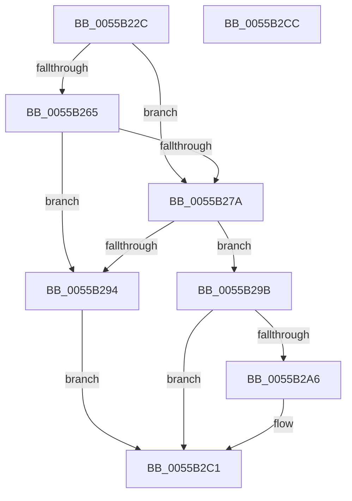

# HalpMcUpdateInitializeBSP

- RVA: `0x0055B22C`–`0x0055B2CD` (길이 `161` bytes)
- VA: `0x000000014055B22C`
- 실행 섹션: `.text`
- PDB 이름 있음: `예`; PDB Function 태그: `아니요`
- unwind 정보 RVA: `0x0006E5F8`
- 디코드: `40`개 명령, `161/161` bytes 표시
- 미해석 바이트: `0` (있으면 어셈블리에 `.byte`로 보존)

> 이 문서는 커널 이미지의 기계어와 PDB 기호를 분석해 생성했습니다. 4번과 5번은 함수 원형과 자료형을 바이너리 사용 방식에서 추정한 C 해석이며 원본 소스 복구 결과는 아닙니다.

## 1. Dependencies

- 직접 호출 지점: **4**; 고유 호출 대상: **3**
- 직접 호출자로 확인된 함수: **1**
- RIP 상대 이미지 참조: **2**

### Outgoing calls
- `0x0055B271` → [PrExtControlOperations](../66/PrExtControlOperations_function_00666A6C.md) (function, `0x00666A6C`)
- `0x0055B28B` → [PrExtControlOperations](../66/PrExtControlOperations_function_00666A6C.md) (function, `0x00666A6C`)
- `0x0055B29B` → [HalpGetCurrentMicrocodePlatform](HalpGetCurrentMicrocodePlatform_function_0055AA40.md) (function, `0x0055AA40`)
- `0x0055B2BA` → [HalpMcExportAndChargeNeededData](../../page/70/HalpMcExportAndChargeNeededData_function_0070B524.md) (function, `0x0070B524`)

### Direct callers
- [HalpProcInitSystem](../../pagelk/B5/HalpProcInitSystem_function_00B5D440.md) at `0x00B5D4B4`

### Static image references
- `0x0055B24C` → RVA `0x00F90531` (`.data`; write)
- `0x0055B280` → RVA `0x00F90531` (`.data`; read)

## 2. Other-region calls and transfers

- 다른 실행 섹션으로 향하는 call: **1**
  - `0x0055B2BA` → [HalpMcExportAndChargeNeededData](../../page/70/HalpMcExportAndChargeNeededData_function_0070B524.md) (`.text` → `PAGE`)
- 별도 외부 분기/꼬리 이동을 확인하지 못했습니다.

## 3. Assembly (complete function range)

```asm
0055B22C  48 89 5C 24 08                  mov qword ptr [rsp + 8], rbx
0055B231  57                              push rdi
0055B232  48 83 EC 30                     sub rsp, 0x30
0055B236  48 8B 81 F0 00 00 00            mov rax, qword ptr [rcx + 0xf0]
0055B23D  48 8B F9                        mov rdi, rcx
0055B240  8B 90 84 00 00 00               mov edx, dword ptr [rax + 0x84]
0055B246  C1 EA 1B                        shr edx, 0x1b
0055B249  80 E2 01                        and dl, 1
0055B24C  88 15 DF 52 A3 00               mov byte ptr [rip + 0xa352df], dl
0055B252  4C 8B 81 F0 00 00 00            mov r8, qword ptr [rcx + 0xf0]
0055B259  49 8B 90 D8 0E 00 00            mov rdx, qword ptr [r8 + 0xed8]
0055B260  48 85 D2                        test rdx, rdx
0055B263  74 15                           je 0x14055b27a
0055B265  45 8B 80 E0 0E 00 00            mov r8d, dword ptr [r8 + 0xee0]
0055B26C  B9 05 00 00 00                  mov ecx, 5
0055B271  E8 F6 B7 10 00                  call 0x140666a6c
0055B276  85 C0                           test eax, eax
0055B278  78 1A                           js 0x14055b294
0055B27A  41 B8 01 00 00 00               mov r8d, 1
0055B280  48 8D 15 AA 52 A3 00            lea rdx, [rip + 0xa352aa]
0055B287  41 8D 48 02                     lea ecx, [r8 + 2]
0055B28B  E8 DC B7 10 00                  call 0x140666a6c
0055B290  85 C0                           test eax, eax
0055B292  79 07                           jns 0x14055b29b
0055B294  B8 01 00 00 C0                  mov eax, 0xc0000001
0055B299  EB 26                           jmp 0x14055b2c1
0055B29B  E8 A0 F7 FF FF                  call 0x14055aa40
0055B2A0  8B D8                           mov ebx, eax
0055B2A2  85 C0                           test eax, eax
0055B2A4  78 1B                           js 0x14055b2c1
0055B2A6  48 8B 8F F0 00 00 00            mov rcx, qword ptr [rdi + 0xf0]
0055B2AD  8B 91 58 0F 00 00               mov edx, dword ptr [rcx + 0xf58]
0055B2B3  48 8B 89 50 0F 00 00            mov rcx, qword ptr [rcx + 0xf50]
0055B2BA  E8 65 02 1B 00                  call 0x14070b524
0055B2BF  8B C3                           mov eax, ebx
0055B2C1  48 8B 5C 24 40                  mov rbx, qword ptr [rsp + 0x40]
0055B2C6  48 83 C4 30                     add rsp, 0x30
0055B2CA  5F                              pop rdi
0055B2CB  C3                              ret
0055B2CC  CC                              int3
```

## 4. C-style interpretation (structured pseudocode)

```c
__int64 __fastcall HalpMcUpdateInitializeBSP(__int64 a1)
{
    __int64 result;
    __int64 v_rsp;
    unsigned __int64 v_stack_p8;

    v_stack_p8 = v_rbx;
    v_rsp = (v_rsp) - (48);
    a2 = (unsigned int)(((unsigned int)(*(unsigned int *)(*(unsigned __int64 *)(a1 + 240) + 132))) >> (27));
    a2 = (unsigned __int8)((a2) & (1));
    *(unsigned __int8 *)(v_rip + 10703583) = (unsigned __int8)(a2);
    if (*(unsigned __int64 *)(*(unsigned __int64 *)(a1 + 240) + 3800) == 0) goto loc_0055B27A;
    result = PrExtControlOperations(5, *(unsigned __int64 *)(*(unsigned __int64 *)(a1 + 240) + 3800), (unsigned int)(*(unsigned int *)(*(unsigned __int64 *)(a1 + 240) + 3808)), a4);
    if (sign_flag) goto loc_0055B294;
loc_0055B27A:
    result = PrExtControlOperations(1 + 2, v_rip + 10703530, 1, a4);
    if (!sign_flag) goto loc_0055B29B;
loc_0055B294:
    goto loc_0055B2C1;
loc_0055B29B:
    result = HalpGetCurrentMicrocodePlatform(1 + 2, v_rip + 10703530, 1, a4);
    if (!(sign_flag)) {
        a1 = *(unsigned __int64 *)(a1 + 240);
        a2 = *(unsigned int *)(a1 + 3928);
        a1 = *(unsigned __int64 *)(a1 + 3920);
        result = HalpMcExportAndChargeNeededData(a1, a2, 1, a4);
        result = (unsigned int)((unsigned int)((unsigned int)(result)));
    }
    v_rsp = (v_rsp) + (48);
    return result;
}
```

## 5. (Beta) C Style

```c
int64_t HalpMcUpdateInitializeBSP(void *Arg1)
{
    uint8_t *arg1 = (uint8_t *)Arg1;

    int64_t result;
    int64_t local_rsp;
    uint64_t v_stack_p8;

    v_stack_p8 = local_rbx;
    local_rsp = (local_rsp) - (48);
    a2 = (uint32_t)(((uint32_t)(*(uint32_t *)(*(uint64_t *)(arg1 + 0xF0) + 0x84))) >> (27));
    a2 = (uint8_t)((a2) & (1));
    *(uint8_t *)(v_rip + 0xA352DF) = (uint8_t)(a2);
    if (*(uint64_t *)(*(uint64_t *)(arg1 + 0xF0) + 0xED8) == 0) goto loc_0055B27A;
    result = PrExtControlOperations(5, *(uint64_t *)(*(uint64_t *)(arg1 + 0xF0) + 0xED8), (uint32_t)(*(uint32_t *)(*(uint64_t *)(arg1 + 0xF0) + 0xEE0)), a4);
    if (sign_flag) goto loc_0055B294;
loc_0055B27A:
    result = PrExtControlOperations(1 + 2, v_rip + 10703530, 1, a4);
    if (!sign_flag) goto loc_0055B29B;
loc_0055B294:
    goto loc_0055B2C1;
loc_0055B29B:
    result = HalpGetCurrentMicrocodePlatform(1 + 2, v_rip + 10703530, 1, a4);
    if (!(sign_flag)) {
        Arg1 = *(uint64_t *)(arg1 + 0xF0);
        a2 = *(uint32_t *)(arg1 + 0xF58);
        Arg1 = *(uint64_t *)(arg1 + 0xF50);
        result = HalpMcExportAndChargeNeededData(Arg1, a2, 1, a4);
        result = (uint32_t)((uint32_t)((uint32_t)(result)));
    }
    local_rsp = (local_rsp) + (48);
    return result;
}
```

### 관측된 메모리 오프셋

구조체 형식이 확인되지 않은 접근은 인자 기준의 오프셋으로만 기록했습니다.

| 기준 인자 | 오프셋 표현 | 폭 (bit) | 접근 |
|---|---:|---:|---|
| `Arg1` | `+ 0xF0` | `64` | `R` |

## 6. Execution-region graph

[열기: 2D/3D 그래프와 함수 탐색 컨트롤 패널](../../../control-panel.html?section=text&rva=0x0055B22C&view=graph)

- 2D 그래프는 위에서 아래로 흐르고, 3D 그래프는 빈 공간을 드래그해 회전합니다. Shift+드래그는 이동, 휠은 확대·축소, 함수 노드 선택은 대상 보고서 이동입니다.

### Static fallback


