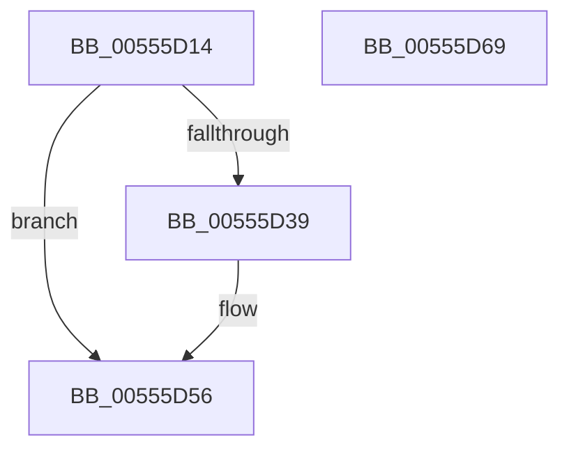

# HalpMceInitializeRecovery

- RVA: `0x00555D14`–`0x00555D6A` (길이 `86` bytes)
- VA: `0x0000000140555D14`
- 실행 섹션: `.text`
- PDB 이름 있음: `예`; PDB Function 태그: `아니요`
- unwind 정보 RVA: `0x000B64AC`
- 디코드: `25`개 명령, `86/86` bytes 표시
- 미해석 바이트: `0` (있으면 어셈블리에 `.byte`로 보존)

> 이 문서는 커널 이미지의 기계어와 PDB 기호를 분석해 생성했습니다. 4번과 5번은 함수 원형과 자료형을 바이너리 사용 방식에서 추정한 C 해석이며 원본 소스 복구 결과는 아닙니다.

## 1. Dependencies

- 직접 호출 지점: **1**; 고유 호출 대상: **1**
- 직접 호출자로 확인된 함수: **1**
- RIP 상대 이미지 참조: **2**

### Outgoing calls
- `0x00555D5E` → [_security_check_cookie](../6A/_security_check_cookie_function_006AC640.md) (function, `0x006AC640`)

### Direct callers
- [HalpInitializeMce](../../pagelk/B5/HalpInitializeMce_function_00B5BC04.md) at `0x00B5BC5B`

### Static image references
- `0x00555D1A` → RVA `0x00E0A740` (`.data`; read)
- `0x00555D4F` → RVA `0x00E0A810` (`.data`; write)

## 2. Other-region calls and transfers

- 다른 실행 섹션으로 향하는 call: **0**
- 별도 외부 분기/꼬리 이동을 확인하지 못했습니다.

## 3. Assembly (complete function range)

```asm
00555D14  40 53                           push rbx
00555D16  48 83 EC 20                     sub rsp, 0x20
00555D1A  48 8B 05 1F 4A 8B 00            mov rax, qword ptr [rip + 0x8b4a1f]
00555D21  48 33 C4                        xor rax, rsp
00555D24  48 89 44 24 10                  mov qword ptr [rsp + 0x10], rax
00555D29  33 C9                           xor ecx, ecx
00555D2B  B8 00 00 00 80                  mov eax, 0x80000000
00555D30  0F A2                           cpuid
00555D32  3D 08 00 00 80                  cmp eax, 0x80000008
00555D37  72 1D                           jb 0x140555d56
00555D39  33 C9                           xor ecx, ecx
00555D3B  B8 08 00 00 80                  mov eax, 0x80000008
00555D40  0F A2                           cpuid
00555D42  8B C8                           mov ecx, eax
00555D44  B8 01 00 00 00                  mov eax, 1
00555D49  48 D3 E0                        shl rax, cl
00555D4C  48 FF C8                        dec rax
00555D4F  48 89 05 BA 4A 8B 00            mov qword ptr [rip + 0x8b4aba], rax
00555D56  48 8B 4C 24 10                  mov rcx, qword ptr [rsp + 0x10]
00555D5B  48 33 CC                        xor rcx, rsp
00555D5E  E8 DD 68 15 00                  call 0x1406ac640
00555D63  48 83 C4 20                     add rsp, 0x20
00555D67  5B                              pop rbx
00555D68  C3                              ret
00555D69  CC                              int3
```

## 4. C-style interpretation (structured pseudocode)

```c
__int64 __fastcall HalpMceInitializeRecovery(int a1)
{
    __int64 result;
    __int64 v_rsp;
    unsigned __int64 v_stack_m18;

    v_rsp = (v_rsp) - (32);
    result = (*(unsigned __int64 *)(v_rip + 9128479)) ^ (v_rsp);
    v_stack_m18 = result;
    a1 = 0;
    result = (unsigned int)(0x80000000ULL);
    if (((unsigned int)((unsigned int)(0x80000000ULL))) >= 0x80000008ULL) {
        a1 = 0;
        result = 0x80000008ULL;
        a1 = (unsigned int)(result);
        result = 1;
        result = (result) << ((unsigned __int8)(a1));
        result = (result) - 1;
        *(unsigned __int64 *)(v_rip + 9128634) = result;
    }
    a1 = (v_stack_m18) ^ (v_rsp);
    result = _security_check_cookie(a1, a2, a3, a4);
    v_rsp = (v_rsp) + (32);
    return result;
}
```

## 5. (Beta) C Style

```c
int64_t HalpMceInitializeRecovery(int32_t Arg1)
{
    int64_t result;
    int64_t local_rsp;
    uint64_t v_stack_m18;

    local_rsp = (local_rsp) - (32);
    result = (*(uint64_t *)(v_rip + 0x8B4A1F)) ^ (local_rsp);
    v_stack_m18 = result;
    Arg1 = 0;
    result = (uint32_t)(0x80000000ULL);
    if (((uint32_t)((uint32_t)(0x80000000ULL))) >= 0x80000008ULL) {
        Arg1 = 0;
        result = 0x80000008ULL;
        Arg1 = (uint32_t)(result);
        result = 1;
        result = (result) << ((uint8_t)(Arg1));
        result = (result) - 1;
        *(uint64_t *)(v_rip + 0x8B4ABA) = result;
    }
    Arg1 = (v_stack_m18) ^ (local_rsp);
    result = _security_check_cookie(Arg1, a2, a3, a4);
    local_rsp = (local_rsp) + (32);
    return result;
}
```

## 6. Execution-region graph

[열기: 2D/3D 그래프와 함수 탐색 컨트롤 패널](../../../control-panel.html?section=text&rva=0x00555D14&view=graph)

- 2D 그래프는 위에서 아래로 흐르고, 3D 그래프는 빈 공간을 드래그해 회전합니다. Shift+드래그는 이동, 휠은 확대·축소, 함수 노드 선택은 대상 보고서 이동입니다.

### Static fallback


