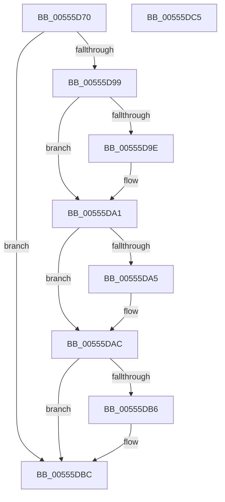

# HalpMceMemoryErrorRecovery

- RVA: `0x00555D70`–`0x00555DC6` (길이 `86` bytes)
- VA: `0x0000000140555D70`
- 실행 섹션: `.text`
- PDB 이름 있음: `예`; PDB Function 태그: `아니요`
- unwind 정보 RVA: `0x00071750`
- 디코드: `26`개 명령, `86/86` bytes 표시
- 미해석 바이트: `0` (있으면 어셈블리에 `.byte`로 보존)

> 이 문서는 커널 이미지의 기계어와 PDB 기호를 분석해 생성했습니다. 4번과 5번은 함수 원형과 자료형을 바이너리 사용 방식에서 추정한 C 해석이며 원본 소스 복구 결과는 아닙니다.

## 1. Dependencies

- 직접 호출 지점: **0**; 고유 호출 대상: **0**
- 직접 호출자로 확인된 함수: **2**
- RIP 상대 이미지 참조: **0**

### Outgoing calls
- 직접 디코드된 call 명령이 없습니다.

### Direct callers
- [HalpMceRecoveryMemoryErrorAmd](HalpMceRecoveryMemoryErrorAmd_function_00556024.md) at `0x005560F4`
- [HalpMceRecoveryMemoryErrorIntel](HalpMceRecoveryMemoryErrorIntel_function_00556138.md) at `0x00556251`

### Static image references
- 디코드된 RIP-relative 메모리 참조가 없습니다.

## 2. Other-region calls and transfers

- 다른 실행 섹션으로 향하는 call: **0**
- 별도 외부 분기/꼬리 이동을 확인하지 못했습니다.

## 3. Assembly (complete function range)

```asm
00555D70  48 89 5C 24 08                  mov qword ptr [rsp + 8], rbx
00555D75  65 48 8B 04 25 18 00 00 00      mov rax, qword ptr gs:[0x18]
00555D7E  44 8A D9                        mov r11b, cl
00555D81  BB 01 00 00 C0                  mov ebx, 0xc0000001
00555D86  44 8B D3                        mov r10d, ebx
00555D89  4C 8B 88 D8 00 00 00            mov r9, qword ptr [rax + 0xd8]
00555D90  49 8B 49 20                     mov rcx, qword ptr [r9 + 0x20]
00555D94  48 85 C9                        test rcx, rcx
00555D97  74 23                           je 0x140555dbc
00555D99  45 84 DB                        test r11b, r11b
00555D9C  74 03                           je 0x140555da1
00555D9E  83 09 09                        or dword ptr [rcx], 9
00555DA1  84 D2                           test dl, dl
00555DA3  74 07                           je 0x140555dac
00555DA5  83 09 05                        or dword ptr [rcx], 5
00555DA8  4C 89 41 08                     mov qword ptr [rcx + 8], r8
00555DAC  8B 09                           mov ecx, dword ptr [rcx]
00555DAE  45 33 D2                        xor r10d, r10d
00555DB1  F6 C1 10                        test cl, 0x10
00555DB4  74 06                           je 0x140555dbc
00555DB6  84 D2                           test dl, dl
00555DB8  44 0F 44 D3                     cmove r10d, ebx
00555DBC  48 8B 5C 24 08                  mov rbx, qword ptr [rsp + 8]
00555DC1  41 8B C2                        mov eax, r10d
00555DC4  C3                              ret
00555DC5  CC                              int3
```

## 4. C-style interpretation (structured pseudocode)

```c
__int64 __fastcall HalpMceMemoryErrorRecovery(unsigned __int8 a1, unsigned __int8 a2, __int64 a3)
{
    __int64 v_r10;
    unsigned __int64 v_stack_p8;

    v_stack_p8 = v_rbx;
    if (*(unsigned __int64 *)(*(unsigned __int64 *)(*(unsigned __int64 *)(gs_base + (0 + 24)) + 216) + 32) == 0) goto loc_00555DBC;
    if (a1 != 0) {
    }
    if (a2 != 0) {
        *(unsigned __int64 *)(*(unsigned __int64 *)(*(unsigned __int64 *)(*(unsigned __int64 *)(gs_base + (0 + 24)) + 216) + 32) + 8) = a3;
    }
    v_r10 = 0;
    if ((((unsigned __int8)((unsigned int)(*(unsigned int *)(*(unsigned __int64 *)(*(unsigned __int64 *)(*(unsigned __int64 *)(gs_base + (0 + 24)) + 216) + 32))))) & (16)) != 0) {
        if (a2 == 0) { v_r10 = (unsigned int)((unsigned int)(0xC0000001ULL)); }
    }
    return (unsigned int)((unsigned int)(v_r10));
}
```

## 5. (Beta) C Style

```c
int64_t HalpMceMemoryErrorRecovery(uint8_t Arg1, uint8_t Arg2, int64_t Arg3)
{
    int64_t local_r10;
    uint64_t v_stack_p8;

    v_stack_p8 = local_rbx;
    if (*(uint64_t *)(*(uint64_t *)(*(uint64_t *)(gs_base + (0 + 0x18)) + 0xD8) + 0x20) == 0) goto loc_00555DBC;
    if (Arg1 != 0) {
    }
    if (Arg2 != 0) {
        *(uint64_t *)(*(uint64_t *)(*(uint64_t *)(*(uint64_t *)(gs_base + (0 + 0x18)) + 0xD8) + 0x20) + 0x8) = Arg3;
    }
    local_r10 = 0;
    if ((((uint8_t)((uint32_t)(*(uint32_t *)(*(uint64_t *)(*(uint64_t *)(*(uint64_t *)(gs_base + (0 + 0x18)) + 0xD8) + 0x20))))) & (16)) != 0) {
        if (Arg2 == 0) { local_r10 = (uint32_t)((uint32_t)(0xC0000001ULL)); }
    }
    return (uint32_t)((uint32_t)(local_r10));
}
```

## 6. Execution-region graph

[열기: 2D/3D 그래프와 함수 탐색 컨트롤 패널](../../../control-panel.html?section=text&rva=0x00555D70&view=graph)

- 2D 그래프는 위에서 아래로 흐르고, 3D 그래프는 빈 공간을 드래그해 회전합니다. Shift+드래그는 이동, 휠은 확대·축소, 함수 노드 선택은 대상 보고서 이동입니다.

### Static fallback


