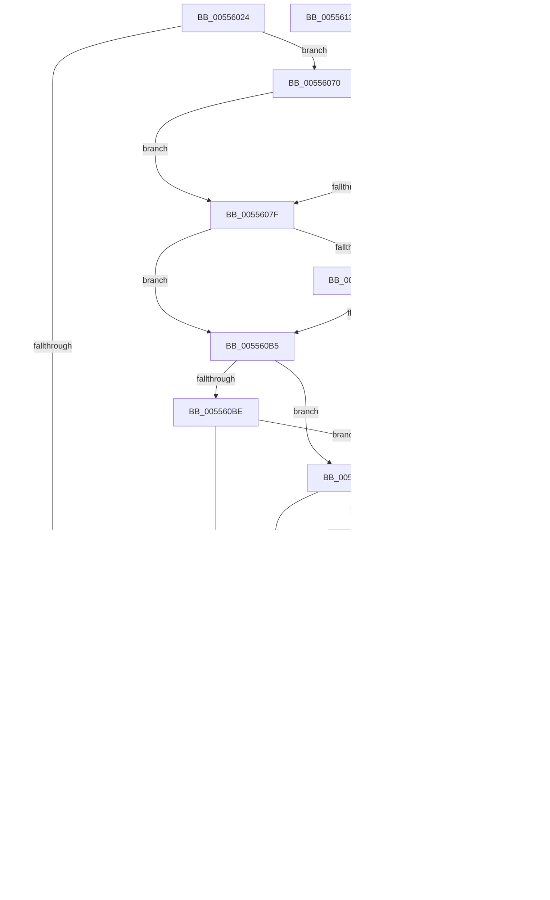

# HalpMceRecoveryMemoryErrorAmd

- RVA: `0x00556024`–`0x00556131` (길이 `269` bytes)
- VA: `0x0000000140556024`
- 실행 섹션: `.text`
- PDB 이름 있음: `예`; PDB Function 태그: `아니요`
- unwind 정보 RVA: `0x000717F8`
- 디코드: `76`개 명령, `269/269` bytes 표시
- 미해석 바이트: `0` (있으면 어셈블리에 `.byte`로 보존)

> 이 문서는 커널 이미지의 기계어와 PDB 기호를 분석해 생성했습니다. 4번과 5번은 함수 원형과 자료형을 바이너리 사용 방식에서 추정한 C 해석이며 원본 소스 복구 결과는 아닙니다.

## 1. Dependencies

- 직접 호출 지점: **2**; 고유 호출 대상: **2**
- 직접 호출자로 확인된 함수: **1**
- RIP 상대 이미지 참조: **1**

### Outgoing calls
- `0x005560D3` → [HalpHvMceConsumedMemoryErrorRecovery](../54/HalpHvMceConsumedMemoryErrorRecovery_function_0054C310.md) (function, `0x0054C310`)
- `0x005560F4` → [HalpMceMemoryErrorRecovery](HalpMceMemoryErrorRecovery_function_00555D70.md) (function, `0x00555D70`)

### Direct callers
- [HalpMceRecoveryMemoryError](HalpMceRecoveryMemoryError_function_00556000.md) at `0x00556011`

### Static image references
- `0x005560B5` → RVA `0x00FC1C48` (`.data`; read)

## 2. Other-region calls and transfers

- 다른 실행 섹션으로 향하는 call: **0**
- 별도 외부 분기/꼬리 이동을 확인하지 못했습니다.

## 3. Assembly (complete function range)

```asm
00556024  48 89 5C 24 10                  mov qword ptr [rsp + 0x10], rbx
00556029  48 89 74 24 18                  mov qword ptr [rsp + 0x18], rsi
0055602E  57                              push rdi
0055602F  48 83 EC 30                     sub rsp, 0x30
00556033  48 83 64 24 40 00               and qword ptr [rsp + 0x40], 0
00556039  48 8B D9                        mov rbx, rcx
0055603C  40 32 F6                        xor sil, sil
0055603F  33 FF                           xor edi, edi
00556041  B9 BB 00 00 C0                  mov ecx, 0xc00000bb
00556046  48 8B 43 14                     mov rax, qword ptr [rbx + 0x14]
0055604A  4C 8B 43 28                     mov r8, qword ptr [rbx + 0x28]
0055604E  44 8B C8                        mov r9d, eax
00556051  41 D1 E9                        shr r9d, 1
00556054  41 83 E1 01                     and r9d, 1
00556058  75 16                           jne 0x140556070
0055605A  83 3B 03                        cmp dword ptr [rbx], 3
0055605D  72 07                           jb 0x140556066
0055605F  83 8B 10 01 00 00 08            or dword ptr [rbx + 0x110], 8
00556066  B9 01 00 00 C0                  mov ecx, 0xc0000001
0055606B  E9 AE 00 00 00                  jmp 0x14055611e
00556070  49 0F BA E0 2B                  bt r8, 0x2b
00556075  72 08                           jb 0x14055607f
00556077  A8 01                           test al, 1
00556079  0F 85 93 00 00 00               jne 0x140556112
0055607F  49 0F BA E0 3A                  bt r8, 0x3a
00556084  73 2F                           jae 0x1405560b5
00556086  48 8B 53 30                     mov rdx, qword ptr [rbx + 0x30]
0055608A  BF 01 00 00 00                  mov edi, 1
0055608F  48 8B CA                        mov rcx, rdx
00556092  40 B6 01                        mov sil, 1
00556095  48 C1 E9 38                     shr rcx, 0x38
00556099  83 E1 3F                        and ecx, 0x3f
0055609C  48 D3 E7                        shl rdi, cl
0055609F  48 B9 FF FF FF FF FF FF FF 00   movabs rcx, 0xffffffffffffff
005560A9  48 FF CF                        dec rdi
005560AC  48 F7 D7                        not rdi
005560AF  48 23 FA                        and rdi, rdx
005560B2  48 23 F9                        and rdi, rcx
005560B5  80 3D 8C BB A6 00 00            cmp byte ptr [rip + 0xa6bb8c], 0
005560BC  74 2E                           je 0x1405560ec
005560BE  8B 4B 10                        mov ecx, dword ptr [rbx + 0x10]
005560C1  24 01                           and al, 1
005560C3  89 4C 24 40                     mov dword ptr [rsp + 0x40], ecx
005560C7  48 8B D7                        mov rdx, rdi
005560CA  48 8B 4C 24 40                  mov rcx, qword ptr [rsp + 0x40]
005560CF  88 44 24 20                     mov byte ptr [rsp + 0x20], al
005560D3  E8 38 62 FF FF                  call 0x14054c310
005560D8  8B C8                           mov ecx, eax
005560DA  85 C0                           test eax, eax
005560DC  78 0E                           js 0x1405560ec
005560DE  83 3B 03                        cmp dword ptr [rbx], 3
005560E1  72 3B                           jb 0x14055611e
005560E3  83 8B 14 01 00 00 02            or dword ptr [rbx + 0x114], 2
005560EA  EB 32                           jmp 0x14055611e
005560EC  4C 8B C7                        mov r8, rdi
005560EF  40 8A D6                        mov dl, sil
005560F2  B1 01                           mov cl, 1
005560F4  E8 77 FC FF FF                  call 0x140555d70
005560F9  8B C8                           mov ecx, eax
005560FB  85 C0                           test eax, eax
005560FD  79 0C                           jns 0x14055610b
005560FF  83 3B 03                        cmp dword ptr [rbx], 3
00556102  72 07                           jb 0x14055610b
00556104  83 8B 10 01 00 00 10            or dword ptr [rbx + 0x110], 0x10
0055610B  3D BB 00 00 C0                  cmp eax, 0xc00000bb
00556110  75 0C                           jne 0x14055611e
00556112  83 3B 03                        cmp dword ptr [rbx], 3
00556115  72 07                           jb 0x14055611e
00556117  83 8B 10 01 00 00 01            or dword ptr [rbx + 0x110], 1
0055611E  48 8B 5C 24 48                  mov rbx, qword ptr [rsp + 0x48]
00556123  8B C1                           mov eax, ecx
00556125  48 8B 74 24 50                  mov rsi, qword ptr [rsp + 0x50]
0055612A  48 83 C4 30                     add rsp, 0x30
0055612E  5F                              pop rdi
0055612F  C3                              ret
00556130  CC                              int3
```

## 4. C-style interpretation (structured pseudocode)

```c
__int64 __fastcall HalpMceRecoveryMemoryErrorAmd(__int64 a1)
{
    __int64 result;
    __int64 v_rdi;
    __int64 v_rsi;
    __int64 v_rsp;
    unsigned __int8 v_stack_m18;
    unsigned __int64 v_stack_p10;
    unsigned __int64 v_stack_p18;
    unsigned __int64 v_stack_p8;

    v_stack_p10 = v_rbx;
    v_stack_p18 = v_rsi;
    v_rsp = (v_rsp) - (48);
    v_rsi = 0;
    v_rdi = 0;
    a4 = (unsigned int)(((unsigned int)((unsigned int)(*(unsigned __int64 *)(a1 + 20)))) >> (1));
    a4 = (unsigned int)((a4) & (1));
    if (condition_is_not_equal) goto loc_00556070;
    if ((*(unsigned int *)(a1)) >= 3) {
    }
    goto loc_0055611E;
loc_00556070:
    if ((*(unsigned int *)(a1)) < 3) goto loc_0055607F;
    if ((((unsigned __int8)(*(unsigned __int64 *)(a1 + 20))) & (1)) != 0) goto loc_00556112;
loc_0055607F:
    if (!(condition_is_above_or_equal)) {
        a2 = *(unsigned __int64 *)(a1 + 48);
        v_rdi = 1;
        a1 = a2;
        v_rsi = 1;
        a1 = (a1) >> (56);
        a1 = (unsigned int)((a1) & (63));
        v_rdi = (v_rdi) << ((unsigned __int8)(a1));
        v_rdi = (v_rdi) - 1;
        v_rdi = ~(v_rdi);
        v_rdi = (v_rdi) & (a2);
        v_rdi = (v_rdi) & (a1);
    }
    if ((*(unsigned __int8 *)(v_rip + 10926988)) == 0) goto loc_005560EC;
    result = (unsigned __int8)((*(unsigned __int64 *)(a1 + 20)) & (1));
    v_stack_p8 = (unsigned int)((unsigned int)(*(unsigned int *)(a1 + 16)));
    v_stack_m18 = (unsigned __int8)(result);
    result = HalpHvMceConsumedMemoryErrorRecovery(v_stack_p8, v_rdi, *(unsigned __int64 *)(a1 + 40), a4);
    if (sign_flag) goto loc_005560EC;
    if ((*(unsigned int *)(a1)) < 3) goto loc_0055611E;
    goto loc_0055611E;
loc_005560EC:
    result = HalpMceMemoryErrorRecovery(1, (unsigned __int8)(v_rsi), v_rdi, a4);
    if (!sign_flag) goto loc_0055610B;
    if ((*(unsigned int *)(a1)) >= 3) {
    }
    if (((unsigned int)(result)) != 0xC00000BBULL) goto loc_0055611E;
loc_00556112:
    if ((*(unsigned int *)(a1)) >= 3) {
    }
    v_rsp = (v_rsp) + (48);
    return (unsigned int)((unsigned int)((unsigned int)((unsigned int)(result))));
}
```

## 5. (Beta) C Style

```c
int64_t HalpMceRecoveryMemoryErrorAmd(void *Arg1)
{
    uint8_t *arg1 = (uint8_t *)Arg1;

    int64_t result;
    int64_t local_rdi;
    int64_t local_rsi;
    int64_t local_rsp;
    uint8_t v_stack_m18;
    uint64_t v_stack_p10;
    uint64_t v_stack_p18;
    uint64_t v_stack_p8;

    v_stack_p10 = local_rbx;
    v_stack_p18 = local_rsi;
    local_rsp = (local_rsp) - (48);
    local_rsi = 0;
    local_rdi = 0;
    a4 = (uint32_t)(((uint32_t)((uint32_t)(*(uint64_t *)(arg1 + 0x14)))) >> (1));
    a4 = (uint32_t)((a4) & (1));
    if (condition_is_not_equal) goto loc_00556070;
    if ((*(uint32_t *)(arg1)) >= 3) {
    }
    goto loc_0055611E;
loc_00556070:
    if ((*(uint32_t *)(arg1)) < 3) goto loc_0055607F;
    if ((((uint8_t)(*(uint64_t *)(arg1 + 0x14))) & (1)) != 0) goto loc_00556112;
loc_0055607F:
    if (!(condition_is_above_or_equal)) {
        a2 = *(uint64_t *)(arg1 + 0x30);
        local_rdi = 1;
        Arg1 = a2;
        local_rsi = 1;
        Arg1 = (Arg1) >> (56);
        Arg1 = (uint32_t)((Arg1) & (63));
        local_rdi = (local_rdi) << ((uint8_t)(Arg1));
        local_rdi = (local_rdi) - 1;
        local_rdi = ~(local_rdi);
        local_rdi = (local_rdi) & (a2);
        local_rdi = (local_rdi) & (Arg1);
    }
    if ((*(uint8_t *)(v_rip + 0xA6BB8C)) == 0) goto loc_005560EC;
    result = (uint8_t)((*(uint64_t *)(arg1 + 0x14)) & (1));
    v_stack_p8 = (uint32_t)((uint32_t)(*(uint32_t *)(arg1 + 0x10)));
    v_stack_m18 = (uint8_t)(result);
    result = HalpHvMceConsumedMemoryErrorRecovery(v_stack_p8, local_rdi, *(uint64_t *)(arg1 + 0x28), a4);
    if (sign_flag) goto loc_005560EC;
    if ((*(uint32_t *)(arg1)) < 3) goto loc_0055611E;
    goto loc_0055611E;
loc_005560EC:
    result = HalpMceMemoryErrorRecovery(1, (uint8_t)(local_rsi), local_rdi, a4);
    if (!sign_flag) goto loc_0055610B;
    if ((*(uint32_t *)(arg1)) >= 3) {
    }
    if (((uint32_t)(result)) != 0xC00000BBULL) goto loc_0055611E;
loc_00556112:
    if ((*(uint32_t *)(arg1)) >= 3) {
    }
    local_rsp = (local_rsp) + (48);
    return (uint32_t)((uint32_t)((uint32_t)((uint32_t)(result))));
}
```

### 관측된 메모리 오프셋

구조체 형식이 확인되지 않은 접근은 인자 기준의 오프셋으로만 기록했습니다.

| 기준 인자 | 오프셋 표현 | 폭 (bit) | 접근 |
|---|---:|---:|---|
| `Arg1` | `+ 0x0` | `32` | `R` |
| `Arg1` | `+ 0x10` | `32` | `R` |
| `Arg1` | `+ 0x14` | `64` | `R` |
| `Arg1` | `+ 0x28` | `64` | `R` |
| `Arg1` | `+ 0x30` | `64` | `R` |
| `Arg1` | `+ 0x110` | `32` | `R/W` |
| `Arg1` | `+ 0x114` | `32` | `R/W` |

## 6. Execution-region graph

[열기: 2D/3D 그래프와 함수 탐색 컨트롤 패널](../../../control-panel.html?section=text&rva=0x00556024&view=graph)

- 2D 그래프는 위에서 아래로 흐르고, 3D 그래프는 빈 공간을 드래그해 회전합니다. Shift+드래그는 이동, 휠은 확대·축소, 함수 노드 선택은 대상 보고서 이동입니다.

### Static fallback


