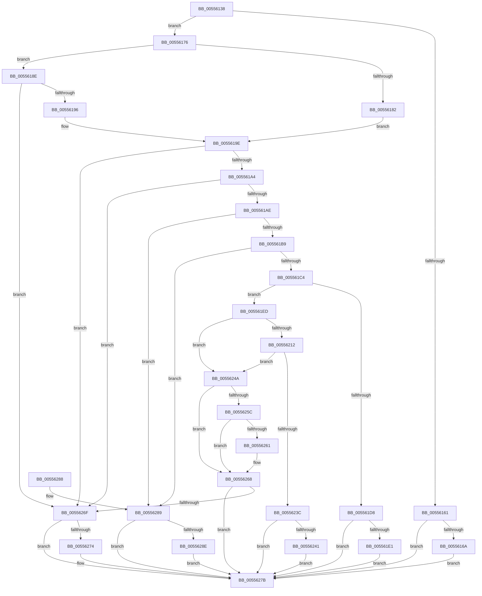

# HalpMceRecoveryMemoryErrorIntel

- RVA: `0x00556138`–`0x00556297` (길이 `351` bytes)
- VA: `0x0000000140556138`
- 실행 섹션: `.text`
- PDB 이름 있음: `예`; PDB Function 태그: `아니요`
- unwind 정보 RVA: `0x000C458C`
- 디코드: `98`개 명령, `351/351` bytes 표시
- 미해석 바이트: `0` (있으면 어셈블리에 `.byte`로 보존)

> 이 문서는 커널 이미지의 기계어와 PDB 기호를 분석해 생성했습니다. 4번과 5번은 함수 원형과 자료형을 바이너리 사용 방식에서 추정한 C 해석이며 원본 소스 복구 결과는 아닙니다.

## 1. Dependencies

- 직접 호출 지점: **2**; 고유 호출 대상: **2**
- 직접 호출자로 확인된 함수: **1**
- RIP 상대 이미지 참조: **2**

### Outgoing calls
- `0x00556231` → [HalpHvMceConsumedMemoryErrorRecovery](../54/HalpHvMceConsumedMemoryErrorRecovery_function_0054C310.md) (function, `0x0054C310`)
- `0x00556251` → [HalpMceMemoryErrorRecovery](HalpMceMemoryErrorRecovery_function_00555D70.md) (function, `0x00555D70`)

### Direct callers
- [HalpMceRecoveryMemoryError](HalpMceRecoveryMemoryError_function_00556000.md) at `0x0055600A`

### Static image references
- `0x00556202` → RVA `0x00E0A810` (`.data`; read)
- `0x00556209` → RVA `0x00FC1C48` (`.data`; read)

## 2. Other-region calls and transfers

- 다른 실행 섹션으로 향하는 call: **0**
- 별도 외부 분기/꼬리 이동을 확인하지 못했습니다.

## 3. Assembly (complete function range)

```asm
00556138  48 89 5C 24 10                  mov qword ptr [rsp + 0x10], rbx
0055613D  57                              push rdi
0055613E  48 83 EC 30                     sub rsp, 0x30
00556142  4C 8B 49 14                     mov r9, qword ptr [rcx + 0x14]
00556146  48 8B D9                        mov rbx, rcx
00556149  48 83 64 24 40 00               and qword ptr [rsp + 0x40], 0
0055614F  41 8B C1                        mov eax, r9d
00556152  4C 8B 41 28                     mov r8, qword ptr [rcx + 0x28]
00556156  24 03                           and al, 3
00556158  BA BB 00 00 C0                  mov edx, 0xc00000bb
0055615D  3C 01                           cmp al, 1
0055615F  75 15                           jne 0x140556176
00556161  83 39 03                        cmp dword ptr [rcx], 3
00556164  0F 82 11 01 00 00               jb 0x14055627b
0055616A  83 89 10 01 00 00 08            or dword ptr [rcx + 0x110], 8
00556171  E9 05 01 00 00                  jmp 0x14055627b
00556176  41 8A C0                        mov al, r8b
00556179  C0 E8 04                        shr al, 4
0055617C  24 0F                           and al, 0xf
0055617E  3C 03                           cmp al, 3
00556180  75 0C                           jne 0x14055618e
00556182  41 8A C0                        mov al, r8b
00556185  C0 E8 02                        shr al, 2
00556188  24 03                           and al, 3
0055618A  3C 01                           cmp al, 1
0055618C  EB 10                           jmp 0x14055619e
0055618E  3C 05                           cmp al, 5
00556190  0F 85 D9 00 00 00               jne 0x14055626f
00556196  41 8A C0                        mov al, r8b
00556199  C0 E8 02                        shr al, 2
0055619C  A8 03                           test al, 3
0055619E  0F 85 CB 00 00 00               jne 0x14055626f
005561A4  41 F6 C0 03                     test r8b, 3
005561A8  0F 85 C1 00 00 00               jne 0x14055626f
005561AE  49 0F BA E0 3B                  bt r8, 0x3b
005561B3  0F 83 D0 00 00 00               jae 0x140556289
005561B9  49 0F BA E0 3A                  bt r8, 0x3a
005561BE  0F 83 C5 00 00 00               jae 0x140556289
005561C4  48 8B 49 38                     mov rcx, qword ptr [rcx + 0x38]
005561C8  48 8B C1                        mov rax, rcx
005561CB  25 C0 01 00 00                  and eax, 0x1c0
005561D0  48 3D 80 00 00 00               cmp rax, 0x80
005561D6  74 15                           je 0x1405561ed
005561D8  83 3B 03                        cmp dword ptr [rbx], 3
005561DB  0F 82 9A 00 00 00               jb 0x14055627b
005561E1  83 8B 10 01 00 00 40            or dword ptr [rbx + 0x110], 0x40
005561E8  E9 8E 00 00 00                  jmp 0x14055627b
005561ED  83 E1 3F                        and ecx, 0x3f
005561F0  BF 01 00 00 00                  mov edi, 1
005561F5  48 D3 E7                        shl rdi, cl
005561F8  48 FF CF                        dec rdi
005561FB  48 F7 D7                        not rdi
005561FE  48 23 7B 30                     and rdi, qword ptr [rbx + 0x30]
00556202  48 23 3D 07 46 8B 00            and rdi, qword ptr [rip + 0x8b4607]
00556209  80 3D 38 BA A6 00 00            cmp byte ptr [rip + 0xa6ba38], 0
00556210  74 38                           je 0x14055624a
00556212  8B 43 10                        mov eax, dword ptr [rbx + 0x10]
00556215  48 8B D7                        mov rdx, rdi
00556218  89 44 24 40                     mov dword ptr [rsp + 0x40], eax
0055621C  41 8A C1                        mov al, r9b
0055621F  48 8B 4C 24 40                  mov rcx, qword ptr [rsp + 0x40]
00556224  24 01                           and al, 1
00556226  41 D1 E9                        shr r9d, 1
00556229  41 80 E1 01                     and r9b, 1
0055622D  88 44 24 20                     mov byte ptr [rsp + 0x20], al
00556231  E8 DA 60 FF FF                  call 0x14054c310
00556236  8B D0                           mov edx, eax
00556238  85 C0                           test eax, eax
0055623A  78 0E                           js 0x14055624a
0055623C  83 3B 03                        cmp dword ptr [rbx], 3
0055623F  72 3A                           jb 0x14055627b
00556241  83 8B 14 01 00 00 02            or dword ptr [rbx + 0x114], 2
00556248  EB 31                           jmp 0x14055627b
0055624A  B2 01                           mov dl, 1
0055624C  4C 8B C7                        mov r8, rdi
0055624F  8A CA                           mov cl, dl
00556251  E8 1A FB FF FF                  call 0x140555d70
00556256  8B D0                           mov edx, eax
00556258  85 C0                           test eax, eax
0055625A  79 0C                           jns 0x140556268
0055625C  83 3B 03                        cmp dword ptr [rbx], 3
0055625F  72 07                           jb 0x140556268
00556261  83 8B 10 01 00 00 10            or dword ptr [rbx + 0x110], 0x10
00556268  3D BB 00 00 C0                  cmp eax, 0xc00000bb
0055626D  75 0C                           jne 0x14055627b
0055626F  83 3B 03                        cmp dword ptr [rbx], 3
00556272  72 07                           jb 0x14055627b
00556274  83 8B 10 01 00 00 01            or dword ptr [rbx + 0x110], 1
0055627B  48 8B 5C 24 48                  mov rbx, qword ptr [rsp + 0x48]
00556280  8B C2                           mov eax, edx
00556282  48 83 C4 30                     add rsp, 0x30
00556286  5F                              pop rdi
00556287  C3                              ret
00556288  CC                              int3
00556289  83 39 03                        cmp dword ptr [rcx], 3
0055628C  72 ED                           jb 0x14055627b
0055628E  83 89 10 01 00 00 20            or dword ptr [rcx + 0x110], 0x20
00556295  EB E4                           jmp 0x14055627b
```

## 4. C-style interpretation (structured pseudocode)

```c
__int64 __fastcall HalpMceRecoveryMemoryErrorIntel(__int64 a1)
{
    __int64 result;
    __int64 v_rdi;
    __int64 v_rsp;
    unsigned __int8 v_stack_m18;
    unsigned __int64 v_stack_p10;
    unsigned __int64 v_stack_p8;

    v_stack_p10 = v_rbx;
    v_rsp = (v_rsp) - (48);
    result = (unsigned __int8)(((unsigned int)((unsigned int)(*(unsigned __int64 *)(a1 + 20)))) & (3));
    if (((unsigned __int8)(result)) != 1) goto loc_00556176;
    if ((*(unsigned int *)(a1)) < 3) goto loc_0055627B;
    goto loc_0055627B;
loc_00556176:
    result = (unsigned __int8)(((unsigned __int8)(*(unsigned __int64 *)(a1 + 40))) >> (4));
    result = (unsigned __int8)((result) & (15));
    if (((unsigned __int8)(result)) != 3) goto loc_0055618E;
    result = (unsigned __int8)(((unsigned __int8)(*(unsigned __int64 *)(a1 + 40))) >> (2));
    result = (unsigned __int8)((result) & (3));
    goto loc_0055619E;
loc_0055618E:
    if (((unsigned __int8)(result)) != 5) goto loc_0055626F;
    result = (unsigned __int8)(((unsigned __int8)(*(unsigned __int64 *)(a1 + 40))) >> (2));
loc_0055619E:
    if ((((unsigned __int8)(result)) & (3)) != 0) goto loc_0055626F;
    if ((((unsigned __int8)(*(unsigned __int64 *)(a1 + 40))) & (3)) != 0) goto loc_0055626F;
    if (condition_is_above_or_equal) goto loc_00556289;
    if (condition_is_above_or_equal) goto loc_00556289;
    result = (unsigned int)((*(unsigned __int64 *)(a1 + 56)) & (448));
    if (result == 128) goto loc_005561ED;
    if ((*(unsigned int *)(a1)) < 3) goto loc_0055627B;
    goto loc_0055627B;
loc_005561ED:
    a1 = (unsigned int)((*(unsigned __int64 *)(a1 + 56)) & (63));
    v_rdi = (1) << ((unsigned __int8)(a1));
    v_rdi = (v_rdi) - 1;
    v_rdi = ~(v_rdi);
    v_rdi = (v_rdi) & (*(unsigned __int64 *)(a1 + 48));
    v_rdi = (v_rdi) & (*(unsigned __int64 *)(v_rip + 9127431));
    if ((*(unsigned __int8 *)(v_rip + 10926648)) == 0) goto loc_0055624A;
    v_stack_p8 = (unsigned int)((unsigned int)(*(unsigned int *)(a1 + 16)));
    result = (unsigned __int8)(((unsigned __int8)(*(unsigned __int64 *)(a1 + 20))) & (1));
    a4 = (unsigned int)((*(unsigned __int64 *)(a1 + 20)) >> (1));
    a4 = (unsigned __int8)((a4) & (1));
    v_stack_m18 = (unsigned __int8)(result);
    result = HalpHvMceConsumedMemoryErrorRecovery(v_stack_p8, v_rdi, *(unsigned __int64 *)(a1 + 40), a4);
    if (sign_flag) goto loc_0055624A;
    if ((*(unsigned int *)(a1)) < 3) goto loc_0055627B;
    goto loc_0055627B;
loc_0055624A:
    result = HalpMceMemoryErrorRecovery(1, 1, v_rdi, a4);
    if (!sign_flag) goto loc_00556268;
    if ((*(unsigned int *)(a1)) >= 3) {
    }
    if (((unsigned int)(result)) != 0xC00000BBULL) goto loc_0055627B;
loc_0055626F:
    if ((*(unsigned int *)(a1)) >= 3) {
    }
    v_rsp = (v_rsp) + (48);
    return (unsigned int)((unsigned int)((unsigned int)((unsigned int)(result))));
loc_00556289:
    if ((*(unsigned int *)(1)) < 3) goto loc_0055627B;
    goto loc_0055627B;
}
```

## 5. (Beta) C Style

```c
int64_t HalpMceRecoveryMemoryErrorIntel(void *Arg1)
{
    uint8_t *arg1 = (uint8_t *)Arg1;

    int64_t result;
    int64_t local_rdi;
    int64_t local_rsp;
    uint8_t v_stack_m18;
    uint64_t v_stack_p10;
    uint64_t v_stack_p8;

    v_stack_p10 = local_rbx;
    local_rsp = (local_rsp) - (48);
    result = (uint8_t)(((uint32_t)((uint32_t)(*(uint64_t *)(arg1 + 0x14)))) & (3));
    if (((uint8_t)(result)) != 1) goto loc_00556176;
    if ((*(uint32_t *)(arg1)) < 3) goto loc_0055627B;
    goto loc_0055627B;
loc_00556176:
    result = (uint8_t)(((uint8_t)(*(uint64_t *)(arg1 + 0x28))) >> (4));
    result = (uint8_t)((result) & (15));
    if (((uint8_t)(result)) != 3) goto loc_0055618E;
    result = (uint8_t)(((uint8_t)(*(uint64_t *)(arg1 + 0x28))) >> (2));
    result = (uint8_t)((result) & (3));
    goto loc_0055619E;
loc_0055618E:
    if (((uint8_t)(result)) != 5) goto loc_0055626F;
    result = (uint8_t)(((uint8_t)(*(uint64_t *)(arg1 + 0x28))) >> (2));
loc_0055619E:
    if ((((uint8_t)(result)) & (3)) != 0) goto loc_0055626F;
    if ((((uint8_t)(*(uint64_t *)(arg1 + 0x28))) & (3)) != 0) goto loc_0055626F;
    if (condition_is_above_or_equal) goto loc_00556289;
    if (condition_is_above_or_equal) goto loc_00556289;
    result = (uint32_t)((*(uint64_t *)(arg1 + 0x38)) & (448));
    if (result == 128) goto loc_005561ED;
    if ((*(uint32_t *)(arg1)) < 3) goto loc_0055627B;
    goto loc_0055627B;
loc_005561ED:
    Arg1 = (uint32_t)((*(uint64_t *)(arg1 + 0x38)) & (63));
    local_rdi = (1) << ((uint8_t)(Arg1));
    local_rdi = (local_rdi) - 1;
    local_rdi = ~(local_rdi);
    local_rdi = (local_rdi) & (*(uint64_t *)(arg1 + 0x30));
    local_rdi = (local_rdi) & (*(uint64_t *)(v_rip + 0x8B4607));
    if ((*(uint8_t *)(v_rip + 0xA6BA38)) == 0) goto loc_0055624A;
    v_stack_p8 = (uint32_t)((uint32_t)(*(uint32_t *)(arg1 + 0x10)));
    result = (uint8_t)(((uint8_t)(*(uint64_t *)(arg1 + 0x14))) & (1));
    a4 = (uint32_t)((*(uint64_t *)(arg1 + 0x14)) >> (1));
    a4 = (uint8_t)((a4) & (1));
    v_stack_m18 = (uint8_t)(result);
    result = HalpHvMceConsumedMemoryErrorRecovery(v_stack_p8, local_rdi, *(uint64_t *)(arg1 + 0x28), a4);
    if (sign_flag) goto loc_0055624A;
    if ((*(uint32_t *)(arg1)) < 3) goto loc_0055627B;
    goto loc_0055627B;
loc_0055624A:
    result = HalpMceMemoryErrorRecovery(1, 1, local_rdi, a4);
    if (!sign_flag) goto loc_00556268;
    if ((*(uint32_t *)(arg1)) >= 3) {
    }
    if (((uint32_t)(result)) != 0xC00000BBULL) goto loc_0055627B;
loc_0055626F:
    if ((*(uint32_t *)(arg1)) >= 3) {
    }
    local_rsp = (local_rsp) + (48);
    return (uint32_t)((uint32_t)((uint32_t)((uint32_t)(result))));
loc_00556289:
    if ((*(uint32_t *)(1)) < 3) goto loc_0055627B;
    goto loc_0055627B;
}
```

### 관측된 메모리 오프셋

구조체 형식이 확인되지 않은 접근은 인자 기준의 오프셋으로만 기록했습니다.

| 기준 인자 | 오프셋 표현 | 폭 (bit) | 접근 |
|---|---:|---:|---|
| `Arg1` | `+ 0x0` | `32` | `R` |
| `Arg1` | `+ 0x10` | `32` | `R` |
| `Arg1` | `+ 0x14` | `64` | `R` |
| `Arg1` | `+ 0x28` | `64` | `R` |
| `Arg1` | `+ 0x30` | `64` | `R` |
| `Arg1` | `+ 0x38` | `64` | `R` |
| `Arg1` | `+ 0x110` | `32` | `R/W` |
| `Arg1` | `+ 0x114` | `32` | `R/W` |

## 6. Execution-region graph

[열기: 2D/3D 그래프와 함수 탐색 컨트롤 패널](../../../control-panel.html?section=text&rva=0x00556138&view=graph)

- 2D 그래프는 위에서 아래로 흐르고, 3D 그래프는 빈 공간을 드래그해 회전합니다. Shift+드래그는 이동, 휠은 확대·축소, 함수 노드 선택은 대상 보고서 이동입니다.

### Static fallback


