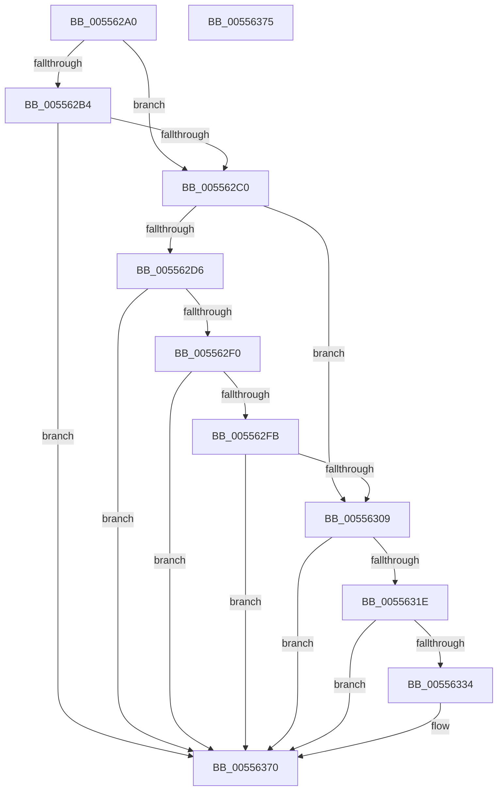

# HalpMceRecoveryNotRequiredIntel

- RVA: `0x005562A0`–`0x00556376` (길이 `214` bytes)
- VA: `0x00000001405562A0`
- 실행 섹션: `.text`
- PDB 이름 있음: `예`; PDB Function 태그: `아니요`
- unwind 정보 RVA: `0x00063458`
- 디코드: `57`개 명령, `214/214` bytes 표시
- 미해석 바이트: `0` (있으면 어셈블리에 `.byte`로 보존)

> 이 문서는 커널 이미지의 기계어와 PDB 기호를 분석해 생성했습니다. 4번과 5번은 함수 원형과 자료형을 바이너리 사용 방식에서 추정한 C 해석이며 원본 소스 복구 결과는 아닙니다.

## 1. Dependencies

- 직접 호출 지점: **1**; 고유 호출 대상: **1**
- 직접 호출자로 확인된 함수: **1**
- RIP 상대 이미지 참조: **2**

### Outgoing calls
- `0x0055636B` → [HalpMemoryErrorDeferredRecovery](HalpMemoryErrorDeferredRecovery_function_00556918.md) (function, `0x00556918`)

### Direct callers
- [HalpMceRecovery](HalpMceRecovery_function_00555DD0.md) at `0x00555F89`

### Static image references
- `0x005562B4` → RVA `0x00E0FC01` (`.data`; read)
- `0x00556364` → RVA `0x00E0A810` (`.data`; read)

## 2. Other-region calls and transfers

- 다른 실행 섹션으로 향하는 call: **0**
- 별도 외부 분기/꼬리 이동을 확인하지 못했습니다.

## 3. Assembly (complete function range)

```asm
005562A0  48 83 EC 48                     sub rsp, 0x48
005562A4  4C 8B 41 28                     mov r8, qword ptr [rcx + 0x28]
005562A8  33 C0                           xor eax, eax
005562AA  49 0F BA E0 3E                  bt r8, 0x3e
005562AF  4C 8B C9                        mov r9, rcx
005562B2  73 0C                           jae 0x1405562c0
005562B4  38 05 47 99 8B 00               cmp byte ptr [rip + 0x8b9947], al
005562BA  0F 84 B0 00 00 00               je 0x140556370
005562C0  BA C0 EF 00 00                  mov edx, 0xefc0
005562C5  41 0F B7 C8                     movzx ecx, r8w
005562C9  66 23 CA                        and cx, dx
005562CC  BA C0 00 00 00                  mov edx, 0xc0
005562D1  66 3B CA                        cmp cx, dx
005562D4  74 33                           je 0x140556309
005562D6  BA 00 EF 00 00                  mov edx, 0xef00
005562DB  41 0F B7 C8                     movzx ecx, r8w
005562DF  66 23 CA                        and cx, dx
005562E2  BA 00 01 00 00                  mov edx, 0x100
005562E7  66 3B CA                        cmp cx, dx
005562EA  0F 85 80 00 00 00               jne 0x140556370
005562F0  41 8A C8                        mov cl, r8b
005562F3  80 E1 03                        and cl, 3
005562F6  80 F9 02                        cmp cl, 2
005562F9  75 75                           jne 0x140556370
005562FB  41 8A C8                        mov cl, r8b
005562FE  C0 E9 04                        shr cl, 4
00556301  80 E1 0F                        and cl, 0xf
00556304  80 F9 07                        cmp cl, 7
00556307  75 67                           jne 0x140556370
00556309  48 BA 00 00 00 00 00 00 00 0C   movabs rdx, 0xc00000000000000
00556313  49 8B C8                        mov rcx, r8
00556316  48 23 CA                        and rcx, rdx
00556319  48 3B CA                        cmp rcx, rdx
0055631C  75 52                           jne 0x140556370
0055631E  49 8B 49 38                     mov rcx, qword ptr [r9 + 0x38]
00556322  48 8B D1                        mov rdx, rcx
00556325  81 E2 C0 01 00 00               and edx, 0x1c0
0055632B  48 81 FA 80 00 00 00            cmp rdx, 0x80
00556332  75 3C                           jne 0x140556370
00556334  83 E1 3F                        and ecx, 0x3f
00556337  89 44 24 38                     mov dword ptr [rsp + 0x38], eax
0055633B  44 8D 52 81                     lea r10d, [rdx - 0x7f]
0055633F  C6 44 24 30 01                  mov byte ptr [rsp + 0x30], 1
00556344  49 D3 E2                        shl r10, cl
00556347  33 D2                           xor edx, edx
00556349  88 44 24 28                     mov byte ptr [rsp + 0x28], al
0055634D  66 44 89 44 24 20               mov word ptr [rsp + 0x20], r8w
00556353  45 33 C0                        xor r8d, r8d
00556356  49 8D 4A FF                     lea rcx, [r10 - 1]
0055635A  48 F7 D1                        not rcx
0055635D  49 23 49 30                     and rcx, qword ptr [r9 + 0x30]
00556361  45 33 C9                        xor r9d, r9d
00556364  48 23 0D A5 44 8B 00            and rcx, qword ptr [rip + 0x8b44a5]
0055636B  E8 A8 05 00 00                  call 0x140556918
00556370  48 83 C4 48                     add rsp, 0x48
00556374  C3                              ret
00556375  CC                              int3
```

## 4. C-style interpretation (structured pseudocode)

```c
__int64 __fastcall HalpMceRecoveryNotRequiredIntel(__int64 a1)
{
    __int64 result;
    __int64 v_r10;
    __int64 v_rsp;
    unsigned int v_stack_m10;
    unsigned __int8 v_stack_m18;
    unsigned __int8 v_stack_m20;
    unsigned __int16 v_stack_m28;

    v_rsp = (v_rsp) - (72);
    result = 0;
    if (condition_is_above_or_equal) goto loc_005562C0;
    if ((*(unsigned __int8 *)(v_rip + 9148743)) == 0) goto loc_00556370;
loc_005562C0:
    a1 = (unsigned __int16)(((unsigned __int16)(*(unsigned __int64 *)(a1 + 40))) & ((unsigned __int16)((unsigned int)(0xEFC0ULL))));
    if (((unsigned __int16)(a1)) == 192) goto loc_00556309;
    a1 = (unsigned __int16)(((unsigned __int16)(*(unsigned __int64 *)(a1 + 40))) & ((unsigned __int16)((unsigned int)(0xEF00ULL))));
    if (((unsigned __int16)(a1)) != 256) goto loc_00556370;
    a1 = (unsigned __int8)(((unsigned __int8)(*(unsigned __int64 *)(a1 + 40))) & (3));
    if (((unsigned __int8)(a1)) != 2) goto loc_00556370;
    a1 = (unsigned __int8)(((unsigned __int8)(*(unsigned __int64 *)(a1 + 40))) >> (4));
    a1 = (unsigned __int8)((a1) & (15));
    if (((unsigned __int8)(a1)) != 7) goto loc_00556370;
loc_00556309:
    a1 = (*(unsigned __int64 *)(a1 + 40)) & (256);
    if (a1 != 256) goto loc_00556370;
    a2 = (unsigned int)((*(unsigned __int64 *)(a1 + 56)) & (448));
    if (a2 == 128) {
        a1 = (unsigned int)((*(unsigned __int64 *)(a1 + 56)) & (63));
        v_stack_m10 = 0;
        v_r10 = a2 - 127;
        v_stack_m18 = 1;
        v_r10 = (v_r10) << ((unsigned __int8)(a1));
        a2 = 0;
        v_stack_m20 = 0;
        v_stack_m28 = (unsigned __int16)(*(unsigned __int64 *)(a1 + 40));
        a3 = 0;
        a1 = v_r10 - 1;
        a1 = ~(a1);
        a1 = (a1) & (*(unsigned __int64 *)(a1 + 48));
        a4 = 0;
        a1 = (a1) & (*(unsigned __int64 *)(v_rip + 9127077));
        result = HalpMemoryErrorDeferredRecovery(a1, a2, a3, a4);
    }
    v_rsp = (v_rsp) + (72);
    return result;
}
```

## 5. (Beta) C Style

```c
int64_t HalpMceRecoveryNotRequiredIntel(void *Arg1)
{
    uint8_t *arg1 = (uint8_t *)Arg1;

    int64_t result;
    int64_t local_r10;
    int64_t local_rsp;
    uint32_t v_stack_m10;
    uint8_t v_stack_m18;
    uint8_t v_stack_m20;
    uint16_t v_stack_m28;

    local_rsp = (local_rsp) - (72);
    result = 0;
    if (condition_is_above_or_equal) goto loc_005562C0;
    if ((*(uint8_t *)(v_rip + 0x8B9947)) == 0) goto loc_00556370;
loc_005562C0:
    Arg1 = (uint16_t)(((uint16_t)(*(uint64_t *)(arg1 + 0x28))) & ((uint16_t)((uint32_t)(0xEFC0ULL))));
    if (((uint16_t)(Arg1)) == 192) goto loc_00556309;
    Arg1 = (uint16_t)(((uint16_t)(*(uint64_t *)(arg1 + 0x28))) & ((uint16_t)((uint32_t)(0xEF00ULL))));
    if (((uint16_t)(Arg1)) != 256) goto loc_00556370;
    Arg1 = (uint8_t)(((uint8_t)(*(uint64_t *)(arg1 + 0x28))) & (3));
    if (((uint8_t)(Arg1)) != 2) goto loc_00556370;
    Arg1 = (uint8_t)(((uint8_t)(*(uint64_t *)(arg1 + 0x28))) >> (4));
    Arg1 = (uint8_t)((Arg1) & (15));
    if (((uint8_t)(Arg1)) != 7) goto loc_00556370;
loc_00556309:
    Arg1 = (*(uint64_t *)(arg1 + 0x28)) & (256);
    if (Arg1 != 256) goto loc_00556370;
    a2 = (uint32_t)((*(uint64_t *)(arg1 + 0x38)) & (448));
    if (a2 == 128) {
        Arg1 = (uint32_t)((*(uint64_t *)(arg1 + 0x38)) & (63));
        v_stack_m10 = 0;
        local_r10 = a2 - 127;
        v_stack_m18 = 1;
        local_r10 = (local_r10) << ((uint8_t)(Arg1));
        a2 = 0;
        v_stack_m20 = 0;
        v_stack_m28 = (uint16_t)(*(uint64_t *)(arg1 + 0x28));
        a3 = 0;
        Arg1 = local_r10 - 1;
        Arg1 = ~(Arg1);
        Arg1 = (Arg1) & (*(uint64_t *)(arg1 + 0x30));
        a4 = 0;
        Arg1 = (Arg1) & (*(uint64_t *)(v_rip + 0x8B44A5));
        result = HalpMemoryErrorDeferredRecovery(Arg1, a2, a3, a4);
    }
    local_rsp = (local_rsp) + (72);
    return result;
}
```

### 관측된 메모리 오프셋

구조체 형식이 확인되지 않은 접근은 인자 기준의 오프셋으로만 기록했습니다.

| 기준 인자 | 오프셋 표현 | 폭 (bit) | 접근 |
|---|---:|---:|---|
| `Arg1` | `+ 0x28` | `64` | `R` |
| `Arg1` | `+ 0x30` | `64` | `R` |
| `Arg1` | `+ 0x38` | `64` | `R` |

## 6. Execution-region graph

[열기: 2D/3D 그래프와 함수 탐색 컨트롤 패널](../../../control-panel.html?section=text&rva=0x005562A0&view=graph)

- 2D 그래프는 위에서 아래로 흐르고, 3D 그래프는 빈 공간을 드래그해 회전합니다. Shift+드래그는 이동, 휠은 확대·축소, 함수 노드 선택은 대상 보고서 이동입니다.

### Static fallback


