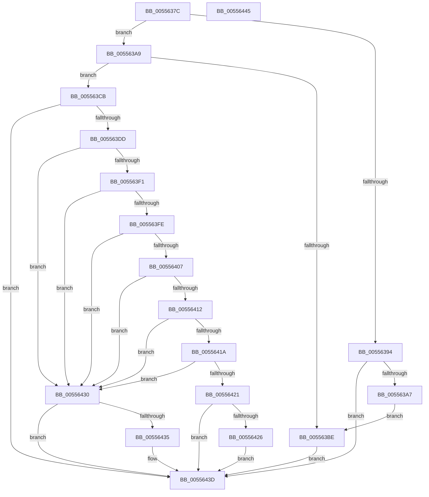

# HalpMceRecoveryRequired

- RVA: `0x0055637C`–`0x00556446` (길이 `202` bytes)
- VA: `0x000000014055637C`
- 실행 섹션: `.text`
- PDB 이름 있음: `예`; PDB Function 태그: `아니요`
- unwind 정보 RVA: `0x0005C788`
- 디코드: `64`개 명령, `202/202` bytes 표시
- 미해석 바이트: `0` (있으면 어셈블리에 `.byte`로 보존)

> 이 문서는 커널 이미지의 기계어와 PDB 기호를 분석해 생성했습니다. 4번과 5번은 함수 원형과 자료형을 바이너리 사용 방식에서 추정한 C 해석이며 원본 소스 복구 결과는 아닙니다.

## 1. Dependencies

- 직접 호출 지점: **2**; 고유 호출 대상: **2**
- 직접 호출자로 확인된 함수: **1**
- RIP 상대 이미지 참조: **0**

### Outgoing calls
- `0x0055639A` → [HalpMcaAMDIsMemoryError](../54/HalpMcaAMDIsMemoryError_function_00545428.md) (function, `0x00545428`)
- `0x005563C1` → [HalpMceRecoveryMemoryError](HalpMceRecoveryMemoryError_function_00556000.md) (function, `0x00556000`)

### Direct callers
- [HalpMceRecovery](HalpMceRecovery_function_00555DD0.md) at `0x00555EBB`

### Static image references
- 디코드된 RIP-relative 메모리 참조가 없습니다.

## 2. Other-region calls and transfers

- 다른 실행 섹션으로 향하는 call: **0**
- 별도 외부 분기/꼬리 이동을 확인하지 못했습니다.

## 3. Assembly (complete function range)

```asm
0055637C  48 83 EC 28                     sub rsp, 0x28
00556380  4C 8B D1                        mov r10, rcx
00556383  41 BB BB 00 00 C0               mov r11d, 0xc00000bb
00556389  0F B7 49 28                     movzx ecx, word ptr [rcx + 0x28]
0055638D  41 83 7A 04 02                  cmp dword ptr [r10 + 4], 2
00556392  75 15                           jne 0x1405563a9
00556394  0F B7 D1                        movzx edx, cx
00556397  49 8B CA                        mov rcx, r10
0055639A  E8 89 F0 FE FF                  call 0x140545428
0055639F  84 C0                           test al, al
005563A1  0F 84 96 00 00 00               je 0x14055643d
005563A7  EB 15                           jmp 0x1405563be
005563A9  BA 00 EF 00 00                  mov edx, 0xef00
005563AE  0F B7 C1                        movzx eax, cx
005563B1  66 23 C2                        and ax, dx
005563B4  BA 00 01 00 00                  mov edx, 0x100
005563B9  66 3B C2                        cmp ax, dx
005563BC  75 0D                           jne 0x1405563cb
005563BE  49 8B CA                        mov rcx, r10
005563C1  E8 3A FC FF FF                  call 0x140556000
005563C6  44 8B D8                        mov r11d, eax
005563C9  EB 72                           jmp 0x14055643d
005563CB  B8 00 E8 00 00                  mov eax, 0xe800
005563D0  66 23 C8                        and cx, ax
005563D3  B8 00 08 00 00                  mov eax, 0x800
005563D8  66 3B C8                        cmp cx, ax
005563DB  75 60                           jne 0x14055643d
005563DD  49 8B 4A 28                     mov rcx, qword ptr [r10 + 0x28]
005563E1  BA 03 00 00 00                  mov edx, 3
005563E6  0F B7 C1                        movzx eax, cx
005563E9  66 C1 E8 0C                     shr ax, 0xc
005563ED  A8 01                           test al, 1
005563EF  75 3F                           jne 0x140556430
005563F1  0F B7 C1                        movzx eax, cx
005563F4  66 C1 E8 09                     shr ax, 9
005563F8  22 C2                           and al, dl
005563FA  3A C2                           cmp al, dl
005563FC  75 32                           jne 0x140556430
005563FE  8A C1                           mov al, cl
00556400  C0 E8 04                        shr al, 4
00556403  A8 0F                           test al, 0xf
00556405  75 29                           jne 0x140556430
00556407  8A C1                           mov al, cl
00556409  C0 E8 02                        shr al, 2
0055640C  22 C2                           and al, dl
0055640E  3C 02                           cmp al, 2
00556410  75 1E                           jne 0x140556430
00556412  8A C1                           mov al, cl
00556414  22 C2                           and al, dl
00556416  3A C2                           cmp al, dl
00556418  75 16                           jne 0x140556430
0055641A  48 0F BA E1 3B                  bt rcx, 0x3b
0055641F  72 0F                           jb 0x140556430
00556421  41 39 12                        cmp dword ptr [r10], edx
00556424  72 17                           jb 0x14055643d
00556426  41 83 8A 10 01 00 00 20         or dword ptr [r10 + 0x110], 0x20
0055642E  EB 0D                           jmp 0x14055643d
00556430  41 39 12                        cmp dword ptr [r10], edx
00556433  72 08                           jb 0x14055643d
00556435  41 83 8A 10 01 00 00 01         or dword ptr [r10 + 0x110], 1
0055643D  41 8B C3                        mov eax, r11d
00556440  48 83 C4 28                     add rsp, 0x28
00556444  C3                              ret
00556445  CC                              int3
```

## 4. C-style interpretation (structured pseudocode)

```c
__int64 __fastcall HalpMceRecoveryRequired(__int64 a1)
{
    __int64 result;
    __int64 v_rsp;

    v_rsp = (v_rsp) - (40);
    if ((*(unsigned int *)(a1 + 4)) != 2) goto loc_005563A9;
    result = HalpMcaAMDIsMemoryError(a1, (unsigned __int16)(*(unsigned __int16 *)(a1 + 40)), a3, a4);
    if ((unsigned __int8)(result) == 0) goto loc_0055643D;
    goto loc_005563BE;
loc_005563A9:
    result = (unsigned __int16)(((unsigned __int16)(a1)) & ((unsigned __int16)((unsigned int)(0xEF00ULL))));
    if (((unsigned __int16)(result)) != 256) goto loc_005563CB;
loc_005563BE:
    result = HalpMceRecoveryMemoryError(a1, 256, a3, a4);
    goto loc_0055643D;
loc_005563CB:
    a1 = (unsigned __int16)((a1) & ((unsigned __int16)((unsigned int)(0xE800ULL))));
    if (((unsigned __int16)(a1)) != ((unsigned __int16)((unsigned int)(0x800ULL)))) goto loc_0055643D;
    result = (unsigned __int16)(((unsigned __int16)(*(unsigned __int64 *)(a1 + 40))) >> (12));
    if ((((unsigned __int8)(result)) & (1)) != 0) goto loc_00556430;
    result = (unsigned __int16)(((unsigned __int16)(*(unsigned __int64 *)(a1 + 40))) >> (9));
    result = (unsigned __int8)((result) & (3));
    if (((unsigned __int8)(result)) != 3) goto loc_00556430;
    result = (unsigned __int8)(((unsigned __int8)(*(unsigned __int64 *)(a1 + 40))) >> (4));
    if ((((unsigned __int8)(result)) & (15)) != 0) goto loc_00556430;
    result = (unsigned __int8)(((unsigned __int8)(*(unsigned __int64 *)(a1 + 40))) >> (2));
    result = (unsigned __int8)((result) & (3));
    if (((unsigned __int8)(result)) != 2) goto loc_00556430;
    result = (unsigned __int8)(((unsigned __int8)(*(unsigned __int64 *)(a1 + 40))) & (3));
    if (((unsigned __int8)(result)) != 3) goto loc_00556430;
    if (((unsigned __int8)(result)) < 3) goto loc_00556430;
    if ((*(unsigned int *)(a1)) < 3) goto loc_0055643D;
    goto loc_0055643D;
loc_00556430:
    if ((*(unsigned int *)(a1)) >= 3) {
    }
    v_rsp = (v_rsp) + (40);
    return (unsigned int)((unsigned int)((unsigned int)((unsigned int)(result))));
}
```

## 5. (Beta) C Style

```c
int64_t HalpMceRecoveryRequired(void *Arg1)
{
    uint8_t *arg1 = (uint8_t *)Arg1;

    int64_t result;
    int64_t local_rsp;

    local_rsp = (local_rsp) - (40);
    if ((*(uint32_t *)(arg1 + 0x4)) != 2) goto loc_005563A9;
    result = HalpMcaAMDIsMemoryError(Arg1, (uint16_t)(*(uint16_t *)(arg1 + 0x28)), a3, a4);
    if ((uint8_t)(result) == 0) goto loc_0055643D;
    goto loc_005563BE;
loc_005563A9:
    result = (uint16_t)(((uint16_t)(Arg1)) & ((uint16_t)((uint32_t)(0xEF00ULL))));
    if (((uint16_t)(result)) != 256) goto loc_005563CB;
loc_005563BE:
    result = HalpMceRecoveryMemoryError(Arg1, 256, a3, a4);
    goto loc_0055643D;
loc_005563CB:
    Arg1 = (uint16_t)((Arg1) & ((uint16_t)((uint32_t)(0xE800ULL))));
    if (((uint16_t)(Arg1)) != ((uint16_t)((uint32_t)(0x800ULL)))) goto loc_0055643D;
    result = (uint16_t)(((uint16_t)(*(uint64_t *)(arg1 + 0x28))) >> (12));
    if ((((uint8_t)(result)) & (1)) != 0) goto loc_00556430;
    result = (uint16_t)(((uint16_t)(*(uint64_t *)(arg1 + 0x28))) >> (9));
    result = (uint8_t)((result) & (3));
    if (((uint8_t)(result)) != 3) goto loc_00556430;
    result = (uint8_t)(((uint8_t)(*(uint64_t *)(arg1 + 0x28))) >> (4));
    if ((((uint8_t)(result)) & (15)) != 0) goto loc_00556430;
    result = (uint8_t)(((uint8_t)(*(uint64_t *)(arg1 + 0x28))) >> (2));
    result = (uint8_t)((result) & (3));
    if (((uint8_t)(result)) != 2) goto loc_00556430;
    result = (uint8_t)(((uint8_t)(*(uint64_t *)(arg1 + 0x28))) & (3));
    if (((uint8_t)(result)) != 3) goto loc_00556430;
    if (((uint8_t)(result)) < 3) goto loc_00556430;
    if ((*(uint32_t *)(arg1)) < 3) goto loc_0055643D;
    goto loc_0055643D;
loc_00556430:
    if ((*(uint32_t *)(arg1)) >= 3) {
    }
    local_rsp = (local_rsp) + (40);
    return (uint32_t)((uint32_t)((uint32_t)((uint32_t)(result))));
}
```

### 관측된 메모리 오프셋

구조체 형식이 확인되지 않은 접근은 인자 기준의 오프셋으로만 기록했습니다.

| 기준 인자 | 오프셋 표현 | 폭 (bit) | 접근 |
|---|---:|---:|---|
| `Arg1` | `+ 0x0` | `32` | `R` |
| `Arg1` | `+ 0x4` | `32` | `R` |
| `Arg1` | `+ 0x28` | `16` | `R` |
| `Arg1` | `+ 0x28` | `64` | `R` |
| `Arg1` | `+ 0x110` | `32` | `R/W` |

## 6. Execution-region graph

[열기: 2D/3D 그래프와 함수 탐색 컨트롤 패널](../../../control-panel.html?section=text&rva=0x0055637C&view=graph)

- 2D 그래프는 위에서 아래로 흐르고, 3D 그래프는 빈 공간을 드래그해 회전합니다. Shift+드래그는 이동, 휠은 확대·축소, 함수 노드 선택은 대상 보고서 이동입니다.

### Static fallback


