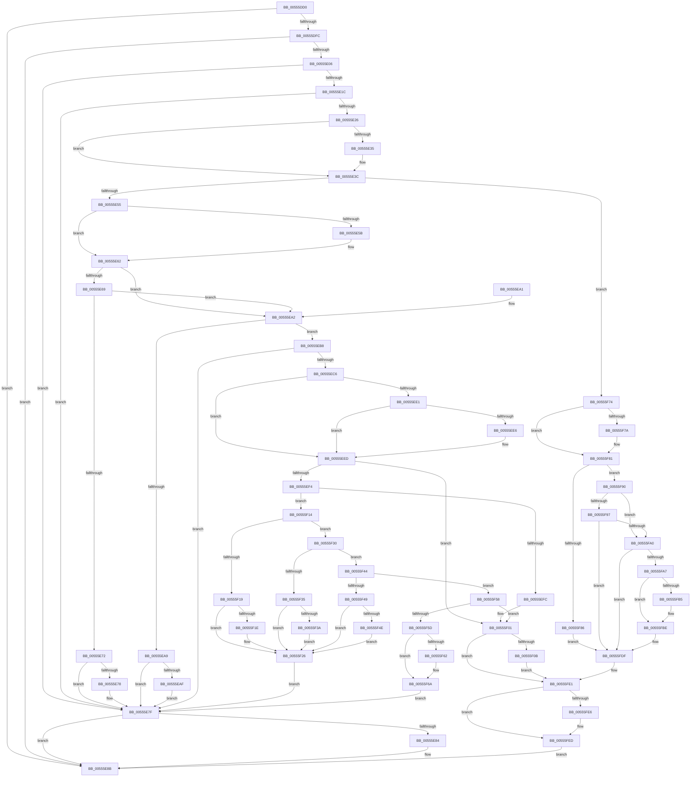

# HalpMceRecovery

- RVA: `0x00555DD0`–`0x00555FF9` (길이 `553` bytes)
- VA: `0x0000000140555DD0`
- 실행 섹션: `.text`
- PDB 이름 있음: `예`; PDB Function 태그: `아니요`
- unwind 정보 RVA: `0x000C459C`
- 디코드: `146`개 명령, `553/553` bytes 표시
- 미해석 바이트: `0` (있으면 어셈블리에 `.byte`로 보존)

> 이 문서는 커널 이미지의 기계어와 PDB 기호를 분석해 생성했습니다. 4번과 5번은 함수 원형과 자료형을 바이너리 사용 방식에서 추정한 C 해석이며 원본 소스 복구 결과는 아닙니다.

## 1. Dependencies

- 직접 호출 지점: **5**; 고유 호출 대상: **5**
- 직접 호출자로 확인된 함수: **0**
- RIP 상대 이미지 참조: **4**

### Outgoing calls
- `0x00555DEE` → [WheaGetErrPacketFromErrRecord](WheaGetErrPacketFromErrRecord_function_00556490.md) (function, `0x00556490`)
- `0x00555E48` → [HalpShouldRecoveryBeAttempted](HalpShouldRecoveryBeAttempted_function_0055644C.md) (function, `0x0055644C`)
- `0x00555EBB` → [HalpMceRecoveryRequired](HalpMceRecoveryRequired_function_0055637C.md) (function, `0x0055637C`)
- `0x00555F89` → [HalpMceRecoveryNotRequiredIntel](HalpMceRecoveryNotRequiredIntel_function_005562A0.md) (function, `0x005562A0`)
- `0x00555FDA` → [HalpMemoryErrorDeferredRecovery](HalpMemoryErrorDeferredRecovery_function_00556918.md) (function, `0x00556918`)

### Direct callers
- 이 함수 시작 RVA로 연결되는 직접 call은 확인되지 않았습니다. 간접 호출은 완전히 역산할 수 없습니다.

### Static image references
- `0x00555E06` → RVA `0x00E100B8` (`.data`; read)
- `0x00555E1C` → RVA `0x00E103E0` (`.data`; read)
- `0x00555E69` → RVA `0x00E0FC01` (`.data`; read)
- `0x00555FAD` → RVA `0x00E10258` (`.data`; read)

## 2. Other-region calls and transfers

- 다른 실행 섹션으로 향하는 call: **0**
- 별도 외부 분기/꼬리 이동을 확인하지 못했습니다.

## 3. Assembly (complete function range)

```asm
00555DD0  48 89 5C 24 10                  mov qword ptr [rsp + 0x10], rbx
00555DD5  48 89 74 24 18                  mov qword ptr [rsp + 0x18], rsi
00555DDA  57                              push rdi
00555DDB  41 54                           push r12
00555DDD  41 56                           push r14
00555DDF  48 83 EC 40                     sub rsp, 0x40
00555DE3  4C 8B F2                        mov r14, rdx
00555DE6  48 8B F1                        mov rsi, rcx
00555DE9  BF BB 00 00 C0                  mov edi, 0xc00000bb
00555DEE  E8 9D 06 00 00                  call 0x140556490
00555DF3  48 85 C0                        test rax, rax
00555DF6  0F 84 8F 00 00 00               je 0x140555e8b
00555DFC  83 78 1C 12                     cmp dword ptr [rax + 0x1c], 0x12
00555E00  0F 87 85 00 00 00               ja 0x140555e8b
00555E06  80 3D AB A2 8B 00 00            cmp byte ptr [rip + 0x8ba2ab], 0
00555E0D  48 8B 58 30                     mov rbx, qword ptr [rax + 0x30]
00555E11  4C 8B 43 28                     mov r8, qword ptr [rbx + 0x28]
00555E15  4C 89 44 24 60                  mov qword ptr [rsp + 0x60], r8
00555E1A  74 63                           je 0x140555e7f
00555E1C  48 83 3D BC A5 8B 00 00         cmp qword ptr [rip + 0x8ba5bc], 0
00555E24  74 59                           je 0x140555e7f
00555E26  44 8B 0B                        mov r9d, dword ptr [rbx]
00555E29  41 BC 01 00 00 00               mov r12d, 1
00555E2F  41 83 F9 03                     cmp r9d, 3
00555E33  72 07                           jb 0x140555e3c
00555E35  44 09 A3 14 01 00 00            or dword ptr [rbx + 0x114], r12d
00555E3C  44 8B 53 04                     mov r10d, dword ptr [rbx + 4]
00555E40  48 8D 54 24 60                  lea rdx, [rsp + 0x60]
00555E45  41 8B CA                        mov ecx, r10d
00555E48  E8 FF 05 00 00                  call 0x14055644c
00555E4D  84 C0                           test al, al
00555E4F  0F 84 1F 01 00 00               je 0x140555f74
00555E55  41 83 F9 03                     cmp r9d, 3
00555E59  72 07                           jb 0x140555e62
00555E5B  44 88 A3 18 01 00 00            mov byte ptr [rbx + 0x118], r12b
00555E62  49 0F BA E0 3E                  bt r8, 0x3e
00555E67  73 39                           jae 0x140555ea2
00555E69  80 3D 91 9D 8B 00 00            cmp byte ptr [rip + 0x8b9d91], 0
00555E70  75 30                           jne 0x140555ea2
00555E72  41 83 F9 03                     cmp r9d, 3
00555E76  72 07                           jb 0x140555e7f
00555E78  83 8B 10 01 00 00 02            or dword ptr [rbx + 0x110], 2
00555E7F  83 3B 03                        cmp dword ptr [rbx], 3
00555E82  72 07                           jb 0x140555e8b
00555E84  C6 83 19 01 00 00 00            mov byte ptr [rbx + 0x119], 0
00555E8B  48 8B 5C 24 68                  mov rbx, qword ptr [rsp + 0x68]
00555E90  8B C7                           mov eax, edi
00555E92  48 8B 74 24 70                  mov rsi, qword ptr [rsp + 0x70]
00555E97  48 83 C4 40                     add rsp, 0x40
00555E9B  41 5E                           pop r14
00555E9D  41 5C                           pop r12
00555E9F  5F                              pop rdi
00555EA0  C3                              ret
00555EA1  CC                              int3
00555EA2  49 0F BA E0 39                  bt r8, 0x39
00555EA7  73 0F                           jae 0x140555eb8
00555EA9  41 83 F9 03                     cmp r9d, 3
00555EAD  72 D0                           jb 0x140555e7f
00555EAF  83 8B 10 01 00 00 04            or dword ptr [rbx + 0x110], 4
00555EB6  EB C7                           jmp 0x140555e7f
00555EB8  48 8B CB                        mov rcx, rbx
00555EBB  E8 BC 04 00 00                  call 0x14055637c
00555EC0  8B F8                           mov edi, eax
00555EC2  85 C0                           test eax, eax
00555EC4  78 B9                           js 0x140555e7f
00555EC6  65 48 8B 0C 25 18 00 00 00      mov rcx, qword ptr gs:[0x18]
00555ECF  4C 8B 81 D8 00 00 00            mov r8, qword ptr [rcx + 0xd8]
00555ED6  49 8B 50 20                     mov rdx, qword ptr [r8 + 0x20]
00555EDA  8B 0A                           mov ecx, dword ptr [rdx]
00555EDC  F6 C1 10                        test cl, 0x10
00555EDF  74 0C                           je 0x140555eed
00555EE1  83 3B 03                        cmp dword ptr [rbx], 3
00555EE4  72 07                           jb 0x140555eed
00555EE6  44 88 A3 1A 01 00 00            mov byte ptr [rbx + 0x11a], r12b
00555EED  8B 02                           mov eax, dword ptr [rdx]
00555EEF  41 84 C4                        test r12b, al
00555EF2  74 0D                           je 0x140555f01
00555EF4  41 8B 40 28                     mov eax, dword ptr [r8 + 0x28]
00555EF8  85 C0                           test eax, eax
00555EFA  75 18                           jne 0x140555f14
00555EFC  0F BA 6E 68 07                  bts dword ptr [rsi + 0x68], 7
00555F01  8B 02                           mov eax, dword ptr [rdx]
00555F03  A8 04                           test al, 4
00555F05  0F 84 D6 00 00 00               je 0x140555fe1
00555F0B  48 89 72 08                     mov qword ptr [rdx + 8], rsi
00555F0F  E9 CD 00 00 00                  jmp 0x140555fe1
00555F14  83 F8 0C                        cmp eax, 0xc
00555F17  75 17                           jne 0x140555f30
00555F19  83 3B 03                        cmp dword ptr [rbx], 3
00555F1C  72 08                           jb 0x140555f26
00555F1E  0F BA AB 10 01 00 00 08         bts dword ptr [rbx + 0x110], 8
00555F26  BF BB 00 00 C0                  mov edi, 0xc00000bb
00555F2B  E9 4F FF FF FF                  jmp 0x140555e7f
00555F30  83 F8 0A                        cmp eax, 0xa
00555F33  75 0F                           jne 0x140555f44
00555F35  83 3B 03                        cmp dword ptr [rbx], 3
00555F38  72 EC                           jb 0x140555f26
00555F3A  0F BA AB 10 01 00 00 07         bts dword ptr [rbx + 0x110], 7
00555F42  EB E2                           jmp 0x140555f26
00555F44  83 F8 0D                        cmp eax, 0xd
00555F47  75 0F                           jne 0x140555f58
00555F49  83 3B 03                        cmp dword ptr [rbx], 3
00555F4C  72 D8                           jb 0x140555f26
00555F4E  0F BA AB 10 01 00 00 09         bts dword ptr [rbx + 0x110], 9
00555F56  EB CE                           jmp 0x140555f26
00555F58  83 F8 0E                        cmp eax, 0xe
00555F5B  75 A4                           jne 0x140555f01
00555F5D  83 3B 03                        cmp dword ptr [rbx], 3
00555F60  72 08                           jb 0x140555f6a
00555F62  0F BA AB 10 01 00 00 0A         bts dword ptr [rbx + 0x110], 0xa
00555F6A  BF FD 00 00 C0                  mov edi, 0xc00000fd
00555F6F  E9 0B FF FF FF                  jmp 0x140555e7f
00555F74  41 83 F9 03                     cmp r9d, 3
00555F78  72 07                           jb 0x140555f81
00555F7A  C6 83 18 01 00 00 00            mov byte ptr [rbx + 0x118], 0
00555F81  45 3B D4                        cmp r10d, r12d
00555F84  75 0A                           jne 0x140555f90
00555F86  48 8B CB                        mov rcx, rbx
00555F89  E8 12 03 00 00                  call 0x1405562a0
00555F8E  EB 4F                           jmp 0x140555fdf
00555F90  49 0F BA E0 3E                  bt r8, 0x3e
00555F95  73 09                           jae 0x140555fa0
00555F97  80 3D 63 9C 8B 00 00            cmp byte ptr [rip + 0x8b9c63], 0
00555F9E  74 3F                           je 0x140555fdf
00555FA0  49 0F BA E0 3A                  bt r8, 0x3a
00555FA5  73 38                           jae 0x140555fdf
00555FA7  48 8B 4B 30                     mov rcx, qword ptr [rbx + 0x30]
00555FAB  33 C0                           xor eax, eax
00555FAD  38 05 A5 A2 8B 00               cmp byte ptr [rip + 0x8ba2a5], al
00555FB3  74 09                           je 0x140555fbe
00555FB5  49 0F BA E0 2C                  bt r8, 0x2c
00555FBA  41 0F 42 C4                     cmovb eax, r12d
00555FBE  89 44 24 38                     mov dword ptr [rsp + 0x38], eax
00555FC2  45 33 C9                        xor r9d, r9d
00555FC5  44 88 64 24 30                  mov byte ptr [rsp + 0x30], r12b
00555FCA  33 D2                           xor edx, edx
00555FCC  C6 44 24 28 00                  mov byte ptr [rsp + 0x28], 0
00555FD1  66 44 89 44 24 20               mov word ptr [rsp + 0x20], r8w
00555FD7  45 33 C0                        xor r8d, r8d
00555FDA  E8 39 09 00 00                  call 0x140556918
00555FDF  33 FF                           xor edi, edi
00555FE1  83 3B 03                        cmp dword ptr [rbx], 3
00555FE4  72 07                           jb 0x140555fed
00555FE6  44 88 A3 19 01 00 00            mov byte ptr [rbx + 0x119], r12b
00555FED  41 C7 06 02 00 00 00            mov dword ptr [r14], 2
00555FF4  E9 92 FE FF FF                  jmp 0x140555e8b
```

## 4. C-style interpretation (structured pseudocode)

```c
__int64 __fastcall HalpMceRecovery(__int64 a1, __int64 a2)
{
    __int64 result;
    __int64 v_rdi;
    __int64 v_rsp;
    unsigned __int64 v_stack_p10;
    unsigned __int64 v_stack_p18;
    unsigned __int16 v_stack_p20;
    unsigned __int8 v_stack_p28;
    unsigned __int8 v_stack_p30;
    unsigned int v_stack_p38;
    unsigned __int64 v_stack_p8;

    v_stack_p10 = v_rbx;
    v_stack_p18 = v_rsi;
    v_rsp = (v_rsp) - (64);
    result = WheaGetErrPacketFromErrRecord(a1, a2, a3, a4);
    if (result == 0) goto loc_00555E8B;
    if ((*(unsigned int *)(result + 28)) > 18) goto loc_00555E8B;
    v_stack_p8 = *(unsigned __int64 *)(*(unsigned __int64 *)(result + 48) + 40);
    if ((*(unsigned __int8 *)(v_rip + 9151147)) == 0) goto loc_00555E7F;
    if ((*(unsigned __int64 *)(v_rip + 9151932)) == 0) goto loc_00555E7F;
    if (((unsigned int)((unsigned int)(*(unsigned int *)(*(unsigned __int64 *)(result + 48))))) >= 3) {
    }
    result = HalpShouldRecoveryBeAttempted((unsigned int)((unsigned int)((unsigned int)(*(unsigned int *)(*(unsigned __int64 *)(result + 48) + 4)))), v_stack_p8, *(unsigned __int64 *)(*(unsigned __int64 *)(result + 48) + 40), (unsigned int)(*(unsigned int *)(*(unsigned __int64 *)(result + 48))));
    if ((unsigned __int8)(result) == 0) goto loc_00555F74;
    if (((unsigned int)((unsigned int)(*(unsigned int *)(*(unsigned __int64 *)(result + 48))))) >= 3) {
        *(unsigned __int8 *)(*(unsigned __int64 *)(result + 48) + 280) = 1;
    }
    if (((unsigned int)((unsigned int)(*(unsigned int *)(*(unsigned __int64 *)(result + 48))))) >= 3) goto loc_00555EA2;
    if ((*(unsigned __int8 *)(v_rip + 9149841)) != 0) goto loc_00555EA2;
    if (((unsigned int)((unsigned int)(*(unsigned int *)(*(unsigned __int64 *)(result + 48))))) >= 3) {
    }
    if ((*(unsigned int *)(*(unsigned __int64 *)(result + 48))) >= 3) {
        *(unsigned __int8 *)(*(unsigned __int64 *)(result + 48) + 281) = 0;
    }
    v_rsp = (v_rsp) + (64);
    return (unsigned int)((unsigned int)((unsigned int)(0xC00000BBULL)));
loc_00555EA2:
    if (condition_is_above_or_equal) goto loc_00555EB8;
    if (((unsigned int)((unsigned int)(*(unsigned int *)(*(unsigned __int64 *)(result + 48))))) < 3) goto loc_00555E7F;
    goto loc_00555E7F;
loc_00555EB8:
    result = HalpMceRecoveryRequired(v_stack_p10, v_stack_p8, *(unsigned __int64 *)(*(unsigned __int64 *)(result + 48) + 40), (unsigned int)(*(unsigned int *)(*(unsigned __int64 *)(result + 48))));
    if (sign_flag) goto loc_00555E7F;
    if ((((unsigned __int8)((unsigned int)(*(unsigned int *)(*(unsigned __int64 *)(*(unsigned __int64 *)(*(unsigned __int64 *)(gs_base + (0 + 24)) + 216) + 32))))) & (16)) == 0) goto loc_00555EED;
    if ((*(unsigned int *)(v_stack_p10)) >= 3) {
        *(unsigned __int8 *)(v_stack_p10 + 282) = 1;
    }
    if (((1) & ((unsigned __int8)((unsigned int)(*(unsigned int *)(*(unsigned __int64 *)(*(unsigned __int64 *)(*(unsigned __int64 *)(gs_base + (0 + 24)) + 216) + 32)))))) == 0) goto loc_00555F01;
    if ((unsigned int)((unsigned int)(*(unsigned int *)(*(unsigned __int64 *)(*(unsigned __int64 *)(gs_base + (0 + 24)) + 216) + 40))) != 0) goto loc_00555F14;
loc_00555F01:
    if ((((unsigned __int8)((unsigned int)(*(unsigned int *)(*(unsigned __int64 *)(*(unsigned __int64 *)(*(unsigned __int64 *)(gs_base + (0 + 24)) + 216) + 32))))) & (4)) == 0) goto loc_00555FE1;
    *(unsigned __int64 *)(*(unsigned __int64 *)(*(unsigned __int64 *)(*(unsigned __int64 *)(gs_base + (0 + 24)) + 216) + 32) + 8) = v_stack_p18;
    goto loc_00555FE1;
loc_00555F14:
    if (((unsigned int)((unsigned int)(*(unsigned int *)(*(unsigned __int64 *)(*(unsigned __int64 *)(*(unsigned __int64 *)(gs_base + (0 + 24)) + 216) + 32))))) != 12) goto loc_00555F30;
    if ((*(unsigned int *)(v_stack_p10)) >= 3) {
    }
    goto loc_00555E7F;
loc_00555F30:
    if (((unsigned int)((unsigned int)(*(unsigned int *)(*(unsigned __int64 *)(*(unsigned __int64 *)(*(unsigned __int64 *)(gs_base + (0 + 24)) + 216) + 32))))) != 10) goto loc_00555F44;
    if ((*(unsigned int *)(v_stack_p10)) < 3) goto loc_00555F26;
    goto loc_00555F26;
loc_00555F44:
    if (((unsigned int)((unsigned int)(*(unsigned int *)(*(unsigned __int64 *)(*(unsigned __int64 *)(*(unsigned __int64 *)(gs_base + (0 + 24)) + 216) + 32))))) != 13) goto loc_00555F58;
    if ((*(unsigned int *)(v_stack_p10)) < 3) goto loc_00555F26;
    goto loc_00555F26;
loc_00555F58:
    if (((unsigned int)((unsigned int)(*(unsigned int *)(*(unsigned __int64 *)(*(unsigned __int64 *)(*(unsigned __int64 *)(gs_base + (0 + 24)) + 216) + 32))))) != 14) goto loc_00555F01;
    if ((*(unsigned int *)(v_stack_p10)) >= 3) {
    }
    goto loc_00555E7F;
loc_00555F74:
    if (((unsigned int)((unsigned int)(*(unsigned int *)(*(unsigned __int64 *)(result + 48))))) >= 3) {
        *(unsigned __int8 *)(v_stack_p10 + 280) = 0;
    }
    if (((unsigned int)((unsigned int)(*(unsigned int *)(*(unsigned __int64 *)(result + 48) + 4)))) != 1) goto loc_00555F90;
    result = HalpMceRecoveryNotRequiredIntel(v_stack_p10, *(unsigned __int64 *)(*(unsigned __int64 *)(*(unsigned __int64 *)(gs_base + (0 + 24)) + 216) + 32), *(unsigned __int64 *)(*(unsigned __int64 *)(gs_base + (0 + 24)) + 216), (unsigned int)(*(unsigned int *)(*(unsigned __int64 *)(result + 48))));
    goto loc_00555FDF;
loc_00555F90:
    if (((unsigned int)((unsigned int)(*(unsigned int *)(*(unsigned __int64 *)(result + 48) + 4)))) >= 1) goto loc_00555FA0;
    if ((*(unsigned __int8 *)(v_rip + 9149539)) == 0) goto loc_00555FDF;
loc_00555FA0:
    if ((*(unsigned __int8 *)(v_rip + 9149539)) >= 0) goto loc_00555FDF;
    result = 0;
    if ((*(unsigned __int8 *)(v_rip + 9151141)) != 0) {
        if ((*(unsigned __int8 *)(v_rip + 9151141)) < 0) { result = 1; }
    }
    v_stack_p38 = (unsigned int)(result);
    a4 = 0;
    v_stack_p30 = 1;
    a2 = 0;
    v_stack_p28 = 0;
    v_stack_p20 = (unsigned __int16)(*(unsigned __int64 *)(*(unsigned __int64 *)(gs_base + (0 + 24)) + 216));
    a3 = 0;
    result = HalpMemoryErrorDeferredRecovery(*(unsigned __int64 *)(v_stack_p10 + 48), a2, a3, a4);
loc_00555FDF:
    v_rdi = 0;
loc_00555FE1:
    if ((*(unsigned int *)(v_stack_p10)) >= 3) {
        *(unsigned __int8 *)(v_stack_p10 + 281) = 1;
    }
    *(unsigned int *)(a2) = 2;
    goto loc_00555E8B;
}
```

## 5. (Beta) C Style

```c
int64_t HalpMceRecovery(void *Arg1, void *Arg2)
{
    uint8_t *arg1 = (uint8_t *)Arg1;
    uint8_t *arg2 = (uint8_t *)Arg2;

    int64_t result;
    int64_t local_rdi;
    int64_t local_rsp;
    uint64_t v_stack_p10;
    uint64_t v_stack_p18;
    uint16_t v_stack_p20;
    uint8_t v_stack_p28;
    uint8_t v_stack_p30;
    uint32_t v_stack_p38;
    uint64_t v_stack_p8;

    v_stack_p10 = local_rbx;
    v_stack_p18 = local_rsi;
    local_rsp = (local_rsp) - (64);
    result = WheaGetErrPacketFromErrRecord(Arg1, Arg2, a3, a4);
    if (result == 0) goto loc_00555E8B;
    if ((*(uint32_t *)(result + 0x1C)) > 18) goto loc_00555E8B;
    v_stack_p8 = *(uint64_t *)(*(uint64_t *)(result + 0x30) + 0x28);
    if ((*(uint8_t *)(v_rip + 0x8BA2AB)) == 0) goto loc_00555E7F;
    if ((*(uint64_t *)(v_rip + 0x8BA5BC)) == 0) goto loc_00555E7F;
    if (((uint32_t)((uint32_t)(*(uint32_t *)(*(uint64_t *)(result + 0x30))))) >= 3) {
    }
    result = HalpShouldRecoveryBeAttempted((uint32_t)((uint32_t)((uint32_t)(*(uint32_t *)(*(uint64_t *)(result + 0x30) + 0x4)))), v_stack_p8, *(uint64_t *)(*(uint64_t *)(result + 0x30) + 0x28), (uint32_t)(*(uint32_t *)(*(uint64_t *)(result + 0x30))));
    if ((uint8_t)(result) == 0) goto loc_00555F74;
    if (((uint32_t)((uint32_t)(*(uint32_t *)(*(uint64_t *)(result + 0x30))))) >= 3) {
        *(uint8_t *)(*(uint64_t *)(result + 0x30) + 0x118) = 1;
    }
    if (((uint32_t)((uint32_t)(*(uint32_t *)(*(uint64_t *)(result + 0x30))))) >= 3) goto loc_00555EA2;
    if ((*(uint8_t *)(v_rip + 0x8B9D91)) != 0) goto loc_00555EA2;
    if (((uint32_t)((uint32_t)(*(uint32_t *)(*(uint64_t *)(result + 0x30))))) >= 3) {
    }
    if ((*(uint32_t *)(*(uint64_t *)(result + 0x30))) >= 3) {
        *(uint8_t *)(*(uint64_t *)(result + 0x30) + 0x119) = 0;
    }
    local_rsp = (local_rsp) + (64);
    return (uint32_t)((uint32_t)((uint32_t)(0xC00000BBULL)));
loc_00555EA2:
    if (condition_is_above_or_equal) goto loc_00555EB8;
    if (((uint32_t)((uint32_t)(*(uint32_t *)(*(uint64_t *)(result + 0x30))))) < 3) goto loc_00555E7F;
    goto loc_00555E7F;
loc_00555EB8:
    result = HalpMceRecoveryRequired(v_stack_p10, v_stack_p8, *(uint64_t *)(*(uint64_t *)(result + 0x30) + 0x28), (uint32_t)(*(uint32_t *)(*(uint64_t *)(result + 0x30))));
    if (sign_flag) goto loc_00555E7F;
    if ((((uint8_t)((uint32_t)(*(uint32_t *)(*(uint64_t *)(*(uint64_t *)(*(uint64_t *)(gs_base + (0 + 0x18)) + 0xD8) + 0x20))))) & (16)) == 0) goto loc_00555EED;
    if ((*(uint32_t *)(v_stack_p10)) >= 3) {
        *(uint8_t *)(v_stack_p10 + 0x11A) = 1;
    }
    if (((1) & ((uint8_t)((uint32_t)(*(uint32_t *)(*(uint64_t *)(*(uint64_t *)(*(uint64_t *)(gs_base + (0 + 0x18)) + 0xD8) + 0x20)))))) == 0) goto loc_00555F01;
    if ((uint32_t)((uint32_t)(*(uint32_t *)(*(uint64_t *)(*(uint64_t *)(gs_base + (0 + 0x18)) + 0xD8) + 0x28))) != 0) goto loc_00555F14;
loc_00555F01:
    if ((((uint8_t)((uint32_t)(*(uint32_t *)(*(uint64_t *)(*(uint64_t *)(*(uint64_t *)(gs_base + (0 + 0x18)) + 0xD8) + 0x20))))) & (4)) == 0) goto loc_00555FE1;
    *(uint64_t *)(*(uint64_t *)(*(uint64_t *)(*(uint64_t *)(gs_base + (0 + 0x18)) + 0xD8) + 0x20) + 0x8) = v_stack_p18;
    goto loc_00555FE1;
loc_00555F14:
    if (((uint32_t)((uint32_t)(*(uint32_t *)(*(uint64_t *)(*(uint64_t *)(*(uint64_t *)(gs_base + (0 + 0x18)) + 0xD8) + 0x20))))) != 12) goto loc_00555F30;
    if ((*(uint32_t *)(v_stack_p10)) >= 3) {
    }
    goto loc_00555E7F;
loc_00555F30:
    if (((uint32_t)((uint32_t)(*(uint32_t *)(*(uint64_t *)(*(uint64_t *)(*(uint64_t *)(gs_base + (0 + 0x18)) + 0xD8) + 0x20))))) != 10) goto loc_00555F44;
    if ((*(uint32_t *)(v_stack_p10)) < 3) goto loc_00555F26;
    goto loc_00555F26;
loc_00555F44:
    if (((uint32_t)((uint32_t)(*(uint32_t *)(*(uint64_t *)(*(uint64_t *)(*(uint64_t *)(gs_base + (0 + 0x18)) + 0xD8) + 0x20))))) != 13) goto loc_00555F58;
    if ((*(uint32_t *)(v_stack_p10)) < 3) goto loc_00555F26;
    goto loc_00555F26;
loc_00555F58:
    if (((uint32_t)((uint32_t)(*(uint32_t *)(*(uint64_t *)(*(uint64_t *)(*(uint64_t *)(gs_base + (0 + 0x18)) + 0xD8) + 0x20))))) != 14) goto loc_00555F01;
    if ((*(uint32_t *)(v_stack_p10)) >= 3) {
    }
    goto loc_00555E7F;
loc_00555F74:
    if (((uint32_t)((uint32_t)(*(uint32_t *)(*(uint64_t *)(result + 0x30))))) >= 3) {
        *(uint8_t *)(v_stack_p10 + 0x118) = 0;
    }
    if (((uint32_t)((uint32_t)(*(uint32_t *)(*(uint64_t *)(result + 0x30) + 0x4)))) != 1) goto loc_00555F90;
    result = HalpMceRecoveryNotRequiredIntel(v_stack_p10, *(uint64_t *)(*(uint64_t *)(*(uint64_t *)(gs_base + (0 + 0x18)) + 0xD8) + 0x20), *(uint64_t *)(*(uint64_t *)(gs_base + (0 + 0x18)) + 0xD8), (uint32_t)(*(uint32_t *)(*(uint64_t *)(result + 0x30))));
    goto loc_00555FDF;
loc_00555F90:
    if (((uint32_t)((uint32_t)(*(uint32_t *)(*(uint64_t *)(result + 0x30) + 0x4)))) >= 1) goto loc_00555FA0;
    if ((*(uint8_t *)(v_rip + 0x8B9C63)) == 0) goto loc_00555FDF;
loc_00555FA0:
    if ((*(uint8_t *)(v_rip + 0x8B9C63)) >= 0) goto loc_00555FDF;
    result = 0;
    if ((*(uint8_t *)(v_rip + 0x8BA2A5)) != 0) {
        if ((*(uint8_t *)(v_rip + 0x8BA2A5)) < 0) { result = 1; }
    }
    v_stack_p38 = (uint32_t)(result);
    a4 = 0;
    v_stack_p30 = 1;
    Arg2 = 0;
    v_stack_p28 = 0;
    v_stack_p20 = (uint16_t)(*(uint64_t *)(*(uint64_t *)(gs_base + (0 + 0x18)) + 0xD8));
    a3 = 0;
    result = HalpMemoryErrorDeferredRecovery(*(uint64_t *)(v_stack_p10 + 0x30), Arg2, a3, a4);
loc_00555FDF:
    local_rdi = 0;
loc_00555FE1:
    if ((*(uint32_t *)(v_stack_p10)) >= 3) {
        *(uint8_t *)(v_stack_p10 + 0x119) = 1;
    }
    *(uint32_t *)(arg2) = 2;
    goto loc_00555E8B;
}
```

### 관측된 메모리 오프셋

구조체 형식이 확인되지 않은 접근은 인자 기준의 오프셋으로만 기록했습니다.

| 기준 인자 | 오프셋 표현 | 폭 (bit) | 접근 |
|---|---:|---:|---|
| `Arg1` | `+ 0x68` | `32` | `R/W` |
| `Arg2` | `+ 0x0` | `32` | `W` |

## 6. Execution-region graph

[열기: 2D/3D 그래프와 함수 탐색 컨트롤 패널](../../../control-panel.html?section=text&rva=0x00555DD0&view=graph)

- 2D 그래프는 위에서 아래로 흐르고, 3D 그래프는 빈 공간을 드래그해 회전합니다. Shift+드래그는 이동, 휠은 확대·축소, 함수 노드 선택은 대상 보고서 이동입니다.

### Static fallback


