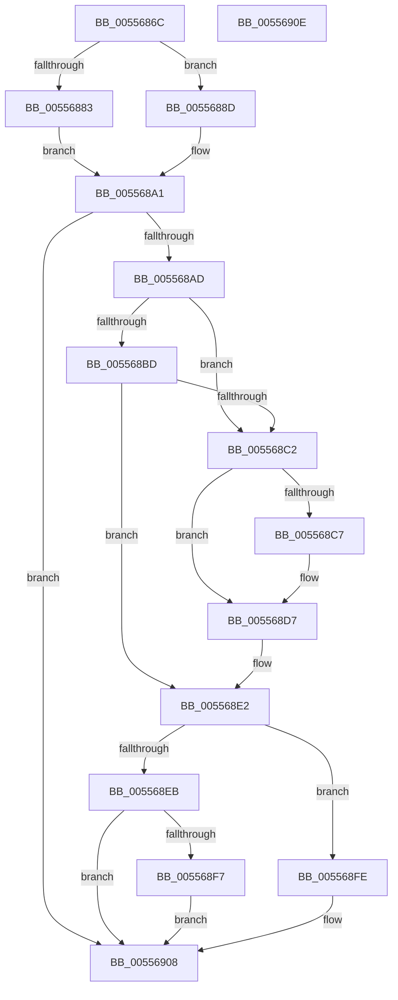

# HalpMemoryErrorDeferredHandler

- RVA: `0x0055686C`–`0x0055690F` (길이 `163` bytes)
- VA: `0x000000014055686C`
- 실행 섹션: `.text`
- PDB 이름 있음: `예`; PDB Function 태그: `아니요`
- unwind 정보 RVA: `0x00064C80`
- 디코드: `50`개 명령, `163/163` bytes 표시
- 미해석 바이트: `0` (있으면 어셈블리에 `.byte`로 보존)

> 이 문서는 커널 이미지의 기계어와 PDB 기호를 분석해 생성했습니다. 4번과 5번은 함수 원형과 자료형을 바이너리 사용 방식에서 추정한 C 해석이며 원본 소스 복구 결과는 아닙니다.

## 1. Dependencies

- 직접 호출 지점: **5**; 고유 호출 대상: **5**
- 직접 호출자로 확인된 함수: **1**
- RIP 상대 이미지 참조: **3**

### Outgoing calls
- `0x00556886` → [WheaAttemptClearPoison](../../page/7D/WheaAttemptClearPoison_function_007D72A0.md) (function, `0x007D72A0`)
- `0x0055689C` → [WheaAttemptPhysicalPageOffline](../../page/7D/WheaAttemptPhysicalPageOffline_function_007D7380.md) (function, `0x007D7380`)
- `0x005568DD` → [HalpHvInvokeWheaErrorNotificationCallback](../54/HalpHvInvokeWheaErrorNotificationCallback_function_0054CE74.md) (function, `0x0054CE74`)
- `0x005568F7` → [guard_dispatch_icall](../6B/guard_dispatch_icall_function_006BAAD0.md) (function, `0x006BAAD0`)
- `0x00556903` → [HalpHvSetMachineCheckRecoveryState](../54/HalpHvSetMachineCheckRecoveryState_function_0054CF38.md) (function, `0x0054CF38`)

### Direct callers
- [HalpErrorDeferredHandler](HalpErrorDeferredHandler_function_005565D0.md) at `0x00556631`

### Static image references
- `0x005568A1` → RVA `0x00FC1C48` (`.data`; read)
- `0x005568AD` → RVA `0x00E097A8` (`.data`; read)
- `0x005568EB` → RVA `0x00FC1D08` (`.data`; read)

## 2. Other-region calls and transfers

- 다른 실행 섹션으로 향하는 call: **2**
  - `0x00556886` → [WheaAttemptClearPoison](../../page/7D/WheaAttemptClearPoison_function_007D72A0.md) (`.text` → `PAGE`)
  - `0x0055689C` → [WheaAttemptPhysicalPageOffline](../../page/7D/WheaAttemptPhysicalPageOffline_function_007D7380.md) (`.text` → `PAGE`)
- 별도 외부 분기/꼬리 이동을 확인하지 못했습니다.

## 3. Assembly (complete function range)

```asm
0055686C  40 53                           push rbx
0055686E  48 83 EC 30                     sub rsp, 0x30
00556872  80 61 0D 0F                     and byte ptr [rcx + 0xd], 0xf
00556876  33 D2                           xor edx, edx
00556878  38 51 0E                        cmp byte ptr [rcx + 0xe], dl
0055687B  48 8B D9                        mov rbx, rcx
0055687E  48 8B 09                        mov rcx, qword ptr [rcx]
00556881  74 0A                           je 0x14055688d
00556883  4C 8B C3                        mov r8, rbx
00556886  E8 15 0A 28 00                  call 0x1407d72a0
0055688B  EB 14                           jmp 0x1405568a1
0055688D  48 C1 E9 0C                     shr rcx, 0xc
00556891  45 33 C9                        xor r9d, r9d
00556894  41 B0 01                        mov r8b, 1
00556897  48 89 5C 24 20                  mov qword ptr [rsp + 0x20], rbx
0055689C  E8 DF 0A 28 00                  call 0x1407d7380
005568A1  80 3D A0 B3 A6 00 00            cmp byte ptr [rip + 0xa6b3a0], 0
005568A8  44 8B C0                        mov r8d, eax
005568AB  74 5B                           je 0x140556908
005568AD  48 8B 05 F4 2E 8B 00            mov rax, qword ptr [rip + 0x8b2ef4]
005568B4  32 C9                           xor cl, cl
005568B6  8B 10                           mov edx, dword ptr [rax]
005568B8  45 85 C0                        test r8d, r8d
005568BB  75 05                           jne 0x1405568c2
005568BD  83 FA 01                        cmp edx, 1
005568C0  77 20                           ja 0x1405568e2
005568C2  83 FA 01                        cmp edx, 1
005568C5  77 10                           ja 0x1405568d7
005568C7  B0 40                           mov al, 0x40
005568C9  45 85 C0                        test r8d, r8d
005568CC  0F B6 C8                        movzx ecx, al
005568CF  B8 C0 00 00 00                  mov eax, 0xc0
005568D4  0F 44 C8                        cmove ecx, eax
005568D7  88 4B 30                        mov byte ptr [rbx + 0x30], cl
005568DA  48 8B CB                        mov rcx, rbx
005568DD  E8 92 65 FF FF                  call 0x14054ce74
005568E2  48 8B 4B 10                     mov rcx, qword ptr [rbx + 0x10]
005568E6  48 85 C9                        test rcx, rcx
005568E9  74 13                           je 0x1405568fe
005568EB  48 8B 05 16 B4 A6 00            mov rax, qword ptr [rip + 0xa6b416]
005568F2  48 85 C0                        test rax, rax
005568F5  74 11                           je 0x140556908
005568F7  E8 D4 41 16 00                  call 0x1406baad0
005568FC  EB 0A                           jmp 0x140556908
005568FE  B9 02 00 00 00                  mov ecx, 2
00556903  E8 30 66 FF FF                  call 0x14054cf38
00556908  48 83 C4 30                     add rsp, 0x30
0055690C  5B                              pop rbx
0055690D  C3                              ret
0055690E  CC                              int3
```

## 4. C-style interpretation (structured pseudocode)

```c
__int64 __fastcall HalpMemoryErrorDeferredHandler(__int64 a1, int a2, __int64 a3, int a4)
{
    __int64 result;
    __int64 v_rsp;
    unsigned __int64 v_stack_m18;

    v_rsp = (v_rsp) - (48);
    a2 = 0;
    if ((*(unsigned __int8 *)(a1 + 14)) == 0) goto loc_0055688D;
    result = WheaAttemptClearPoison(*(unsigned __int64 *)(a1), a2, a1, a4);
    goto loc_005568A1;
loc_0055688D:
    a1 = (*(unsigned __int64 *)(a1)) >> (12);
    a4 = 0;
    v_stack_m18 = a1;
    result = WheaAttemptPhysicalPageOffline(a1, a2, 1, a4);
loc_005568A1:
    if ((*(unsigned __int8 *)(v_rip + 10924960)) == 0) goto loc_00556908;
    a1 = 0;
    if ((unsigned int)((unsigned int)((unsigned int)(result))) != 0) goto loc_005568C2;
    if (((unsigned int)((unsigned int)(*(unsigned int *)(*(unsigned __int64 *)(v_rip + 9121524))))) > 1) goto loc_005568E2;
loc_005568C2:
    result = *(unsigned __int64 *)(v_rip + 9121524);
    if (((unsigned int)((unsigned int)(*(unsigned int *)(*(unsigned __int64 *)(v_rip + 9121524))))) <= 1) {
        result = 64;
        a1 = (unsigned __int8)(result);
        result = 192;
        if ((unsigned int)((unsigned int)((unsigned int)(result))) == 0) { a1 = (unsigned int)(result); }
    }
    *(unsigned __int8 *)(a1 + 48) = (unsigned __int8)(a1);
    result = HalpHvInvokeWheaErrorNotificationCallback(a1, (unsigned int)(*(unsigned int *)(*(unsigned __int64 *)(v_rip + 9121524))), (unsigned int)((unsigned int)(result)), a4);
loc_005568E2:
    if (*(unsigned __int64 *)(a1 + 16) == 0) goto loc_005568FE;
    if (*(unsigned __int64 *)(v_rip + 10925078) == 0) goto loc_00556908;
    result = guard_dispatch_icall(*(unsigned __int64 *)(a1 + 16), (unsigned int)(*(unsigned int *)(*(unsigned __int64 *)(v_rip + 9121524))), (unsigned int)((unsigned int)(result)), a4);
    goto loc_00556908;
loc_005568FE:
    result = HalpHvSetMachineCheckRecoveryState(2, (unsigned int)(*(unsigned int *)(*(unsigned __int64 *)(v_rip + 9121524))), (unsigned int)((unsigned int)(result)), a4);
loc_00556908:
    v_rsp = (v_rsp) + (48);
    return result;
}
```

## 5. (Beta) C Style

```c
int64_t HalpMemoryErrorDeferredHandler(void *Arg1, int32_t Arg2, int64_t Arg3, int32_t Arg4)
{
    uint8_t *arg1 = (uint8_t *)Arg1;

    int64_t result;
    int64_t local_rsp;
    uint64_t v_stack_m18;

    local_rsp = (local_rsp) - (48);
    Arg2 = 0;
    if ((*(uint8_t *)(arg1 + 0xE)) == 0) goto loc_0055688D;
    result = WheaAttemptClearPoison(*(uint64_t *)(arg1), Arg2, Arg1, Arg4);
    goto loc_005568A1;
loc_0055688D:
    Arg1 = (*(uint64_t *)(arg1)) >> (12);
    Arg4 = 0;
    v_stack_m18 = Arg1;
    result = WheaAttemptPhysicalPageOffline(Arg1, Arg2, 1, Arg4);
loc_005568A1:
    if ((*(uint8_t *)(v_rip + 0xA6B3A0)) == 0) goto loc_00556908;
    Arg1 = 0;
    if ((uint32_t)((uint32_t)((uint32_t)(result))) != 0) goto loc_005568C2;
    if (((uint32_t)((uint32_t)(*(uint32_t *)(*(uint64_t *)(v_rip + 0x8B2EF4))))) > 1) goto loc_005568E2;
loc_005568C2:
    result = *(uint64_t *)(v_rip + 0x8B2EF4);
    if (((uint32_t)((uint32_t)(*(uint32_t *)(*(uint64_t *)(v_rip + 0x8B2EF4))))) <= 1) {
        result = 64;
        Arg1 = (uint8_t)(result);
        result = 192;
        if ((uint32_t)((uint32_t)((uint32_t)(result))) == 0) { Arg1 = (uint32_t)(result); }
    }
    *(uint8_t *)(arg1 + 0x30) = (uint8_t)(Arg1);
    result = HalpHvInvokeWheaErrorNotificationCallback(Arg1, (uint32_t)(*(uint32_t *)(*(uint64_t *)(v_rip + 0x8B2EF4))), (uint32_t)((uint32_t)(result)), Arg4);
loc_005568E2:
    if (*(uint64_t *)(arg1 + 0x10) == 0) goto loc_005568FE;
    if (*(uint64_t *)(v_rip + 0xA6B416) == 0) goto loc_00556908;
    result = guard_dispatch_icall(*(uint64_t *)(arg1 + 0x10), (uint32_t)(*(uint32_t *)(*(uint64_t *)(v_rip + 0x8B2EF4))), (uint32_t)((uint32_t)(result)), Arg4);
    goto loc_00556908;
loc_005568FE:
    result = HalpHvSetMachineCheckRecoveryState(2, (uint32_t)(*(uint32_t *)(*(uint64_t *)(v_rip + 0x8B2EF4))), (uint32_t)((uint32_t)(result)), Arg4);
loc_00556908:
    local_rsp = (local_rsp) + (48);
    return result;
}
```

### 관측된 메모리 오프셋

구조체 형식이 확인되지 않은 접근은 인자 기준의 오프셋으로만 기록했습니다.

| 기준 인자 | 오프셋 표현 | 폭 (bit) | 접근 |
|---|---:|---:|---|
| `Arg1` | `+ 0x0` | `64` | `R` |
| `Arg1` | `+ 0xD` | `8` | `R/W` |
| `Arg1` | `+ 0xE` | `8` | `R` |
| `Arg1` | `+ 0x10` | `64` | `R` |
| `Arg1` | `+ 0x30` | `8` | `W` |

## 6. Execution-region graph

[열기: 2D/3D 그래프와 함수 탐색 컨트롤 패널](../../../control-panel.html?section=text&rva=0x0055686C&view=graph)

- 2D 그래프는 위에서 아래로 흐르고, 3D 그래프는 빈 공간을 드래그해 회전합니다. Shift+드래그는 이동, 휠은 확대·축소, 함수 노드 선택은 대상 보고서 이동입니다.

### Static fallback


