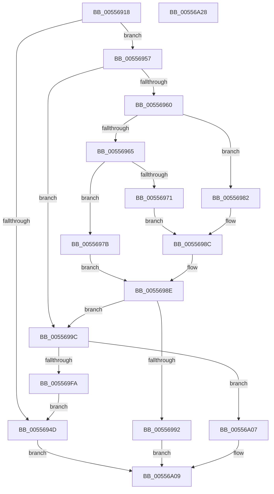

# HalpMemoryErrorDeferredRecovery

- RVA: `0x00556918`–`0x00556A29` (길이 `273` bytes)
- VA: `0x0000000140556918`
- 실행 섹션: `.text`
- PDB 이름 있음: `예`; PDB Function 태그: `아니요`
- unwind 정보 RVA: `0x00075C18`
- 디코드: `77`개 명령, `273/273` bytes 표시
- 미해석 바이트: `0` (있으면 어셈블리에 `.byte`로 보존)

> 이 문서는 커널 이미지의 기계어와 PDB 기호를 분석해 생성했습니다. 4번과 5번은 함수 원형과 자료형을 바이너리 사용 방식에서 추정한 C 해석이며 원본 소스 복구 결과는 아닙니다.

## 1. Dependencies

- 직접 호출 지점: **6**; 고유 호출 대상: **5**
- 직접 호출자로 확인된 함수: **4**
- RIP 상대 이미지 참조: **2**

### Outgoing calls
- `0x00556940` → [HalpAcquireDrsPool](HalpAcquireDrsPool_function_00556538.md) (function, `0x00556538`)
- `0x00556974` → [guard_dispatch_icall](../6B/guard_dispatch_icall_function_006BAAD0.md) (function, `0x006BAAD0`)
- `0x00556987` → [HalpHvSetMachineCheckRecoveryState](../54/HalpHvSetMachineCheckRecoveryState_function_0054CF38.md) (function, `0x0054CF38`)
- `0x00556995` → [HalpFreeDrsPool](HalpFreeDrsPool_function_0055666C.md) (function, `0x0055666C`)
- `0x005569F1` → [WheaRequestDeferredRecovery](../66/WheaRequestDeferredRecovery_function_00660140.md) (function, `0x00660140`)
- `0x005569FD` → [HalpFreeDrsPool](HalpFreeDrsPool_function_0055666C.md) (function, `0x0055666C`)

### Direct callers
- [HalpHvMceConsumedMemoryErrorRecovery](../54/HalpHvMceConsumedMemoryErrorRecovery_function_0054C310.md) at `0x0054C38A`
- [HalpMceRecovery](HalpMceRecovery_function_00555DD0.md) at `0x00555FDA`
- [HalpMceRecoveryNotRequiredIntel](HalpMceRecoveryNotRequiredIntel_function_005562A0.md) at `0x0055636B`
- [HalpGenericErrorSourceRecovery](HalpGenericErrorSourceRecovery_function_0055669C.md) at `0x00556779`

### Static image references
- `0x00556957` → RVA `0x00FC1C48` (`.data`; read)
- `0x00556965` → RVA `0x00FC1D00` (`.data`; read)

## 2. Other-region calls and transfers

- 다른 실행 섹션으로 향하는 call: **0**
- 별도 외부 분기/꼬리 이동을 확인하지 못했습니다.

## 3. Assembly (complete function range)

```asm
00556918  48 89 5C 24 08                  mov qword ptr [rsp + 8], rbx
0055691D  48 89 6C 24 10                  mov qword ptr [rsp + 0x10], rbp
00556922  48 89 74 24 18                  mov qword ptr [rsp + 0x18], rsi
00556927  57                              push rdi
00556928  41 54                           push r12
0055692A  41 55                           push r13
0055692C  41 56                           push r14
0055692E  41 57                           push r15
00556930  48 83 EC 20                     sub rsp, 0x20
00556934  45 8B F9                        mov r15d, r9d
00556937  49 8B E8                        mov rbp, r8
0055693A  44 8A E2                        mov r12b, dl
0055693D  4C 8B E9                        mov r13, rcx
00556940  E8 F3 FB FF FF                  call 0x140556538
00556945  48 8B F8                        mov rdi, rax
00556948  48 85 C0                        test rax, rax
0055694B  75 0A                           jne 0x140556957
0055694D  BB 43 00 00 C0                  mov ebx, 0xc0000043
00556952  E9 B2 00 00 00                  jmp 0x140556a09
00556957  80 3D EA B2 A6 00 00            cmp byte ptr [rip + 0xa6b2ea], 0
0055695E  74 3C                           je 0x14055699c
00556960  48 85 ED                        test rbp, rbp
00556963  74 1D                           je 0x140556982
00556965  48 8B 05 94 B3 A6 00            mov rax, qword ptr [rip + 0xa6b394]
0055696C  48 85 C0                        test rax, rax
0055696F  74 0A                           je 0x14055697b
00556971  48 8B CD                        mov rcx, rbp
00556974  E8 57 41 16 00                  call 0x1406baad0
00556979  EB 11                           jmp 0x14055698c
0055697B  BB 01 00 00 C0                  mov ebx, 0xc0000001
00556980  EB 0C                           jmp 0x14055698e
00556982  B9 01 00 00 00                  mov ecx, 1
00556987  E8 AC 65 FF FF                  call 0x14054cf38
0055698C  8B D8                           mov ebx, eax
0055698E  85 DB                           test ebx, ebx
00556990  79 0A                           jns 0x14055699c
00556992  48 8B CF                        mov rcx, rdi
00556995  E8 D2 FC FF FF                  call 0x14055666c
0055699A  EB 6D                           jmp 0x140556a09
0055699C  0F B7 44 24 70                  movzx eax, word ptr [rsp + 0x70]
005569A1  48 8D 57 30                     lea rdx, [rdi + 0x30]
005569A5  66 89 47 3A                     mov word ptr [rdi + 0x3a], ax
005569A9  48 8D 4F 08                     lea rcx, [rdi + 8]
005569AD  8A 44 24 78                     mov al, byte ptr [rsp + 0x78]
005569B1  88 47 3C                        mov byte ptr [rdi + 0x3c], al
005569B4  8A 84 24 80 00 00 00            mov al, byte ptr [rsp + 0x80]
005569BB  88 47 3D                        mov byte ptr [rdi + 0x3d], al
005569BE  8A 84 24 88 00 00 00            mov al, byte ptr [rsp + 0x88]
005569C5  4C 89 6F 30                     mov qword ptr [rdi + 0x30], r13
005569C9  24 01                           and al, 1
005569CB  44 88 67 38                     mov byte ptr [rdi + 0x38], r12b
005569CF  83 67 5C 00                     and dword ptr [rdi + 0x5c], 0
005569D3  48 83 67 64 00                  and qword ptr [rdi + 0x64], 0
005569D8  88 47 3E                        mov byte ptr [rdi + 0x3e], al
005569DB  48 89 6F 40                     mov qword ptr [rdi + 0x40], rbp
005569DF  44 89 7F 48                     mov dword ptr [rdi + 0x48], r15d
005569E3  C7 47 4C 01 00 00 00            mov dword ptr [rdi + 0x4c], 1
005569EA  C7 47 50 01 00 00 00            mov dword ptr [rdi + 0x50], 1
005569F1  E8 4A 97 10 00                  call 0x140660140
005569F6  84 C0                           test al, al
005569F8  75 0D                           jne 0x140556a07
005569FA  48 8B CF                        mov rcx, rdi
005569FD  E8 6A FC FF FF                  call 0x14055666c
00556A02  E9 46 FF FF FF                  jmp 0x14055694d
00556A07  33 DB                           xor ebx, ebx
00556A09  48 8B 6C 24 58                  mov rbp, qword ptr [rsp + 0x58]
00556A0E  8B C3                           mov eax, ebx
00556A10  48 8B 5C 24 50                  mov rbx, qword ptr [rsp + 0x50]
00556A15  48 8B 74 24 60                  mov rsi, qword ptr [rsp + 0x60]
00556A1A  48 83 C4 20                     add rsp, 0x20
00556A1E  41 5F                           pop r15
00556A20  41 5E                           pop r14
00556A22  41 5D                           pop r13
00556A24  41 5C                           pop r12
00556A26  5F                              pop rdi
00556A27  C3                              ret
00556A28  CC                              int3
```

## 4. C-style interpretation (structured pseudocode)

```c
__int64 __fastcall HalpMemoryErrorDeferredRecovery(__int64 a1, unsigned __int8 a2, __int64 a3, int a4, unsigned __int16 a5, unsigned __int8 a6, unsigned __int8 a7, unsigned __int8 a8)
{
    __int64 result;
    __int64 v_rbx;
    __int64 v_rsp;
    unsigned __int64 v_stack_p10;
    unsigned __int64 v_stack_p18;
    unsigned __int64 v_stack_p8;

    v_stack_p8 = v_rbx;
    v_stack_p10 = v_rbp;
    v_stack_p18 = v_rsi;
    v_rsp = (v_rsp) - (32);
    result = HalpAcquireDrsPool(a1, a2, a3, a4);
    if (result != 0) goto loc_00556957;
loc_0055694D:
    goto loc_00556A09;
loc_00556957:
    if ((*(unsigned __int8 *)(v_rip + 10924778)) == 0) goto loc_0055699C;
    if (a3 == 0) goto loc_00556982;
    if (*(unsigned __int64 *)(v_rip + 10924948) == 0) goto loc_0055697B;
    result = guard_dispatch_icall(a3, a2, a3, a4);
    goto loc_0055698C;
loc_0055697B:
    goto loc_0055698E;
loc_00556982:
    result = HalpHvSetMachineCheckRecoveryState(1, a2, a3, a4);
loc_0055698C:
loc_0055698E:
    if (!sign_flag) goto loc_0055699C;
    result = HalpFreeDrsPool(result, a2, a3, a4);
    goto loc_00556A09;
loc_0055699C:
    *(unsigned __int16 *)(result + 58) = a5;
    *(unsigned __int8 *)(result + 60) = a6;
    *(unsigned __int8 *)(result + 61) = a7;
    *(unsigned __int64 *)(result + 48) = a1;
    result = (unsigned __int8)((a8) & (1));
    *(unsigned __int8 *)(result + 56) = a2;
    *(unsigned __int8 *)(result + 62) = (unsigned __int8)(result);
    *(unsigned __int64 *)(result + 64) = a3;
    *(unsigned int *)(result + 72) = (unsigned int)((unsigned int)(a4));
    *(unsigned int *)(result + 76) = 1;
    *(unsigned int *)(result + 80) = 1;
    result = WheaRequestDeferredRecovery(result + 8, result + 48, a3, a4);
    if ((unsigned __int8)(result) != 0) goto loc_00556A07;
    result = HalpFreeDrsPool(result, result + 48, a3, a4);
    goto loc_0055694D;
loc_00556A07:
    v_rbx = 0;
loc_00556A09:
    v_rsp = (v_rsp) + (32);
    return 0;
}
```

## 5. (Beta) C Style

```c
int64_t HalpMemoryErrorDeferredRecovery(int64_t Arg1, uint8_t Arg2, int64_t Arg3, int32_t Arg4, uint16_t Arg5, uint8_t Arg6, uint8_t Arg7, uint8_t Arg8)
{
    int64_t result;
    int64_t local_rbx;
    int64_t local_rsp;
    uint64_t v_stack_p10;
    uint64_t v_stack_p18;
    uint64_t v_stack_p8;

    v_stack_p8 = local_rbx;
    v_stack_p10 = local_rbp;
    v_stack_p18 = local_rsi;
    local_rsp = (local_rsp) - (32);
    result = HalpAcquireDrsPool(Arg1, Arg2, Arg3, Arg4);
    if (result != 0) goto loc_00556957;
loc_0055694D:
    goto loc_00556A09;
loc_00556957:
    if ((*(uint8_t *)(v_rip + 0xA6B2EA)) == 0) goto loc_0055699C;
    if (Arg3 == 0) goto loc_00556982;
    if (*(uint64_t *)(v_rip + 0xA6B394) == 0) goto loc_0055697B;
    result = guard_dispatch_icall(Arg3, Arg2, Arg3, Arg4);
    goto loc_0055698C;
loc_0055697B:
    goto loc_0055698E;
loc_00556982:
    result = HalpHvSetMachineCheckRecoveryState(1, Arg2, Arg3, Arg4);
loc_0055698C:
loc_0055698E:
    if (!sign_flag) goto loc_0055699C;
    result = HalpFreeDrsPool(result, Arg2, Arg3, Arg4);
    goto loc_00556A09;
loc_0055699C:
    *(uint16_t *)(result + 0x3A) = Arg5;
    *(uint8_t *)(result + 0x3C) = Arg6;
    *(uint8_t *)(result + 0x3D) = Arg7;
    *(uint64_t *)(result + 0x30) = Arg1;
    result = (uint8_t)((Arg8) & (1));
    *(uint8_t *)(result + 0x38) = Arg2;
    *(uint8_t *)(result + 0x3E) = (uint8_t)(result);
    *(uint64_t *)(result + 0x40) = Arg3;
    *(uint32_t *)(result + 0x48) = (uint32_t)((uint32_t)(Arg4));
    *(uint32_t *)(result + 0x4C) = 1;
    *(uint32_t *)(result + 0x50) = 1;
    result = WheaRequestDeferredRecovery(result + 8, result + 48, Arg3, Arg4);
    if ((uint8_t)(result) != 0) goto loc_00556A07;
    result = HalpFreeDrsPool(result, result + 48, Arg3, Arg4);
    goto loc_0055694D;
loc_00556A07:
    local_rbx = 0;
loc_00556A09:
    local_rsp = (local_rsp) + (32);
    return 0;
}
```

## 6. Execution-region graph

[열기: 2D/3D 그래프와 함수 탐색 컨트롤 패널](../../../control-panel.html?section=text&rva=0x00556918&view=graph)

- 2D 그래프는 위에서 아래로 흐르고, 3D 그래프는 빈 공간을 드래그해 회전합니다. Shift+드래그는 이동, 휠은 확대·축소, 함수 노드 선택은 대상 보고서 이동입니다.

### Static fallback


