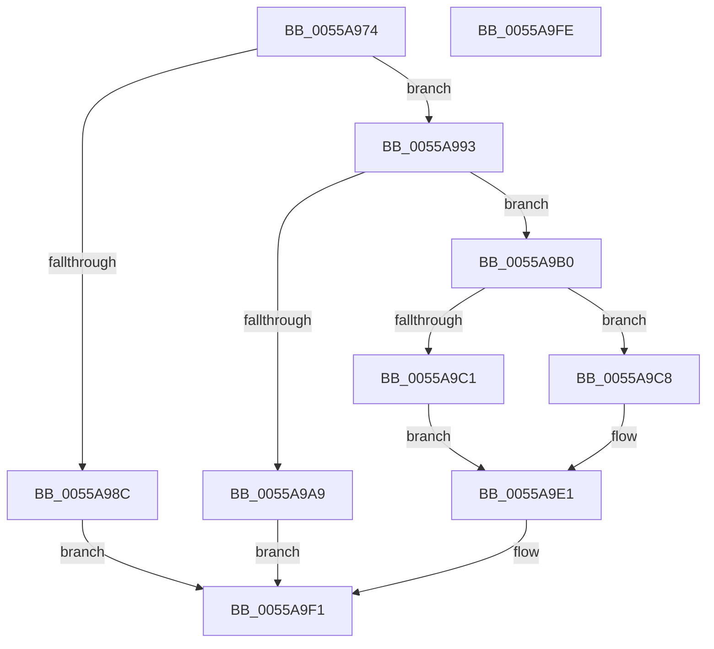

# HalpMmUpdateTiledMemoryMapTargetStub

- RVA: `0x0055A974`–`0x0055A9FF` (길이 `139` bytes)
- VA: `0x000000014055A974`
- 실행 섹션: `.text`
- PDB 이름 있음: `예`; PDB Function 태그: `아니요`
- unwind 정보 RVA: `0x0005CAAC`
- 디코드: `39`개 명령, `139/139` bytes 표시
- 미해석 바이트: `0` (있으면 어셈블리에 `.byte`로 보존)

> 이 문서는 커널 이미지의 기계어와 PDB 기호를 분석해 생성했습니다. 4번과 5번은 함수 원형과 자료형을 바이너리 사용 방식에서 추정한 C 해석이며 원본 소스 복구 결과는 아닙니다.

## 1. Dependencies

- 직접 호출 지점: **3**; 고유 호출 대상: **3**
- 직접 호출자로 확인된 함수: **2**
- RIP 상대 이미지 참조: **2**

### Outgoing calls
- `0x0055A99C` → [MmMapIoSpaceEx](../32/MmMapIoSpaceEx_function_00327830.md) (function, `0x00327830`)
- `0x0055A9B7` → [MmGetPhysicalAddress](../23/MmGetPhysicalAddress_function_0023A500.md) (function, `0x0023A500`)
- `0x0055A9EC` → [MiUnmapContiguousMemory](../3F/MiUnmapContiguousMemory_function_003F7908.md) (function, `0x003F7908`)

### Direct callers
- [HalpInterruptStartProcessor](../../pagelk/B5/HalpInterruptStartProcessor_function_00B5BEF0.md) at `0x00B5BFA6`
- [HalpBuildResumeStructures](../../pagelk/B5/HalpBuildResumeStructures_function_00B5D0F0.md) at `0x00B5D133`

### Static image references
- `0x0055A97E` → RVA `0x00F905E0` (`.data`; read)
- `0x0055A9B0` → RVA `0x006AC820` (`HalpLMStub`; read)

## 2. Other-region calls and transfers

- 다른 실행 섹션으로 향하는 call: **0**
- 별도 외부 분기/꼬리 이동을 확인하지 못했습니다.

## 3. Assembly (complete function range)

```asm
0055A974  48 89 5C 24 08                  mov qword ptr [rsp + 8], rbx
0055A979  57                              push rdi
0055A97A  48 83 EC 20                     sub rsp, 0x20
0055A97E  48 8B 0D 5B 5C A3 00            mov rcx, qword ptr [rip + 0xa35c5b]
0055A985  33 DB                           xor ebx, ebx
0055A987  48 85 C9                        test rcx, rcx
0055A98A  75 07                           jne 0x14055a993
0055A98C  BB 01 00 00 C0                  mov ebx, 0xc0000001
0055A991  EB 5E                           jmp 0x14055a9f1
0055A993  BA 08 00 00 00                  mov edx, 8
0055A998  44 8D 42 FC                     lea r8d, [rdx - 4]
0055A99C  E8 8F CE DC FF                  call 0x140327830
0055A9A1  48 8B F8                        mov rdi, rax
0055A9A4  48 85 C0                        test rax, rax
0055A9A7  75 07                           jne 0x14055a9b0
0055A9A9  BB 9A 00 00 C0                  mov ebx, 0xc000009a
0055A9AE  EB 41                           jmp 0x14055a9f1
0055A9B0  48 8D 0D 69 1E 15 00            lea rcx, [rip + 0x151e69]
0055A9B7  E8 44 FB CD FF                  call 0x14023a500
0055A9BC  48 85 C0                        test rax, rax
0055A9BF  75 07                           jne 0x14055a9c8
0055A9C1  BB 01 00 00 C0                  mov ebx, 0xc0000001
0055A9C6  EB 19                           jmp 0x14055a9e1
0055A9C8  48 8B C8                        mov rcx, rax
0055A9CB  49 B8 FF 0F 00 00 00 00 F0 FF   movabs r8, 0xfff0000000000fff
0055A9D5  48 33 0F                        xor rcx, qword ptr [rdi]
0055A9D8  49 23 C8                        and rcx, r8
0055A9DB  48 33 C8                        xor rcx, rax
0055A9DE  48 89 0F                        mov qword ptr [rdi], rcx
0055A9E1  41 B0 01                        mov r8b, 1
0055A9E4  BA 08 00 00 00                  mov edx, 8
0055A9E9  48 8B CF                        mov rcx, rdi
0055A9EC  E8 17 CF E9 FF                  call 0x1403f7908
0055A9F1  8B C3                           mov eax, ebx
0055A9F3  48 8B 5C 24 30                  mov rbx, qword ptr [rsp + 0x30]
0055A9F8  48 83 C4 20                     add rsp, 0x20
0055A9FC  5F                              pop rdi
0055A9FD  C3                              ret
0055A9FE  CC                              int3
```

## 4. C-style interpretation (structured pseudocode)

```c
__int64 __fastcall HalpMmUpdateTiledMemoryMapTargetStub(void)
{
    __int64 result;
    __int64 v_rbx;
    __int64 v_rsp;
    unsigned __int64 v_stack_p8;

    v_stack_p8 = v_rbx;
    v_rsp = (v_rsp) - (32);
    v_rbx = 0;
    if (*(unsigned __int64 *)(v_rip + 10706011) != 0) goto loc_0055A993;
    goto loc_0055A9F1;
loc_0055A993:
    result = MmMapIoSpaceEx(*(unsigned __int64 *)(v_rip + 10706011), 8, 8 - 4, a4);
    if (result != 0) goto loc_0055A9B0;
    goto loc_0055A9F1;
loc_0055A9B0:
    result = MmGetPhysicalAddress(v_rip + 1384041, 8, 8 - 4, a4);
    if (result != 0) goto loc_0055A9C8;
    goto loc_0055A9E1;
loc_0055A9C8:
    a1 = (result) ^ (*(unsigned __int64 *)(result));
    a1 = (a1) & (8 - 4);
    a1 = (a1) ^ (result);
    *(unsigned __int64 *)(result) = a1;
loc_0055A9E1:
    result = MiUnmapContiguousMemory(result, 8, 1, a4);
loc_0055A9F1:
    v_rsp = (v_rsp) + (32);
    return (unsigned int)((unsigned int)((unsigned int)(0xC0000001ULL)));
}
```

## 5. (Beta) C Style

```c
void HalpMmUpdateTiledMemoryMapTargetStub(void)
{
    int64_t result;
    int64_t local_rbx;
    int64_t local_rsp;
    uint64_t v_stack_p8;

    v_stack_p8 = local_rbx;
    local_rsp = (local_rsp) - (32);
    local_rbx = 0;
    if (*(uint64_t *)(v_rip + 0xA35C5B) != 0) goto loc_0055A993;
    goto loc_0055A9F1;
loc_0055A993:
    result = MmMapIoSpaceEx(*(uint64_t *)(v_rip + 0xA35C5B), 8, 8 - 4, a4);
    if (result != 0) goto loc_0055A9B0;
    goto loc_0055A9F1;
loc_0055A9B0:
    result = MmGetPhysicalAddress(v_rip + 1384041, 8, 8 - 4, a4);
    if (result != 0) goto loc_0055A9C8;
    goto loc_0055A9E1;
loc_0055A9C8:
    a1 = (result) ^ (*(uint64_t *)(result));
    a1 = (a1) & (8 - 4);
    a1 = (a1) ^ (result);
    *(uint64_t *)(result) = a1;
loc_0055A9E1:
    result = MiUnmapContiguousMemory(result, 8, 1, a4);
loc_0055A9F1:
    local_rsp = (local_rsp) + (32);
    return (uint32_t)((uint32_t)((uint32_t)(0xC0000001ULL)));
}
```

## 6. Execution-region graph

[열기: 2D/3D 그래프와 함수 탐색 컨트롤 패널](../../../control-panel.html?section=text&rva=0x0055A974&view=graph)

- 2D 그래프는 위에서 아래로 흐르고, 3D 그래프는 빈 공간을 드래그해 회전합니다. Shift+드래그는 이동, 휠은 확대·축소, 함수 노드 선택은 대상 보고서 이동입니다.

### Static fallback


