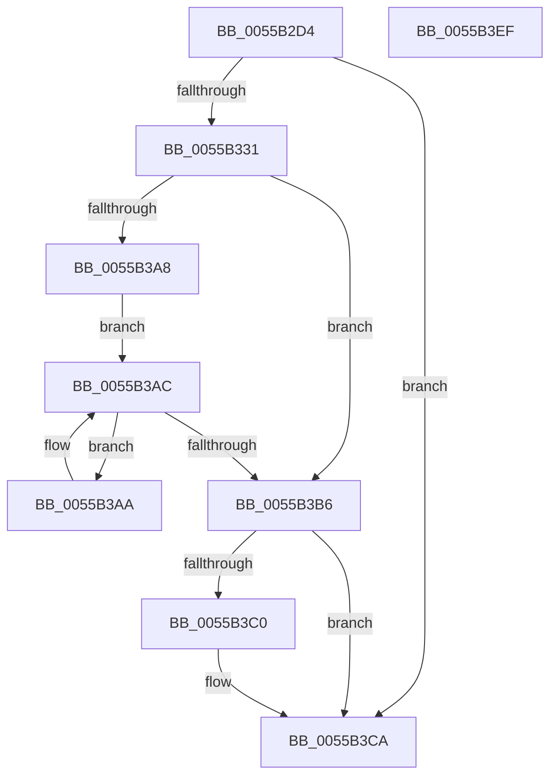

# HalpNmiReboot

- RVA: `0x0055B2D4`–`0x0055B3F0` (길이 `284` bytes)
- VA: `0x000000014055B2D4`
- 실행 섹션: `.text`
- PDB 이름 있음: `예`; PDB Function 태그: `아니요`
- unwind 정보 RVA: `0x000C4824`
- 디코드: `65`개 명령, `284/284` bytes 표시
- 미해석 바이트: `0` (있으면 어셈블리에 `.byte`로 보존)

> 이 문서는 커널 이미지의 기계어와 PDB 기호를 분석해 생성했습니다. 4번과 5번은 함수 원형과 자료형을 바이너리 사용 방식에서 추정한 C 해석이며 원본 소스 복구 결과는 아닙니다.

## 1. Dependencies

- 직접 호출 지점: **9**; 고유 호출 대상: **8**
- 직접 호출자로 확인된 함수: **1**
- RIP 상대 이미지 참조: **5**

### Outgoing calls
- `0x0055B305` → [memset](../6C/memset_function_006C6C40.md) (function, `0x006C6C40`)
- `0x0055B35D` → [memset](../6C/memset_function_006C6C40.md) (function, `0x006C6C40`)
- `0x0055B373` → [KiCopyAffinityEx](../2C/KiCopyAffinityEx_function_002CE860.md) (function, `0x002CE860`)
- `0x0055B386` → [KeRemoveProcessorAffinityEx](../30/KeRemoveProcessorAffinityEx_function_00304E10.md) (function, `0x00304E10`)
- `0x0055B390` → [HalSendNMI](../54/HalSendNMI_function_00545E80.md) (function, `0x00545E80`)
- `0x0055B39A` → [KeStallExecutionProcessor](../44/KeStallExecutionProcessor_function_0044F620.md) (function, `0x0044F620`)
- `0x0055B39F` → [HalpIsHvPresent](../4A/HalpIsHvPresent_function_004AFA10.md) (function, `0x004AFA10`)
- `0x0055B3C4` → [HalpInterruptRebootService](HalpInterruptRebootService_function_0055B850.md) (function, `0x0055B850`)
- `0x0055B3D5` → [_security_check_cookie](../6A/_security_check_cookie_function_006AC640.md) (function, `0x006AC640`)

### Direct callers
- [HalpReboot](../54/HalpReboot_function_00546870.md) at `0x005468F9`

### Static image references
- `0x0055B2E6` → RVA `0x00E0A740` (`.data`; read)
- `0x0055B331` → RVA `0x00E0A774` (`.data`; read)
- `0x0055B348` → RVA `0x00F90530` (`.data`; write)
- `0x0055B367` → RVA `0x00FC7120` (`ALMOSTRO`; read)
- `0x0055B378` → RVA `0x00FC6A80` (`ALMOSTRO`; read)

## 2. Other-region calls and transfers

- 다른 실행 섹션으로 향하는 call: **0**
- 별도 외부 분기/꼬리 이동을 확인하지 못했습니다.

## 3. Assembly (complete function range)

```asm
0055B2D4  48 89 5C 24 08                  mov qword ptr [rsp + 8], rbx
0055B2D9  48 89 74 24 10                  mov qword ptr [rsp + 0x10], rsi
0055B2DE  57                              push rdi
0055B2DF  48 81 EC 40 01 00 00            sub rsp, 0x140
0055B2E6  48 8B 05 53 F4 8A 00            mov rax, qword ptr [rip + 0x8af453]
0055B2ED  48 33 C4                        xor rax, rsp
0055B2F0  48 89 84 24 30 01 00 00         mov qword ptr [rsp + 0x130], rax
0055B2F8  33 D2                           xor edx, edx
0055B2FA  48 8D 4C 24 28                  lea rcx, [rsp + 0x28]
0055B2FF  41 B8 00 01 00 00               mov r8d, 0x100
0055B305  E8 36 B9 16 00                  call 0x1406c6c40
0055B30A  65 48 8B 1C 25 20 00 00 00      mov rbx, qword ptr gs:[0x20]
0055B313  0F B6 4B 40                     movzx ecx, byte ptr [rbx + 0x40]
0055B317  0F B7 43 42                     movzx eax, word ptr [rbx + 0x42]
0055B31B  C1 E1 10                        shl ecx, 0x10
0055B31E  25 00 FF 00 00                  and eax, 0xff00
0055B323  0B C8                           or ecx, eax
0055B325  81 F9 00 01 05 00               cmp ecx, 0x50100
0055B32B  0F 86 99 00 00 00               jbe 0x14055b3ca
0055B331  8B 3D 3D F4 8A 00               mov edi, dword ptr [rip + 0x8af43d]
0055B337  48 8D 4C 24 28                  lea rcx, [rsp + 0x28]
0055B33C  83 64 24 24 00                  and dword ptr [rsp + 0x24], 0
0055B341  BE 01 00 00 00                  mov esi, 1
0055B346  33 D2                           xor edx, edx
0055B348  40 88 35 E1 51 A3 00            mov byte ptr [rip + 0xa351e1], sil
0055B34F  41 B8 00 01 00 00               mov r8d, 0x100
0055B355  C7 44 24 20 01 00 20 00         mov dword ptr [rsp + 0x20], 0x200001
0055B35D  E8 DE B8 16 00                  call 0x1406c6c40
0055B362  0F B7 54 24 22                  movzx edx, word ptr [rsp + 0x22]
0055B367  4C 8D 05 B2 BD A6 00            lea r8, [rip + 0xa6bdb2]
0055B36E  48 8D 4C 24 20                  lea rcx, [rsp + 0x20]
0055B373  E8 E8 34 D7 FF                  call 0x1402ce860
0055B378  8B 05 02 B7 A6 00               mov eax, dword ptr [rip + 0xa6b702]
0055B37E  48 8D 4C 24 20                  lea rcx, [rsp + 0x20]
0055B383  8B 53 24                        mov edx, dword ptr [rbx + 0x24]
0055B386  E8 85 9A DA FF                  call 0x140304e10
0055B38B  48 8D 4C 24 20                  lea rcx, [rsp + 0x20]
0055B390  E8 EB AA FE FF                  call 0x140545e80
0055B395  B9 F4 01 00 00                  mov ecx, 0x1f4
0055B39A  E8 81 42 EF FF                  call 0x14044f620
0055B39F  E8 6C 46 F5 FF                  call 0x1404afa10
0055B3A4  84 C0                           test al, al
0055B3A6  74 0E                           je 0x14055b3b6
0055B3A8  EB 02                           jmp 0x14055b3ac
0055B3AA  F3 90                           pause
0055B3AC  8B 05 C2 F3 8A 00               mov eax, dword ptr [rip + 0x8af3c2]
0055B3B2  3B C6                           cmp eax, esi
0055B3B4  7F F4                           jg 0x14055b3aa
0055B3B6  8B 05 B8 F3 8A 00               mov eax, dword ptr [rip + 0x8af3b8]
0055B3BC  3B C7                           cmp eax, edi
0055B3BE  74 0A                           je 0x14055b3ca
0055B3C0  33 D2                           xor edx, edx
0055B3C2  33 C9                           xor ecx, ecx
0055B3C4  E8 87 04 00 00                  call 0x14055b850
0055B3C9  CC                              int3
0055B3CA  48 8B 8C 24 30 01 00 00         mov rcx, qword ptr [rsp + 0x130]
0055B3D2  48 33 CC                        xor rcx, rsp
0055B3D5  E8 66 12 15 00                  call 0x1406ac640
0055B3DA  4C 8D 9C 24 40 01 00 00         lea r11, [rsp + 0x140]
0055B3E2  49 8B 5B 10                     mov rbx, qword ptr [r11 + 0x10]
0055B3E6  49 8B 73 18                     mov rsi, qword ptr [r11 + 0x18]
0055B3EA  49 8B E3                        mov rsp, r11
0055B3ED  5F                              pop rdi
0055B3EE  C3                              ret
0055B3EF  CC                              int3
```

## 4. C-style interpretation (structured pseudocode)

```c
__int64 __fastcall HalpNmiReboot(__int64 a1, int a2)
{
    __int64 result;
    __int64 v_rsp;
    unsigned __int64 v_stack_m120;
    unsigned int v_stack_m124;
    unsigned __int16 v_stack_m126;
    unsigned int v_stack_m128;
    unsigned __int64 v_stack_m18;
    unsigned __int64 v_stack_m8;
    unsigned __int64 v_stack_p10;
    unsigned __int64 v_stack_p8;

    v_stack_p8 = v_rbx;
    v_stack_p10 = v_rsi;
    v_rsp = (v_rsp) - (320);
    result = (*(unsigned __int64 *)(v_rip + 9106515)) ^ (v_rsp);
    v_stack_m18 = result;
    a2 = 0;
    result = memset(v_stack_m120, a2, 256, a4);
    a1 = (unsigned int)((*(unsigned __int8 *)(*(unsigned __int64 *)(gs_base + (0 + 32)) + 64)) << (16));
    result = (unsigned int)((*(unsigned __int16 *)(*(unsigned __int64 *)(gs_base + (0 + 32)) + 66)) & (0xFF00ULL));
    a1 = (unsigned int)((a1) | ((unsigned int)(result)));
    if (((unsigned int)(a1)) <= 0x50100ULL) goto loc_0055B3CA;
    a2 = 0;
    *(unsigned __int8 *)(v_rip + 10703329) = 1;
    v_stack_m128 = 0x200001ULL;
    result = memset(v_stack_m120, a2, 256, a4);
    result = KiCopyAffinityEx(v_stack_m128, v_stack_m126, v_rip + 10927538, a4);
    result = KeRemoveProcessorAffinityEx(v_stack_m128, (unsigned int)(*(unsigned int *)(*(unsigned __int64 *)(gs_base + (0 + 32)) + 36)), v_rip + 10927538, a4);
    result = HalSendNMI(v_stack_m128, (unsigned int)(*(unsigned int *)(*(unsigned __int64 *)(gs_base + (0 + 32)) + 36)), v_rip + 10927538, a4);
    result = KeStallExecutionProcessor(500, (unsigned int)(*(unsigned int *)(*(unsigned __int64 *)(gs_base + (0 + 32)) + 36)), v_rip + 10927538, a4);
    result = HalpIsHvPresent(500, (unsigned int)(*(unsigned int *)(*(unsigned __int64 *)(gs_base + (0 + 32)) + 36)), v_rip + 10927538, a4);
    if ((unsigned __int8)(result) == 0) goto loc_0055B3B6;
    goto loc_0055B3AC;
loc_0055B3AA:
loc_0055B3AC:
    if (((unsigned int)((unsigned int)(*(unsigned int *)(v_rip + 9106370)))) > 1) goto loc_0055B3AA;
loc_0055B3B6:
    result = (unsigned int)(*(unsigned int *)(v_rip + 9106360));
    if (((unsigned int)((unsigned int)(*(unsigned int *)(v_rip + 9106360)))) != ((unsigned int)((unsigned int)(*(unsigned int *)(v_rip + 9106493))))) {
        a2 = 0;
        a1 = 0;
        result = HalpInterruptRebootService(a1, a2, v_rip + 10927538, a4);
    }
    a1 = (v_stack_m18) ^ (v_rsp);
    result = _security_check_cookie(a1, a2, v_rip + 10927538, a4);
    return result;
}
```

## 5. (Beta) C Style

```c
int64_t HalpNmiReboot(int64_t Arg1, int32_t Arg2)
{
    int64_t result;
    int64_t local_rsp;
    uint64_t v_stack_m120;
    uint32_t v_stack_m124;
    uint16_t v_stack_m126;
    uint32_t v_stack_m128;
    uint64_t v_stack_m18;
    uint64_t v_stack_m8;
    uint64_t v_stack_p10;
    uint64_t v_stack_p8;

    v_stack_p8 = local_rbx;
    v_stack_p10 = local_rsi;
    local_rsp = (local_rsp) - (320);
    result = (*(uint64_t *)(v_rip + 0x8AF453)) ^ (local_rsp);
    v_stack_m18 = result;
    Arg2 = 0;
    result = memset(v_stack_m120, Arg2, 256, a4);
    Arg1 = (uint32_t)((*(uint8_t *)(*(uint64_t *)(gs_base + (0 + 0x20)) + 0x40)) << (16));
    result = (uint32_t)((*(uint16_t *)(*(uint64_t *)(gs_base + (0 + 0x20)) + 0x42)) & (0xFF00ULL));
    Arg1 = (uint32_t)((Arg1) | ((uint32_t)(result)));
    if (((uint32_t)(Arg1)) <= 0x50100ULL) goto loc_0055B3CA;
    Arg2 = 0;
    *(uint8_t *)(v_rip + 0xA351E1) = 1;
    v_stack_m128 = 0x200001ULL;
    result = memset(v_stack_m120, Arg2, 256, a4);
    result = KiCopyAffinityEx(v_stack_m128, v_stack_m126, v_rip + 10927538, a4);
    result = KeRemoveProcessorAffinityEx(v_stack_m128, (uint32_t)(*(uint32_t *)(*(uint64_t *)(gs_base + (0 + 0x20)) + 0x24)), v_rip + 10927538, a4);
    result = HalSendNMI(v_stack_m128, (uint32_t)(*(uint32_t *)(*(uint64_t *)(gs_base + (0 + 0x20)) + 0x24)), v_rip + 10927538, a4);
    result = KeStallExecutionProcessor(500, (uint32_t)(*(uint32_t *)(*(uint64_t *)(gs_base + (0 + 0x20)) + 0x24)), v_rip + 10927538, a4);
    result = HalpIsHvPresent(500, (uint32_t)(*(uint32_t *)(*(uint64_t *)(gs_base + (0 + 0x20)) + 0x24)), v_rip + 10927538, a4);
    if ((uint8_t)(result) == 0) goto loc_0055B3B6;
    goto loc_0055B3AC;
loc_0055B3AA:
loc_0055B3AC:
    if (((uint32_t)((uint32_t)(*(uint32_t *)(v_rip + 0x8AF3C2)))) > 1) goto loc_0055B3AA;
loc_0055B3B6:
    result = (uint32_t)(*(uint32_t *)(v_rip + 0x8AF3B8));
    if (((uint32_t)((uint32_t)(*(uint32_t *)(v_rip + 0x8AF3B8)))) != ((uint32_t)((uint32_t)(*(uint32_t *)(v_rip + 0x8AF43D))))) {
        Arg2 = 0;
        Arg1 = 0;
        result = HalpInterruptRebootService(Arg1, Arg2, v_rip + 10927538, a4);
    }
    Arg1 = (v_stack_m18) ^ (local_rsp);
    result = _security_check_cookie(Arg1, Arg2, v_rip + 10927538, a4);
    return result;
}
```

## 6. Execution-region graph

[열기: 2D/3D 그래프와 함수 탐색 컨트롤 패널](../../../control-panel.html?section=text&rva=0x0055B2D4&view=graph)

- 2D 그래프는 위에서 아래로 흐르고, 3D 그래프는 빈 공간을 드래그해 회전합니다. Shift+드래그는 이동, 휠은 확대·축소, 함수 노드 선택은 대상 보고서 이동입니다.

### Static fallback


