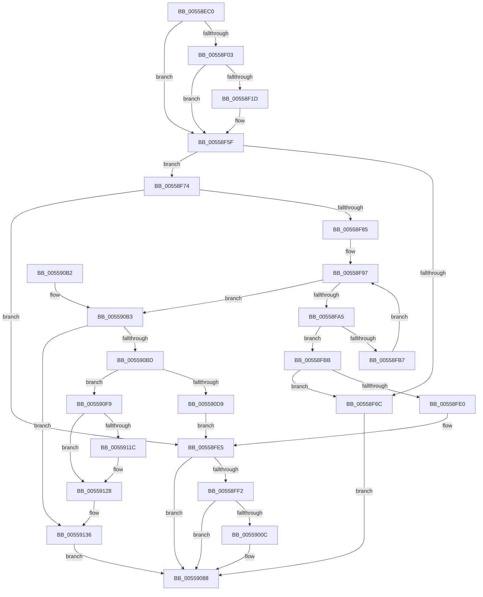

# HalpNumaAddRangeProximity

- RVA: `0x00558EC0`–`0x005591B7` (길이 `759` bytes)
- VA: `0x0000000140558EC0`
- 실행 섹션: `.text`
- PDB 이름 있음: `예`; PDB Function 태그: `아니요`
- unwind 정보 RVA: `0x000C4720`
- 디코드: `169`개 명령, `759/759` bytes 표시
- 미해석 바이트: `0` (있으면 어셈블리에 `.byte`로 보존)

> 이 문서는 커널 이미지의 기계어와 PDB 기호를 분석해 생성했습니다. 4번과 5번은 함수 원형과 자료형을 바이너리 사용 방식에서 추정한 C 해석이며 원본 소스 복구 결과는 아닙니다.

## 1. Dependencies

- 직접 호출 지점: **15**; 고유 호출 대상: **11**
- 직접 호출자로 확인된 함수: **0**
- RIP 상대 이미지 참조: **16**

### Outgoing calls
- `0x00558F14` → [tlgKeywordOn](../42/tlgKeywordOn_function_0042EAA0.md) (function, `0x0042EAA0`)
- `0x00558F5A` → [tlgWriteTransfer_EtwWriteTransfer](../42/tlgWriteTransfer_EtwWriteTransfer_function_004260E0.md) (function, `0x004260E0`)
- `0x00558F62` → [HalpCheckSratMemoryRanges](HalpCheckSratMemoryRanges_function_00558CD0.md) (function, `0x00558CD0`)
- `0x00558F7A` → [HalpNumaQueryProximityNode](HalpNumaQueryProximityNode_function_00559790.md) (function, `0x00559790`)
- `0x00558F8C` → [ExAcquireSpinLockExclusive](../24/ExAcquireSpinLockExclusive_function_00248690.md) (function, `0x00248690`)
- `0x00558FCB` → [ExReleaseSpinLockExclusive](../2C/ExReleaseSpinLockExclusive_function_002C0EF0.md) (function, `0x002C0EF0`)
- `0x00559003` → [tlgKeywordOn](../42/tlgKeywordOn_function_0042EAA0.md) (function, `0x0042EAA0`)
- `0x00559083` → [tlgWriteTransfer_EtwWriteTransfer](../42/tlgWriteTransfer_EtwWriteTransfer_function_004260E0.md) (function, `0x004260E0`)
- `0x00559091` → [_security_check_cookie](../6A/_security_check_cookie_function_006AC640.md) (function, `0x006AC640`)
- `0x005590CC` → [HalpMmAllocCtxAlloc](../3E/HalpMmAllocCtxAlloc_function_003E10B8.md) (function, `0x003E10B8`)
- `0x005590EA` → [ExReleaseSpinLockExclusive](../2C/ExReleaseSpinLockExclusive_function_002C0EF0.md) (function, `0x002C0EF0`)
- `0x0055910E` → [memcpy](../6C/memcpy_function_006C6840.md) (function, `0x006C6840`)
- `0x00559123` → [HalpMmAllocCtxFree](../3E/HalpMmAllocCtxFree_function_003E1904.md) (function, `0x003E1904`)
- `0x0055917D` → [qsort](../50/qsort_function_005009F0.md) (function, `0x005009F0`)
- `0x005591AD` → [ExReleaseSpinLockExclusive](../2C/ExReleaseSpinLockExclusive_function_002C0EF0.md) (function, `0x002C0EF0`)

### Direct callers
- 이 함수 시작 RVA로 연결되는 직접 call은 확인되지 않았습니다. 간접 호출은 완전히 역산할 수 없습니다.

### Static image references
- `0x00558EDE` → RVA `0x00E0A740` (`.data`; read)
- `0x00558EF2` → RVA `0x00E03B28` (`.data`; read)
- `0x00558F2D` → RVA `0x00043817` (`.rdata`; read)
- `0x00558F85` → RVA `0x00F90610` (`.data`; read)
- `0x00558F97` → RVA `0x00F90630` (`.data`; read)
- `0x00558FA5` → RVA `0x00F90608` (`.data`; read)
- `0x00558FD0` → RVA `0x00F90658` (`.data`; read)
- `0x00559017` → RVA `0x00043754` (`.rdata`; read)
- `0x005590B3` → RVA `0x00F90660` (`.data`; read)
- `0x005590C0` → RVA `0x00F90660` (`.data`; write)
- `0x005590D9` → RVA `0x00F90660` (`.data`; read/write)
- `0x00559113` → RVA `0x00F90620` (`.data`; read)
- `0x00559128` → RVA `0x00F90620` (`.data`; write)
- `0x0055912F` → RVA `0x00F90608` (`.data`; write)
- `0x0055913D` → RVA `0x00558EA0` (`HalpNodeCostSort`; read)
- `0x00559177` → RVA `0x00F90630` (`.data`; write)

## 2. Other-region calls and transfers

- 다른 실행 섹션으로 향하는 call: **0**
- 별도 외부 분기/꼬리 이동을 확인하지 못했습니다.

## 3. Assembly (complete function range)

```asm
00558EC0  48 89 5C 24 10                  mov qword ptr [rsp + 0x10], rbx
00558EC5  48 89 74 24 18                  mov qword ptr [rsp + 0x18], rsi
00558ECA  55                              push rbp
00558ECB  57                              push rdi
00558ECC  41 54                           push r12
00558ECE  41 56                           push r14
00558ED0  41 57                           push r15
00558ED2  48 8D 6C 24 C9                  lea rbp, [rsp - 0x37]
00558ED7  48 81 EC C0 00 00 00            sub rsp, 0xc0
00558EDE  48 8B 05 5B 18 8B 00            mov rax, qword ptr [rip + 0x8b185b]
00558EE5  48 33 C4                        xor rax, rsp
00558EE8  48 89 45 27                     mov qword ptr [rbp + 0x27], rax
00558EEC  45 33 E4                        xor r12d, r12d
00558EEF  41 8B F0                        mov esi, r8d
00558EF2  83 3D 2F AC 8A 00 05            cmp dword ptr [rip + 0x8aac2f], 5
00558EF9  4C 8B F1                        mov r14, rcx
00558EFC  66 44 89 65 A7                  mov word ptr [rbp - 0x59], r12w
00558F01  76 5C                           jbe 0x140558f5f
00558F03  48 BA 00 00 00 00 00 40 00 00   movabs rdx, 0x400000000000
00558F0D  48 8D 0D 14 AC 8A 00            lea rcx, [rip + 0x8aac14]
00558F14  E8 87 5B ED FF                  call 0x14042eaa0
00558F19  84 C0                           test al, al
00558F1B  74 42                           je 0x140558f5f
00558F1D  48 8D 45 AF                     lea rax, [rbp - 0x51]
00558F21  48 C7 45 AF 00 00 00 01         mov qword ptr [rbp - 0x51], 0x1000000
00558F29  48 89 45 E7                     mov qword ptr [rbp - 0x19], rax
00558F2D  48 8D 15 E3 A8 AE FF            lea rdx, [rip - 0x51571d]
00558F34  48 8D 45 C7                     lea rax, [rbp - 0x39]
00558F38  48 C7 45 EF 08 00 00 00         mov qword ptr [rbp - 0x11], 8
00558F40  48 89 44 24 28                  mov qword ptr [rsp + 0x28], rax
00558F45  48 8D 0D DC AB 8A 00            lea rcx, [rip + 0x8aabdc]
00558F4C  45 33 C9                        xor r9d, r9d
00558F4F  C7 44 24 20 03 00 00 00         mov dword ptr [rsp + 0x20], 3
00558F57  45 33 C0                        xor r8d, r8d
00558F5A  E8 81 D1 EC FF                  call 0x1404260e0
00558F5F  49 8B CE                        mov rcx, r14
00558F62  E8 69 FD FF FF                  call 0x140558cd0
00558F67  83 FE FF                        cmp esi, -1
00558F6A  75 08                           jne 0x140558f74
00558F6C  41 8B DC                        mov ebx, r12d
00558F6F  E9 14 01 00 00                  jmp 0x140559088
00558F74  48 8D 55 A7                     lea rdx, [rbp - 0x59]
00558F78  8B CE                           mov ecx, esi
00558F7A  E8 11 08 00 00                  call 0x140559790
00558F7F  8B D8                           mov ebx, eax
00558F81  85 C0                           test eax, eax
00558F83  78 60                           js 0x140558fe5
00558F85  48 8D 0D 84 76 A3 00            lea rcx, [rip + 0xa37684]
00558F8C  E8 FF F6 CE FF                  call 0x140248690
00558F91  44 8A F8                        mov r15b, al
00558F94  41 8B CC                        mov ecx, r12d
00558F97  8B 15 93 76 A3 00               mov edx, dword ptr [rip + 0xa37693]
00558F9D  3B CA                           cmp ecx, edx
00558F9F  0F 83 0E 01 00 00               jae 0x1405590b3
00558FA5  4C 8B 05 5C 76 A3 00            mov r8, qword ptr [rip + 0xa3765c]
00558FAC  8B D1                           mov edx, ecx
00558FAE  48 03 D2                        add rdx, rdx
00558FB1  4D 39 34 D0                     cmp qword ptr [r8 + rdx*8], r14
00558FB5  74 04                           je 0x140558fbb
00558FB7  FF C1                           inc ecx
00558FB9  EB DC                           jmp 0x140558f97
00558FBB  41 0F B7 5C D0 08               movzx ebx, word ptr [r8 + rdx*8 + 8]
00558FC1  48 8D 0D 48 76 A3 00            lea rcx, [rip + 0xa37648]
00558FC8  41 8A D7                        mov dl, r15b
00558FCB  E8 20 7F D6 FF                  call 0x1402c0ef0
00558FD0  48 8B 05 81 76 A3 00            mov rax, qword ptr [rip + 0xa37681]
00558FD7  48 8B 48 18                     mov rcx, qword ptr [rax + 0x18]
00558FDB  39 34 99                        cmp dword ptr [rcx + rbx*4], esi
00558FDE  74 8C                           je 0x140558f6c
00558FE0  BB 18 00 00 C0                  mov ebx, 0xc0000018
00558FE5  83 3D 3C AB 8A 00 05            cmp dword ptr [rip + 0x8aab3c], 5
00558FEC  0F 86 96 00 00 00               jbe 0x140559088
00558FF2  48 BA 00 00 00 00 00 40 00 00   movabs rdx, 0x400000000000
00558FFC  48 8D 0D 25 AB 8A 00            lea rcx, [rip + 0x8aab25]
00559003  E8 98 5A ED FF                  call 0x14042eaa0
00559008  84 C0                           test al, al
0055900A  74 7C                           je 0x140559088
0055900C  48 8D 45 A7                     lea rax, [rbp - 0x59]
00559010  89 5D A7                        mov dword ptr [rbp - 0x59], ebx
00559013  48 89 45 E7                     mov qword ptr [rbp - 0x19], rax
00559017  48 8D 15 36 A7 AE FF            lea rdx, [rip - 0x5158ca]
0055901E  48 8D 45 B7                     lea rax, [rbp - 0x49]
00559022  48 C7 45 EF 04 00 00 00         mov qword ptr [rbp - 0x11], 4
0055902A  48 89 45 F7                     mov qword ptr [rbp - 9], rax
0055902E  48 8D 0D F3 AA 8A 00            lea rcx, [rip + 0x8aaaf3]
00559035  48 8D 45 AF                     lea rax, [rbp - 0x51]
00559039  4C 89 75 B7                     mov qword ptr [rbp - 0x49], r14
0055903D  48 89 45 07                     mov qword ptr [rbp + 7], rax
00559041  45 33 C9                        xor r9d, r9d
00559044  48 8D 45 BF                     lea rax, [rbp - 0x41]
00559048  48 C7 45 FF 08 00 00 00         mov qword ptr [rbp - 1], 8
00559050  48 89 45 17                     mov qword ptr [rbp + 0x17], rax
00559054  45 33 C0                        xor r8d, r8d
00559057  48 8D 45 C7                     lea rax, [rbp - 0x39]
0055905B  89 75 AF                        mov dword ptr [rbp - 0x51], esi
0055905E  48 89 44 24 28                  mov qword ptr [rsp + 0x28], rax
00559063  C7 44 24 20 06 00 00 00         mov dword ptr [rsp + 0x20], 6
0055906B  48 C7 45 0F 04 00 00 00         mov qword ptr [rbp + 0xf], 4
00559073  48 C7 45 BF 00 00 00 01         mov qword ptr [rbp - 0x41], 0x1000000
0055907B  48 C7 45 1F 08 00 00 00         mov qword ptr [rbp + 0x1f], 8
00559083  E8 58 D0 EC FF                  call 0x1404260e0
00559088  8B C3                           mov eax, ebx
0055908A  48 8B 4D 27                     mov rcx, qword ptr [rbp + 0x27]
0055908E  48 33 CC                        xor rcx, rsp
00559091  E8 AA 35 15 00                  call 0x1406ac640
00559096  4C 8D 9C 24 C0 00 00 00         lea r11, [rsp + 0xc0]
0055909E  49 8B 5B 38                     mov rbx, qword ptr [r11 + 0x38]
005590A2  49 8B 73 40                     mov rsi, qword ptr [r11 + 0x40]
005590A6  49 8B E3                        mov rsp, r11
005590A9  41 5F                           pop r15
005590AB  41 5E                           pop r14
005590AD  41 5C                           pop r12
005590AF  5F                              pop rdi
005590B0  5D                              pop rbp
005590B1  C3                              ret
005590B2  CC                              int3
005590B3  8B 05 A7 75 A3 00               mov eax, dword ptr [rip + 0xa375a7]
005590B9  3B D0                           cmp edx, eax
005590BB  72 79                           jb 0x140559136
005590BD  83 C0 05                        add eax, 5
005590C0  89 05 9A 75 A3 00               mov dword ptr [rip + 0xa3759a], eax
005590C6  8D 50 01                        lea edx, [rax + 1]
005590C9  C1 E2 04                        shl edx, 4
005590CC  E8 E7 7F E8 FF                  call 0x1403e10b8
005590D1  48 8B F8                        mov rdi, rax
005590D4  48 85 C0                        test rax, rax
005590D7  75 20                           jne 0x1405590f9
005590D9  83 05 80 75 A3 00 FB            add dword ptr [rip + 0xa37580], -5
005590E0  48 8D 0D 29 75 A3 00            lea rcx, [rip + 0xa37529]
005590E7  41 8A D7                        mov dl, r15b
005590EA  E8 01 7E D6 FF                  call 0x1402c0ef0
005590EF  BB 9A 00 00 C0                  mov ebx, 0xc000009a
005590F4  E9 EC FE FF FF                  jmp 0x140558fe5
005590F9  44 8B 05 30 75 A3 00            mov r8d, dword ptr [rip + 0xa37530]
00559100  48 8B CF                        mov rcx, rdi
00559103  48 8B 15 FE 74 A3 00            mov rdx, qword ptr [rip + 0xa374fe]
0055910A  49 C1 E0 04                     shl r8, 4
0055910E  E8 2D D7 16 00                  call 0x1406c6840
00559113  44 38 25 06 75 A3 00            cmp byte ptr [rip + 0xa37506], r12b
0055911A  74 0C                           je 0x140559128
0055911C  48 8B 15 E5 74 A3 00            mov rdx, qword ptr [rip + 0xa374e5]
00559123  E8 DC 87 E8 FF                  call 0x1403e1904
00559128  C6 05 F1 74 A3 00 01            mov byte ptr [rip + 0xa374f1], 1
0055912F  48 89 3D D2 74 A3 00            mov qword ptr [rip + 0xa374d2], rdi
00559136  44 8B 05 F3 74 A3 00            mov r8d, dword ptr [rip + 0xa374f3]
0055913D  4C 8D 0D 5C FD FF FF            lea r9, [rip - 0x2a4]
00559144  48 8B 05 BD 74 A3 00            mov rax, qword ptr [rip + 0xa374bd]
0055914B  41 8B D0                        mov edx, r8d
0055914E  0F B7 4D A7                     movzx ecx, word ptr [rbp - 0x59]
00559152  48 03 D2                        add rdx, rdx
00559155  4C 89 34 D0                     mov qword ptr [rax + rdx*8], r14
00559159  48 8B 05 A8 74 A3 00            mov rax, qword ptr [rip + 0xa374a8]
00559160  89 4C D0 08                     mov dword ptr [rax + rdx*8 + 8], ecx
00559164  41 8D 40 01                     lea eax, [r8 + 1]
00559168  48 8B 0D 99 74 A3 00            mov rcx, qword ptr [rip + 0xa37499]
0055916F  41 B8 10 00 00 00               mov r8d, 0x10
00559175  8B D0                           mov edx, eax
00559177  89 05 B3 74 A3 00               mov dword ptr [rip + 0xa374b3], eax
0055917D  E8 6E 78 FA FF                  call 0x1405009f0
00559182  48 8B 05 7F 74 A3 00            mov rax, qword ptr [rip + 0xa3747f]
00559189  41 8A D7                        mov dl, r15b
0055918C  8B 0D 9E 74 A3 00               mov ecx, dword ptr [rip + 0xa3749e]
00559192  48 03 C9                        add rcx, rcx
00559195  48 83 0C C8 FF                  or qword ptr [rax + rcx*8], 0xffffffffffffffff
0055919A  48 8B 05 67 74 A3 00            mov rax, qword ptr [rip + 0xa37467]
005591A1  44 89 64 C8 08                  mov dword ptr [rax + rcx*8 + 8], r12d
005591A6  48 8D 0D 63 74 A3 00            lea rcx, [rip + 0xa37463]
005591AD  E8 3E 7D D6 FF                  call 0x1402c0ef0
005591B2  E9 D1 FE FF FF                  jmp 0x140559088
```

## 4. C-style interpretation (structured pseudocode)

```c
__int64 __fastcall HalpNumaAddRangeProximity(__int64 a1, __int64 a2, int a3, int a4)
{
    __int64 result;
    __int64 v_r12;
    __int64 v_rsp;
    unsigned __int64 v_stack_m28;
    unsigned __int64 v_stack_m38;
    unsigned __int64 v_stack_m40;
    unsigned __int64 v_stack_m48;
    unsigned __int64 v_stack_m50;
    unsigned __int64 v_stack_m58;
    unsigned __int64 v_stack_m5F;
    unsigned __int64 v_stack_m60;
    unsigned __int64 v_stack_m68;
    unsigned __int64 v_stack_m70;
    unsigned __int64 v_stack_m78;
    unsigned __int64 v_stack_m98;
    unsigned __int64 v_stack_mA0;
    unsigned __int64 v_stack_mA8;
    unsigned __int64 v_stack_mB0;
    unsigned __int16 v_stack_mB8;
    unsigned __int64 v_stack_mC0;
    unsigned int v_stack_mC8;
    unsigned __int64 v_stack_p10;
    unsigned __int64 v_stack_p18;

    v_stack_p10 = v_rbx;
    v_stack_p18 = v_rsi;
    v_rsp = (v_rsp) - (192);
    result = (*(unsigned __int64 *)(v_rip + 9115739)) ^ (v_rsp);
    v_stack_m38 = result;
    v_r12 = 0;
    v_stack_mB8 = 0;
    if ((*(unsigned int *)(v_rip + 9088047)) <= 5) goto loc_00558F5F;
    result = tlgKeywordOn(v_rip + 9088020, a2, a3, a4);
    if ((unsigned __int8)(result) != 0) {
        result = v_stack_mB0;
        v_stack_mB0 = 0x1000000ULL;
        v_stack_m78 = result;
        a2 = v_rip - 5330717;
        result = v_stack_m98;
        v_stack_m70 = 8;
        v_stack_mC0 = result;
        a1 = v_rip + 9087964;
        a4 = 0;
        v_stack_mC8 = 3;
        a3 = 0;
        result = tlgWriteTransfer_EtwWriteTransfer(a1, a2, a3, a4);
    }
    result = HalpCheckSratMemoryRanges(a1, a2, a3, a4);
    if (((unsigned int)((unsigned int)(a3))) != -1) goto loc_00558F74;
loc_00558F6C:
    goto loc_00559088;
loc_00558F74:
    result = HalpNumaQueryProximityNode((unsigned int)((unsigned int)((unsigned int)(a3))), v_stack_mB8, a3, a4);
    if (sign_flag) goto loc_00558FE5;
    result = ExAcquireSpinLockExclusive(v_rip + 10712708, v_stack_mB8, a3, a4);
loc_00558F97:
    if (0 >= ((unsigned int)((unsigned int)(*(unsigned int *)(v_rip + 10712723))))) goto loc_005590B3;
    a2 = (0) + (0);
    if ((*(unsigned __int64 *)(*(unsigned __int64 *)(v_rip + 10712668) + a2 * 8)) == a1) goto loc_00558FBB;
    a1 = (unsigned int)((0) + 1);
    goto loc_00558F97;
loc_00558FBB:
    result = ExReleaseSpinLockExclusive(v_rip + 10712648, (unsigned __int8)((unsigned __int8)(result)), *(unsigned __int64 *)(v_rip + 10712668), a4);
    if ((*(unsigned int *)(*(unsigned __int64 *)(*(unsigned __int64 *)(v_rip + 10712705) + 24) + *(unsigned __int16 *)(*(unsigned __int64 *)(v_rip + 10712668) + a2 * 8 + 8) * 4)) == ((unsigned int)((unsigned int)(a3)))) goto loc_00558F6C;
loc_00558FE5:
    if ((*(unsigned int *)(v_rip + 9087804)) <= 5) goto loc_00559088;
    result = tlgKeywordOn(v_rip + 9087781, (unsigned __int8)((unsigned __int8)(result)), *(unsigned __int64 *)(v_rip + 10712668), a4);
    if ((unsigned __int8)(result) != 0) {
        result = v_stack_mB8;
        v_stack_mB8 = (unsigned int)((unsigned int)(0xC0000018ULL));
        v_stack_m78 = result;
        a2 = v_rip - 5331146;
        result = v_stack_mA8;
        v_stack_m70 = 4;
        v_stack_m68 = result;
        a1 = v_rip + 9087731;
        result = v_stack_mB0;
        v_stack_mA8 = a1;
        v_stack_m58 = result;
        a4 = 0;
        result = v_stack_mA0;
        v_stack_m60 = 8;
        v_stack_m48 = result;
        a3 = 0;
        result = v_stack_m98;
        v_stack_mB0 = (unsigned int)((unsigned int)(a3));
        v_stack_mC0 = result;
        v_stack_mC8 = 6;
        v_stack_m50 = 4;
        v_stack_mA0 = 0x1000000ULL;
        v_stack_m40 = 8;
        result = tlgWriteTransfer_EtwWriteTransfer(a1, a2, a3, a4);
    }
    a1 = (v_stack_m38) ^ (v_rsp);
    result = _security_check_cookie(a1, a2, a3, a4);
    return result;
loc_005590B3:
    if (((unsigned int)(a2)) < ((unsigned int)((unsigned int)(*(unsigned int *)(v_rip + 10712487))))) goto loc_00559136;
    result = (unsigned int)(((unsigned int)(*(unsigned int *)(v_rip + 10712487))) + (5));
    *(unsigned int *)(v_rip + 10712474) = (unsigned int)(result);
    a2 = (unsigned int)((result + 1) << (4));
    result = HalpMmAllocCtxAlloc(a1, a2, a3, a4);
    if (result != 0) goto loc_005590F9;
    result = ExReleaseSpinLockExclusive(v_rip + 10712361, (unsigned __int8)((unsigned __int8)(result)), a3, a4);
    goto loc_00558FE5;
loc_005590F9:
    a3 = ((unsigned int)(*(unsigned int *)(v_rip + 10712368))) << (4);
    result = memcpy(result, *(unsigned __int64 *)(v_rip + 10712318), a3, a4);
    if ((*(unsigned __int8 *)(v_rip + 10712326)) != 0) {
        a2 = *(unsigned __int64 *)(v_rip + 10712293);
        result = HalpMmAllocCtxFree(result, a2, a3, a4);
    }
    *(unsigned __int8 *)(v_rip + 10712305) = 1;
    *(unsigned __int64 *)(v_rip + 10712274) = result;
loc_00559136:
    a2 = ((unsigned int)((unsigned int)((unsigned int)(*(unsigned int *)(v_rip + 10712307))))) + ((unsigned int)((unsigned int)((unsigned int)(*(unsigned int *)(v_rip + 10712307)))));
    *(unsigned __int64 *)(*(unsigned __int64 *)(v_rip + 10712253) + a2 * 8) = a1;
    *(unsigned int *)(*(unsigned __int64 *)(v_rip + 10712232) + a2 * 8 + 8) = (unsigned int)(v_stack_mB8);
    *(unsigned int *)(v_rip + 10712243) = (unsigned int)((unsigned int)(*(unsigned int *)(v_rip + 10712307)) + 1);
    result = qsort(*(unsigned __int64 *)(v_rip + 10712217), (unsigned int)((unsigned int)((unsigned int)(*(unsigned int *)(v_rip + 10712307)) + 1)), 16, v_rip - 676);
    a1 = ((unsigned int)(*(unsigned int *)(v_rip + 10712222))) + ((unsigned int)(*(unsigned int *)(v_rip + 10712222)));
    *(unsigned int *)(*(unsigned __int64 *)(v_rip + 10712167) + a1 * 8 + 8) = 0;
    result = ExReleaseSpinLockExclusive(v_rip + 10712163, (unsigned __int8)((unsigned __int8)(result)), 16, v_rip - 676);
    goto loc_00559088;
}
```

## 5. (Beta) C Style

```c
int64_t HalpNumaAddRangeProximity(int64_t Arg1, int64_t Arg2, int32_t Arg3, int32_t Arg4)
{
    int64_t result;
    int64_t local_r12;
    int64_t local_rsp;
    uint64_t v_stack_m28;
    uint64_t v_stack_m38;
    uint64_t v_stack_m40;
    uint64_t v_stack_m48;
    uint64_t v_stack_m50;
    uint64_t v_stack_m58;
    uint64_t v_stack_m5F;
    uint64_t v_stack_m60;
    uint64_t v_stack_m68;
    uint64_t v_stack_m70;
    uint64_t v_stack_m78;
    uint64_t v_stack_m98;
    uint64_t v_stack_mA0;
    uint64_t v_stack_mA8;
    uint64_t v_stack_mB0;
    uint16_t v_stack_mB8;
    uint64_t v_stack_mC0;
    uint32_t v_stack_mC8;
    uint64_t v_stack_p10;
    uint64_t v_stack_p18;

    v_stack_p10 = local_rbx;
    v_stack_p18 = local_rsi;
    local_rsp = (local_rsp) - (192);
    result = (*(uint64_t *)(v_rip + 0x8B185B)) ^ (local_rsp);
    v_stack_m38 = result;
    local_r12 = 0;
    v_stack_mB8 = 0;
    if ((*(uint32_t *)(v_rip + 0x8AAC2F)) <= 5) goto loc_00558F5F;
    result = tlgKeywordOn(v_rip + 9088020, Arg2, Arg3, Arg4);
    if ((uint8_t)(result) != 0) {
        result = v_stack_mB0;
        v_stack_mB0 = 0x1000000ULL;
        v_stack_m78 = result;
        Arg2 = v_rip - 5330717;
        result = v_stack_m98;
        v_stack_m70 = 8;
        v_stack_mC0 = result;
        Arg1 = v_rip + 9087964;
        Arg4 = 0;
        v_stack_mC8 = 3;
        Arg3 = 0;
        result = tlgWriteTransfer_EtwWriteTransfer(Arg1, Arg2, Arg3, Arg4);
    }
    result = HalpCheckSratMemoryRanges(Arg1, Arg2, Arg3, Arg4);
    if (((uint32_t)((uint32_t)(Arg3))) != -1) goto loc_00558F74;
loc_00558F6C:
    goto loc_00559088;
loc_00558F74:
    result = HalpNumaQueryProximityNode((uint32_t)((uint32_t)((uint32_t)(Arg3))), v_stack_mB8, Arg3, Arg4);
    if (sign_flag) goto loc_00558FE5;
    result = ExAcquireSpinLockExclusive(v_rip + 10712708, v_stack_mB8, Arg3, Arg4);
loc_00558F97:
    if (0 >= ((uint32_t)((uint32_t)(*(uint32_t *)(v_rip + 0xA37693))))) goto loc_005590B3;
    Arg2 = (0) + (0);
    if ((*(uint64_t *)(*(uint64_t *)(v_rip + 0xA3765C) + Arg2 * 8)) == Arg1) goto loc_00558FBB;
    Arg1 = (uint32_t)((0) + 1);
    goto loc_00558F97;
loc_00558FBB:
    result = ExReleaseSpinLockExclusive(v_rip + 10712648, (uint8_t)((uint8_t)(result)), *(uint64_t *)(v_rip + 0xA3765C), Arg4);
    if ((*(uint32_t *)(*(uint64_t *)(*(uint64_t *)(v_rip + 0xA37681) + 0x18) + *(uint16_t *)(*(uint64_t *)(v_rip + 0xA3765C) + Arg2 * 8 + 0x8) * 4)) == ((uint32_t)((uint32_t)(Arg3)))) goto loc_00558F6C;
loc_00558FE5:
    if ((*(uint32_t *)(v_rip + 0x8AAB3C)) <= 5) goto loc_00559088;
    result = tlgKeywordOn(v_rip + 9087781, (uint8_t)((uint8_t)(result)), *(uint64_t *)(v_rip + 0xA3765C), Arg4);
    if ((uint8_t)(result) != 0) {
        result = v_stack_mB8;
        v_stack_mB8 = (uint32_t)((uint32_t)(0xC0000018ULL));
        v_stack_m78 = result;
        Arg2 = v_rip - 5331146;
        result = v_stack_mA8;
        v_stack_m70 = 4;
        v_stack_m68 = result;
        Arg1 = v_rip + 9087731;
        result = v_stack_mB0;
        v_stack_mA8 = Arg1;
        v_stack_m58 = result;
        Arg4 = 0;
        result = v_stack_mA0;
        v_stack_m60 = 8;
        v_stack_m48 = result;
        Arg3 = 0;
        result = v_stack_m98;
        v_stack_mB0 = (uint32_t)((uint32_t)(Arg3));
        v_stack_mC0 = result;
        v_stack_mC8 = 6;
        v_stack_m50 = 4;
        v_stack_mA0 = 0x1000000ULL;
        v_stack_m40 = 8;
        result = tlgWriteTransfer_EtwWriteTransfer(Arg1, Arg2, Arg3, Arg4);
    }
    Arg1 = (v_stack_m38) ^ (local_rsp);
    result = _security_check_cookie(Arg1, Arg2, Arg3, Arg4);
    return result;
loc_005590B3:
    if (((uint32_t)(Arg2)) < ((uint32_t)((uint32_t)(*(uint32_t *)(v_rip + 0xA375A7))))) goto loc_00559136;
    result = (uint32_t)(((uint32_t)(*(uint32_t *)(v_rip + 0xA375A7))) + (5));
    *(uint32_t *)(v_rip + 0xA3759A) = (uint32_t)(result);
    Arg2 = (uint32_t)((result + 1) << (4));
    result = HalpMmAllocCtxAlloc(Arg1, Arg2, Arg3, Arg4);
    if (result != 0) goto loc_005590F9;
    result = ExReleaseSpinLockExclusive(v_rip + 10712361, (uint8_t)((uint8_t)(result)), Arg3, Arg4);
    goto loc_00558FE5;
loc_005590F9:
    Arg3 = ((uint32_t)(*(uint32_t *)(v_rip + 0xA37530))) << (4);
    result = memcpy(result, *(uint64_t *)(v_rip + 0xA374FE), Arg3, Arg4);
    if ((*(uint8_t *)(v_rip + 0xA37506)) != 0) {
        Arg2 = *(uint64_t *)(v_rip + 0xA374E5);
        result = HalpMmAllocCtxFree(result, Arg2, Arg3, Arg4);
    }
    *(uint8_t *)(v_rip + 0xA374F1) = 1;
    *(uint64_t *)(v_rip + 0xA374D2) = result;
loc_00559136:
    Arg2 = ((uint32_t)((uint32_t)((uint32_t)(*(uint32_t *)(v_rip + 0xA374F3))))) + ((uint32_t)((uint32_t)((uint32_t)(*(uint32_t *)(v_rip + 0xA374F3)))));
    *(uint64_t *)(*(uint64_t *)(v_rip + 0xA374BD) + Arg2 * 8) = Arg1;
    *(uint32_t *)(*(uint64_t *)(v_rip + 0xA374A8) + Arg2 * 8 + 0x8) = (uint32_t)(v_stack_mB8);
    *(uint32_t *)(v_rip + 0xA374B3) = (uint32_t)((uint32_t)(*(uint32_t *)(v_rip + 0xA374F3)) + 1);
    result = qsort(*(uint64_t *)(v_rip + 0xA37499), (uint32_t)((uint32_t)((uint32_t)(*(uint32_t *)(v_rip + 0xA374F3)) + 1)), 16, v_rip - 676);
    Arg1 = ((uint32_t)(*(uint32_t *)(v_rip + 0xA3749E))) + ((uint32_t)(*(uint32_t *)(v_rip + 0xA3749E)));
    *(uint32_t *)(*(uint64_t *)(v_rip + 0xA37467) + Arg1 * 8 + 0x8) = 0;
    result = ExReleaseSpinLockExclusive(v_rip + 10712163, (uint8_t)((uint8_t)(result)), 16, v_rip - 676);
    goto loc_00559088;
}
```

## 6. Execution-region graph

[열기: 2D/3D 그래프와 함수 탐색 컨트롤 패널](../../../control-panel.html?section=text&rva=0x00558EC0&view=graph)

- 2D 그래프는 위에서 아래로 흐르고, 3D 그래프는 빈 공간을 드래그해 회전합니다. Shift+드래그는 이동, 휠은 확대·축소, 함수 노드 선택은 대상 보고서 이동입니다.

### Static fallback


