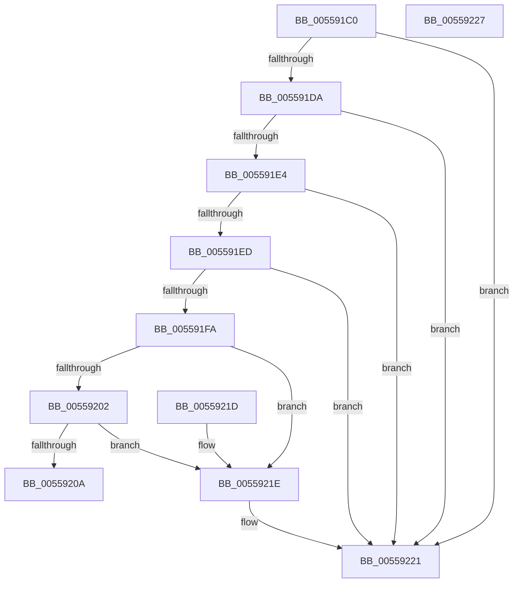

# HalpNumaCalculateSllbiSize

- RVA: `0x005591C0`–`0x00559228` (길이 `104` bytes)
- VA: `0x00000001405591C0`
- 실행 섹션: `.text`
- PDB 이름 있음: `예`; PDB Function 태그: `아니요`
- unwind 정보 RVA: `0x000DB714`
- 디코드: `36`개 명령, `104/104` bytes 표시
- 미해석 바이트: `0` (있으면 어셈블리에 `.byte`로 보존)

> 이 문서는 커널 이미지의 기계어와 PDB 기호를 분석해 생성했습니다. 4번과 5번은 함수 원형과 자료형을 바이너리 사용 방식에서 추정한 C 해석이며 원본 소스 복구 결과는 아닙니다.

## 1. Dependencies

- 직접 호출 지점: **0**; 고유 호출 대상: **0**
- 직접 호출자로 확인된 함수: **2**
- RIP 상대 이미지 참조: **0**

### Outgoing calls
- 직접 디코드된 call 명령이 없습니다.

### Direct callers
- [HalpNumaGetHmatConfigSize](HalpNumaGetHmatConfigSize_function_00559230.md) at `0x005593BC`
- [HalpNumaParseHmat](../../init/C2/HalpNumaParseHmat_function_00C22980.md) at `0x00C22BB4`

### Static image references
- 디코드된 RIP-relative 메모리 참조가 없습니다.

## 2. Other-region calls and transfers

- 다른 실행 섹션으로 향하는 call: **0**
- 별도 외부 분기/꼬리 이동을 확인하지 못했습니다.

## 3. Assembly (complete function range)

```asm
005591C0  41 83 20 00                     and dword ptr [r8], 0
005591C4  44 8B D1                        mov r10d, ecx
005591C7  B9 FF FF FF FF                  mov ecx, 0xffffffff
005591CC  8B C2                           mov eax, edx
005591CE  49 0F AF C2                     imul rax, r10
005591D2  44 8B CA                        mov r9d, edx
005591D5  48 3B C1                        cmp rax, rcx
005591D8  77 47                           ja 0x140559221
005591DA  8B C0                           mov eax, eax
005591DC  48 03 C0                        add rax, rax
005591DF  48 3B C1                        cmp rax, rcx
005591E2  77 3D                           ja 0x140559221
005591E4  49 C1 E1 02                     shl r9, 2
005591E8  4C 3B C9                        cmp r9, rcx
005591EB  77 34                           ja 0x140559221
005591ED  4A 8D 14 95 00 00 00 00         lea rdx, [r10*4]
005591F5  48 3B D1                        cmp rdx, rcx
005591F8  77 27                           ja 0x140559221
005591FA  44 03 C8                        add r9d, eax
005591FD  44 3B C8                        cmp r9d, eax
00559200  72 1C                           jb 0x14055921e
00559202  41 03 D1                        add edx, r9d
00559205  41 3B D1                        cmp edx, r9d
00559208  72 14                           jb 0x14055921e
0055920A  8D 42 28                        lea eax, [rdx + 0x28]
0055920D  3B C2                           cmp eax, edx
0055920F  0F 43 C8                        cmovae ecx, eax
00559212  1B C0                           sbb eax, eax
00559214  25 95 00 00 C0                  and eax, 0xc0000095
00559219  41 89 08                        mov dword ptr [r8], ecx
0055921C  C3                              ret
0055921D  CC                              int3
0055921E  41 89 08                        mov dword ptr [r8], ecx
00559221  B8 95 00 00 C0                  mov eax, 0xc0000095
00559226  C3                              ret
00559227  CC                              int3
```

## 4. C-style interpretation (structured pseudocode)

```c
__int64 __fastcall HalpNumaCalculateSllbiSize(int a1, int a2, __int64 a3)
{
    __int64 result;

    result = ((unsigned int)(a2)) * ((unsigned int)(a1));
    if (result > ((unsigned int)(0xFFFFFFFFULL))) goto loc_00559221;
    result = ((unsigned int)((unsigned int)(result))) + ((unsigned int)((unsigned int)(result)));
    if (result > ((unsigned int)(0xFFFFFFFFULL))) goto loc_00559221;
    a4 = ((unsigned int)(a2)) << (2);
    if (a4 > ((unsigned int)(0xFFFFFFFFULL))) goto loc_00559221;
    if (((unsigned int)(a1) * 4) > ((unsigned int)(0xFFFFFFFFULL))) goto loc_00559221;
    a4 = (unsigned int)((a4) + ((unsigned int)(result)));
    if (((unsigned int)(a4)) < ((unsigned int)(result))) goto loc_0055921E;
    a2 = (unsigned int)(((unsigned int)(a1) * 4) + ((unsigned int)(a4)));
    if (a2 < ((unsigned int)(a4))) goto loc_0055921E;
    a1 = (unsigned int)(0xFFFFFFFFULL);
    if (((unsigned int)(a2 + 40)) >= a2) { a1 = (unsigned int)(a2 + 40); }
    result = (unsigned int)((a2 + 40) & (0xC0000095ULL));
    *(unsigned int *)(a3) = a1;
    return result;
loc_0055921E:
    *(unsigned int *)(a3) = a1;
loc_00559221:
    return (unsigned int)(0xC0000095ULL);
}
```

## 5. (Beta) C Style

```c
int64_t HalpNumaCalculateSllbiSize(int32_t Arg1, int32_t Arg2, void *Arg3)
{
    uint8_t *arg3 = (uint8_t *)Arg3;

    int64_t result;

    result = ((uint32_t)(Arg2)) * ((uint32_t)(Arg1));
    if (result > ((uint32_t)(0xFFFFFFFFULL))) goto loc_00559221;
    result = ((uint32_t)((uint32_t)(result))) + ((uint32_t)((uint32_t)(result)));
    if (result > ((uint32_t)(0xFFFFFFFFULL))) goto loc_00559221;
    a4 = ((uint32_t)(Arg2)) << (2);
    if (a4 > ((uint32_t)(0xFFFFFFFFULL))) goto loc_00559221;
    if (((uint32_t)(Arg1) * 4) > ((uint32_t)(0xFFFFFFFFULL))) goto loc_00559221;
    a4 = (uint32_t)((a4) + ((uint32_t)(result)));
    if (((uint32_t)(a4)) < ((uint32_t)(result))) goto loc_0055921E;
    Arg2 = (uint32_t)(((uint32_t)(Arg1) * 4) + ((uint32_t)(a4)));
    if (Arg2 < ((uint32_t)(a4))) goto loc_0055921E;
    Arg1 = (uint32_t)(0xFFFFFFFFULL);
    if (((uint32_t)(Arg2 + 40)) >= Arg2) { Arg1 = (uint32_t)(Arg2 + 40); }
    result = (uint32_t)((Arg2 + 40) & (0xC0000095ULL));
    *(uint32_t *)(arg3) = Arg1;
    return result;
loc_0055921E:
    *(uint32_t *)(arg3) = Arg1;
loc_00559221:
    return (uint32_t)(0xC0000095ULL);
}
```

### 관측된 메모리 오프셋

구조체 형식이 확인되지 않은 접근은 인자 기준의 오프셋으로만 기록했습니다.

| 기준 인자 | 오프셋 표현 | 폭 (bit) | 접근 |
|---|---:|---:|---|
| `Arg3` | `+ 0x0` | `32` | `R/W` |
| `Arg3` | `+ 0x0` | `32` | `W` |

## 6. Execution-region graph

[열기: 2D/3D 그래프와 함수 탐색 컨트롤 패널](../../../control-panel.html?section=text&rva=0x005591C0&view=graph)

- 2D 그래프는 위에서 아래로 흐르고, 3D 그래프는 빈 공간을 드래그해 회전합니다. Shift+드래그는 이동, 휠은 확대·축소, 함수 노드 선택은 대상 보고서 이동입니다.

### Static fallback


