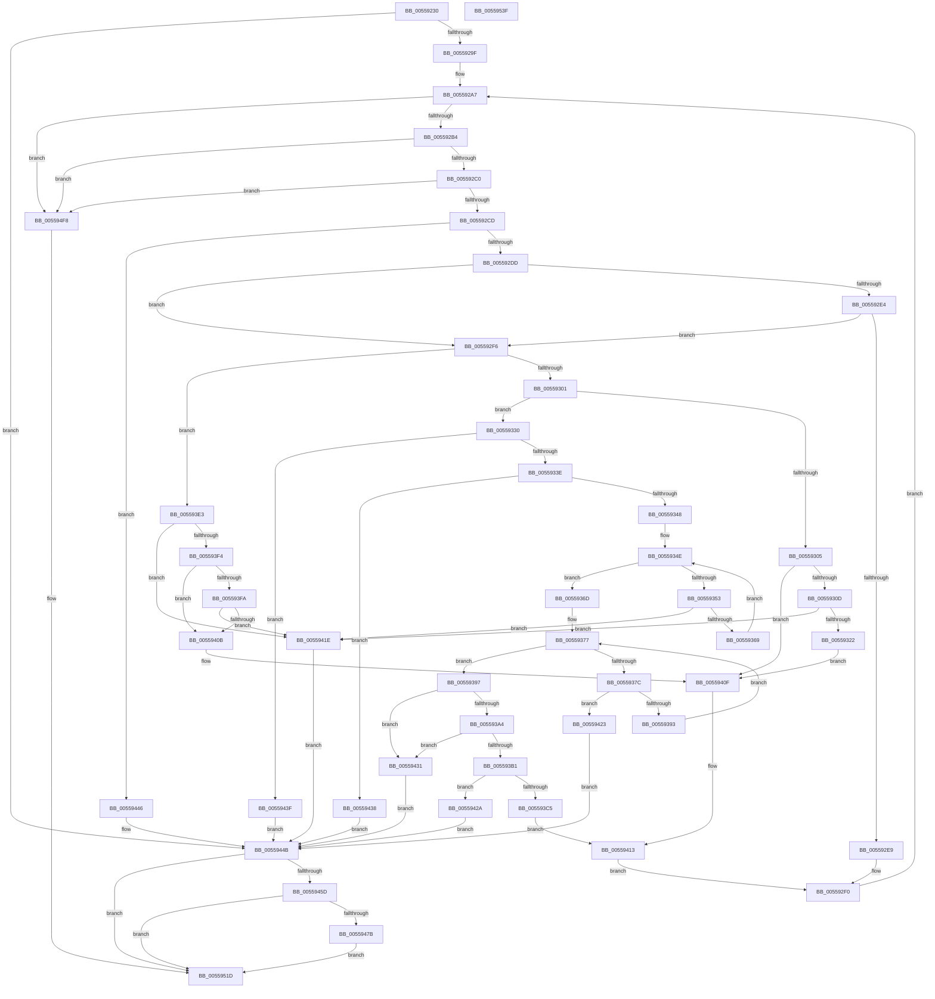

# HalpNumaGetHmatConfigSize

- RVA: `0x00559230`–`0x00559540` (길이 `784` bytes)
- VA: `0x0000000140559230`
- 실행 섹션: `.text`
- PDB 이름 있음: `예`; PDB Function 태그: `아니요`
- unwind 정보 RVA: `0x000A9E74`
- 디코드: `205`개 명령, `784/784` bytes 표시
- 미해석 바이트: `0` (있으면 어셈블리에 `.byte`로 보존)

> 이 문서는 커널 이미지의 기계어와 PDB 기호를 분석해 생성했습니다. 4번과 5번은 함수 원형과 자료형을 바이너리 사용 방식에서 추정한 C 해석이며 원본 소스 복구 결과는 아닙니다.

## 1. Dependencies

- 직접 호출 지점: **10**; 고유 호출 대상: **6**
- 직접 호출자로 확인된 함수: **1**
- RIP 상대 이미지 참조: **3**

### Outgoing calls
- `0x005592D0` → [HalpVerifyHmatEntryValidity](../../init/C2/HalpVerifyHmatEntryValidity_function_00C23040.md) (function, `0x00C23040`)
- `0x00559315` → [HalpNumaQueryProximityNode](HalpNumaQueryProximityNode_function_00559790.md) (function, `0x00559790`)
- `0x0055935C` → [HalpNumaQueryProximityNode](HalpNumaQueryProximityNode_function_00559790.md) (function, `0x00559790`)
- `0x00559386` → [HalpNumaQueryProximityNode](HalpNumaQueryProximityNode_function_00559790.md) (function, `0x00559790`)
- `0x005593BC` → [HalpNumaCalculateSllbiSize](HalpNumaCalculateSllbiSize_function_005591C0.md) (function, `0x005591C0`)
- `0x005593EB` → [HalpNumaQueryProximityNode](HalpNumaQueryProximityNode_function_00559790.md) (function, `0x00559790`)
- `0x00559402` → [HalpNumaQueryProximityNode](HalpNumaQueryProximityNode_function_00559790.md) (function, `0x00559790`)
- `0x0055946E` → [tlgKeywordOn](../42/tlgKeywordOn_function_0042EAA0.md) (function, `0x0042EAA0`)
- `0x005594F1` → [tlgWriteTransfer_EtwWriteTransfer](../42/tlgWriteTransfer_EtwWriteTransfer_function_004260E0.md) (function, `0x004260E0`)
- `0x00559526` → [_security_check_cookie](../6A/_security_check_cookie_function_006AC640.md) (function, `0x006AC640`)

### Direct callers
- [HalpNumaParseHmat](../../init/C2/HalpNumaParseHmat_function_00C22980.md) at `0x00C229EA`

### Static image references
- `0x00559249` → RVA `0x00E0A740` (`.data`; read)
- `0x0055944B` → RVA `0x00E03B28` (`.data`; read)
- `0x00559488` → RVA `0x000437BC` (`.rdata`; read)

## 2. Other-region calls and transfers

- 다른 실행 섹션으로 향하는 call: **1**
  - `0x005592D0` → [HalpVerifyHmatEntryValidity](../../init/C2/HalpVerifyHmatEntryValidity_function_00C23040.md) (`.text` → `INIT`)
- 별도 외부 분기/꼬리 이동을 확인하지 못했습니다.

## 3. Assembly (complete function range)

```asm
00559230  40 55                           push rbp
00559232  53                              push rbx
00559233  56                              push rsi
00559234  57                              push rdi
00559235  41 54                           push r12
00559237  41 55                           push r13
00559239  41 56                           push r14
0055923B  41 57                           push r15
0055923D  48 8D 6C 24 E9                  lea rbp, [rsp - 0x17]
00559242  48 81 EC D8 00 00 00            sub rsp, 0xd8
00559249  48 8B 05 F0 14 8B 00            mov rax, qword ptr [rip + 0x8b14f0]
00559250  48 33 C4                        xor rax, rsp
00559253  48 89 45 FF                     mov qword ptr [rbp - 1], rax
00559257  83 64 24 38 00                  and dword ptr [rsp + 0x38], 0
0055925C  4C 8B F9                        mov r15, rcx
0055925F  48 89 4C 24 40                  mov qword ptr [rsp + 0x40], rcx
00559264  45 33 F6                        xor r14d, r14d
00559267  8B 49 04                        mov ecx, dword ptr [rcx + 4]
0055926A  45 33 ED                        xor r13d, r13d
0055926D  49 03 CF                        add rcx, r15
00559270  48 89 55 8F                     mov qword ptr [rbp - 0x71], rdx
00559274  33 D2                           xor edx, edx
00559276  4C 89 45 97                     mov qword ptr [rbp - 0x69], r8
0055927A  4C 8B 45 7F                     mov r8, qword ptr [rbp + 0x7f]
0055927E  4C 89 4D 9F                     mov qword ptr [rbp - 0x61], r9
00559282  4C 89 45 A7                     mov qword ptr [rbp - 0x59], r8
00559286  89 54 24 34                     mov dword ptr [rsp + 0x34], edx
0055928A  8D 7A 01                        lea edi, [rdx + 1]
0055928D  44 89 74 24 3C                  mov dword ptr [rsp + 0x3c], r14d
00559292  48 89 4D 87                     mov qword ptr [rbp - 0x79], rcx
00559296  49 3B CF                        cmp rcx, r15
00559299  0F 86 AC 01 00 00               jbe 0x14055944b
0055929F  49 8D 5F 28                     lea rbx, [r15 + 0x28]
005592A3  45 8D 65 03                     lea r12d, [r13 + 3]
005592A7  48 8D 43 08                     lea rax, [rbx + 8]
005592AB  48 3B C1                        cmp rax, rcx
005592AE  0F 87 44 02 00 00               ja 0x1405594f8
005592B4  8B 43 04                        mov eax, dword ptr [rbx + 4]
005592B7  83 F8 08                        cmp eax, 8
005592BA  0F 82 38 02 00 00               jb 0x1405594f8
005592C0  48 8D 34 03                     lea rsi, [rbx + rax]
005592C4  48 3B F1                        cmp rsi, rcx
005592C7  0F 87 2B 02 00 00               ja 0x1405594f8
005592CD  48 8B CB                        mov rcx, rbx
005592D0  E8 6B 9D 6C 00                  call 0x140c23040
005592D5  84 C0                           test al, al
005592D7  0F 84 69 01 00 00               je 0x140559446
005592DD  41 80 7F 08 02                  cmp byte ptr [r15 + 8], 2
005592E2  73 12                           jae 0x1405592f6
005592E4  66 39 3B                        cmp word ptr [rbx], di
005592E7  77 0D                           ja 0x1405592f6
005592E9  8B 54 24 34                     mov edx, dword ptr [rsp + 0x34]
005592ED  48 8B DE                        mov rbx, rsi
005592F0  48 8B 4D 87                     mov rcx, qword ptr [rbp - 0x79]
005592F4  EB B1                           jmp 0x1405592a7
005592F6  0F B7 0B                        movzx ecx, word ptr [rbx]
005592F9  85 C9                           test ecx, ecx
005592FB  0F 84 E2 00 00 00               je 0x1405593e3
00559301  2B CF                           sub ecx, edi
00559303  74 2B                           je 0x140559330
00559305  3B CF                           cmp ecx, edi
00559307  0F 85 02 01 00 00               jne 0x14055940f
0055930D  8B 4B 08                        mov ecx, dword ptr [rbx + 8]
00559310  48 8D 54 24 30                  lea rdx, [rsp + 0x30]
00559315  E8 76 04 00 00                  call 0x140559790
0055931A  85 C0                           test eax, eax
0055931C  0F 88 FC 00 00 00               js 0x14055941e
00559322  41 83 C6 28                     add r14d, 0x28
00559326  44 89 74 24 3C                  mov dword ptr [rsp + 0x3c], r14d
0055932B  E9 DF 00 00 00                  jmp 0x14055940f
00559330  8A 43 08                        mov al, byte ptr [rbx + 8]
00559333  24 0F                           and al, 0xf
00559335  41 3A C4                        cmp al, r12b
00559338  0F 87 01 01 00 00               ja 0x14055943f
0055933E  80 7B 09 05                     cmp byte ptr [rbx + 9], 5
00559342  0F 87 F0 00 00 00               ja 0x140559438
00559348  44 8B 7B 0C                     mov r15d, dword ptr [rbx + 0xc]
0055934C  33 F6                           xor esi, esi
0055934E  41 3B F7                        cmp esi, r15d
00559351  73 1A                           jae 0x14055936d
00559353  8B 4C B3 20                     mov ecx, dword ptr [rbx + rsi*4 + 0x20]
00559357  48 8D 54 24 30                  lea rdx, [rsp + 0x30]
0055935C  E8 2F 04 00 00                  call 0x140559790
00559361  85 C0                           test eax, eax
00559363  0F 88 B5 00 00 00               js 0x14055941e
00559369  03 F7                           add esi, edi
0055936B  EB E1                           jmp 0x14055934e
0055936D  44 8B 73 10                     mov r14d, dword ptr [rbx + 0x10]
00559371  4E 8D 24 BB                     lea r12, [rbx + r15*4]
00559375  33 F6                           xor esi, esi
00559377  41 3B F6                        cmp esi, r14d
0055937A  73 1B                           jae 0x140559397
0055937C  41 8B 4C B4 20                  mov ecx, dword ptr [r12 + rsi*4 + 0x20]
00559381  48 8D 54 24 30                  lea rdx, [rsp + 0x30]
00559386  E8 05 04 00 00                  call 0x140559790
0055938B  85 C0                           test eax, eax
0055938D  0F 88 90 00 00 00               js 0x140559423
00559393  03 F7                           add esi, edi
00559395  EB E0                           jmp 0x140559377
00559397  41 81 FE FF FF 00 00            cmp r14d, 0xffff
0055939E  0F 87 8D 00 00 00               ja 0x140559431
005593A4  41 81 FF FF FF 00 00            cmp r15d, 0xffff
005593AB  0F 87 80 00 00 00               ja 0x140559431
005593B1  4C 8D 44 24 38                  lea r8, [rsp + 0x38]
005593B6  41 8B D6                        mov edx, r14d
005593B9  41 8B CF                        mov ecx, r15d
005593BC  E8 FF FD FF FF                  call 0x1405591c0
005593C1  85 C0                           test eax, eax
005593C3  78 65                           js 0x14055942a
005593C5  8B 54 24 34                     mov edx, dword ptr [rsp + 0x34]
005593C9  41 BC 03 00 00 00               mov r12d, 3
005593CF  03 54 24 38                     add edx, dword ptr [rsp + 0x38]
005593D3  44 8B 74 24 3C                  mov r14d, dword ptr [rsp + 0x3c]
005593D8  4C 8B 7C 24 40                  mov r15, qword ptr [rsp + 0x40]
005593DD  89 54 24 34                     mov dword ptr [rsp + 0x34], edx
005593E1  EB 30                           jmp 0x140559413
005593E3  8B 4B 10                        mov ecx, dword ptr [rbx + 0x10]
005593E6  48 8D 54 24 30                  lea rdx, [rsp + 0x30]
005593EB  E8 A0 03 00 00                  call 0x140559790
005593F0  85 C0                           test eax, eax
005593F2  78 2A                           js 0x14055941e
005593F4  40 84 7B 08                     test byte ptr [rbx + 8], dil
005593F8  74 11                           je 0x14055940b
005593FA  8B 4B 0C                        mov ecx, dword ptr [rbx + 0xc]
005593FD  48 8D 54 24 30                  lea rdx, [rsp + 0x30]
00559402  E8 89 03 00 00                  call 0x140559790
00559407  85 C0                           test eax, eax
00559409  78 13                           js 0x14055941e
0055940B  41 83 C5 0C                     add r13d, 0xc
0055940F  8B 54 24 34                     mov edx, dword ptr [rsp + 0x34]
00559413  8B 43 04                        mov eax, dword ptr [rbx + 4]
00559416  48 03 D8                        add rbx, rax
00559419  E9 D2 FE FF FF                  jmp 0x1405592f0
0055941E  41 8B FC                        mov edi, r12d
00559421  EB 28                           jmp 0x14055944b
00559423  BF 03 00 00 00                  mov edi, 3
00559428  EB 21                           jmp 0x14055944b
0055942A  BF 05 00 00 00                  mov edi, 5
0055942F  EB 1A                           jmp 0x14055944b
00559431  BF 04 00 00 00                  mov edi, 4
00559436  EB 13                           jmp 0x14055944b
00559438  BF 07 00 00 00                  mov edi, 7
0055943D  EB 0C                           jmp 0x14055944b
0055943F  BF 06 00 00 00                  mov edi, 6
00559444  EB 05                           jmp 0x14055944b
00559446  BF 02 00 00 00                  mov edi, 2
0055944B  83 3D D6 A6 8A 00 05            cmp dword ptr [rip + 0x8aa6d6], 5
00559452  BB 0F 00 14 C0                  mov ebx, 0xc014000f
00559457  0F 86 C0 00 00 00               jbe 0x14055951d
0055945D  48 BA 00 00 00 00 00 40 00 00   movabs rdx, 0x400000000000
00559467  48 8D 0D BA A6 8A 00            lea rcx, [rip + 0x8aa6ba]
0055946E  E8 2D 56 ED FF                  call 0x14042eaa0
00559473  84 C0                           test al, al
00559475  0F 84 A2 00 00 00               je 0x14055951d
0055947B  83 65 DB 00                     and dword ptr [rbp - 0x25], 0
0055947F  48 8D 44 24 3C                  lea rax, [rsp + 0x3c]
00559484  83 65 EB 00                     and dword ptr [rbp - 0x15], 0
00559488  48 8D 15 2D A3 AE FF            lea rdx, [rip - 0x515cd3]
0055948F  83 65 FB 00                     and dword ptr [rbp - 5], 0
00559493  48 8D 0D 8E A6 8A 00            lea rcx, [rip + 0x8aa68e]
0055949A  48 89 45 CF                     mov qword ptr [rbp - 0x31], rax
0055949E  45 33 C9                        xor r9d, r9d
005594A1  48 8D 44 24 38                  lea rax, [rsp + 0x38]
005594A6  C7 44 24 3C 0F 00 14 C0         mov dword ptr [rsp + 0x3c], 0xc014000f
005594AE  48 89 45 DF                     mov qword ptr [rbp - 0x21], rax
005594B2  45 33 C0                        xor r8d, r8d
005594B5  48 8D 44 24 40                  lea rax, [rsp + 0x40]
005594BA  C7 45 D7 04 00 00 00            mov dword ptr [rbp - 0x29], 4
005594C1  48 89 45 EF                     mov qword ptr [rbp - 0x11], rax
005594C5  48 8D 45 AF                     lea rax, [rbp - 0x51]
005594C9  48 89 44 24 28                  mov qword ptr [rsp + 0x28], rax
005594CE  C7 44 24 20 05 00 00 00         mov dword ptr [rsp + 0x20], 5
005594D6  89 7C 24 38                     mov dword ptr [rsp + 0x38], edi
005594DA  C7 45 E7 04 00 00 00            mov dword ptr [rbp - 0x19], 4
005594E1  48 C7 44 24 40 00 00 00 01      mov qword ptr [rsp + 0x40], 0x1000000
005594EA  C7 45 F7 08 00 00 00            mov dword ptr [rbp - 9], 8
005594F1  E8 EA CB EC FF                  call 0x1404260e0
005594F6  EB 25                           jmp 0x14055951d
005594F8  8D 4A 18                        lea ecx, [rdx + 0x18]
005594FB  41 03 CE                        add ecx, r14d
005594FE  41 03 CD                        add ecx, r13d
00559501  33 DB                           xor ebx, ebx
00559503  48 8B 45 8F                     mov rax, qword ptr [rbp - 0x71]
00559507  44 89 28                        mov dword ptr [rax], r13d
0055950A  48 8B 45 97                     mov rax, qword ptr [rbp - 0x69]
0055950E  89 10                           mov dword ptr [rax], edx
00559510  48 8B 45 9F                     mov rax, qword ptr [rbp - 0x61]
00559514  44 89 30                        mov dword ptr [rax], r14d
00559517  48 8B 45 A7                     mov rax, qword ptr [rbp - 0x59]
0055951B  89 08                           mov dword ptr [rax], ecx
0055951D  8B C3                           mov eax, ebx
0055951F  48 8B 4D FF                     mov rcx, qword ptr [rbp - 1]
00559523  48 33 CC                        xor rcx, rsp
00559526  E8 15 31 15 00                  call 0x1406ac640
0055952B  48 81 C4 D8 00 00 00            add rsp, 0xd8
00559532  41 5F                           pop r15
00559534  41 5E                           pop r14
00559536  41 5D                           pop r13
00559538  41 5C                           pop r12
0055953A  5F                              pop rdi
0055953B  5E                              pop rsi
0055953C  5B                              pop rbx
0055953D  5D                              pop rbp
0055953E  C3                              ret
0055953F  CC                              int3
```

## 4. C-style interpretation (structured pseudocode)

```c
__int64 __fastcall HalpNumaGetHmatConfigSize(__int64 a1, __int64 a2, __int64 a3, __int64 a4, __int64 a5)
{
    __int64 result;
    __int64 v_r13;
    __int64 v_r14;
    __int64 v_rbx;
    __int64 v_rsi;
    __int64 v_rsp;
    unsigned __int64 v_stack_m57;
    unsigned __int64 v_stack_m58;
    unsigned int v_stack_m5C;
    unsigned int v_stack_m60;
    unsigned __int64 v_stack_m68;
    unsigned int v_stack_m6C;
    unsigned int v_stack_m70;
    unsigned __int64 v_stack_m78;
    unsigned int v_stack_m7C;
    unsigned int v_stack_m80;
    unsigned __int64 v_stack_m88;
    unsigned __int64 v_stack_mA8;
    unsigned __int64 v_stack_mB0;
    unsigned __int64 v_stack_mB8;
    unsigned __int64 v_stack_mC0;
    unsigned __int64 v_stack_mC8;
    unsigned __int64 v_stack_mD0;
    unsigned __int64 v_stack_mD8;
    unsigned int v_stack_mDC;
    unsigned int v_stack_mE0;
    unsigned int v_stack_mE4;
    unsigned __int64 v_stack_mE8;
    unsigned __int64 v_stack_mF0;
    unsigned int v_stack_mF8;

    v_rsp = (v_rsp) - (216);
    result = (*(unsigned __int64 *)(v_rip + 9114864)) ^ (v_rsp);
    v_stack_m58 = result;
    v_stack_mD8 = a1;
    v_r14 = 0;
    v_r13 = 0;
    a1 = ((unsigned int)(*(unsigned int *)(a1 + 4))) + (a1);
    v_stack_mC8 = a2;
    a2 = 0;
    v_stack_mC0 = a3;
    v_stack_mB8 = a4;
    v_stack_mB0 = a5;
    v_stack_mE4 = 0;
    v_stack_mDC = 0;
    v_stack_mD0 = a1;
    if (a1 <= a1) goto loc_0055944B;
loc_005592A7:
    if ((a1 + 40 + 8) > a1) goto loc_005594F8;
    if (((unsigned int)((unsigned int)(*(unsigned int *)(a1 + 40 + 4)))) < 8) goto loc_005594F8;
    if ((a1 + 40 + (unsigned int)(*(unsigned int *)(a1 + 40 + 4)) * 1) > a1) goto loc_005594F8;
    result = HalpVerifyHmatEntryValidity(a1 + 40, a2, a5, a4);
    if ((unsigned __int8)(result) == 0) goto loc_00559446;
    if ((*(unsigned __int8 *)(a1 + 8)) >= 2) goto loc_005592F6;
    if ((*(unsigned __int16 *)(a1 + 40)) > ((unsigned __int16)(a2 + 1))) goto loc_005592F6;
loc_005592F0:
    goto loc_005592A7;
loc_005592F6:
    if ((unsigned int)(*(unsigned __int16 *)(a1 + 40 + (unsigned int)(*(unsigned int *)(a1 + 40 + 4)) * 1)) == 0) goto loc_005593E3;
    a1 = (unsigned int)((*(unsigned __int16 *)(a1 + 40 + (unsigned int)(*(unsigned int *)(a1 + 40 + 4)) * 1)) - ((unsigned int)(a2 + 1)));
    if (condition_is_equal) goto loc_00559330;
    if (((unsigned int)(a1)) != ((unsigned int)(a2 + 1))) goto loc_0055940F;
    result = HalpNumaQueryProximityNode((unsigned int)(*(unsigned int *)(a1 + 40 + (unsigned int)(*(unsigned int *)(a1 + 40 + 4)) * 1 + 8)), v_stack_mE8, a5, a4);
    if (sign_flag) goto loc_0055941E;
    v_r14 = (unsigned int)((v_r14) + (40));
    v_stack_mDC = (unsigned int)(v_r14);
    goto loc_0055940F;
loc_00559330:
    result = (unsigned __int8)((*(unsigned __int8 *)(a1 + 40 + (unsigned int)(*(unsigned int *)(a1 + 40 + 4)) * 1 + 8)) & (15));
    if (((unsigned __int8)(result)) > ((unsigned __int8)(v_r13 + 3))) goto loc_0055943F;
    if ((*(unsigned __int8 *)(a1 + 40 + (unsigned int)(*(unsigned int *)(a1 + 40 + 4)) * 1 + 9)) > 5) goto loc_00559438;
    v_rsi = 0;
loc_0055934E:
    if (0 >= ((unsigned int)((unsigned int)(*(unsigned int *)(a1 + 40 + (unsigned int)(*(unsigned int *)(a1 + 40 + 4)) * 1 + 12))))) goto loc_0055936D;
    result = HalpNumaQueryProximityNode((unsigned int)(*(unsigned int *)(a1 + 40 + (unsigned int)(*(unsigned int *)(a1 + 40 + 4)) * 1 + v_rsi * 4 + 32)), v_stack_mE8, a5, a4);
    if (sign_flag) goto loc_0055941E;
    v_rsi = (unsigned int)((v_rsi) + ((unsigned int)(a2 + 1)));
    goto loc_0055934E;
loc_0055936D:
    v_rsi = 0;
loc_00559377:
    if (0 >= ((unsigned int)((unsigned int)(*(unsigned int *)(a1 + 40 + (unsigned int)(*(unsigned int *)(a1 + 40 + 4)) * 1 + 16))))) goto loc_00559397;
    result = HalpNumaQueryProximityNode((unsigned int)(*(unsigned int *)(a1 + 40 + (unsigned int)(*(unsigned int *)(a1 + 40 + 4)) * 1 + (unsigned int)(*(unsigned int *)(a1 + 40 + (unsigned int)(*(unsigned int *)(a1 + 40 + 4)) * 1 + 12)) * 4 + v_rsi * 4 + 32)), v_stack_mE8, a5, a4);
    if (sign_flag) goto loc_00559423;
    v_rsi = (unsigned int)((v_rsi) + ((unsigned int)(a2 + 1)));
    goto loc_00559377;
loc_00559397:
    if (((unsigned int)((unsigned int)(*(unsigned int *)(a1 + 40 + (unsigned int)(*(unsigned int *)(a1 + 40 + 4)) * 1 + 16)))) > 0xFFFFULL) goto loc_00559431;
    if (((unsigned int)((unsigned int)(*(unsigned int *)(a1 + 40 + (unsigned int)(*(unsigned int *)(a1 + 40 + 4)) * 1 + 12)))) > 0xFFFFULL) goto loc_00559431;
    result = HalpNumaCalculateSllbiSize((unsigned int)((unsigned int)((unsigned int)(*(unsigned int *)(a1 + 40 + (unsigned int)(*(unsigned int *)(a1 + 40 + 4)) * 1 + 12)))), (unsigned int)((unsigned int)((unsigned int)(*(unsigned int *)(a1 + 40 + (unsigned int)(*(unsigned int *)(a1 + 40 + 4)) * 1 + 16)))), v_stack_mE0, a4);
    if (sign_flag) goto loc_0055942A;
    a2 = (unsigned int)(((unsigned int)(v_stack_mE4)) + (v_stack_mE0));
    v_stack_mE4 = (unsigned int)(a2);
    goto loc_00559413;
loc_005593E3:
    result = HalpNumaQueryProximityNode((unsigned int)(*(unsigned int *)(a1 + 40 + (unsigned int)(*(unsigned int *)(a1 + 40 + 4)) * 1 + 16)), v_stack_mE8, v_stack_mE0, a4);
    if (sign_flag) goto loc_0055941E;
    if (((*(unsigned __int8 *)(a1 + 40 + (unsigned int)(*(unsigned int *)(a1 + 40 + 4)) * 1 + 8)) & ((unsigned __int8)(a2 + 1))) == 0) goto loc_0055940B;
    result = HalpNumaQueryProximityNode((unsigned int)(*(unsigned int *)(a1 + 40 + (unsigned int)(*(unsigned int *)(a1 + 40 + 4)) * 1 + 12)), v_stack_mE8, v_stack_mE0, a4);
    if (sign_flag) goto loc_0055941E;
loc_0055940B:
    v_r13 = (unsigned int)((v_r13) + (12));
loc_0055940F:
loc_00559413:
    v_rbx = (a1 + 40 + (unsigned int)(*(unsigned int *)(a1 + 40 + 4)) * 1) + ((unsigned int)(*(unsigned int *)(a1 + 40 + (unsigned int)(*(unsigned int *)(a1 + 40 + 4)) * 1 + 4)));
    goto loc_005592F0;
loc_0055941E:
    goto loc_0055944B;
loc_00559423:
    goto loc_0055944B;
loc_0055942A:
    goto loc_0055944B;
loc_00559431:
    goto loc_0055944B;
loc_00559438:
    goto loc_0055944B;
loc_0055943F:
    goto loc_0055944B;
loc_00559446:
loc_0055944B:
    if ((*(unsigned int *)(v_rip + 9086678)) <= 5) goto loc_0055951D;
    result = tlgKeywordOn(v_rip + 9086650, (unsigned int)(v_stack_mE4), v_stack_mE0, a4);
    if ((unsigned __int8)(result) == 0) goto loc_0055951D;
    v_stack_m88 = v_stack_mDC;
    a4 = 0;
    v_stack_mDC = 0xC014000FULL;
    v_stack_m78 = v_stack_mE0;
    a3 = 0;
    v_stack_m80 = 4;
    v_stack_m68 = v_stack_mD8;
    v_stack_mF0 = v_stack_mA8;
    v_stack_mF8 = 5;
    v_stack_mE0 = 2;
    v_stack_m70 = 4;
    v_stack_mD8 = 0x1000000ULL;
    v_stack_m60 = 8;
    result = tlgWriteTransfer_EtwWriteTransfer(v_rip + 9086606, v_rip - 5332179, a3, a4);
    goto loc_0055951D;
loc_005594F8:
    a1 = (unsigned int)((v_rip - 5332179 + 24) + ((unsigned int)((unsigned int)(v_stack_mDC))));
    a1 = (unsigned int)((a1) + ((unsigned int)(v_r13)));
    v_rbx = 0;
    *(unsigned int *)(v_stack_mC8) = (unsigned int)(v_r13);
    *(unsigned int *)(v_stack_mC0) = (unsigned int)(v_rip - 5332179);
    *(unsigned int *)(v_stack_mB8) = (unsigned int)((unsigned int)(v_stack_mDC));
    *(unsigned int *)(v_stack_mB0) = (unsigned int)(a1);
loc_0055951D:
    a1 = (v_stack_m58) ^ (v_rsp);
    result = _security_check_cookie(a1, v_rip - 5332179, a3, a4);
    v_rsp = (v_rsp) + (216);
    return result;
}
```

## 5. (Beta) C Style

```c
int64_t HalpNumaGetHmatConfigSize(void *Arg1, int64_t Arg2, int64_t Arg3, int64_t Arg4, int64_t Arg5)
{
    uint8_t *arg1 = (uint8_t *)Arg1;

    int64_t result;
    int64_t local_r13;
    int64_t local_r14;
    int64_t local_rbx;
    int64_t local_rsi;
    int64_t local_rsp;
    uint64_t v_stack_m57;
    uint64_t v_stack_m58;
    uint32_t v_stack_m5C;
    uint32_t v_stack_m60;
    uint64_t v_stack_m68;
    uint32_t v_stack_m6C;
    uint32_t v_stack_m70;
    uint64_t v_stack_m78;
    uint32_t v_stack_m7C;
    uint32_t v_stack_m80;
    uint64_t v_stack_m88;
    uint64_t v_stack_mA8;
    uint64_t v_stack_mB0;
    uint64_t v_stack_mB8;
    uint64_t v_stack_mC0;
    uint64_t v_stack_mC8;
    uint64_t v_stack_mD0;
    uint64_t v_stack_mD8;
    uint32_t v_stack_mDC;
    uint32_t v_stack_mE0;
    uint32_t v_stack_mE4;
    uint64_t v_stack_mE8;
    uint64_t v_stack_mF0;
    uint32_t v_stack_mF8;

    local_rsp = (local_rsp) - (216);
    result = (*(uint64_t *)(v_rip + 0x8B14F0)) ^ (local_rsp);
    v_stack_m58 = result;
    v_stack_mD8 = Arg1;
    local_r14 = 0;
    local_r13 = 0;
    Arg1 = ((uint32_t)(*(uint32_t *)(arg1 + 0x4))) + (Arg1);
    v_stack_mC8 = Arg2;
    Arg2 = 0;
    v_stack_mC0 = Arg3;
    v_stack_mB8 = Arg4;
    v_stack_mB0 = Arg5;
    v_stack_mE4 = 0;
    v_stack_mDC = 0;
    v_stack_mD0 = Arg1;
    if (Arg1 <= Arg1) goto loc_0055944B;
loc_005592A7:
    if ((Arg1 + 40 + 8) > Arg1) goto loc_005594F8;
    if (((uint32_t)((uint32_t)(*(uint32_t *)(arg1 + 0x28 + 0x4)))) < 8) goto loc_005594F8;
    if ((Arg1 + 40 + (uint32_t)(*(uint32_t *)(arg1 + 0x28 + 0x4)) * 1) > Arg1) goto loc_005594F8;
    result = HalpVerifyHmatEntryValidity(Arg1 + 40, Arg2, Arg5, Arg4);
    if ((uint8_t)(result) == 0) goto loc_00559446;
    if ((*(uint8_t *)(arg1 + 0x8)) >= 2) goto loc_005592F6;
    if ((*(uint16_t *)(arg1 + 0x28)) > ((uint16_t)(Arg2 + 1))) goto loc_005592F6;
loc_005592F0:
    goto loc_005592A7;
loc_005592F6:
    if ((uint32_t)(*(uint16_t *)(arg1 + 0x28 + (uint32_t)(*(uint32_t *)(arg1 + 0x28 + 0x4)) * 1)) == 0) goto loc_005593E3;
    Arg1 = (uint32_t)((*(uint16_t *)(arg1 + 0x28 + (uint32_t)(*(uint32_t *)(arg1 + 0x28 + 0x4)) * 1)) - ((uint32_t)(Arg2 + 1)));
    if (condition_is_equal) goto loc_00559330;
    if (((uint32_t)(Arg1)) != ((uint32_t)(Arg2 + 1))) goto loc_0055940F;
    result = HalpNumaQueryProximityNode((uint32_t)(*(uint32_t *)(arg1 + 0x28 + (uint32_t)(*(uint32_t *)(arg1 + 0x28 + 0x4)) * 1 + 0x8)), v_stack_mE8, Arg5, Arg4);
    if (sign_flag) goto loc_0055941E;
    local_r14 = (uint32_t)((local_r14) + (40));
    v_stack_mDC = (uint32_t)(local_r14);
    goto loc_0055940F;
loc_00559330:
    result = (uint8_t)((*(uint8_t *)(arg1 + 0x28 + (uint32_t)(*(uint32_t *)(arg1 + 0x28 + 0x4)) * 1 + 0x8)) & (15));
    if (((uint8_t)(result)) > ((uint8_t)(local_r13 + 3))) goto loc_0055943F;
    if ((*(uint8_t *)(arg1 + 0x28 + (uint32_t)(*(uint32_t *)(arg1 + 0x28 + 0x4)) * 1 + 0x9)) > 5) goto loc_00559438;
    local_rsi = 0;
loc_0055934E:
    if (0 >= ((uint32_t)((uint32_t)(*(uint32_t *)(arg1 + 0x28 + (uint32_t)(*(uint32_t *)(arg1 + 0x28 + 0x4)) * 1 + 0xC))))) goto loc_0055936D;
    result = HalpNumaQueryProximityNode((uint32_t)(*(uint32_t *)(arg1 + 0x28 + (uint32_t)(*(uint32_t *)(arg1 + 0x28 + 0x4)) * 1 + local_rsi * 4 + 0x20)), v_stack_mE8, Arg5, Arg4);
    if (sign_flag) goto loc_0055941E;
    local_rsi = (uint32_t)((local_rsi) + ((uint32_t)(Arg2 + 1)));
    goto loc_0055934E;
loc_0055936D:
    local_rsi = 0;
loc_00559377:
    if (0 >= ((uint32_t)((uint32_t)(*(uint32_t *)(arg1 + 0x28 + (uint32_t)(*(uint32_t *)(arg1 + 0x28 + 0x4)) * 1 + 0x10))))) goto loc_00559397;
    result = HalpNumaQueryProximityNode((uint32_t)(*(uint32_t *)(arg1 + 0x28 + (uint32_t)(*(uint32_t *)(arg1 + 0x28 + 0x4)) * 1 + (uint32_t)(*(uint32_t *)(arg1 + 0x28 + (uint32_t)(*(uint32_t *)(arg1 + 0x28 + 0x4)) * 1 + 0xC)) * 4 + local_rsi * 4 + 0x20)), v_stack_mE8, Arg5, Arg4);
    if (sign_flag) goto loc_00559423;
    local_rsi = (uint32_t)((local_rsi) + ((uint32_t)(Arg2 + 1)));
    goto loc_00559377;
loc_00559397:
    if (((uint32_t)((uint32_t)(*(uint32_t *)(arg1 + 0x28 + (uint32_t)(*(uint32_t *)(arg1 + 0x28 + 0x4)) * 1 + 0x10)))) > 0xFFFFULL) goto loc_00559431;
    if (((uint32_t)((uint32_t)(*(uint32_t *)(arg1 + 0x28 + (uint32_t)(*(uint32_t *)(arg1 + 0x28 + 0x4)) * 1 + 0xC)))) > 0xFFFFULL) goto loc_00559431;
    result = HalpNumaCalculateSllbiSize((uint32_t)((uint32_t)((uint32_t)(*(uint32_t *)(arg1 + 0x28 + (uint32_t)(*(uint32_t *)(arg1 + 0x28 + 0x4)) * 1 + 0xC)))), (uint32_t)((uint32_t)((uint32_t)(*(uint32_t *)(arg1 + 0x28 + (uint32_t)(*(uint32_t *)(arg1 + 0x28 + 0x4)) * 1 + 0x10)))), v_stack_mE0, Arg4);
    if (sign_flag) goto loc_0055942A;
    Arg2 = (uint32_t)(((uint32_t)(v_stack_mE4)) + (v_stack_mE0));
    v_stack_mE4 = (uint32_t)(Arg2);
    goto loc_00559413;
loc_005593E3:
    result = HalpNumaQueryProximityNode((uint32_t)(*(uint32_t *)(arg1 + 0x28 + (uint32_t)(*(uint32_t *)(arg1 + 0x28 + 0x4)) * 1 + 0x10)), v_stack_mE8, v_stack_mE0, Arg4);
    if (sign_flag) goto loc_0055941E;
    if (((*(uint8_t *)(arg1 + 0x28 + (uint32_t)(*(uint32_t *)(arg1 + 0x28 + 0x4)) * 1 + 0x8)) & ((uint8_t)(Arg2 + 1))) == 0) goto loc_0055940B;
    result = HalpNumaQueryProximityNode((uint32_t)(*(uint32_t *)(arg1 + 0x28 + (uint32_t)(*(uint32_t *)(arg1 + 0x28 + 0x4)) * 1 + 0xC)), v_stack_mE8, v_stack_mE0, Arg4);
    if (sign_flag) goto loc_0055941E;
loc_0055940B:
    local_r13 = (uint32_t)((local_r13) + (12));
loc_0055940F:
loc_00559413:
    local_rbx = (Arg1 + 40 + (uint32_t)(*(uint32_t *)(arg1 + 0x28 + 0x4)) * 1) + ((uint32_t)(*(uint32_t *)(arg1 + 0x28 + (uint32_t)(*(uint32_t *)(arg1 + 0x28 + 0x4)) * 1 + 0x4)));
    goto loc_005592F0;
loc_0055941E:
    goto loc_0055944B;
loc_00559423:
    goto loc_0055944B;
loc_0055942A:
    goto loc_0055944B;
loc_00559431:
    goto loc_0055944B;
loc_00559438:
    goto loc_0055944B;
loc_0055943F:
    goto loc_0055944B;
loc_00559446:
loc_0055944B:
    if ((*(uint32_t *)(v_rip + 0x8AA6D6)) <= 5) goto loc_0055951D;
    result = tlgKeywordOn(v_rip + 9086650, (uint32_t)(v_stack_mE4), v_stack_mE0, Arg4);
    if ((uint8_t)(result) == 0) goto loc_0055951D;
    v_stack_m88 = v_stack_mDC;
    Arg4 = 0;
    v_stack_mDC = 0xC014000FULL;
    v_stack_m78 = v_stack_mE0;
    Arg3 = 0;
    v_stack_m80 = 4;
    v_stack_m68 = v_stack_mD8;
    v_stack_mF0 = v_stack_mA8;
    v_stack_mF8 = 5;
    v_stack_mE0 = 2;
    v_stack_m70 = 4;
    v_stack_mD8 = 0x1000000ULL;
    v_stack_m60 = 8;
    result = tlgWriteTransfer_EtwWriteTransfer(v_rip + 9086606, v_rip - 5332179, Arg3, Arg4);
    goto loc_0055951D;
loc_005594F8:
    Arg1 = (uint32_t)((v_rip - 5332179 + 24) + ((uint32_t)((uint32_t)(v_stack_mDC))));
    Arg1 = (uint32_t)((Arg1) + ((uint32_t)(local_r13)));
    local_rbx = 0;
    *(uint32_t *)(v_stack_mC8) = (uint32_t)(local_r13);
    *(uint32_t *)(v_stack_mC0) = (uint32_t)(v_rip - 5332179);
    *(uint32_t *)(v_stack_mB8) = (uint32_t)((uint32_t)(v_stack_mDC));
    *(uint32_t *)(v_stack_mB0) = (uint32_t)(Arg1);
loc_0055951D:
    Arg1 = (v_stack_m58) ^ (local_rsp);
    result = _security_check_cookie(Arg1, v_rip - 5332179, Arg3, Arg4);
    local_rsp = (local_rsp) + (216);
    return result;
}
```

### 관측된 메모리 오프셋

구조체 형식이 확인되지 않은 접근은 인자 기준의 오프셋으로만 기록했습니다.

| 기준 인자 | 오프셋 표현 | 폭 (bit) | 접근 |
|---|---:|---:|---|
| `Arg1` | `+ 0x4` | `32` | `R` |
| `Arg1` | `+ 0x28` | `64` | `R` |

## 6. Execution-region graph

[열기: 2D/3D 그래프와 함수 탐색 컨트롤 패널](../../../control-panel.html?section=text&rva=0x00559230&view=graph)

- 2D 그래프는 위에서 아래로 흐르고, 3D 그래프는 빈 공간을 드래그해 회전합니다. Shift+드래그는 이동, 휠은 확대·축소, 함수 노드 선택은 대상 보고서 이동입니다.

### Static fallback


