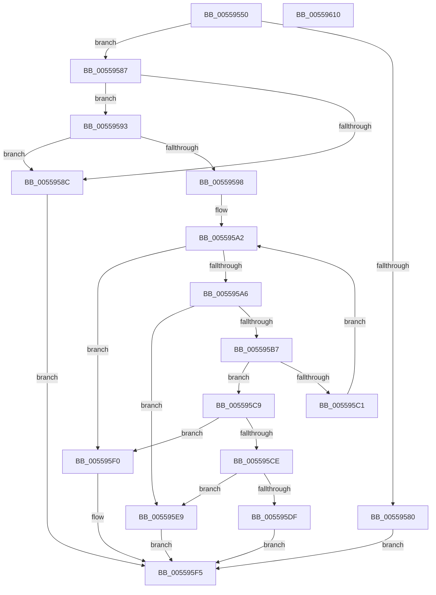

# HalpNumaQueryMemoryNumaAttributes

- RVA: `0x00559550`–`0x00559611` (길이 `193` bytes)
- VA: `0x0000000140559550`
- 실행 섹션: `.text`
- PDB 이름 있음: `예`; PDB Function 태그: `아니요`
- unwind 정보 RVA: `0x00060300`
- 디코드: `63`개 명령, `193/193` bytes 표시
- 미해석 바이트: `0` (있으면 어셈블리에 `.byte`로 보존)

> 이 문서는 커널 이미지의 기계어와 PDB 기호를 분석해 생성했습니다. 4번과 5번은 함수 원형과 자료형을 바이너리 사용 방식에서 추정한 C 해석이며 원본 소스 복구 결과는 아닙니다.

## 1. Dependencies

- 직접 호출 지점: **2**; 고유 호출 대상: **1**
- 직접 호출자로 확인된 함수: **0**
- RIP 상대 이미지 참조: **1**

### Outgoing calls
- `0x005595AE` → [HalpNumaQueryProximityNode](HalpNumaQueryProximityNode_function_00559790.md) (function, `0x00559790`)
- `0x005595D6` → [HalpNumaQueryProximityNode](HalpNumaQueryProximityNode_function_00559790.md) (function, `0x00559790`)

### Direct callers
- 이 함수 시작 RVA로 연결되는 직접 call은 확인되지 않았습니다. 간접 호출은 완전히 역산할 수 없습니다.

### Static image references
- `0x00559574` → RVA `0x00F90640` (`.data`; read)

## 2. Other-region calls and transfers

- 다른 실행 섹션으로 향하는 call: **0**
- 별도 외부 분기/꼬리 이동을 확인하지 못했습니다.

## 3. Assembly (complete function range)

```asm
00559550  48 8B C4                        mov rax, rsp
00559553  48 89 58 08                     mov qword ptr [rax + 8], rbx
00559557  48 89 68 10                     mov qword ptr [rax + 0x10], rbp
0055955B  48 89 70 18                     mov qword ptr [rax + 0x18], rsi
0055955F  57                              push rdi
00559560  41 56                           push r14
00559562  41 57                           push r15
00559564  48 83 EC 20                     sub rsp, 0x20
00559568  33 DB                           xor ebx, ebx
0055956A  4D 8B F0                        mov r14, r8
0055956D  66 89 58 20                     mov word ptr [rax + 0x20], bx
00559571  44 8B FA                        mov r15d, edx
00559574  48 8B 05 C5 70 A3 00            mov rax, qword ptr [rip + 0xa370c5]
0055957B  48 85 C0                        test rax, rax
0055957E  75 07                           jne 0x140559587
00559580  BB E5 00 00 C0                  mov ebx, 0xc00000e5
00559585  EB 6E                           jmp 0x1405595f5
00559587  83 F9 01                        cmp ecx, 1
0055958A  74 07                           je 0x140559593
0055958C  BB 0D 00 00 C0                  mov ebx, 0xc000000d
00559591  EB 62                           jmp 0x1405595f5
00559593  4D 85 F6                        test r14, r14
00559596  74 F4                           je 0x14055958c
00559598  8B 78 0C                        mov edi, dword ptr [rax + 0xc]
0055959B  8B F3                           mov esi, ebx
0055959D  8B 28                           mov ebp, dword ptr [rax]
0055959F  48 03 F8                        add rdi, rax
005595A2  3B F5                           cmp esi, ebp
005595A4  73 4A                           jae 0x1405595f0
005595A6  8B 4F 08                        mov ecx, dword ptr [rdi + 8]
005595A9  48 8D 54 24 58                  lea rdx, [rsp + 0x58]
005595AE  E8 DD 01 00 00                  call 0x140559790
005595B3  85 C0                           test eax, eax
005595B5  78 32                           js 0x1405595e9
005595B7  0F B7 44 24 58                  movzx eax, word ptr [rsp + 0x58]
005595BC  41 3B C7                        cmp eax, r15d
005595BF  74 08                           je 0x1405595c9
005595C1  48 83 C7 0C                     add rdi, 0xc
005595C5  FF C6                           inc esi
005595C7  EB D9                           jmp 0x1405595a2
005595C9  F6 07 01                        test byte ptr [rdi], 1
005595CC  74 22                           je 0x1405595f0
005595CE  8B 4F 04                        mov ecx, dword ptr [rdi + 4]
005595D1  48 8D 54 24 58                  lea rdx, [rsp + 0x58]
005595D6  E8 B5 01 00 00                  call 0x140559790
005595DB  85 C0                           test eax, eax
005595DD  78 0A                           js 0x1405595e9
005595DF  0F B7 44 24 58                  movzx eax, word ptr [rsp + 0x58]
005595E4  41 89 06                        mov dword ptr [r14], eax
005595E7  EB 0C                           jmp 0x1405595f5
005595E9  BB 0F 00 14 C0                  mov ebx, 0xc014000f
005595EE  EB 05                           jmp 0x1405595f5
005595F0  BB 25 02 00 C0                  mov ebx, 0xc0000225
005595F5  48 8B 6C 24 48                  mov rbp, qword ptr [rsp + 0x48]
005595FA  8B C3                           mov eax, ebx
005595FC  48 8B 5C 24 40                  mov rbx, qword ptr [rsp + 0x40]
00559601  48 8B 74 24 50                  mov rsi, qword ptr [rsp + 0x50]
00559606  48 83 C4 20                     add rsp, 0x20
0055960A  41 5F                           pop r15
0055960C  41 5E                           pop r14
0055960E  5F                              pop rdi
0055960F  C3                              ret
00559610  CC                              int3
```

## 4. C-style interpretation (structured pseudocode)

```c
__int64 __fastcall HalpNumaQueryMemoryNumaAttributes(int a1, int a2, __int64 a3)
{
    __int64 result;
    __int64 v_rbx;
    __int64 v_rdi;
    __int64 v_rsi;
    __int64 v_rsp;
    unsigned __int64 v_stack_p10;
    unsigned __int64 v_stack_p18;
    unsigned __int64 v_stack_p20;
    unsigned __int64 v_stack_p8;

    *(unsigned __int64 *)(v_rsp + 8) = v_rbx;
    *(unsigned __int64 *)(v_rsp + 16) = v_rbp;
    *(unsigned __int64 *)(v_rsp + 24) = v_rsi;
    v_rsp = (v_rsp) - (32);
    v_rbx = 0;
    *(unsigned __int16 *)(v_rsp + 32) = 0;
    if (*(unsigned __int64 *)(v_rip + 10711237) != 0) goto loc_00559587;
    goto loc_005595F5;
loc_00559587:
    if (a1 == 1) goto loc_00559593;
loc_0055958C:
    goto loc_005595F5;
loc_00559593:
    if (a3 == 0) goto loc_0055958C;
    v_rdi = ((unsigned int)(*(unsigned int *)(*(unsigned __int64 *)(v_rip + 10711237) + 12))) + (*(unsigned __int64 *)(v_rip + 10711237));
loc_005595A2:
    if (((unsigned int)((unsigned int)((unsigned int)((unsigned int)(0xC000000DULL))))) >= ((unsigned int)((unsigned int)(*(unsigned int *)(*(unsigned __int64 *)(v_rip + 10711237)))))) goto loc_005595F0;
    result = HalpNumaQueryProximityNode((unsigned int)(*(unsigned int *)(v_rdi + 8)), v_stack_p20, a3, a4);
    if (sign_flag) goto loc_005595E9;
    if (((unsigned int)(v_stack_p20)) == ((unsigned int)((unsigned int)(a2)))) goto loc_005595C9;
    v_rdi = (v_rdi) + (12);
    v_rsi = (unsigned int)(((unsigned int)((unsigned int)((unsigned int)(0xC000000DULL)))) + 1);
    goto loc_005595A2;
loc_005595C9:
    if (((*(unsigned __int8 *)(v_rdi)) & (1)) == 0) goto loc_005595F0;
    result = HalpNumaQueryProximityNode((unsigned int)(*(unsigned int *)(v_rdi + 4)), v_stack_p20, a3, a4);
    if (sign_flag) goto loc_005595E9;
    *(unsigned int *)(a3) = (unsigned int)(v_stack_p20);
    goto loc_005595F5;
loc_005595E9:
    goto loc_005595F5;
loc_005595F0:
loc_005595F5:
    v_rsp = (v_rsp) + (32);
    return (unsigned int)((unsigned int)((unsigned int)(0xC0000225ULL)));
}
```

## 5. (Beta) C Style

```c
int64_t HalpNumaQueryMemoryNumaAttributes(int32_t Arg1, int32_t Arg2, int64_t Arg3)
{
    int64_t result;
    int64_t local_rbx;
    int64_t local_rdi;
    int64_t local_rsi;
    int64_t local_rsp;
    uint64_t v_stack_p10;
    uint64_t v_stack_p18;
    uint64_t v_stack_p20;
    uint64_t v_stack_p8;

    *(uint64_t *)(local_rsp + 0x8) = local_rbx;
    *(uint64_t *)(local_rsp + 0x10) = local_rbp;
    *(uint64_t *)(local_rsp + 0x18) = local_rsi;
    local_rsp = (local_rsp) - (32);
    local_rbx = 0;
    *(uint16_t *)(local_rsp + 0x20) = 0;
    if (*(uint64_t *)(v_rip + 0xA370C5) != 0) goto loc_00559587;
    goto loc_005595F5;
loc_00559587:
    if (Arg1 == 1) goto loc_00559593;
loc_0055958C:
    goto loc_005595F5;
loc_00559593:
    if (Arg3 == 0) goto loc_0055958C;
    local_rdi = ((uint32_t)(*(uint32_t *)(*(uint64_t *)(v_rip + 0xA370C5) + 0xC))) + (*(uint64_t *)(v_rip + 0xA370C5));
loc_005595A2:
    if (((uint32_t)((uint32_t)((uint32_t)((uint32_t)(0xC000000DULL))))) >= ((uint32_t)((uint32_t)(*(uint32_t *)(*(uint64_t *)(v_rip + 0xA370C5)))))) goto loc_005595F0;
    result = HalpNumaQueryProximityNode((uint32_t)(*(uint32_t *)(local_rdi + 0x8)), v_stack_p20, Arg3, a4);
    if (sign_flag) goto loc_005595E9;
    if (((uint32_t)(v_stack_p20)) == ((uint32_t)((uint32_t)(Arg2)))) goto loc_005595C9;
    local_rdi = (local_rdi) + (12);
    local_rsi = (uint32_t)(((uint32_t)((uint32_t)((uint32_t)(0xC000000DULL)))) + 1);
    goto loc_005595A2;
loc_005595C9:
    if (((*(uint8_t *)(local_rdi)) & (1)) == 0) goto loc_005595F0;
    result = HalpNumaQueryProximityNode((uint32_t)(*(uint32_t *)(local_rdi + 0x4)), v_stack_p20, Arg3, a4);
    if (sign_flag) goto loc_005595E9;
    *(uint32_t *)(Arg3) = (uint32_t)(v_stack_p20);
    goto loc_005595F5;
loc_005595E9:
    goto loc_005595F5;
loc_005595F0:
loc_005595F5:
    local_rsp = (local_rsp) + (32);
    return (uint32_t)((uint32_t)((uint32_t)(0xC0000225ULL)));
}
```

## 6. Execution-region graph

[열기: 2D/3D 그래프와 함수 탐색 컨트롤 패널](../../../control-panel.html?section=text&rva=0x00559550&view=graph)

- 2D 그래프는 위에서 아래로 흐르고, 3D 그래프는 빈 공간을 드래그해 회전합니다. Shift+드래그는 이동, 휠은 확대·축소, 함수 노드 선택은 대상 보고서 이동입니다.

### Static fallback


