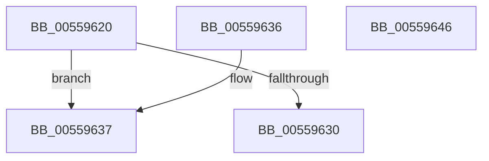

# HalpNumaQueryNodeCapacity

- RVA: `0x00559620`–`0x00559647` (길이 `39` bytes)
- VA: `0x0000000140559620`
- 실행 섹션: `.text`
- PDB 이름 있음: `예`; PDB Function 태그: `아니요`
- unwind 정보 RVA: `0x000DB714`
- 디코드: `14`개 명령, `39/39` bytes 표시
- 미해석 바이트: `0` (있으면 어셈블리에 `.byte`로 보존)

> 이 문서는 커널 이미지의 기계어와 PDB 기호를 분석해 생성했습니다. 4번과 5번은 함수 원형과 자료형을 바이너리 사용 방식에서 추정한 C 해석이며 원본 소스 복구 결과는 아닙니다.

## 1. Dependencies

- 직접 호출 지점: **0**; 고유 호출 대상: **0**
- 직접 호출자로 확인된 함수: **0**
- RIP 상대 이미지 참조: **1**

### Outgoing calls
- 직접 디코드된 call 명령이 없습니다.

### Direct callers
- 이 함수 시작 RVA로 연결되는 직접 call은 확인되지 않았습니다. 간접 호출은 완전히 역산할 수 없습니다.

### Static image references
- `0x00559620` → RVA `0x00F90658` (`.data`; read)

## 2. Other-region calls and transfers

- 다른 실행 섹션으로 향하는 call: **0**
- 별도 외부 분기/꼬리 이동을 확인하지 못했습니다.

## 3. Assembly (complete function range)

```asm
00559620  4C 8B 05 31 70 A3 00            mov r8, qword ptr [rip + 0xa37031]
00559627  0F B7 C1                        movzx eax, cx
0055962A  41 3B 40 38                     cmp eax, dword ptr [r8 + 0x38]
0055962E  72 07                           jb 0x140559637
00559630  B8 25 02 00 C0                  mov eax, 0xc0000225
00559635  C3                              ret
00559636  CC                              int3
00559637  49 8B 40 28                     mov rax, qword ptr [r8 + 0x28]
0055963B  0F B7 C9                        movzx ecx, cx
0055963E  8B 0C 88                        mov ecx, dword ptr [rax + rcx*4]
00559641  33 C0                           xor eax, eax
00559643  89 0A                           mov dword ptr [rdx], ecx
00559645  C3                              ret
00559646  CC                              int3
```

## 4. C-style interpretation (structured pseudocode)

```c
__int64 __fastcall HalpNumaQueryNodeCapacity(unsigned __int16 a1, __int64 a2)
{
    __int64 result;

    if (a1 < (*(unsigned int *)(*(unsigned __int64 *)(v_rip + 10711089) + 56))) goto loc_00559637;
    return (unsigned int)(0xC0000225ULL);
loc_00559637:
    result = 0;
    *(unsigned int *)(a2) = (unsigned int)((unsigned int)(*(unsigned int *)(*(unsigned __int64 *)(*(unsigned __int64 *)(v_rip + 10711089) + 40) + a1 * 4)));
    return result;
}
```

## 5. (Beta) C Style

```c
int64_t HalpNumaQueryNodeCapacity(uint16_t Arg1, void *Arg2)
{
    uint8_t *arg2 = (uint8_t *)Arg2;

    int64_t result;

    if (Arg1 < (*(uint32_t *)(*(uint64_t *)(v_rip + 0xA37031) + 0x38))) goto loc_00559637;
    return (uint32_t)(0xC0000225ULL);
loc_00559637:
    result = 0;
    *(uint32_t *)(arg2) = (uint32_t)((uint32_t)(*(uint32_t *)(*(uint64_t *)(*(uint64_t *)(v_rip + 0xA37031) + 0x28) + Arg1 * 4)));
    return result;
}
```

### 관측된 메모리 오프셋

구조체 형식이 확인되지 않은 접근은 인자 기준의 오프셋으로만 기록했습니다.

| 기준 인자 | 오프셋 표현 | 폭 (bit) | 접근 |
|---|---:|---:|---|
| `Arg2` | `+ 0x0` | `32` | `W` |

## 6. Execution-region graph

[열기: 2D/3D 그래프와 함수 탐색 컨트롤 패널](../../../control-panel.html?section=text&rva=0x00559620&view=graph)

- 2D 그래프는 위에서 아래로 흐르고, 3D 그래프는 빈 공간을 드래그해 회전합니다. Shift+드래그는 이동, 휠은 확대·축소, 함수 노드 선택은 대상 보고서 이동입니다.

### Static fallback


