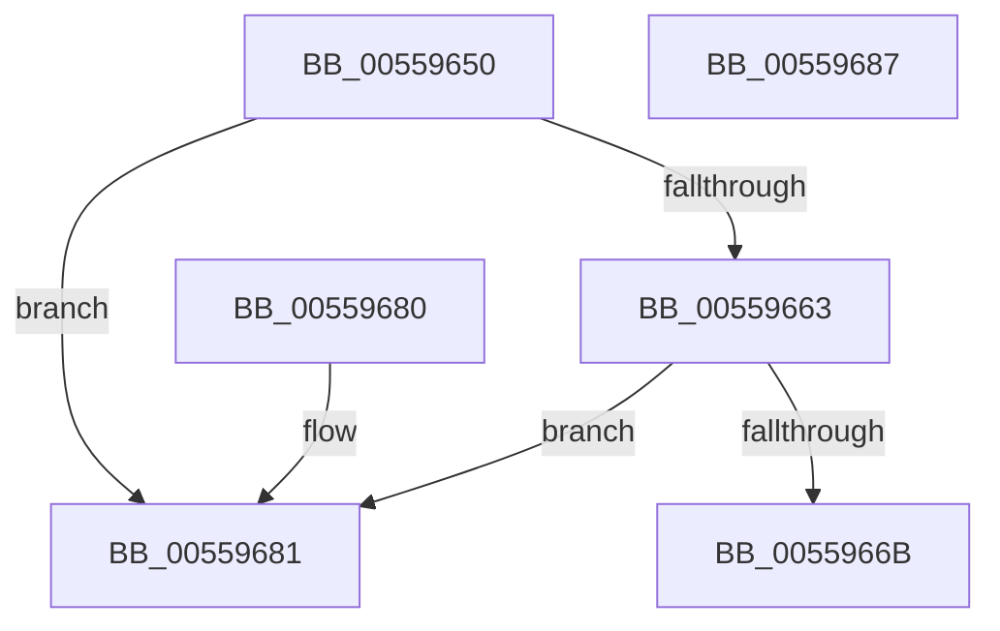

# HalpNumaQueryNodeDistance

- RVA: `0x00559650`–`0x00559688` (길이 `56` bytes)
- VA: `0x0000000140559650`
- 실행 섹션: `.text`
- PDB 이름 있음: `예`; PDB Function 태그: `아니요`
- unwind 정보 RVA: `0x000DB714`
- 디코드: `19`개 명령, `56/56` bytes 표시
- 미해석 바이트: `0` (있으면 어셈블리에 `.byte`로 보존)

> 이 문서는 커널 이미지의 기계어와 PDB 기호를 분석해 생성했습니다. 4번과 5번은 함수 원형과 자료형을 바이너리 사용 방식에서 추정한 C 해석이며 원본 소스 복구 결과는 아닙니다.

## 1. Dependencies

- 직접 호출 지점: **0**; 고유 호출 대상: **0**
- 직접 호출자로 확인된 함수: **0**
- RIP 상대 이미지 참조: **1**

### Outgoing calls
- 직접 디코드된 call 명령이 없습니다.

### Direct callers
- 이 함수 시작 RVA로 연결되는 직접 call은 확인되지 않았습니다. 간접 호출은 완전히 역산할 수 없습니다.

### Static image references
- `0x00559650` → RVA `0x00F90658` (`.data`; read)

## 2. Other-region calls and transfers

- 다른 실행 섹션으로 향하는 call: **0**
- 별도 외부 분기/꼬리 이동을 확인하지 못했습니다.

## 3. Assembly (complete function range)

```asm
00559650  4C 8B 0D 01 70 A3 00            mov r9, qword ptr [rip + 0xa37001]
00559657  0F B7 C1                        movzx eax, cx
0055965A  45 8B 51 38                     mov r10d, dword ptr [r9 + 0x38]
0055965E  41 3B C2                        cmp eax, r10d
00559661  73 1E                           jae 0x140559681
00559663  0F B7 CA                        movzx ecx, dx
00559666  41 3B CA                        cmp ecx, r10d
00559669  73 16                           jae 0x140559681
0055966B  41 0F AF 41 40                  imul eax, dword ptr [r9 + 0x40]
00559670  03 C8                           add ecx, eax
00559672  49 8B 41 30                     mov rax, qword ptr [r9 + 0x30]
00559676  0F B7 0C 48                     movzx ecx, word ptr [rax + rcx*2]
0055967A  33 C0                           xor eax, eax
0055967C  41 89 08                        mov dword ptr [r8], ecx
0055967F  C3                              ret
00559680  CC                              int3
00559681  B8 25 02 00 C0                  mov eax, 0xc0000225
00559686  C3                              ret
00559687  CC                              int3
```

## 4. C-style interpretation (structured pseudocode)

```c
__int64 __fastcall HalpNumaQueryNodeDistance(unsigned __int16 a1, unsigned __int16 a2, __int64 a3)
{
    __int64 result;

    if (a1 >= ((unsigned int)((unsigned int)(*(unsigned int *)(*(unsigned __int64 *)(v_rip + 10711041) + 56))))) goto loc_00559681;
    if (a2 >= ((unsigned int)((unsigned int)(*(unsigned int *)(*(unsigned __int64 *)(v_rip + 10711041) + 56))))) goto loc_00559681;
    result = (unsigned int)((a1) * (*(unsigned int *)(*(unsigned __int64 *)(v_rip + 10711041) + 64)));
    a1 = (unsigned int)((a2) + ((unsigned int)(result)));
    result = 0;
    *(unsigned int *)(a3) = (unsigned int)(*(unsigned __int16 *)(*(unsigned __int64 *)(*(unsigned __int64 *)(v_rip + 10711041) + 48) + a1 * 2));
    return result;
loc_00559681:
    return (unsigned int)(0xC0000225ULL);
}
```

## 5. (Beta) C Style

```c
int64_t HalpNumaQueryNodeDistance(uint16_t Arg1, uint16_t Arg2, void *Arg3)
{
    uint8_t *arg3 = (uint8_t *)Arg3;

    int64_t result;

    if (Arg1 >= ((uint32_t)((uint32_t)(*(uint32_t *)(*(uint64_t *)(v_rip + 0xA37001) + 0x38))))) goto loc_00559681;
    if (Arg2 >= ((uint32_t)((uint32_t)(*(uint32_t *)(*(uint64_t *)(v_rip + 0xA37001) + 0x38))))) goto loc_00559681;
    result = (uint32_t)((Arg1) * (*(uint32_t *)(*(uint64_t *)(v_rip + 0xA37001) + 0x40)));
    Arg1 = (uint32_t)((Arg2) + ((uint32_t)(result)));
    result = 0;
    *(uint32_t *)(arg3) = (uint32_t)(*(uint16_t *)(*(uint64_t *)(*(uint64_t *)(v_rip + 0xA37001) + 0x30) + Arg1 * 2));
    return result;
loc_00559681:
    return (uint32_t)(0xC0000225ULL);
}
```

### 관측된 메모리 오프셋

구조체 형식이 확인되지 않은 접근은 인자 기준의 오프셋으로만 기록했습니다.

| 기준 인자 | 오프셋 표현 | 폭 (bit) | 접근 |
|---|---:|---:|---|
| `Arg3` | `+ 0x0` | `32` | `W` |

## 6. Execution-region graph

[열기: 2D/3D 그래프와 함수 탐색 컨트롤 패널](../../../control-panel.html?section=text&rva=0x00559650&view=graph)

- 2D 그래프는 위에서 아래로 흐르고, 3D 그래프는 빈 공간을 드래그해 회전합니다. Shift+드래그는 이동, 휠은 확대·축소, 함수 노드 선택은 대상 보고서 이동입니다.

### Static fallback


