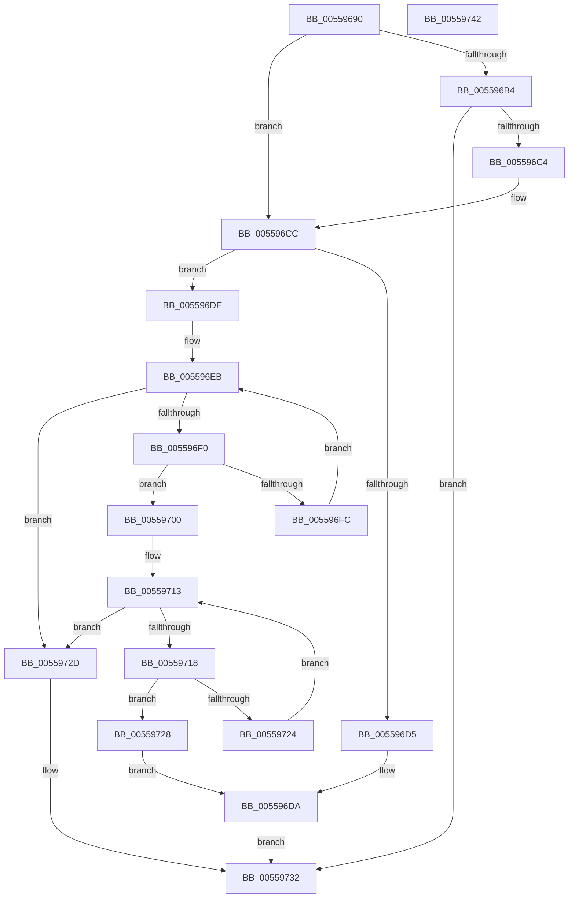

# HalpNumaQueryProcessorNode

- RVA: `0x00559690`–`0x00559743` (길이 `179` bytes)
- VA: `0x0000000140559690`
- 실행 섹션: `.text`
- PDB 이름 있음: `예`; PDB Function 태그: `아니요`
- unwind 정보 RVA: `0x000B6464`
- 디코드: `56`개 명령, `179/179` bytes 표시
- 미해석 바이트: `0` (있으면 어셈블리에 `.byte`로 보존)

> 이 문서는 커널 이미지의 기계어와 PDB 기호를 분석해 생성했습니다. 4번과 5번은 함수 원형과 자료형을 바이너리 사용 방식에서 추정한 C 해석이며 원본 소스 복구 결과는 아닙니다.

## 1. Dependencies

- 직접 호출 지점: **1**; 고유 호출 대상: **1**
- 직접 호출자로 확인된 함수: **0**
- RIP 상대 이미지 참조: **2**

### Outgoing calls
- `0x005596BB` → [HalpInterruptGetIdentifiers](../4C/HalpInterruptGetIdentifiers_function_004C5DC0.md) (function, `0x004C5DC0`)

### Direct callers
- 이 함수 시작 RVA로 연결되는 직접 call은 확인되지 않았습니다. 간접 호출은 완전히 역산할 수 없습니다.

### Static image references
- `0x005596CC` → RVA `0x00F90618` (`.data`; read)
- `0x005596DE` → RVA `0x00F90658` (`.data`; read)

## 2. Other-region calls and transfers

- 다른 실행 섹션으로 향하는 call: **0**
- 별도 외부 분기/꼬리 이동을 확인하지 못했습니다.

## 3. Assembly (complete function range)

```asm
00559690  48 8B C4                        mov rax, rsp
00559693  48 89 58 08                     mov qword ptr [rax + 8], rbx
00559697  48 89 70 18                     mov qword ptr [rax + 0x18], rsi
0055969B  57                              push rdi
0055969C  48 83 EC 20                     sub rsp, 0x20
005596A0  44 8B 0A                        mov r9d, dword ptr [rdx]
005596A3  33 DB                           xor ebx, ebx
005596A5  89 58 10                        mov dword ptr [rax + 0x10], ebx
005596A8  49 8B F0                        mov rsi, r8
005596AB  48 8B FA                        mov rdi, rdx
005596AE  41 83 F9 FF                     cmp r9d, -1
005596B2  75 18                           jne 0x1405596cc
005596B4  45 33 C0                        xor r8d, r8d
005596B7  48 8D 50 10                     lea rdx, [rax + 0x10]
005596BB  E8 00 C7 F6 FF                  call 0x1404c5dc0
005596C0  85 C0                           test eax, eax
005596C2  78 6E                           js 0x140559732
005596C4  44 8B 4C 24 38                  mov r9d, dword ptr [rsp + 0x38]
005596C9  44 89 0F                        mov dword ptr [rdi], r9d
005596CC  48 39 1D 45 6F A3 00            cmp qword ptr [rip + 0xa36f45], rbx
005596D3  75 09                           jne 0x1405596de
005596D5  66 81 0E FF FF                  or word ptr [rsi], 0xffff
005596DA  33 C0                           xor eax, eax
005596DC  EB 54                           jmp 0x140559732
005596DE  48 8B 15 73 6F A3 00            mov rdx, qword ptr [rip + 0xa36f73]
005596E5  8B CB                           mov ecx, ebx
005596E7  44 8B 52 3C                     mov r10d, dword ptr [rdx + 0x3c]
005596EB  41 3B CA                        cmp ecx, r10d
005596EE  73 3D                           jae 0x14055972d
005596F0  48 8B 02                        mov rax, qword ptr [rdx]
005596F3  44 8B C1                        mov r8d, ecx
005596F6  46 39 0C 80                     cmp dword ptr [rax + r8*4], r9d
005596FA  74 04                           je 0x140559700
005596FC  FF C1                           inc ecx
005596FE  EB EB                           jmp 0x1405596eb
00559700  48 8B 15 51 6F A3 00            mov rdx, qword ptr [rip + 0xa36f51]
00559707  48 8B 42 10                     mov rax, qword ptr [rdx + 0x10]
0055970B  46 8B 0C 80                     mov r9d, dword ptr [rax + r8*4]
0055970F  44 8B 42 38                     mov r8d, dword ptr [rdx + 0x38]
00559713  41 3B D8                        cmp ebx, r8d
00559716  73 15                           jae 0x14055972d
00559718  48 8B 42 18                     mov rax, qword ptr [rdx + 0x18]
0055971C  8B CB                           mov ecx, ebx
0055971E  44 39 0C 88                     cmp dword ptr [rax + rcx*4], r9d
00559722  74 04                           je 0x140559728
00559724  FF C3                           inc ebx
00559726  EB EB                           jmp 0x140559713
00559728  66 89 1E                        mov word ptr [rsi], bx
0055972B  EB AD                           jmp 0x1405596da
0055972D  B8 25 02 00 C0                  mov eax, 0xc0000225
00559732  48 8B 5C 24 30                  mov rbx, qword ptr [rsp + 0x30]
00559737  48 8B 74 24 40                  mov rsi, qword ptr [rsp + 0x40]
0055973C  48 83 C4 20                     add rsp, 0x20
00559740  5F                              pop rdi
00559741  C3                              ret
00559742  CC                              int3
```

## 4. C-style interpretation (structured pseudocode)

```c
__int64 __fastcall HalpNumaQueryProcessorNode(__int64 a1, __int64 a2, __int64 a3)
{
    __int64 result;
    __int64 v_rbx;
    __int64 v_rsp;
    unsigned int v_stack_p10;
    unsigned __int64 v_stack_p18;
    unsigned __int64 v_stack_p8;

    *(unsigned __int64 *)(v_rsp + 8) = v_rbx;
    *(unsigned __int64 *)(v_rsp + 24) = v_rsi;
    v_rsp = (v_rsp) - (32);
    v_rbx = 0;
    *(unsigned int *)(v_rsp + 16) = 0;
    if (((unsigned int)((unsigned int)(*(unsigned int *)(a2)))) != -1) goto loc_005596CC;
    a3 = 0;
    result = HalpInterruptGetIdentifiers(a1, v_rsp + 16, a3, (unsigned int)(*(unsigned int *)(a2)));
    if (sign_flag) goto loc_00559732;
    *(unsigned int *)(a2) = (unsigned int)((unsigned int)(v_stack_p10));
loc_005596CC:
    if ((*(unsigned __int64 *)(v_rip + 10710853)) != 0) goto loc_005596DE;
loc_005596DA:
    result = 0;
    goto loc_00559732;
loc_005596DE:
loc_005596EB:
    if (0 >= ((unsigned int)((unsigned int)(*(unsigned int *)(*(unsigned __int64 *)(v_rip + 10710899) + 60))))) goto loc_0055972D;
    if ((*(unsigned int *)(*(unsigned __int64 *)(*(unsigned __int64 *)(v_rip + 10710899)) + 0 * 4)) == ((unsigned int)((unsigned int)(v_stack_p10)))) goto loc_00559700;
    a1 = (unsigned int)((0) + 1);
    goto loc_005596EB;
loc_00559700:
loc_00559713:
    if (0 >= ((unsigned int)((unsigned int)(*(unsigned int *)(*(unsigned __int64 *)(v_rip + 10710865) + 56))))) goto loc_0055972D;
    if ((*(unsigned int *)(*(unsigned __int64 *)(*(unsigned __int64 *)(v_rip + 10710865) + 24) + 0 * 4)) == ((unsigned int)((unsigned int)(*(unsigned int *)(*(unsigned __int64 *)(*(unsigned __int64 *)(v_rip + 10710865) + 16) + 0 * 4))))) goto loc_00559728;
    v_rbx = (unsigned int)((v_rbx) + 1);
    goto loc_00559713;
loc_00559728:
    *(unsigned __int16 *)(a3) = (unsigned __int16)(v_rbx);
    goto loc_005596DA;
loc_0055972D:
loc_00559732:
    v_rsp = (v_rsp) + (32);
    return (unsigned int)(0xC0000225ULL);
}
```

## 5. (Beta) C Style

```c
int64_t HalpNumaQueryProcessorNode(int64_t Arg1, void *Arg2, void *Arg3)
{
    uint8_t *arg2 = (uint8_t *)Arg2;
    uint8_t *arg3 = (uint8_t *)Arg3;

    int64_t result;
    int64_t local_rbx;
    int64_t local_rsp;
    uint32_t v_stack_p10;
    uint64_t v_stack_p18;
    uint64_t v_stack_p8;

    *(uint64_t *)(local_rsp + 0x8) = local_rbx;
    *(uint64_t *)(local_rsp + 0x18) = local_rsi;
    local_rsp = (local_rsp) - (32);
    local_rbx = 0;
    *(uint32_t *)(local_rsp + 0x10) = 0;
    if (((uint32_t)((uint32_t)(*(uint32_t *)(arg2)))) != -1) goto loc_005596CC;
    Arg3 = 0;
    result = HalpInterruptGetIdentifiers(Arg1, local_rsp + 16, Arg3, (uint32_t)(*(uint32_t *)(arg2)));
    if (sign_flag) goto loc_00559732;
    *(uint32_t *)(arg2) = (uint32_t)((uint32_t)(v_stack_p10));
loc_005596CC:
    if ((*(uint64_t *)(v_rip + 0xA36F45)) != 0) goto loc_005596DE;
loc_005596DA:
    result = 0;
    goto loc_00559732;
loc_005596DE:
loc_005596EB:
    if (0 >= ((uint32_t)((uint32_t)(*(uint32_t *)(*(uint64_t *)(v_rip + 0xA36F73) + 0x3C))))) goto loc_0055972D;
    if ((*(uint32_t *)(*(uint64_t *)(*(uint64_t *)(v_rip + 0xA36F73)) + 0x0 * 4)) == ((uint32_t)((uint32_t)(v_stack_p10)))) goto loc_00559700;
    Arg1 = (uint32_t)((0) + 1);
    goto loc_005596EB;
loc_00559700:
loc_00559713:
    if (0 >= ((uint32_t)((uint32_t)(*(uint32_t *)(*(uint64_t *)(v_rip + 0xA36F51) + 0x38))))) goto loc_0055972D;
    if ((*(uint32_t *)(*(uint64_t *)(*(uint64_t *)(v_rip + 0xA36F51) + 0x18) + 0x0 * 4)) == ((uint32_t)((uint32_t)(*(uint32_t *)(*(uint64_t *)(*(uint64_t *)(v_rip + 0xA36F51) + 0x10) + 0x0 * 4))))) goto loc_00559728;
    local_rbx = (uint32_t)((local_rbx) + 1);
    goto loc_00559713;
loc_00559728:
    *(uint16_t *)(arg3) = (uint16_t)(local_rbx);
    goto loc_005596DA;
loc_0055972D:
loc_00559732:
    local_rsp = (local_rsp) + (32);
    return (uint32_t)(0xC0000225ULL);
}
```

### 관측된 메모리 오프셋

구조체 형식이 확인되지 않은 접근은 인자 기준의 오프셋으로만 기록했습니다.

| 기준 인자 | 오프셋 표현 | 폭 (bit) | 접근 |
|---|---:|---:|---|
| `Arg2` | `+ 0x0` | `32` | `R` |
| `Arg2` | `+ 0x0` | `32` | `W` |
| `Arg3` | `+ 0x0` | `16` | `R/W` |
| `Arg3` | `+ 0x0` | `16` | `W` |

## 6. Execution-region graph

[열기: 2D/3D 그래프와 함수 탐색 컨트롤 패널](../../../control-panel.html?section=text&rva=0x00559690&view=graph)

- 2D 그래프는 위에서 아래로 흐르고, 3D 그래프는 빈 공간을 드래그해 회전합니다. Shift+드래그는 이동, 휠은 확대·축소, 함수 노드 선택은 대상 보고서 이동입니다.

### Static fallback


