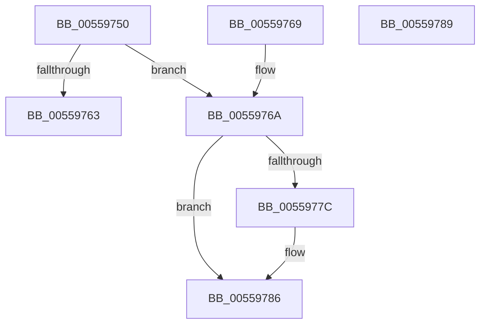

# HalpNumaQueryProximityId

- RVA: `0x00559750`–`0x0055978A` (길이 `58` bytes)
- VA: `0x0000000140559750`
- 실행 섹션: `.text`
- PDB 이름 있음: `예`; PDB Function 태그: `아니요`
- unwind 정보 RVA: `0x000DB714`
- 디코드: `20`개 명령, `58/58` bytes 표시
- 미해석 바이트: `0` (있으면 어셈블리에 `.byte`로 보존)

> 이 문서는 커널 이미지의 기계어와 PDB 기호를 분석해 생성했습니다. 4번과 5번은 함수 원형과 자료형을 바이너리 사용 방식에서 추정한 C 해석이며 원본 소스 복구 결과는 아닙니다.

## 1. Dependencies

- 직접 호출 지점: **0**; 고유 호출 대상: **0**
- 직접 호출자로 확인된 함수: **1**
- RIP 상대 이미지 참조: **1**

### Outgoing calls
- 직접 디코드된 call 명령이 없습니다.

### Direct callers
- [HalpNumaQuerySystemLocalityLatencyAndBandwidthInfo](HalpNumaQuerySystemLocalityLatencyAndBandwidthInfo_function_005597E0.md) at `0x00559890`
- [HalpNumaQuerySystemLocalityLatencyAndBandwidthInfo](HalpNumaQuerySystemLocalityLatencyAndBandwidthInfo_function_005597E0.md) at `0x005598C7`

### Static image references
- `0x00559750` → RVA `0x00F90658` (`.data`; read)

## 2. Other-region calls and transfers

- 다른 실행 섹션으로 향하는 call: **0**
- 별도 외부 분기/꼬리 이동을 확인하지 못했습니다.

## 3. Assembly (complete function range)

```asm
00559750  4C 8B 0D 01 6F A3 00            mov r9, qword ptr [rip + 0xa36f01]
00559757  4C 8B D2                        mov r10, rdx
0055975A  0F B7 C1                        movzx eax, cx
0055975D  41 3B 41 38                     cmp eax, dword ptr [r9 + 0x38]
00559761  72 07                           jb 0x14055976a
00559763  B8 25 02 00 C0                  mov eax, 0xc0000225
00559768  C3                              ret
00559769  CC                              int3
0055976A  49 8B 41 18                     mov rax, qword ptr [r9 + 0x18]
0055976E  0F B7 D1                        movzx edx, cx
00559771  8B 0C 90                        mov ecx, dword ptr [rax + rdx*4]
00559774  41 89 0A                        mov dword ptr [r10], ecx
00559777  4D 85 C0                        test r8, r8
0055977A  74 0A                           je 0x140559786
0055977C  49 8B 41 20                     mov rax, qword ptr [r9 + 0x20]
00559780  8B 0C 90                        mov ecx, dword ptr [rax + rdx*4]
00559783  41 89 08                        mov dword ptr [r8], ecx
00559786  33 C0                           xor eax, eax
00559788  C3                              ret
00559789  CC                              int3
```

## 4. C-style interpretation (structured pseudocode)

```c
__int64 __fastcall HalpNumaQueryProximityId(unsigned __int16 a1, __int64 a2, __int64 a3)
{
    __int64 result;

    if (a1 < (*(unsigned int *)(*(unsigned __int64 *)(v_rip + 10710785) + 56))) goto loc_0055976A;
    return (unsigned int)(0xC0000225ULL);
loc_0055976A:
    *(unsigned int *)(a2) = (unsigned int)((unsigned int)(*(unsigned int *)(*(unsigned __int64 *)(*(unsigned __int64 *)(v_rip + 10710785) + 24) + a1 * 4)));
    result = *(unsigned __int64 *)(*(unsigned __int64 *)(v_rip + 10710785) + 24);
    if (a3 != 0) {
        result = *(unsigned __int64 *)(*(unsigned __int64 *)(v_rip + 10710785) + 32);
        a1 = *(unsigned int *)(result + a1 * 4);
        *(unsigned int *)(a3) = a1;
    }
    result = 0;
    return result;
}
```

## 5. (Beta) C Style

```c
int64_t HalpNumaQueryProximityId(uint16_t Arg1, void *Arg2, int64_t Arg3)
{
    uint8_t *arg2 = (uint8_t *)Arg2;

    int64_t result;

    if (Arg1 < (*(uint32_t *)(*(uint64_t *)(v_rip + 0xA36F01) + 0x38))) goto loc_0055976A;
    return (uint32_t)(0xC0000225ULL);
loc_0055976A:
    *(uint32_t *)(arg2) = (uint32_t)((uint32_t)(*(uint32_t *)(*(uint64_t *)(*(uint64_t *)(v_rip + 0xA36F01) + 0x18) + Arg1 * 4)));
    result = *(uint64_t *)(*(uint64_t *)(v_rip + 0xA36F01) + 0x18);
    if (Arg3 != 0) {
        result = *(uint64_t *)(*(uint64_t *)(v_rip + 0xA36F01) + 0x20);
        Arg1 = *(uint32_t *)(result + Arg1 * 4);
        *(uint32_t *)(Arg3) = Arg1;
    }
    result = 0;
    return result;
}
```

### 관측된 메모리 오프셋

구조체 형식이 확인되지 않은 접근은 인자 기준의 오프셋으로만 기록했습니다.

| 기준 인자 | 오프셋 표현 | 폭 (bit) | 접근 |
|---|---:|---:|---|
| `Arg2` | `+ 0x0` | `32` | `W` |

## 6. Execution-region graph

[열기: 2D/3D 그래프와 함수 탐색 컨트롤 패널](../../../control-panel.html?section=text&rva=0x00559750&view=graph)

- 2D 그래프는 위에서 아래로 흐르고, 3D 그래프는 빈 공간을 드래그해 회전합니다. Shift+드래그는 이동, 휠은 확대·축소, 함수 노드 선택은 대상 보고서 이동입니다.

### Static fallback


