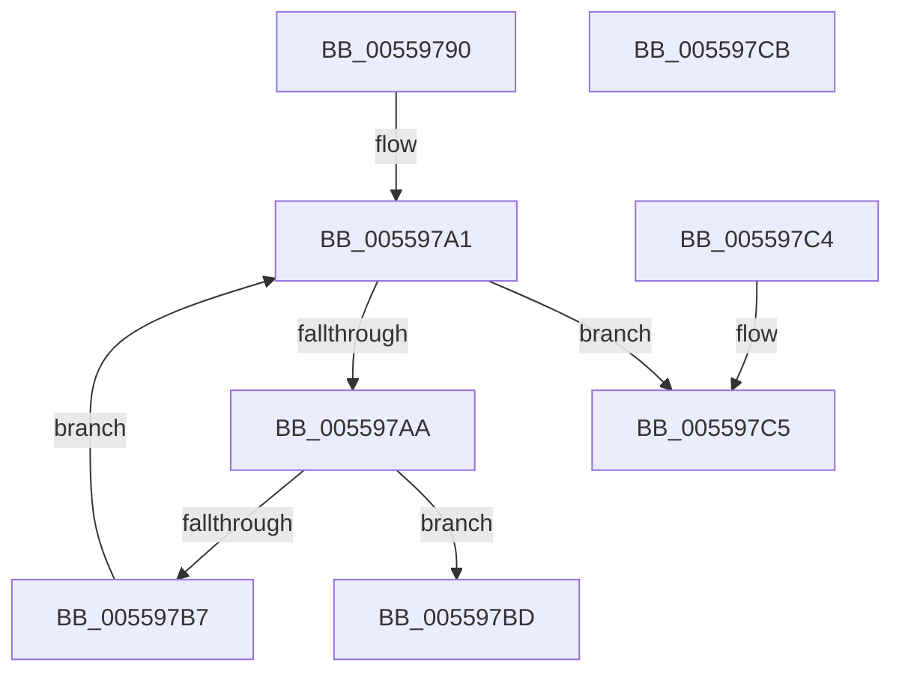

# HalpNumaQueryProximityNode

- RVA: `0x00559790`–`0x005597CC` (길이 `60` bytes)
- VA: `0x0000000140559790`
- 실행 섹션: `.text`
- PDB 이름 있음: `예`; PDB Function 태그: `아니요`
- unwind 정보 RVA: `0x000DB714`
- 디코드: `20`개 명령, `60/60` bytes 표시
- 미해석 바이트: `0` (있으면 어셈블리에 `.byte`로 보존)

> 이 문서는 커널 이미지의 기계어와 PDB 기호를 분석해 생성했습니다. 4번과 5번은 함수 원형과 자료형을 바이너리 사용 방식에서 추정한 C 해석이며 원본 소스 복구 결과는 아닙니다.

## 1. Dependencies

- 직접 호출 지점: **0**; 고유 호출 대상: **0**
- 직접 호출자로 확인된 함수: **5**
- RIP 상대 이미지 참조: **1**

### Outgoing calls
- 직접 디코드된 call 명령이 없습니다.

### Direct callers
- [HalpNumaAddRangeProximity](HalpNumaAddRangeProximity_function_00558EC0.md) at `0x00558F7A`
- [HalpNumaGetHmatConfigSize](HalpNumaGetHmatConfigSize_function_00559230.md) at `0x00559315`
- [HalpNumaGetHmatConfigSize](HalpNumaGetHmatConfigSize_function_00559230.md) at `0x0055935C`
- [HalpNumaGetHmatConfigSize](HalpNumaGetHmatConfigSize_function_00559230.md) at `0x00559386`
- [HalpNumaGetHmatConfigSize](HalpNumaGetHmatConfigSize_function_00559230.md) at `0x005593EB`
- [HalpNumaGetHmatConfigSize](HalpNumaGetHmatConfigSize_function_00559230.md) at `0x00559402`
- [HalpNumaQueryMemoryNumaAttributes](HalpNumaQueryMemoryNumaAttributes_function_00559550.md) at `0x005595AE`
- [HalpNumaQueryMemoryNumaAttributes](HalpNumaQueryMemoryNumaAttributes_function_00559550.md) at `0x005595D6`
- [HalpNumaQuerySystemLocalityLatencyAndBandwidthInfo](HalpNumaQuerySystemLocalityLatencyAndBandwidthInfo_function_005597E0.md) at `0x00559C67`
- [HalpNumaQuerySystemLocalityLatencyAndBandwidthInfo](HalpNumaQuerySystemLocalityLatencyAndBandwidthInfo_function_005597E0.md) at `0x00559C8E`
- [HalpNumaParseHmat](../../init/C2/HalpNumaParseHmat_function_00C22980.md) at `0x00C22B1B`

### Static image references
- `0x00559790` → RVA `0x00F90658` (`.data`; read)

## 2. Other-region calls and transfers

- 다른 실행 섹션으로 향하는 call: **0**
- 별도 외부 분기/꼬리 이동을 확인하지 못했습니다.

## 3. Assembly (complete function range)

```asm
00559790  4C 8B 15 C1 6E A3 00            mov r10, qword ptr [rip + 0xa36ec1]
00559797  4C 8B CA                        mov r9, rdx
0055979A  45 33 C0                        xor r8d, r8d
0055979D  45 8B 5A 38                     mov r11d, dword ptr [r10 + 0x38]
005597A1  41 0F B7 C0                     movzx eax, r8w
005597A5  41 3B C3                        cmp eax, r11d
005597A8  73 1B                           jae 0x1405597c5
005597AA  49 8B 42 18                     mov rax, qword ptr [r10 + 0x18]
005597AE  41 0F B7 D0                     movzx edx, r8w
005597B2  39 0C 90                        cmp dword ptr [rax + rdx*4], ecx
005597B5  74 06                           je 0x1405597bd
005597B7  66 41 FF C0                     inc r8w
005597BB  EB E4                           jmp 0x1405597a1
005597BD  66 45 89 01                     mov word ptr [r9], r8w
005597C1  33 C0                           xor eax, eax
005597C3  C3                              ret
005597C4  CC                              int3
005597C5  B8 25 02 00 C0                  mov eax, 0xc0000225
005597CA  C3                              ret
005597CB  CC                              int3
```

## 4. C-style interpretation (structured pseudocode)

```c
__int64 __fastcall HalpNumaQueryProximityNode(int a1, __int64 a2, int a3)
{
    __int64 result;

    a3 = 0;
loc_005597A1:
    if (0 >= ((unsigned int)((unsigned int)(*(unsigned int *)(*(unsigned __int64 *)(v_rip + 10710721) + 56))))) goto loc_005597C5;
    if ((*(unsigned int *)(*(unsigned __int64 *)(*(unsigned __int64 *)(v_rip + 10710721) + 24) + 0 * 4)) == a1) goto loc_005597BD;
    a3 = (unsigned __int16)((a3) + 1);
    goto loc_005597A1;
loc_005597BD:
    *(unsigned __int16 *)(a2) = (unsigned __int16)(a3);
    result = 0;
    return result;
loc_005597C5:
    return (unsigned int)(0xC0000225ULL);
}
```

## 5. (Beta) C Style

```c
int64_t HalpNumaQueryProximityNode(int32_t Arg1, void *Arg2, int32_t Arg3)
{
    uint8_t *arg2 = (uint8_t *)Arg2;

    int64_t result;

    Arg3 = 0;
loc_005597A1:
    if (0 >= ((uint32_t)((uint32_t)(*(uint32_t *)(*(uint64_t *)(v_rip + 0xA36EC1) + 0x38))))) goto loc_005597C5;
    if ((*(uint32_t *)(*(uint64_t *)(*(uint64_t *)(v_rip + 0xA36EC1) + 0x18) + 0x0 * 4)) == Arg1) goto loc_005597BD;
    Arg3 = (uint16_t)((Arg3) + 1);
    goto loc_005597A1;
loc_005597BD:
    *(uint16_t *)(arg2) = (uint16_t)(Arg3);
    result = 0;
    return result;
loc_005597C5:
    return (uint32_t)(0xC0000225ULL);
}
```

### 관측된 메모리 오프셋

구조체 형식이 확인되지 않은 접근은 인자 기준의 오프셋으로만 기록했습니다.

| 기준 인자 | 오프셋 표현 | 폭 (bit) | 접근 |
|---|---:|---:|---|
| `Arg2` | `+ 0x0` | `16` | `W` |

## 6. Execution-region graph

[열기: 2D/3D 그래프와 함수 탐색 컨트롤 패널](../../../control-panel.html?section=text&rva=0x00559790&view=graph)

- 2D 그래프는 위에서 아래로 흐르고, 3D 그래프는 빈 공간을 드래그해 회전합니다. Shift+드래그는 이동, 휠은 확대·축소, 함수 노드 선택은 대상 보고서 이동입니다.

### Static fallback


