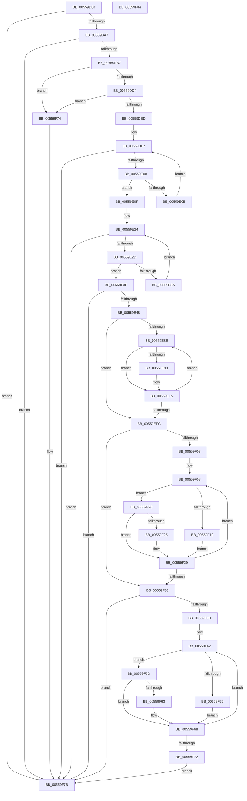

# HalpNumaSwapP0NodeToFront

- RVA: `0x00559D80`–`0x00559F85` (길이 `517` bytes)
- VA: `0x0000000140559D80`
- 실행 섹션: `.text`
- PDB 이름 있음: `예`; PDB Function 태그: `아니요`
- unwind 정보 RVA: `0x000C4748`
- 디코드: `149`개 명령, `517/517` bytes 표시
- 미해석 바이트: `0` (있으면 어셈블리에 `.byte`로 보존)

> 이 문서는 커널 이미지의 기계어와 PDB 기호를 분석해 생성했습니다. 4번과 5번은 함수 원형과 자료형을 바이너리 사용 방식에서 추정한 C 해석이며 원본 소스 복구 결과는 아닙니다.

## 1. Dependencies

- 직접 호출 지점: **2**; 고유 호출 대상: **2**
- 직접 호출자로 확인된 함수: **1**
- RIP 상대 이미지 참조: **6**

### Outgoing calls
- `0x00559DC7` → [HalpGetNumaProcMemoryCount](../../init/C2/HalpGetNumaProcMemoryCount_function_00C21B40.md) (function, `0x00C21B40`)
- `0x00559DE0` → [HalpInterruptGetIdentifiers](../4C/HalpInterruptGetIdentifiers_function_004C5DC0.md) (function, `0x004C5DC0`)

### Direct callers
- [HalpAcpiInitSystem](../../pagelk/B5/HalpAcpiInitSystem_function_00B5D390.md) at `0x00B5D3E9`

### Static image references
- `0x00559D8E` → RVA `0x00F90618` (`.data`; read)
- `0x00559DA7` → RVA `0x00F90658` (`.data`; read)
- `0x00559F08` → RVA `0x00F90608` (`.data`; read)
- `0x00559F33` → RVA `0x00F8F9E0` (`.data`; read)
- `0x00559F42` → RVA `0x00F8F9D8` (`.data`; read)
- `0x00559F74` → RVA `0x00F90658` (`.data`; write)

## 2. Other-region calls and transfers

- 다른 실행 섹션으로 향하는 call: **1**
  - `0x00559DC7` → [HalpGetNumaProcMemoryCount](../../init/C2/HalpGetNumaProcMemoryCount_function_00C21B40.md) (`.text` → `INIT`)
- 별도 외부 분기/꼬리 이동을 확인하지 못했습니다.

## 3. Assembly (complete function range)

```asm
00559D80  40 55                           push rbp
00559D82  53                              push rbx
00559D83  56                              push rsi
00559D84  57                              push rdi
00559D85  48 8B EC                        mov rbp, rsp
00559D88  48 83 EC 28                     sub rsp, 0x28
00559D8C  33 F6                           xor esi, esi
00559D8E  48 39 35 83 68 A3 00            cmp qword ptr [rip + 0xa36883], rsi
00559D95  89 75 28                        mov dword ptr [rbp + 0x28], esi
00559D98  89 75 40                        mov dword ptr [rbp + 0x40], esi
00559D9B  89 75 30                        mov dword ptr [rbp + 0x30], esi
00559D9E  89 75 38                        mov dword ptr [rbp + 0x38], esi
00559DA1  0F 84 D4 01 00 00               je 0x140559f7b
00559DA7  48 8B 1D AA 68 A3 00            mov rbx, qword ptr [rip + 0xa368aa]
00559DAE  48 85 DB                        test rbx, rbx
00559DB1  0F 84 C4 01 00 00               je 0x140559f7b
00559DB7  4C 8D 4D 28                     lea r9, [rbp + 0x28]
00559DBB  4C 8D 45 30                     lea r8, [rbp + 0x30]
00559DBF  48 8D 55 38                     lea rdx, [rbp + 0x38]
00559DC3  48 8D 4D 40                     lea rcx, [rbp + 0x40]
00559DC7  E8 74 7D 6C 00                  call 0x140c21b40
00559DCC  84 C0                           test al, al
00559DCE  0F 84 A0 01 00 00               je 0x140559f74
00559DD4  45 33 C0                        xor r8d, r8d
00559DD7  89 75 28                        mov dword ptr [rbp + 0x28], esi
00559DDA  48 8D 55 28                     lea rdx, [rbp + 0x28]
00559DDE  33 C9                           xor ecx, ecx
00559DE0  E8 DB BF F6 FF                  call 0x1404c5dc0
00559DE5  85 C0                           test eax, eax
00559DE7  0F 88 87 01 00 00               js 0x140559f74
00559DED  44 8B 43 3C                     mov r8d, dword ptr [rbx + 0x3c]
00559DF1  8B CE                           mov ecx, esi
00559DF3  44 8B 4D 28                     mov r9d, dword ptr [rbp + 0x28]
00559DF7  41 3B C8                        cmp ecx, r8d
00559DFA  0F 83 7B 01 00 00               jae 0x140559f7b
00559E00  48 8B 03                        mov rax, qword ptr [rbx]
00559E03  8B D1                           mov edx, ecx
00559E05  44 39 0C 90                     cmp dword ptr [rax + rdx*4], r9d
00559E09  74 04                           je 0x140559e0f
00559E0B  FF C1                           inc ecx
00559E0D  EB E8                           jmp 0x140559df7
00559E0F  48 8B 3D 42 68 A3 00            mov rdi, qword ptr [rip + 0xa36842]
00559E16  44 8B DE                        mov r11d, esi
00559E19  48 8B 47 10                     mov rax, qword ptr [rdi + 0x10]
00559E1D  44 8B 04 90                     mov r8d, dword ptr [rax + rdx*4]
00559E21  8B 47 38                        mov eax, dword ptr [rdi + 0x38]
00559E24  44 3B D8                        cmp r11d, eax
00559E27  0F 83 4E 01 00 00               jae 0x140559f7b
00559E2D  48 8B 4F 18                     mov rcx, qword ptr [rdi + 0x18]
00559E31  45 8B CB                        mov r9d, r11d
00559E34  46 39 04 89                     cmp dword ptr [rcx + r9*4], r8d
00559E38  74 05                           je 0x140559e3f
00559E3A  41 FF C3                        inc r11d
00559E3D  EB E5                           jmp 0x140559e24
00559E3F  45 85 DB                        test r11d, r11d
00559E42  0F 84 33 01 00 00               je 0x140559f7b
00559E48  8B 01                           mov eax, dword ptr [rcx]
00559E4A  BB 01 00 00 00                  mov ebx, 1
00559E4F  42 89 04 89                     mov dword ptr [rcx + r9*4], eax
00559E53  48 8B 47 18                     mov rax, qword ptr [rdi + 0x18]
00559E57  44 89 00                        mov dword ptr [rax], r8d
00559E5A  4C 8B 05 F7 67 A3 00            mov r8, qword ptr [rip + 0xa367f7]
00559E61  49 8B 48 20                     mov rcx, qword ptr [r8 + 0x20]
00559E65  42 8B 14 89                     mov edx, dword ptr [rcx + r9*4]
00559E69  8B 01                           mov eax, dword ptr [rcx]
00559E6B  42 89 04 89                     mov dword ptr [rcx + r9*4], eax
00559E6F  49 8B 40 20                     mov rax, qword ptr [r8 + 0x20]
00559E73  89 10                           mov dword ptr [rax], edx
00559E75  49 8B 48 28                     mov rcx, qword ptr [r8 + 0x28]
00559E79  8B 01                           mov eax, dword ptr [rcx]
00559E7B  42 8B 14 89                     mov edx, dword ptr [rcx + r9*4]
00559E7F  42 89 04 89                     mov dword ptr [rcx + r9*4], eax
00559E83  49 8B 40 28                     mov rax, qword ptr [r8 + 0x28]
00559E87  89 10                           mov dword ptr [rax], edx
00559E89  39 5F 38                        cmp dword ptr [rdi + 0x38], ebx
00559E8C  76 6E                           jbe 0x140559efc
00559E8E  41 3B DB                        cmp ebx, r11d
00559E91  74 62                           je 0x140559ef5
00559E93  4C 8B 15 BE 67 A3 00            mov r10, qword ptr [rip + 0xa367be]
00559E9A  41 8B C3                        mov eax, r11d
00559E9D  8B CB                           mov ecx, ebx
00559E9F  41 0F AF 42 40                  imul eax, dword ptr [r10 + 0x40]
00559EA4  4D 8B 4A 30                     mov r9, qword ptr [r10 + 0x30]
00559EA8  03 C3                           add eax, ebx
00559EAA  8B D0                           mov edx, eax
00559EAC  45 0F B7 04 41                  movzx r8d, word ptr [r9 + rax*2]
00559EB1  41 0F B7 04 49                  movzx eax, word ptr [r9 + rcx*2]
00559EB6  66 41 89 04 51                  mov word ptr [r9 + rdx*2], ax
00559EBB  49 8B 42 30                     mov rax, qword ptr [r10 + 0x30]
00559EBF  66 44 89 04 48                  mov word ptr [rax + rcx*2], r8w
00559EC4  8B C3                           mov eax, ebx
00559EC6  41 0F AF 42 40                  imul eax, dword ptr [r10 + 0x40]
00559ECB  49 8B 52 30                     mov rdx, qword ptr [r10 + 0x30]
00559ECF  44 8B C0                        mov r8d, eax
00559ED2  41 03 C3                        add eax, r11d
00559ED5  8B C8                           mov ecx, eax
00559ED7  44 0F B7 0C 42                  movzx r9d, word ptr [rdx + rax*2]
00559EDC  42 0F B7 04 42                  movzx eax, word ptr [rdx + r8*2]
00559EE1  66 89 04 4A                     mov word ptr [rdx + rcx*2], ax
00559EE5  8B CB                           mov ecx, ebx
00559EE7  41 0F AF 4A 40                  imul ecx, dword ptr [r10 + 0x40]
00559EEC  49 8B 42 30                     mov rax, qword ptr [r10 + 0x30]
00559EF0  66 44 89 0C 48                  mov word ptr [rax + rcx*2], r9w
00559EF5  FF C3                           inc ebx
00559EF7  3B 5F 38                        cmp ebx, dword ptr [rdi + 0x38]
00559EFA  72 92                           jb 0x140559e8e
00559EFC  8B 4D 30                        mov ecx, dword ptr [rbp + 0x30]
00559EFF  85 C9                           test ecx, ecx
00559F01  74 30                           je 0x140559f33
00559F03  48 8B C6                        mov rax, rsi
00559F06  8B D1                           mov edx, ecx
00559F08  48 8B 0D F9 66 A3 00            mov rcx, qword ptr [rip + 0xa366f9]
00559F0F  44 8B 44 08 08                  mov r8d, dword ptr [rax + rcx + 8]
00559F14  45 85 C0                        test r8d, r8d
00559F17  75 07                           jne 0x140559f20
00559F19  44 89 5C 08 08                  mov dword ptr [rax + rcx + 8], r11d
00559F1E  EB 09                           jmp 0x140559f29
00559F20  45 3B C3                        cmp r8d, r11d
00559F23  75 04                           jne 0x140559f29
00559F25  89 74 08 08                     mov dword ptr [rax + rcx + 8], esi
00559F29  48 83 C0 10                     add rax, 0x10
00559F2D  48 83 EA 01                     sub rdx, 1
00559F31  75 D5                           jne 0x140559f08
00559F33  8B 0D A7 5A A3 00               mov ecx, dword ptr [rip + 0xa35aa7]
00559F39  85 C9                           test ecx, ecx
00559F3B  74 3E                           je 0x140559f7b
00559F3D  48 8B C6                        mov rax, rsi
00559F40  8B D1                           mov edx, ecx
00559F42  48 8B 0D 8F 5A A3 00            mov rcx, qword ptr [rip + 0xa35a8f]
00559F49  44 0F B7 44 08 0A               movzx r8d, word ptr [rax + rcx + 0xa]
00559F4F  66 45 85 C0                     test r8w, r8w
00559F53  75 08                           jne 0x140559f5d
00559F55  66 44 89 5C 08 0A               mov word ptr [rax + rcx + 0xa], r11w
00559F5B  EB 0B                           jmp 0x140559f68
00559F5D  66 45 3B C3                     cmp r8w, r11w
00559F61  75 05                           jne 0x140559f68
00559F63  66 89 74 08 0A                  mov word ptr [rax + rcx + 0xa], si
00559F68  48 83 C0 10                     add rax, 0x10
00559F6C  48 83 EA 01                     sub rdx, 1
00559F70  75 D0                           jne 0x140559f42
00559F72  EB 07                           jmp 0x140559f7b
00559F74  48 89 35 DD 66 A3 00            mov qword ptr [rip + 0xa366dd], rsi
00559F7B  48 83 C4 28                     add rsp, 0x28
00559F7F  5F                              pop rdi
00559F80  5E                              pop rsi
00559F81  5B                              pop rbx
00559F82  5D                              pop rbp
00559F83  C3                              ret
00559F84  CC                              int3
```

## 4. C-style interpretation (structured pseudocode)

```c
__int64 __fastcall HalpNumaSwapP0NodeToFront(void)
{
    __int64 result;
    __int64 v_r10;
    __int64 v_r11;
    __int64 v_rbx;
    __int64 v_rsi;
    __int64 v_rsp;
    unsigned int v_stack_p10;
    unsigned int v_stack_p18;
    unsigned int v_stack_p20;
    unsigned int v_stack_p8;

    v_rsp = (v_rsp) - (40);
    v_rsi = 0;
    v_stack_p8 = 0;
    v_stack_p20 = 0;
    v_stack_p10 = 0;
    v_stack_p18 = 0;
    if ((*(unsigned __int64 *)(v_rip + 10709123)) == 0) goto loc_00559F7B;
    if (*(unsigned __int64 *)(v_rip + 10709162) == 0) goto loc_00559F7B;
    result = HalpGetNumaProcMemoryCount(v_stack_p20, v_stack_p18, v_stack_p10, v_stack_p8);
    if ((unsigned __int8)(result) == 0) goto loc_00559F74;
    a3 = 0;
    v_stack_p8 = 0;
    a1 = 0;
    result = HalpInterruptGetIdentifiers(a1, v_stack_p8, a3, v_stack_p8);
    if (sign_flag) goto loc_00559F74;
loc_00559DF7:
    if (0 >= ((unsigned int)((unsigned int)(*(unsigned int *)(*(unsigned __int64 *)(v_rip + 10709162) + 60))))) goto loc_00559F7B;
    if ((*(unsigned int *)(*(unsigned __int64 *)(*(unsigned __int64 *)(v_rip + 10709162)) + 0 * 4)) == ((unsigned int)((unsigned int)(v_stack_p8)))) goto loc_00559E0F;
    a1 = (unsigned int)((0) + 1);
    goto loc_00559DF7;
loc_00559E0F:
loc_00559E24:
    if (0 >= ((unsigned int)((unsigned int)(*(unsigned int *)(*(unsigned __int64 *)(v_rip + 10709058) + 56))))) goto loc_00559F7B;
    if ((*(unsigned int *)(*(unsigned __int64 *)(*(unsigned __int64 *)(v_rip + 10709058) + 24) + 0 * 4)) == ((unsigned int)((unsigned int)(*(unsigned int *)(*(unsigned __int64 *)(*(unsigned __int64 *)(v_rip + 10709058) + 16) + 0 * 4))))) goto loc_00559E3F;
    v_r11 = (unsigned int)((0) + 1);
    goto loc_00559E24;
loc_00559E3F:
    if ((unsigned int)(v_r11) == 0) goto loc_00559F7B;
    *(unsigned int *)(*(unsigned __int64 *)(*(unsigned __int64 *)(v_rip + 10709058) + 24) + 0 * 4) = (unsigned int)((unsigned int)(*(unsigned int *)(*(unsigned __int64 *)(*(unsigned __int64 *)(v_rip + 10709058) + 24))));
    *(unsigned int *)(*(unsigned __int64 *)(*(unsigned __int64 *)(v_rip + 10709058) + 24)) = (unsigned int)((unsigned int)(*(unsigned int *)(*(unsigned __int64 *)(*(unsigned __int64 *)(v_rip + 10709058) + 16) + 0 * 4)));
    *(unsigned int *)(*(unsigned __int64 *)(*(unsigned __int64 *)(v_rip + 10708983) + 32) + 0 * 4) = (unsigned int)((unsigned int)(*(unsigned int *)(*(unsigned __int64 *)(*(unsigned __int64 *)(v_rip + 10708983) + 32))));
    *(unsigned int *)(*(unsigned __int64 *)(*(unsigned __int64 *)(v_rip + 10708983) + 32)) = (unsigned int)((unsigned int)(*(unsigned int *)(*(unsigned __int64 *)(*(unsigned __int64 *)(v_rip + 10708983) + 32) + 0 * 4)));
    *(unsigned int *)(*(unsigned __int64 *)(*(unsigned __int64 *)(v_rip + 10708983) + 40) + 0 * 4) = (unsigned int)((unsigned int)(*(unsigned int *)(*(unsigned __int64 *)(*(unsigned __int64 *)(v_rip + 10708983) + 40))));
    *(unsigned int *)(*(unsigned __int64 *)(*(unsigned __int64 *)(v_rip + 10708983) + 40)) = (unsigned int)((unsigned int)(*(unsigned int *)(*(unsigned __int64 *)(*(unsigned __int64 *)(v_rip + 10708983) + 40) + 0 * 4)));
    if ((*(unsigned int *)(*(unsigned __int64 *)(v_rip + 10709058) + 56)) <= 1) goto loc_00559EFC;
loc_00559E8E:
    result = *(unsigned __int64 *)(*(unsigned __int64 *)(v_rip + 10708983) + 40);
    if (1 != ((unsigned int)(v_r11))) {
        v_r10 = *(unsigned __int64 *)(v_rip + 10708926);
        result = (unsigned int)(v_r11);
        a1 = 1;
        result = (unsigned int)((result) * (*(unsigned int *)(v_r10 + 64)));
        a4 = *(unsigned __int64 *)(v_r10 + 48);
        result = (unsigned int)((result) + (1));
        a2 = (unsigned int)(result);
        a3 = *(unsigned __int16 *)(a4 + result * 2);
        result = *(unsigned __int16 *)(a4 + a1 * 2);
        *(unsigned __int16 *)(a4 + a2 * 2) = (unsigned __int16)(result);
        result = *(unsigned __int64 *)(v_r10 + 48);
        *(unsigned __int16 *)(result + a1 * 2) = (unsigned __int16)(a3);
        result = 1;
        result = (unsigned int)((result) * (*(unsigned int *)(v_r10 + 64)));
        a2 = *(unsigned __int64 *)(v_r10 + 48);
        a3 = (unsigned int)(result);
        result = (unsigned int)((result) + ((unsigned int)(v_r11)));
        a1 = (unsigned int)(result);
        a4 = *(unsigned __int16 *)(a2 + result * 2);
        result = *(unsigned __int16 *)(a2 + a3 * 2);
        *(unsigned __int16 *)(a2 + a1 * 2) = (unsigned __int16)(result);
        a1 = 1;
        a1 = (unsigned int)((a1) * (*(unsigned int *)(v_r10 + 64)));
        result = *(unsigned __int64 *)(v_r10 + 48);
        *(unsigned __int16 *)(result + a1 * 2) = (unsigned __int16)(a4);
    }
    v_rbx = (unsigned int)((1) + 1);
    if (((unsigned int)(v_rbx)) < (*(unsigned int *)(*(unsigned __int64 *)(v_rip + 10709058) + 56))) goto loc_00559E8E;
loc_00559EFC:
    if ((unsigned int)((unsigned int)(v_stack_p10)) == 0) goto loc_00559F33;
loc_00559F08:
    if ((unsigned int)((unsigned int)(*(unsigned int *)(0 + *(unsigned __int64 *)(v_rip + 10708729) * 1 + 8))) != 0) goto loc_00559F20;
    *(unsigned int *)(0 + *(unsigned __int64 *)(v_rip + 10708729) * 1 + 8) = (unsigned int)(v_r11);
    goto loc_00559F29;
loc_00559F20:
    if (((unsigned int)((unsigned int)(*(unsigned int *)(0 + *(unsigned __int64 *)(v_rip + 10708729) * 1 + 8)))) == ((unsigned int)(v_r11))) {
        *(unsigned int *)(0 + *(unsigned __int64 *)(v_rip + 10708729) * 1 + 8) = 0;
    }
    result = (0) + (16);
    a2 = ((unsigned int)((unsigned int)((unsigned int)(v_stack_p10)))) - (1);
    if (condition_is_not_equal) goto loc_00559F08;
loc_00559F33:
    if ((unsigned int)((unsigned int)(*(unsigned int *)(v_rip + 10705575))) == 0) goto loc_00559F7B;
loc_00559F42:
    if ((unsigned __int16)(*(unsigned __int16 *)(0 + *(unsigned __int64 *)(v_rip + 10705551) * 1 + 10)) != 0) goto loc_00559F5D;
    *(unsigned __int16 *)(0 + *(unsigned __int64 *)(v_rip + 10705551) * 1 + 10) = (unsigned __int16)(v_r11);
    goto loc_00559F68;
loc_00559F5D:
    if (((unsigned __int16)(*(unsigned __int16 *)(0 + *(unsigned __int64 *)(v_rip + 10705551) * 1 + 10))) == ((unsigned __int16)(v_r11))) {
        *(unsigned __int16 *)(0 + *(unsigned __int64 *)(v_rip + 10705551) * 1 + 10) = 0;
    }
    result = (0) + (16);
    a2 = ((unsigned int)((unsigned int)((unsigned int)(*(unsigned int *)(v_rip + 10705575))))) - (1);
    if (condition_is_not_equal) goto loc_00559F42;
    goto loc_00559F7B;
loc_00559F74:
    *(unsigned __int64 *)(v_rip + 10708701) = 0;
loc_00559F7B:
    v_rsp = (v_rsp) + (40);
    return result;
}
```

## 5. (Beta) C Style

```c
void HalpNumaSwapP0NodeToFront(void)
{
    int64_t result;
    int64_t local_r10;
    int64_t local_r11;
    int64_t local_rbx;
    int64_t local_rsi;
    int64_t local_rsp;
    uint32_t v_stack_p10;
    uint32_t v_stack_p18;
    uint32_t v_stack_p20;
    uint32_t v_stack_p8;

    local_rsp = (local_rsp) - (40);
    local_rsi = 0;
    v_stack_p8 = 0;
    v_stack_p20 = 0;
    v_stack_p10 = 0;
    v_stack_p18 = 0;
    if ((*(uint64_t *)(v_rip + 0xA36883)) == 0) goto loc_00559F7B;
    if (*(uint64_t *)(v_rip + 0xA368AA) == 0) goto loc_00559F7B;
    result = HalpGetNumaProcMemoryCount(v_stack_p20, v_stack_p18, v_stack_p10, v_stack_p8);
    if ((uint8_t)(result) == 0) goto loc_00559F74;
    a3 = 0;
    v_stack_p8 = 0;
    a1 = 0;
    result = HalpInterruptGetIdentifiers(a1, v_stack_p8, a3, v_stack_p8);
    if (sign_flag) goto loc_00559F74;
loc_00559DF7:
    if (0 >= ((uint32_t)((uint32_t)(*(uint32_t *)(*(uint64_t *)(v_rip + 0xA368AA) + 0x3C))))) goto loc_00559F7B;
    if ((*(uint32_t *)(*(uint64_t *)(*(uint64_t *)(v_rip + 0xA368AA)) + 0x0 * 4)) == ((uint32_t)((uint32_t)(v_stack_p8)))) goto loc_00559E0F;
    a1 = (uint32_t)((0) + 1);
    goto loc_00559DF7;
loc_00559E0F:
loc_00559E24:
    if (0 >= ((uint32_t)((uint32_t)(*(uint32_t *)(*(uint64_t *)(v_rip + 0xA36842) + 0x38))))) goto loc_00559F7B;
    if ((*(uint32_t *)(*(uint64_t *)(*(uint64_t *)(v_rip + 0xA36842) + 0x18) + 0x0 * 4)) == ((uint32_t)((uint32_t)(*(uint32_t *)(*(uint64_t *)(*(uint64_t *)(v_rip + 0xA36842) + 0x10) + 0x0 * 4))))) goto loc_00559E3F;
    local_r11 = (uint32_t)((0) + 1);
    goto loc_00559E24;
loc_00559E3F:
    if ((uint32_t)(local_r11) == 0) goto loc_00559F7B;
    *(uint32_t *)(*(uint64_t *)(*(uint64_t *)(v_rip + 0xA36842) + 0x18) + 0x0 * 4) = (uint32_t)((uint32_t)(*(uint32_t *)(*(uint64_t *)(*(uint64_t *)(v_rip + 0xA36842) + 0x18))));
    *(uint32_t *)(*(uint64_t *)(*(uint64_t *)(v_rip + 0xA36842) + 0x18)) = (uint32_t)((uint32_t)(*(uint32_t *)(*(uint64_t *)(*(uint64_t *)(v_rip + 0xA36842) + 0x10) + 0x0 * 4)));
    *(uint32_t *)(*(uint64_t *)(*(uint64_t *)(v_rip + 0xA367F7) + 0x20) + 0x0 * 4) = (uint32_t)((uint32_t)(*(uint32_t *)(*(uint64_t *)(*(uint64_t *)(v_rip + 0xA367F7) + 0x20))));
    *(uint32_t *)(*(uint64_t *)(*(uint64_t *)(v_rip + 0xA367F7) + 0x20)) = (uint32_t)((uint32_t)(*(uint32_t *)(*(uint64_t *)(*(uint64_t *)(v_rip + 0xA367F7) + 0x20) + 0x0 * 4)));
    *(uint32_t *)(*(uint64_t *)(*(uint64_t *)(v_rip + 0xA367F7) + 0x28) + 0x0 * 4) = (uint32_t)((uint32_t)(*(uint32_t *)(*(uint64_t *)(*(uint64_t *)(v_rip + 0xA367F7) + 0x28))));
    *(uint32_t *)(*(uint64_t *)(*(uint64_t *)(v_rip + 0xA367F7) + 0x28)) = (uint32_t)((uint32_t)(*(uint32_t *)(*(uint64_t *)(*(uint64_t *)(v_rip + 0xA367F7) + 0x28) + 0x0 * 4)));
    if ((*(uint32_t *)(*(uint64_t *)(v_rip + 0xA36842) + 0x38)) <= 1) goto loc_00559EFC;
loc_00559E8E:
    result = *(uint64_t *)(*(uint64_t *)(v_rip + 0xA367F7) + 0x28);
    if (1 != ((uint32_t)(local_r11))) {
        local_r10 = *(uint64_t *)(v_rip + 0xA367BE);
        result = (uint32_t)(local_r11);
        a1 = 1;
        result = (uint32_t)((result) * (*(uint32_t *)(local_r10 + 0x40)));
        a4 = *(uint64_t *)(local_r10 + 0x30);
        result = (uint32_t)((result) + (1));
        a2 = (uint32_t)(result);
        a3 = *(uint16_t *)(a4 + result * 2);
        result = *(uint16_t *)(a4 + a1 * 2);
        *(uint16_t *)(a4 + a2 * 2) = (uint16_t)(result);
        result = *(uint64_t *)(local_r10 + 0x30);
        *(uint16_t *)(result + a1 * 2) = (uint16_t)(a3);
        result = 1;
        result = (uint32_t)((result) * (*(uint32_t *)(local_r10 + 0x40)));
        a2 = *(uint64_t *)(local_r10 + 0x30);
        a3 = (uint32_t)(result);
        result = (uint32_t)((result) + ((uint32_t)(local_r11)));
        a1 = (uint32_t)(result);
        a4 = *(uint16_t *)(a2 + result * 2);
        result = *(uint16_t *)(a2 + a3 * 2);
        *(uint16_t *)(a2 + a1 * 2) = (uint16_t)(result);
        a1 = 1;
        a1 = (uint32_t)((a1) * (*(uint32_t *)(local_r10 + 0x40)));
        result = *(uint64_t *)(local_r10 + 0x30);
        *(uint16_t *)(result + a1 * 2) = (uint16_t)(a4);
    }
    local_rbx = (uint32_t)((1) + 1);
    if (((uint32_t)(local_rbx)) < (*(uint32_t *)(*(uint64_t *)(v_rip + 0xA36842) + 0x38))) goto loc_00559E8E;
loc_00559EFC:
    if ((uint32_t)((uint32_t)(v_stack_p10)) == 0) goto loc_00559F33;
loc_00559F08:
    if ((uint32_t)((uint32_t)(*(uint32_t *)(0 + *(uint64_t *)(v_rip + 0xA366F9) * 1 + 0x8))) != 0) goto loc_00559F20;
    *(uint32_t *)(0 + *(uint64_t *)(v_rip + 0xA366F9) * 1 + 0x8) = (uint32_t)(local_r11);
    goto loc_00559F29;
loc_00559F20:
    if (((uint32_t)((uint32_t)(*(uint32_t *)(0 + *(uint64_t *)(v_rip + 0xA366F9) * 1 + 0x8)))) == ((uint32_t)(local_r11))) {
        *(uint32_t *)(0 + *(uint64_t *)(v_rip + 0xA366F9) * 1 + 0x8) = 0;
    }
    result = (0) + (16);
    a2 = ((uint32_t)((uint32_t)((uint32_t)(v_stack_p10)))) - (1);
    if (condition_is_not_equal) goto loc_00559F08;
loc_00559F33:
    if ((uint32_t)((uint32_t)(*(uint32_t *)(v_rip + 0xA35AA7))) == 0) goto loc_00559F7B;
loc_00559F42:
    if ((uint16_t)(*(uint16_t *)(0 + *(uint64_t *)(v_rip + 0xA35A8F) * 1 + 0xA)) != 0) goto loc_00559F5D;
    *(uint16_t *)(0 + *(uint64_t *)(v_rip + 0xA35A8F) * 1 + 0xA) = (uint16_t)(local_r11);
    goto loc_00559F68;
loc_00559F5D:
    if (((uint16_t)(*(uint16_t *)(0 + *(uint64_t *)(v_rip + 0xA35A8F) * 1 + 0xA))) == ((uint16_t)(local_r11))) {
        *(uint16_t *)(0 + *(uint64_t *)(v_rip + 0xA35A8F) * 1 + 0xA) = 0;
    }
    result = (0) + (16);
    a2 = ((uint32_t)((uint32_t)((uint32_t)(*(uint32_t *)(v_rip + 0xA35AA7))))) - (1);
    if (condition_is_not_equal) goto loc_00559F42;
    goto loc_00559F7B;
loc_00559F74:
    *(uint64_t *)(v_rip + 0xA366DD) = 0;
loc_00559F7B:
    local_rsp = (local_rsp) + (40);
    return result;
}
```

## 6. Execution-region graph

[열기: 2D/3D 그래프와 함수 탐색 컨트롤 패널](../../../control-panel.html?section=text&rva=0x00559D80&view=graph)

- 2D 그래프는 위에서 아래로 흐르고, 3D 그래프는 빈 공간을 드래그해 회전합니다. Shift+드래그는 이동, 휠은 확대·축소, 함수 노드 선택은 대상 보고서 이동입니다.

### Static fallback


