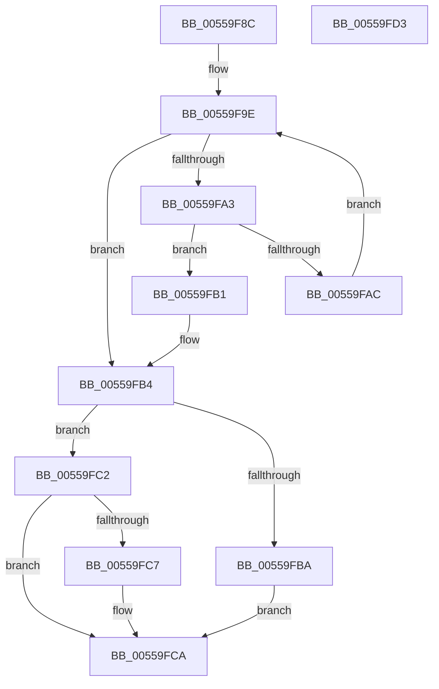

# HalpNumaSystemLocalityInfoFindInitiatorIndex

- RVA: `0x00559F8C`–`0x00559FD4` (길이 `72` bytes)
- VA: `0x0000000140559F8C`
- 실행 섹션: `.text`
- PDB 이름 있음: `예`; PDB Function 태그: `아니요`
- unwind 정보 RVA: `0x00071750`
- 디코드: `24`개 명령, `72/72` bytes 표시
- 미해석 바이트: `0` (있으면 어셈블리에 `.byte`로 보존)

> 이 문서는 커널 이미지의 기계어와 PDB 기호를 분석해 생성했습니다. 4번과 5번은 함수 원형과 자료형을 바이너리 사용 방식에서 추정한 C 해석이며 원본 소스 복구 결과는 아닙니다.

## 1. Dependencies

- 직접 호출 지점: **0**; 고유 호출 대상: **0**
- 직접 호출자로 확인된 함수: **1**
- RIP 상대 이미지 참조: **0**

### Outgoing calls
- 직접 디코드된 call 명령이 없습니다.

### Direct callers
- [HalpNumaQuerySystemLocalityLatencyAndBandwidthInfo](HalpNumaQuerySystemLocalityLatencyAndBandwidthInfo_function_005597E0.md) at `0x00559968`
- [HalpNumaQuerySystemLocalityLatencyAndBandwidthInfo](HalpNumaQuerySystemLocalityLatencyAndBandwidthInfo_function_005597E0.md) at `0x00559991`
- [HalpNumaQuerySystemLocalityLatencyAndBandwidthInfo](HalpNumaQuerySystemLocalityLatencyAndBandwidthInfo_function_005597E0.md) at `0x00559BA8`

### Static image references
- 디코드된 RIP-relative 메모리 참조가 없습니다.

## 2. Other-region calls and transfers

- 다른 실행 섹션으로 향하는 call: **0**
- 별도 외부 분기/꼬리 이동을 확인하지 못했습니다.

## 3. Assembly (complete function range)

```asm
00559F8C  48 89 5C 24 08                  mov qword ptr [rsp + 8], rbx
00559F91  8B 59 0C                        mov ebx, dword ptr [rcx + 0xc]
00559F94  41 83 CB FF                     or r11d, 0xffffffff
00559F98  45 33 D2                        xor r10d, r10d
00559F9B  45 8B CA                        mov r9d, r10d
00559F9E  44 3B CB                        cmp r9d, ebx
00559FA1  73 11                           jae 0x140559fb4
00559FA3  41 8B C1                        mov eax, r9d
00559FA6  39 54 81 20                     cmp dword ptr [rcx + rax*4 + 0x20], edx
00559FAA  74 05                           je 0x140559fb1
00559FAC  41 FF C1                        inc r9d
00559FAF  EB ED                           jmp 0x140559f9e
00559FB1  45 8B D9                        mov r11d, r9d
00559FB4  41 83 FB FF                     cmp r11d, -1
00559FB8  75 08                           jne 0x140559fc2
00559FBA  41 BA 25 02 00 C0               mov r10d, 0xc0000225
00559FC0  EB 08                           jmp 0x140559fca
00559FC2  4D 85 C0                        test r8, r8
00559FC5  74 03                           je 0x140559fca
00559FC7  45 89 18                        mov dword ptr [r8], r11d
00559FCA  48 8B 5C 24 08                  mov rbx, qword ptr [rsp + 8]
00559FCF  41 8B C2                        mov eax, r10d
00559FD2  C3                              ret
00559FD3  CC                              int3
```

## 4. C-style interpretation (structured pseudocode)

```c
__int64 __fastcall HalpNumaSystemLocalityInfoFindInitiatorIndex(__int64 a1, int a2, __int64 a3)
{
    __int64 v_r10;
    __int64 v_r11;
    unsigned __int64 v_stack_p8;

    v_stack_p8 = v_rbx;
    v_r11 = (unsigned int)((v_r11) | (0xFFFFFFFFULL));
    v_r10 = 0;
loc_00559F9E:
    if (0 >= ((unsigned int)((unsigned int)(*(unsigned int *)(a1 + 12))))) goto loc_00559FB4;
    if ((*(unsigned int *)(a1 + 0 * 4 + 32)) == a2) goto loc_00559FB1;
    a4 = (unsigned int)((0) + 1);
    goto loc_00559F9E;
loc_00559FB1:
loc_00559FB4:
    if (((unsigned int)((unsigned int)((unsigned int)(a4)))) != -1) goto loc_00559FC2;
    goto loc_00559FCA;
loc_00559FC2:
    if (a3 != 0) {
        *(unsigned int *)(a3) = (unsigned int)((unsigned int)((unsigned int)(a4)));
    }
    return (unsigned int)((unsigned int)((unsigned int)(0xC0000225ULL)));
}
```

## 5. (Beta) C Style

```c
int64_t HalpNumaSystemLocalityInfoFindInitiatorIndex(void *Arg1, int32_t Arg2, int64_t Arg3)
{
    uint8_t *arg1 = (uint8_t *)Arg1;

    int64_t local_r10;
    int64_t local_r11;
    uint64_t v_stack_p8;

    v_stack_p8 = local_rbx;
    local_r11 = (uint32_t)((local_r11) | (0xFFFFFFFFULL));
    local_r10 = 0;
loc_00559F9E:
    if (0 >= ((uint32_t)((uint32_t)(*(uint32_t *)(arg1 + 0xC))))) goto loc_00559FB4;
    if ((*(uint32_t *)(arg1 + 0x0 * 4 + 0x20)) == Arg2) goto loc_00559FB1;
    a4 = (uint32_t)((0) + 1);
    goto loc_00559F9E;
loc_00559FB1:
loc_00559FB4:
    if (((uint32_t)((uint32_t)((uint32_t)(a4)))) != -1) goto loc_00559FC2;
    goto loc_00559FCA;
loc_00559FC2:
    if (Arg3 != 0) {
        *(uint32_t *)(Arg3) = (uint32_t)((uint32_t)((uint32_t)(a4)));
    }
    return (uint32_t)((uint32_t)((uint32_t)(0xC0000225ULL)));
}
```

### 관측된 메모리 오프셋

구조체 형식이 확인되지 않은 접근은 인자 기준의 오프셋으로만 기록했습니다.

| 기준 인자 | 오프셋 표현 | 폭 (bit) | 접근 |
|---|---:|---:|---|
| `Arg1` | `+ 0xC` | `32` | `R` |
| `Arg1` | `+ 0x20 + rax*4` | `32` | `R` |

## 6. Execution-region graph

[열기: 2D/3D 그래프와 함수 탐색 컨트롤 패널](../../../control-panel.html?section=text&rva=0x00559F8C&view=graph)

- 2D 그래프는 위에서 아래로 흐르고, 3D 그래프는 빈 공간을 드래그해 회전합니다. Shift+드래그는 이동, 휠은 확대·축소, 함수 노드 선택은 대상 보고서 이동입니다.

### Static fallback


